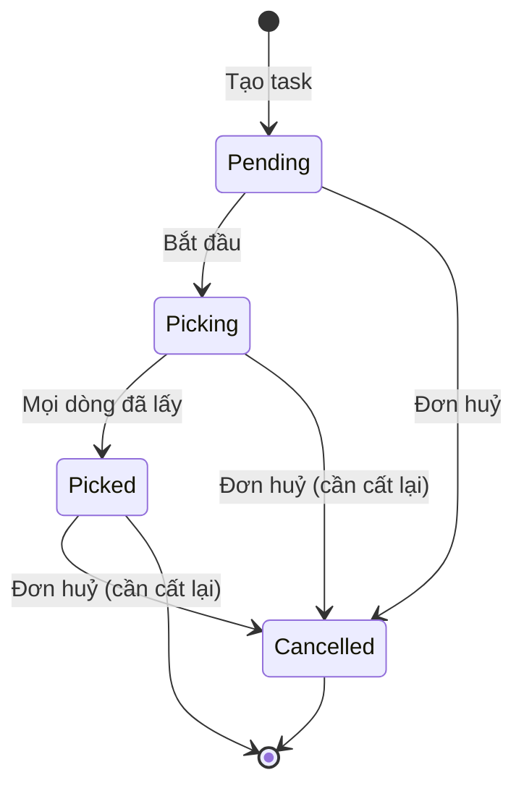

# 07 — Lấy hàng (Picking)

## 1. Mục đích (Purpose)

Lấy đúng **SKU, số lượng, lô** từ các vị trí lưu trữ trong kho cho **dòng hàng sẵn** của đơn đã release, và đưa về khu đóng gói. Yêu cầu đến từ [Order Management](../../ecommerce/17-order-management/README.md).

Picking là **bước mở đầu luồng Fulfillment**: Picking → [Packing](../08-packing/README.md) → [Shipping](../09-shipping/README.md). Chất lượng picking quyết định độ chính xác đơn hàng và tốc độ giao.

- **Mỗi đơn có một nhiệm vụ (task)** gồm phần lấy hàng và phần đóng gói. Điều phối hoặc Quản lý kho tạo task và giao cho một nhân viên.
- **Tồn bị trừ ngay khi quét xác nhận lấy**, không có trạng thái trung gian "đã lấy / đã gom".
- **Dòng in không pick trên kệ.** Phôi cấp cho xưởng bằng **quét xuất vật tư** ở [19](../19-production/README.md), không qua pick task. Thành phẩm đạt QC đi thẳng sang khu `PACKING`.

> ⚠️ Giả định: lấy hàng theo **đợt (wave / batch)**, **theo zone**, và **tối ưu lộ trình** trên bản đồ kho thuộc phạm vi giai đoạn sau. Hiện tại mỗi đơn một task, các dòng lấy được sắp theo mã vị trí rồi SKU. Xem [open-questions C17](../../open-questions/README.md).

---

## 2. Actor liên quan

| Actor | Vai trò |
|-------|---------|
| **Nhân viên kho (Picker)** | Bắt đầu task được giao; tại mỗi dòng: quét vị trí, quét SKU (hoặc mã vạch), nhập số lượng; **báo thiếu (short pick)**; hoàn tất phần lấy hàng. Cất lại hàng của đơn bị huỷ (put-back). |
| **Điều phối đơn hàng (Order Coordinator)** / **Quản lý kho (Warehouse Manager)** | Xem danh sách đơn chờ tạo task, **tạo task và giao người**, đổi người khi task chưa bắt đầu. **Phân bổ lại** dòng bị thiếu. Theo dõi mọi task trong kho. |
| **Hệ thống** | Lập dòng lấy hàng từ phần đã phân bổ (bin, lô) của đơn. Trừ tồn khi quét. Treo đơn khi thiếu hàng, tự mở kiểm kê mù ([20](../20-inventory-control/README.md)), gỡ treo khi đã phân bổ lại xong. Đưa hàng của đơn huỷ vào hàng chờ cất lại. |

- Người được giao là **nhân viên kho hoặc quản lý kho đang hoạt động, được gán vào kho đó**.
- Mọi thao tác chỉ trong phạm vi kho được gán.

---

## 3. Input / Output

### Input

| Trường | Mô tả | Bắt buộc |
|--------|-------|----------|
| Đơn cần lấy | Đơn `Ready to Fulfill`, hoặc đơn `In Production` có dòng hàng sẵn (lấy song song trong lúc in) | Có |
| Phân bổ tồn (allocation) | Bin & lô được phân bổ cho đơn khi release, theo FEFO / FIFO, chỉ từ bin cho phép lấy (`is_pickable`) — [20](../20-inventory-control/README.md) §5.6 | Có |
| Người được giao | Nhân viên kho / quản lý kho của kho đó | Có |
| Số liệu quét | Mã vị trí, SKU hoặc mã vạch của SKU, số lượng | Có |

### Output

| Kết quả | Dùng bởi |
|---------|----------|
| **Dòng lấy hàng** đã lấy (`Picked`) / thiếu (`Short`) / huỷ | 08 Packing, 17 Order Management |
| **Trừ tồn** tại vị trí nguồn + dòng sổ biến động `PICK` | [20](../20-inventory-control/README.md) |
| **Báo thiếu**: đơn treo lý do `INVENTORY`, phiếu kiểm kê mù | 17, 20 |
| **Hàng chờ cất lại (put-back)** của task bị huỷ | Nhân viên kho |
| Task lấy hàng `Picked` → mở đóng gói | 08 Packing |

---

## 4. Luồng nghiệp vụ từng bước (Step-by-step)

### 4.1. Tạo & giao task

1. **Danh sách chờ** — Điều phối / Quản lý kho xem các đơn của kho mình chưa có task. Gồm đơn `Ready to Fulfill`, và đơn `In Production` có ít nhất một dòng hàng sẵn. Đơn release sớm nhất đứng trước.
2. **Tạo task** — chọn đơn và người được giao. Hệ thống:
   - tạo **một task** cho đơn: phần lấy hàng `Pending` và phần đóng gói `Pending`. Tạo lại thì trả về task cũ, không sinh task thứ hai;
   - lập **dòng lấy hàng**: mỗi phần phân bổ (bin + lô) một dòng, sắp theo mã vị trí rồi SKU. Dòng in không có dòng lấy hàng;
   - chuyển đơn `Ready to Fulfill` → `Picking`. Đơn `In Production` giữ nguyên trạng thái.
   - Hàng giữ cho đơn nằm ở kho khác, hoặc rải ở nhiều kho → **không tạo được task**.
3. **Đổi người** — chỉ khi task còn `Pending`.

### 4.2. Lấy hàng

4. **Bắt đầu** — người được giao bấm bắt đầu → task `Picking`.
5. **Tại mỗi dòng** — quét **mã vị trí** → quét **SKU hoặc mã vạch** → nhập **số lượng**. Hệ thống kiểm:
   - đúng vị trí;
   - đúng SKU;
   - số lượng **đúng bằng** phần phân bổ (lấy nhiều hơn bị chặn; ít hơn thì phải báo thiếu, bước 7).

   Hợp lệ → dòng `Picked`, **tồn bị trừ ngay** và ghi một dòng sổ `PICK`. Quét lại cùng dòng không trừ thêm.
6. **Hoàn tất lấy hàng** — khi mọi dòng đã `Picked` (hoặc đã huỷ) → task `Picked`. Hàng mang về khu `PACKING`; phần đóng gói mở cho Packer ([08](../08-packing/README.md)).

### 4.3. Thiếu hàng (Short pick)

7. **Báo thiếu** — vị trí không đủ hàng → picker báo thiếu kèm vị trí và **số lượng thực thấy** (0 tới phân bổ − 1). Hệ thống:
   - chuyển dòng → `Short`, **không trừ tồn**;
   - treo đơn lý do **`INVENTORY`** ([17](../../ecommerce/17-order-management/README.md) §4.6);
   - tự mở **phiếu kiểm kê mù** cho đúng bin + SKU + lô đó, hoặc dùng lại phiếu đang giữ vị trí đó ([20](../20-inventory-control/README.md) §4.2-f).
8. **Phân bổ lại** — Điều phối / Quản lý kho phân bổ lại dòng thiếu:
   - lấy cùng số lượng theo **FEFO** từ bin cho phép lấy khác **của cùng kho**, không bao giờ lấy lại bin vừa thiếu;
   - dòng cũ huỷ, thêm dòng mới để picker lấy tiếp;
   - khi đơn không còn dòng thiếu nào, hệ thống **tự gỡ treo** `INVENTORY`.
9. **Không đủ hàng để phân bổ lại** — đơn ở lại trạng thái treo. Điều phối quyết với Sale theo [17](../../ecommerce/17-order-management/README.md): chờ hàng, giao một phần rồi đóng phần còn lại, hoặc huỷ dòng / đơn.

### 4.4. Huỷ đơn & cất lại hàng (Put-back)

10. Đơn bị huỷ khi task đã bắt đầu → task `Cancelled` và được đánh dấu **cần cất lại**.
11. Các dòng đã `Picked` của task đó vào **hàng chờ cất lại** của kho, task huỷ sớm nhất đứng trước.
12. Nhân viên / quản lý kho của kho đó cất lại **cả dòng một lần** vào một **bin đang hoạt động của cùng kho** → dòng `Put Back`. Tồn quay về `Available`, ghi một dòng sổ `PUT_BACK`.

---

## 5. Trạng thái / Vòng đời (Lifecycle)

### 5.1. Phần lấy hàng của task

| Trạng thái | Ý nghĩa | Chuyển tiếp cho phép | Ai thực hiện |
|------------|---------|----------------------|--------------|
| `Pending` | Đã tạo, chờ người được giao bắt đầu; đổi người được | → `Picking`, → `Cancelled` | Điều phối / Quản lý kho |
| `Picking` | Đang lấy hàng | → `Picked`, → `Cancelled` | Picker |
| `Picked` | Mọi dòng đã lấy (hoặc huỷ); mở đóng gói | → `Cancelled` (đơn huỷ — cần cất lại) | Picker |
| `Cancelled` | Đơn bị huỷ; nếu đã bắt đầu lấy thì hàng đã lấy vào hàng chờ cất lại | *(cuối)* | Hệ thống |

### 5.2. Dòng lấy hàng

| Trạng thái | Ý nghĩa | Chuyển tiếp cho phép | Ai thực hiện |
|------------|---------|----------------------|--------------|
| `Open` | Chờ lấy | → `Picked`, → `Short` | Picker |
| `Picked` | Đã lấy; tồn đã trừ | → `Put Back` (task bị huỷ) | Picker |
| `Short` | Vị trí thiếu; chưa trừ tồn | → `Cancelled` (đã phân bổ lại sang dòng mới) | Picker báo; Điều phối / Quản lý kho phân bổ lại |
| `Cancelled` | Bị thay bằng dòng phân bổ lại | *(cuối)* | Hệ thống |
| `Put Back` | Hàng đã cất lại bin | *(cuối)* | Nhân viên / Quản lý kho |

> Không có trạng thái tồn `Picked` / `Staged`. Hàng đã lấy **rời khỏi tồn ngay khi quét**; phần giữ hàng của đơn chuyển sang `Consumed` ([20](../20-inventory-control/README.md) §5.6).

---

## 6. Ràng buộc nghiệp vụ (Business Rules) & Edge case

### Business rules

- **BR-01:** Chỉ đơn **đã release** mới có task. Điều kiện thanh toán được kiểm **trước release** ([17](../../ecommerce/17-order-management/README.md) BR-02) và **khi bàn giao** cho nhà vận chuyển ([09](../09-shipping/README.md)); lúc lấy hàng không kiểm lại.
- **BR-02:** Chỉ lấy từ phần **đã phân bổ** cho đơn (bin + lô cụ thể); không lấy hàng `Blocked` / `Quarantine` / của đơn khác.
- **BR-03:** Phân bổ (kể cả phân bổ lại) theo **FEFO**, chỉ từ bin cho phép lấy và còn dùng được của **cùng kho**.
- **BR-04:** Số lượng quét phải **đúng bằng** phần phân bổ của dòng. Thiếu thì báo thiếu; muốn lấy thêm phải phân bổ lại.
- **BR-05:** Hàng đã lấy mà đơn bị huỷ phải **cất lại có kiểm soát** vào bin của cùng kho, không "biến mất".
- **BR-06:** Dòng in không có dòng lấy hàng. Phôi cấp cho xưởng bằng quét xuất vật tư ([19](../19-production/README.md)); thành phẩm đạt QC chuyển thẳng sang khu `PACKING`.
- **BR-07:** **Mỗi đơn một task.** Hàng giữ cho đơn phải nằm trong một kho, là kho của đơn.
- **BR-08:** Chỉ người được giao thao tác lấy hàng của task. Đổi người chỉ khi task còn `Pending`.
- **BR-09:** Báo thiếu luôn **treo đơn** và **mở kiểm kê mù**. Phần tồn tự do của vị trí đó bị chặn bán tới khi chênh lệch được duyệt ([20](../20-inventory-control/README.md) BR-11). Phân bổ lại do Điều phối / Quản lý kho làm, không tự động.

### Edge case

| Tình huống | Hướng xử lý |
|------------|-------------|
| Vị trí báo có hàng nhưng thực tế trống | Báo thiếu với số thấy = 0 → đơn treo → kiểm kê mù → Điều phối phân bổ lại từ bin khác |
| Hàng hỏng phát hiện khi lấy | Báo thiếu phần hỏng; ghi giảm bằng điều chỉnh `DAMAGED` ([20 §4.3](../20-inventory-control/README.md)); phân bổ lại lô khác |
| Không còn tồn để phân bổ lại | Đơn ở lại treo `INVENTORY`; Điều phối + Sale quyết: chờ hàng / giao một phần + đóng phần còn lại / huỷ ([17](../../ecommerce/17-order-management/README.md)) |
| Khách huỷ đơn khi đang lấy | Task `Cancelled`; dòng đã lấy vào hàng chờ cất lại |
| Một SKU nằm rải nhiều vị trí / lô | Mỗi phần phân bổ một dòng; picker đi theo thứ tự mã vị trí |
| Đơn hỗn hợp, phần in chưa xong | Dòng hàng sẵn được lấy trong lúc in và chờ tại khu `PACKING`; đóng gói trước chỉ khi Sale cho phép giao một phần ([08](../08-packing/README.md)) |
| Quét nhầm vị trí / SKU | Hệ thống từ chối, báo lệch vị trí / lệch hàng |
| Nhập số lượng nhiều hơn phân bổ | Hệ thống chặn |
| Hàng của đơn hàng giữ ở hai kho | Không tạo được task; Điều phối xử lý phân bổ về một kho |

---

## 7. Liên kết với các module khác

| Module | Quan hệ |
|--------|---------|
| [17 · Order Management](../../ecommerce/17-order-management/README.md) | Nguồn đơn đã release; treo / gỡ treo `INVENTORY`; huỷ đơn → cất lại |
| [20 · Inventory Control](../20-inventory-control/README.md) | Phân bổ bin / lô; trừ tồn khi quét; kiểm kê mù khi thiếu; cất lại tồn |
| [08 · Packing](../08-packing/README.md) | Task `Picked` mở phần đóng gói |
| [19 · Production](../19-production/README.md) | Dòng in không pick; phôi cấp bằng quét xuất vật tư; thành phẩm vào thẳng khu `PACKING` |
| [05 · Putaway](../05-putaway/README.md) / [06 · Slotting](../06-warehouse-map-slotting/README.md) | Vị trí & FEFO do putaway / slotting quyết định |
| [11 · Intra-warehouse Transfer](../11-intra-warehouse-transfer/README.md) | Bổ sung hàng từ bin dự trữ sang bin lấy hàng (`is_pickable`) khi cạn |
| [00 · System Overview §5](../../00-system-overview/README.md) | Bước 1 của luồng Fulfillment |
