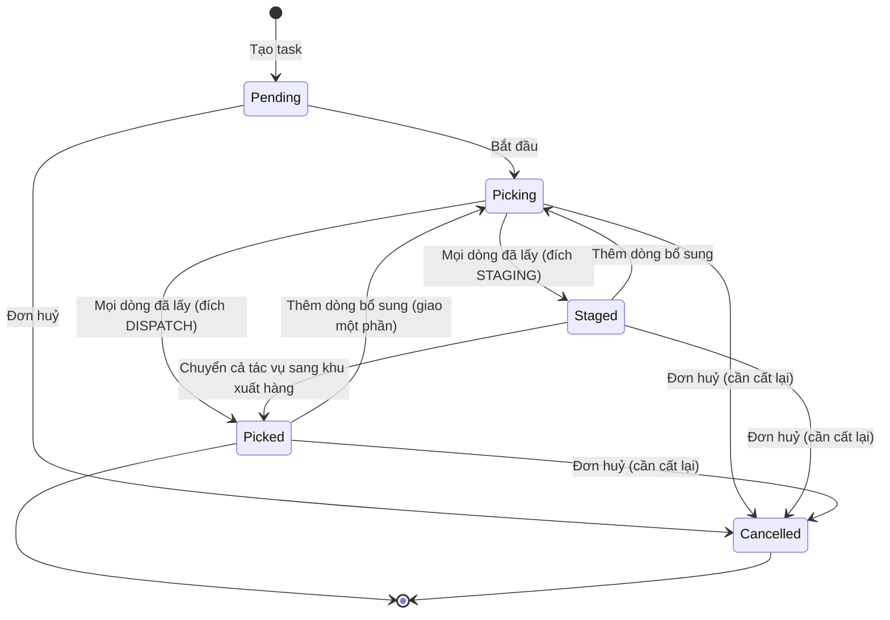

# 07 — Lấy hàng (Picking)

## 1. Mục đích (Purpose)

Lấy đúng **thùng thành phẩm (LPN)** đã phân bổ cho đơn đã release từ các vị trí lưu trữ trong **kho xuất** của đơn, và đưa tới **đích lấy hàng** của đơn: **khu xuất hàng (`DISPATCH`)** — nơi kiểm thùng & dán nhãn giao hàng — hoặc **khu chờ xuất (`STAGING`)**. Yêu cầu đến từ [Order Management](../../ecommerce/17-order-management/README.md).

Picking là **bước mở đầu luồng Fulfillment**: Picking → [Kiểm thùng & Dán nhãn giao hàng](../08-packing/README.md) → [Shipping](../09-shipping/README.md). Chất lượng picking quyết định độ chính xác đơn hàng và tốc độ giao.

> Đã chốt 2026-11-04: kho chỉ chứa **thành phẩm sản xuất theo mẫu của khách**, được đơn vị sản xuất **đóng thùng sẵn** và nhập kho theo thùng LPN ([03](../03-receipt/README.md)). **Chỉ lấy nguyên thùng**: không mở thùng, không lấy lẻ. Mọi dòng đơn đều lấy từ bin; không có dòng nào đi thẳng vào khu xuất hàng mà không qua lấy hàng.

- **Mỗi đơn có một nhiệm vụ (task)** gồm phần lấy hàng và phần kiểm thùng ([08](../08-packing/README.md)). **Quản lý kho** của kho xuất release đơn, tạo task và giao cho một nhân viên.
- **Đích lấy hàng** chọn theo task:
  - **`DISPATCH`** — khu xuất hàng (mặc định): đơn đủ hàng, xuất ngay. **Tồn bị trừ ngay khi quét xác nhận lấy**.
  - **`STAGING`** — Quản lý kho chọn **giữ hàng riêng cho đơn** khi đơn chưa xuất ngay (còn chờ phần hàng từ Đơn sản xuất, hoặc chờ khách thanh toán đợt `BEFORE_DELIVERY`). Thùng chuyển về khu chờ xuất, **vẫn là tồn của kho, gắn với đơn**; tồn chỉ bị trừ khi chuyển cả tác vụ sang khu xuất hàng (§4.3).
- **Mỗi dòng lấy hàng là một thùng LPN**. Dòng đơn ghi **số thùng**; phân bổ chọn **đủ N thùng** của SKU (N = số thùng của dòng đơn), theo **FIFO** (BR-03). Dòng ghi **mã LPN** của thùng và chỉ xác nhận được bằng cách quét đúng LPN ấy (BR-10).

> **Đã chốt 2026-11-05:** kiểm thùng & dán nhãn giao hàng ([08](../08-packing/README.md)) không có khu riêng mà làm ngay tại **khu xuất hàng (`DISPATCH`)**: thùng lấy xong đưa thẳng về đây, quét kiểm và dán nhãn tại chỗ, gom shipment, chờ xe. Hai khu đích của lấy hàng khác nhau như sau:
>
> | Khu | Thùng ở đây | Tồn | Đơn | Thời gian nằm |
> |-----|-------------|-----|-----|---------------|
> | **Khu chờ xuất (`STAGING`)** — tuỳ chọn | Thùng của đơn **chưa được phép xuất**; chưa dán nhãn | Chưa trừ; thùng vẫn `In Stock`, mang khoản phân bổ của đơn (BR-11) | Còn huỷ được | Có thể vài ngày |
> | **Khu xuất hàng (`DISPATCH`)** — mặc định | Thùng **đủ điều kiện xuất**; kiểm & dán nhãn tại đây, gom shipment ([09](../09-shipping/README.md)) | Đã trừ khi thùng được lấy / chuyển tới đây (thùng `Consumed`) | Hết huỷ từ thùng đầu tiên dán nhãn ([08](../08-packing/README.md) BR-04) | Chờ xe trong ngày |

> **Đã chốt 2026-11-05:** khách đặt theo **số thùng**; mọi thùng của một SKU đúng **số cái chuẩn / thùng** ([01](../01-product-creation/README.md) BR-11, [03](../03-receipt/README.md) BR-13). Phân bổ một dòng đơn = chọn **đủ N thùng** của SKU theo **FIFO** (nhập trước lấy trước); thành phẩm không có hạn dùng nên không có FEFO. Thiếu thùng → phần thiếu (tính theo số thùng) đi Đơn sản xuất (Production Order) như thường ([17](../../ecommerce/17-order-management/README.md)). Xem [open-questions C32](../../open-questions/README.md).

> **Đã chốt 2026-11-05:** **mỗi đơn có đúng một kho xuất** (Sale chọn khi đơn `Confirmed`, hệ thống gợi ý — [17](../../ecommerce/17-order-management/README.md)). Chỉ giữ / phân bổ / lấy hàng **tại kho xuất**; thùng dư của cùng SKU ở kho khác không dùng cho đơn đó. Không có chuyển hàng giữa các kho, không bao giờ tách giao từ hai kho; đơn vẫn có thể giao nhiều đợt từ cùng kho xuất.

> **Đã chốt 2026-11-05:** Quản lý kho quyết định có dùng khu chờ xuất cho đơn hay không. ⚠️ Giả định: tồn ở `STAGING` đã gắn đơn, không khả dụng cho đơn khác. Cách vận hành khu chờ xuất (lấy sang `STAGING` chưa trừ tồn, lấy bổ sung vào cùng task khi phần hàng còn thiếu về kho, chuyển cả tác vụ sang khu xuất hàng một lần cho cả task) là đề xuất của tài liệu. Xem [open-questions](../../open-questions/README.md).

> ⚠️ Giả định: lấy hàng theo **đợt (wave / batch)**, **theo zone**, và **tối ưu lộ trình** trên bản đồ kho thuộc phạm vi giai đoạn sau. Hiện tại mỗi đơn một task, các dòng lấy được sắp theo mã vị trí rồi SKU. Xem [open-questions C17](../../open-questions/README.md).

> ⚠️ Giả định: **đổi khoản giữ sang thùng thực tế quét được** (thùng khác cùng SKU, lô, số lượng, bin) thuộc phạm vi giai đoạn sau. Hiện quét thùng khác bị từ chối (BR-10). Xem [open-questions C23](../../open-questions/README.md).

---

## 2. Actor liên quan

| Actor | Vai trò |
|-------|---------|
| **Nhân viên kho (Picker)** | Bắt đầu task được giao; tại mỗi dòng: quét vị trí, quét **mã LPN** của thùng; **báo thiếu (short pick)** khi không lấy được thùng; hoàn tất phần lấy hàng; mang thùng tới đích (`DISPATCH` / `STAGING`) và từ khu chờ xuất sang khu xuất hàng. Cất lại thùng của đơn bị huỷ (put-back). |
| **Quản lý kho (Warehouse Manager)** — của kho xuất | Xem danh sách đơn chờ release / chờ tạo task, **release đơn, tạo task, chọn đích lấy hàng và giao người**, đổi người / đổi đích khi task chưa bắt đầu. **Phân bổ lại** dòng bị thiếu. **Phân bổ bổ sung** khi phần hàng còn thiếu của đơn đã về kho. **Cho chuyển cả tác vụ từ khu chờ xuất sang khu xuất hàng.** Theo dõi mọi task trong kho. Có đủ quyền thao tác như nhân viên kho (làm thay khi cần). |
| **Nhân viên Sale (Sales Staff)** | Cho phép giao một phần; quyết định với khách khi không đủ thùng (lập Đơn sản xuất cho phần thiếu, thoả thuận lại số thùng, giao một phần, huỷ) theo [17](../../ecommerce/17-order-management/README.md). Không thao tác trên task. |
| **Hệ thống** | Lập dòng lấy hàng từ các thùng đã phân bổ cho đơn. Trừ tồn khi quét (đích `DISPATCH`) hoặc chuyển thùng sang khu chờ xuất (đích `STAGING`). Treo đơn khi thiếu hàng, tự mở kiểm kê mù ([20](../20-inventory-control/README.md)), gỡ treo khi đã phân bổ lại xong. Đưa thùng của đơn huỷ vào hàng chờ cất lại. |

- Người được giao là **nhân viên kho hoặc quản lý kho đang hoạt động, được gán vào kho xuất của đơn**.
- Mọi thao tác chỉ trong phạm vi kho được gán.

---

## 3. Input / Output

### Input

| Trường | Mô tả | Bắt buộc |
|--------|-------|----------|
| Đơn cần lấy | Đơn `Ready to Fulfill`; hoặc đơn `Awaiting Stock` có phần hàng đã có tồn — chỉ khi Quản lý kho chọn giữ hàng ở khu chờ xuất, hoặc Sale cho phép giao một phần ([17](../../ecommerce/17-order-management/README.md)) | Có |
| Phân bổ tồn (allocation) | Các **thùng LPN** được phân bổ cho đơn khi release: **đủ N thùng** của SKU (N = số thùng của dòng đơn), theo FIFO, chỉ từ bin cho phép lấy (`is_pickable`) **của kho xuất** — BR-03, [20](../20-inventory-control/README.md) §5.6 | Có |
| **Đích lấy hàng** | `DISPATCH` (mặc định) hoặc `STAGING` (khu chờ xuất của kho xuất — [06](../06-warehouse-map-slotting/README.md)); Quản lý kho chọn khi tạo task, đổi được khi task còn `Pending` | Có |
| Người được giao | Nhân viên kho / quản lý kho của kho xuất | Có |
| Số liệu quét | Mã vị trí; **mã LPN** của thùng. Không nhập số lượng: mỗi dòng là một thùng (số cái chuẩn / thùng) | Có |

### Output

| Kết quả | Dùng bởi |
|---------|----------|
| **Dòng lấy hàng** (mỗi dòng một thùng LPN) đã lấy (`Picked`) / đang ở khu chờ xuất (`Staged`) / thiếu (`Short`) / huỷ | 08 Kiểm thùng & Dán nhãn, 17 Order Management |
| **Trừ tồn** tại vị trí nguồn + dòng sổ biến động `PICK` (đích `DISPATCH`, hoặc khi chuyển cả tác vụ từ khu chờ xuất sang khu xuất hàng); thùng → `Consumed` (rời tồn, đi tiếp làm kiện giao) | [20](../20-inventory-control/README.md) |
| **Thùng chuyển sang khu chờ xuất** + dòng sổ `MOVE` (đích `STAGING`); khoản phân bổ của đơn đi theo thùng, tồn không khả dụng cho đơn khác | [20](../20-inventory-control/README.md) |
| **Báo thiếu**: đơn treo lý do `INVENTORY`, phiếu kiểm kê mù cho thùng đó | 17, 20 |
| **Hàng chờ cất lại (put-back)** của task bị huỷ | Nhân viên kho |
| Task lấy hàng `Picked` → mở phần kiểm thùng | 08 Kiểm thùng & Dán nhãn |

---

## 4. Luồng nghiệp vụ từng bước (Step-by-step)

### 4.1. Tạo & giao task

1. **Danh sách chờ** — Quản lý kho xem các đơn có kho xuất là kho mình, chưa có task:
   - đơn `Ready to Fulfill`;
   - đơn `Awaiting Stock` có ít nhất một dòng đã phân bổ được thùng (phần còn thiếu đang chờ Đơn sản xuất — [17](../../ecommerce/17-order-management/README.md)).

   Đơn release sớm nhất đứng trước.
2. **Tạo task** — chọn đơn, **đích lấy hàng** và người được giao. Đơn `Awaiting Stock` chỉ tạo được task khi đích là `STAGING`, hoặc khi Sale đã cho phép giao một phần (đích `DISPATCH`). Hệ thống:
   - tạo **một task** cho đơn: phần lấy hàng `Pending` và phần kiểm thùng `Pending`. Tạo lại thì trả về task cũ, không sinh task thứ hai;
   - lập **dòng lấy hàng**: **mỗi thùng đã phân bổ một dòng** (bin, lô, mã LPN), sắp theo mã vị trí rồi SKU;
   - chuyển đơn `Ready to Fulfill` → `Picking`. Đơn `Awaiting Stock` giữ nguyên trạng thái.
   - Mọi thùng của task đều thuộc **kho xuất** của đơn, vì giữ hàng và phân bổ chỉ lấy tồn của kho xuất (BR-07).
3. **Đổi người / đổi đích** — chỉ khi task còn `Pending`.

### 4.2. Lấy hàng

4. **Bắt đầu** — người được giao bấm bắt đầu → task `Picking`.
5. **Tại mỗi dòng** — quét **mã vị trí** → quét **mã LPN** của thùng. Hệ thống kiểm:
   - đúng vị trí;
   - đúng **thùng của dòng** (BR-10); SKU, mã vạch hay LPN khác bị từ chối.

   Số lượng của dòng là **một thùng** (số cái chuẩn / thùng); không nhập, không sửa (BR-04). Hợp lệ → tuỳ đích lấy hàng:
   - **`DISPATCH`:** dòng `Picked`, **tồn của thùng bị trừ ngay** và ghi một dòng sổ `PICK`; thùng → `Consumed` ([20](../20-inventory-control/README.md) §4.6) và đi tiếp làm kiện giao với chính mã LPN ([08](../08-packing/README.md)).
   - **`STAGING`:** dòng `Staged`, **thùng chuyển nguyên từ bin sang khu chờ xuất** (dòng sổ `MOVE`), khoản phân bổ của đơn đi theo thùng; tồn chưa bị trừ, thùng vẫn `In Stock`.

   Quét lại cùng dòng không ghi thêm.
6. **Hoàn tất lấy hàng** — khi mọi dòng đã lấy (hoặc đã huỷ):
   - đích `DISPATCH` → task `Picked`; thùng mang về khu xuất hàng, phần kiểm thùng mở ([08](../08-packing/README.md));
   - đích `STAGING` → task `Staged`; thùng gom tại khu chờ xuất, **giữ riêng cho đơn**.

### 4.3. Khu chờ xuất (Staging)

7. **Lấy bổ sung** — đơn `Awaiting Stock` có phần hàng còn thiếu đã nhập vào kho xuất theo Đơn sản xuất ([03](../03-receipt/README.md)) → đơn `Ready to Fulfill` ([17](../../ecommerce/17-order-management/README.md)). Quản lý kho phân bổ phần còn lại (BR-03); hệ thống **thêm dòng lấy hàng vào cùng task**, theo đích của task:
   - task `Staged` → `Picking`, đơn → `Picking`; picker lấy các thùng bổ sung về khu chờ xuất như bước 5–6;
   - task `Picked` (đã giao trước một phần sang `DISPATCH`) → `Picking`; picker lấy bổ sung sang khu xuất hàng, phiên kiểm thùng tiếp tục ([08](../08-packing/README.md)).
8. **Chuyển cả tác vụ sang khu xuất hàng** — khi đơn đã sẵn sàng xuất (đủ hàng, hoặc Sale cho phép giao một phần), Quản lý kho **cho chuyển cả tác vụ sang khu xuất hàng**. Điều kiện: task `Staged`, đơn không đang treo. Hệ thống:
   - chuyển mọi dòng `Staged` → `Picked`, **trừ tồn** của các thùng tại khu chờ xuất, ghi dòng sổ `PICK`; thùng → `Consumed`; khoản phân bổ → `Consumed`;
   - task → `Picked`; nhân viên kho mang thùng sang khu xuất hàng; phần kiểm thùng mở ([08](../08-packing/README.md)).

   Đợt `BEFORE_DELIVERY` chưa thu **không chặn** bước này: bàn giao sẽ bị chặn ở [09](../09-shipping/README.md). Quản lý kho có thể giữ thùng ở khu chờ xuất tới khi khách thanh toán.

### 4.4. Thiếu hàng (Short pick)

9. **Báo thiếu** — picker không lấy được thùng của dòng (không thấy thùng ở vị trí, hoặc thùng hư hỏng không giao được) → báo thiếu kèm vị trí và lý do. Hệ thống:
   - chuyển dòng → `Short`, **không trừ / không chuyển tồn**;
   - treo đơn lý do **`INVENTORY`** ([17](../../ecommerce/17-order-management/README.md));
   - tự mở **phiếu kiểm kê mù** cho đúng thùng đó, hoặc dùng lại phiếu đang giữ thùng / vị trí đó ([20](../20-inventory-control/README.md) §4.2-f).

   Thùng hư hỏng được Quản lý kho cách ly nguyên thùng sang khu `QUARANTINE` ([20](../20-inventory-control/README.md) §4.8).
10. **Phân bổ lại** — Quản lý kho phân bổ lại phần thiếu của dòng đơn:
    - chọn **đủ số thùng thiếu** từ các thùng khác của SKU, theo BR-03, từ bin cho phép lấy **của kho xuất**, không bao giờ lấy lại thùng vừa thiếu;
    - dòng cũ huỷ, thêm dòng mới để picker lấy tiếp;
    - khi đơn không còn dòng thiếu nào, hệ thống **tự gỡ treo** `INVENTORY`.
11. **Không phân bổ lại được** (kho xuất không đủ thùng) — đơn ở lại trạng thái treo. Quản lý kho báo Sale; Sale quyết theo [17](../../ecommerce/17-order-management/README.md): lập Đơn sản xuất cho phần thiếu (theo số thùng, kho nhận = kho xuất) và chờ hàng, thoả thuận lại số thùng với khách, giao một phần rồi đóng phần còn lại, hoặc huỷ dòng / đơn.

### 4.5. Huỷ đơn & cất lại hàng (Put-back)

12. Đơn bị huỷ khi task đã bắt đầu → task `Cancelled` và được đánh dấu **cần cất lại**.
13. Các dòng đã `Picked` hoặc `Staged` của task đó vào **hàng chờ cất lại** của kho, task huỷ sớm nhất đứng trước. Với dòng `Staged`, khoản phân bổ của đơn được nhả (`ORDER_CANCELLED`); thùng vẫn nằm ở khu chờ xuất, không phân bổ được cho đơn khác tới khi cất lại.
14. Nhân viên / quản lý kho của kho đó cất lại **nguyên thùng** vào một **bin đang hoạt động của cùng kho**, quét LPN để xác nhận → dòng `Put Back`:
    - dòng `Picked` (đã trừ tồn): thùng quay về `In Stock`, tồn `Available`, ghi một dòng sổ `PUT_BACK`;
    - dòng `Staged` (chưa trừ tồn): thùng chuyển từ khu chờ xuất về bin, ghi một dòng sổ `MOVE`.

    Thùng giữ nguyên mã LPN và số lượng. Đơn chỉ huỷ được khi **chưa có thùng nào được dán nhãn giao hàng** ([08](../08-packing/README.md), [17](../../ecommerce/17-order-management/README.md)).

---

## 5. Trạng thái / Vòng đời (Lifecycle)

### 5.1. Phần lấy hàng của task

| Trạng thái | Ý nghĩa | Chuyển tiếp cho phép | Ai thực hiện |
|------------|---------|----------------------|--------------|
| `Pending` | Đã tạo, chờ người được giao bắt đầu; đổi người / đổi đích được | → `Picking`, → `Cancelled` | Quản lý kho |
| `Picking` | Đang lấy hàng | → `Picked` (đích `DISPATCH`), → `Staged` (đích `STAGING`), → `Cancelled` | Picker |
| `Staged` | Mọi dòng hiện có đã lấy về khu chờ xuất; thùng giữ riêng cho đơn | → `Picking` (thêm dòng bổ sung), → `Picked` (chuyển cả tác vụ sang khu xuất hàng), → `Cancelled` (đơn huỷ — cần cất lại) | Quản lý kho |
| `Picked` | Mọi dòng đã lấy (hoặc huỷ), thùng ở khu xuất hàng; mở kiểm thùng | → `Picking` (thêm dòng bổ sung khi đơn giao một phần), → `Cancelled` (đơn huỷ — cần cất lại) | Picker; Quản lý kho (từ `Staged`) |
| `Cancelled` | Đơn bị huỷ; nếu đã bắt đầu lấy thì thùng đã lấy vào hàng chờ cất lại | *(cuối)* | Hệ thống |

### 5.2. Dòng lấy hàng (một thùng LPN)

| Trạng thái | Ý nghĩa | Chuyển tiếp cho phép | Ai thực hiện |
|------------|---------|----------------------|--------------|
| `Open` | Chờ lấy thùng | → `Picked`, → `Staged`, → `Short` | Picker |
| `Staged` | Thùng đã về khu chờ xuất; tồn chưa trừ, vẫn gắn đơn | → `Picked` (chuyển cả tác vụ sang khu xuất hàng), → `Put Back` (task bị huỷ) | Picker; Quản lý kho |
| `Picked` | Đã lấy thùng; tồn đã trừ | → `Put Back` (task bị huỷ) | Picker; Hệ thống (từ `Staged`) |
| `Short` | Không lấy được thùng; chưa trừ tồn | → `Cancelled` (đã phân bổ lại sang dòng mới) | Picker báo; Quản lý kho phân bổ lại |
| `Cancelled` | Bị thay bằng dòng phân bổ lại | *(cuối)* | Hệ thống |
| `Put Back` | Thùng đã cất lại bin | *(cuối)* | Nhân viên / Quản lý kho |

> `Staged` / `Picked` là trạng thái của **dòng lấy hàng**, không phải trạng thái tồn. Thùng ở khu chờ xuất vẫn là tồn `Available` mang khoản phân bổ của đơn; thùng đã `Picked` **rời khỏi tồn**, khoản phân bổ chuyển sang `Consumed` ([20](../20-inventory-control/README.md) §5.6).

---

## 6. Ràng buộc nghiệp vụ (Business Rules) & Edge case

### Business rules

- **BR-01:** Chỉ đơn **đã release** mới có task. Đợt thanh toán `ON_SIGNING` được kiểm **trước release** (đơn còn `Pending Payment` không release — [17](../../ecommerce/17-order-management/README.md)); đợt `BEFORE_DELIVERY` được kiểm **khi bàn giao** cho đơn vị vận chuyển ([09](../09-shipping/README.md)). Lúc lấy hàng không kiểm lại.
- **BR-02:** Chỉ lấy các **thùng đã phân bổ** cho đơn; không lấy thùng `Quarantine`, thùng của đơn khác, hay thùng đang ở khu chờ xuất.
- **BR-03:** **Phân bổ nguyên thùng** (kể cả phân bổ lại và phân bổ bổ sung):
  1. Chỉ từ thùng `In Stock`, tồn `Available`, ở bin cho phép lấy của **kho xuất** của đơn; không bao giờ lấy từ khu `STAGING` hay `QUARANTINE`.
  2. Chọn **đủ N thùng** của SKU, N = **số thùng** của dòng đơn *(Đã chốt 2026-11-05)*. Mọi thùng của SKU đúng số cái chuẩn nên N thùng bất kỳ đều đúng số lượng dòng. Không mở thùng, không lấy một phần thùng.
  3. Thứ tự chọn thùng: **FIFO** — thùng nhập kho trước được chọn trước (theo ngày nhập). Thành phẩm không có hạn dùng nên không áp dụng FEFO *(Đã chốt 2026-11-05)*.
  4. Kho xuất chỉ có sẵn k < N thùng → giữ k thùng; **N − k thùng còn lại là thiếu**, đi Đơn sản xuất với kho nhận = kho xuất ([17](../../ecommerce/17-order-management/README.md)). Thùng của cùng SKU ở kho khác không được dùng.

  Ví dụ: SKU 1.000 cái / thùng, dòng đơn 3 thùng (3.000 cái); kho xuất có 5 thùng thuộc hai lô → giữ 3 thùng nhập sớm nhất. Kho xuất chỉ có 2 thùng → giữ 2 thùng, thiếu 1 thùng (dù kho khác còn thùng của SKU này).
- **BR-04:** **Mỗi dòng lấy hàng là một thùng**, số lượng là số cái chuẩn / thùng; không nhập, không sửa số lượng. Không lấy được thùng thì báo thiếu; muốn đổi thùng phải phân bổ lại.
- **BR-05:** Thùng đã lấy (kể cả thùng ở khu chờ xuất) mà đơn bị huỷ phải **cất lại có kiểm soát, nguyên thùng** vào bin của cùng kho, không "biến mất".
- **BR-06:** **Mọi dòng đơn đều lấy thành phẩm từ bin** — SKU thành phẩm theo mẫu của khách đã nhập kho theo thùng ([03](../03-receipt/README.md)). Không có dòng nào vào khu xuất hàng mà không qua lấy hàng. Đích lấy hàng là `DISPATCH` hoặc `STAGING`, chọn theo task.
- **BR-07:** **Mỗi đơn một task, tại một kho.** Thùng giữ cho đơn luôn nằm ở **kho xuất** của đơn (giữ hàng và phân bổ chỉ lấy tồn của kho xuất); task thuộc kho xuất. Lấy bổ sung (đơn từng `Awaiting Stock`) thêm dòng vào cùng task, giữ đích của task, không sinh task mới.
- **BR-08:** Chỉ người được giao thao tác lấy hàng của task. Đổi người / đổi đích chỉ khi task còn `Pending`.
- **BR-09:** Báo thiếu luôn **treo đơn** và **mở kiểm kê mù** cho thùng đó. Thùng đó bị chặn phân bổ tới khi chênh lệch được duyệt ([20](../20-inventory-control/README.md) BR-11). Phân bổ lại do Quản lý kho làm, không tự động.
- **BR-10:** Dòng lấy hàng chỉ xác nhận bằng **mã LPN của chính thùng đó** (không phân biệt hoa thường); SKU, mã vạch hay LPN khác đều bị từ chối. Lý do: tồn bị trừ ở đúng thùng được giữ; quét thùng khác cùng SKU sẽ lệch sổ. Không đổi khoản giữ sang thùng khác.
- **BR-11:** **Thùng ở khu chờ xuất gắn với đơn.** Tồn ở `STAGING` vẫn là tồn của kho nhưng mang khoản phân bổ của đơn, **không khả dụng và không phân bổ được cho đơn khác** ([20](../20-inventory-control/README.md) BR-20). Thùng chỉ rời khu chờ xuất khi **chuyển cả tác vụ sang khu xuất hàng** (tồn bị trừ lúc đó) hoặc **cất lại** khi đơn bị huỷ. Việc chuyển làm một lần cho cả task.

### Edge case

| Tình huống | Hướng xử lý |
|------------|-------------|
| Vị trí báo có thùng nhưng thực tế không thấy | Báo thiếu → đơn treo → kiểm kê mù thùng đó → Quản lý kho phân bổ lại thùng khác của kho xuất |
| Thùng hư hỏng phát hiện khi lấy | Báo thiếu thùng đó; Quản lý kho cách ly nguyên thùng sang khu `QUARANTINE` ([20 §4.8](../20-inventory-control/README.md)); phân bổ lại thùng khác |
| Kho xuất không còn đủ số thùng cho dòng | Đơn ở lại treo `INVENTORY`; Quản lý kho báo Sale; Sale quyết: lập Đơn sản xuất cho số thùng thiếu (kho nhận = kho xuất) / thoả thuận lại số thùng với khách / giao một phần + đóng phần còn lại / huỷ ([17](../../ecommerce/17-order-management/README.md)) |
| Kho khác còn thùng dư của cùng SKU (SKU riêng của khách) | Không dùng cho đơn này; không chuyển hàng giữa các kho. Phần thiếu xử lý như dòng trên |
| Khách huỷ đơn khi đang lấy | Task `Cancelled`; thùng đã lấy vào hàng chờ cất lại, cất nguyên thùng |
| Đơn `Awaiting Stock` (thiếu một phần, chờ Đơn sản xuất) | Quản lý kho chọn: lấy trước các thùng đã có về khu chờ xuất và giữ cho đơn; hoặc (Sale cho phép giao một phần) lấy sang `DISPATCH` để giao trước; hoặc chờ đủ hàng mới tạo task |
| Phần hàng còn thiếu đã nhập kho xuất, đơn đang có task `Staged` | Quản lý kho phân bổ bổ sung → thêm dòng vào cùng task → picker lấy thùng bổ sung về khu chờ xuất → chuyển cả tác vụ sang khu xuất hàng |
| Đơn đủ hàng nhưng khách chưa thanh toán đợt `BEFORE_DELIVERY` | Quản lý kho có thể lấy về khu chờ xuất và giữ tới khi khách thanh toán; hoặc lấy thẳng sang `DISPATCH` — bàn giao vẫn bị chặn ở [09](../09-shipping/README.md) |
| Đơn bị huỷ khi thùng đang ở khu chờ xuất | Task `Cancelled`; nhả phân bổ; dòng `Staged` vào hàng chờ cất lại, cất về bin bằng dòng sổ `MOVE` |
| Đơn đang treo khi task `Staged` | Không chuyển cả tác vụ sang khu xuất hàng được tới khi gỡ treo; thùng vẫn giữ ở khu chờ xuất |
| Các thùng của một dòng đơn nằm rải nhiều vị trí / lô | Mỗi thùng một dòng; picker đi theo thứ tự mã vị trí |
| Quét nhầm vị trí / thùng | Hệ thống từ chối, báo lệch vị trí / LPN đúng của dòng |
| Thùng được giữ không còn ở bin (bị di chuyển, thất lạc) | Báo thiếu → kiểm kê mù thùng đó → Quản lý kho phân bổ lại |
| Khách muốn số cái không tròn thùng | Không phát sinh ở kho: báo giá / đơn chỉ nhận **số thùng nguyên** ([14](../../ecommerce/14-cart-and-order/README.md), [01](../01-product-creation/README.md) BR-11) |

---

## 7. Liên kết với các module khác

| Module | Quan hệ |
|--------|---------|
| [17 · Order Management](../../ecommerce/17-order-management/README.md) | Nguồn đơn đã release (`Ready to Fulfill`, `Awaiting Stock`); kho xuất do Sale chọn; Đơn sản xuất cho phần thiếu (theo số thùng, kho nhận = kho xuất); treo / gỡ treo `INVENTORY`; giao một phần do Sale quyết; huỷ đơn → cất lại |
| [20 · Inventory Control](../20-inventory-control/README.md) | Phân bổ nguyên thùng LPN theo FIFO tại kho xuất; trừ tồn khi quét (thùng `Consumed`); tồn ở khu chờ xuất gắn đơn; kiểm kê mù khi thiếu; cách ly thùng hư hỏng; cất lại thùng |
| [08 · Kiểm thùng & Dán nhãn giao hàng](../08-packing/README.md) | Task `Picked` mở phần kiểm thùng; thùng đã lấy chính là kiện giao |
| [06 · Warehouse Map & Slotting](../06-warehouse-map-slotting/README.md) / [05 · Putaway](../05-putaway/README.md) | Khu xuất hàng `DISPATCH`, khu chờ xuất `STAGING`, khu `QUARANTINE`; vị trí thùng do putaway / slotting quyết định |
| [03 · Receipt](../03-receipt/README.md) | Thùng thành phẩm nhập vào kho xuất theo Đơn sản xuất là nguồn tồn để lấy, kể cả phần bổ sung cho đơn `Awaiting Stock`; ngày nhập là căn cứ FIFO |
| [01 · Product Creation](../01-product-creation/README.md) | Quy cách thùng (số cái chuẩn / thùng) của SKU |
| [09 · Shipping](../09-shipping/README.md) | Đợt `BEFORE_DELIVERY` chưa thu chặn bàn giao, không chặn lấy hàng |
| [11 · Intra-warehouse Transfer](../11-intra-warehouse-transfer/README.md) | Di chuyển thủ công nguyên thùng sang bin lấy hàng (`is_pickable`); bổ sung tự động khi cạn là phạm vi sau (C24) |
| [00 · System Overview §5](../../00-system-overview/README.md) | Bước 1 của luồng Fulfillment |
