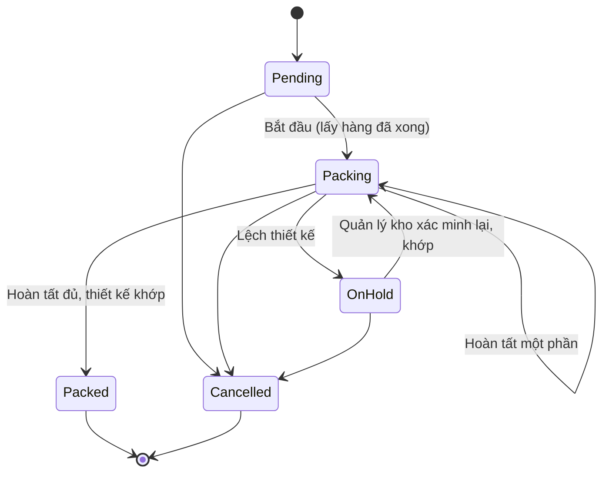

# 08 — Đóng gói (Packing)

## 1. Mục đích (Purpose)

Kiểm lần cuối hàng đã [lấy](../07-picking/README.md) và thành phẩm in do [xưởng](../19-production/README.md) bàn giao. Sau đó **đóng thành kiện (package)**: cân đo, niêm phong, in nhãn kiện, và gom các kiện thành **shipment** để bàn giao [Shipping](../09-shipping/README.md).

Packing đảm bảo: **đúng đơn – đúng hàng – đủ số lượng – đúng thiết kế – kiện có kích thước & khối lượng – có nhãn hợp lệ**. Đây là **chốt kiểm soát cuối** trước khi hàng rời kho.

> ⚠️ Giả định: **gợi ý thùng / cách chia kiện tự động (cartonization)** tại bàn đóng gói thuộc phạm vi giai đoạn sau. Hiện Packer tự chọn loại kiện và nhập kích thước; hệ thống chỉ ước tính số thùng khi **ước tính tải** ([09](../09-shipping/README.md) §4.0). Xem [open-questions C17](../../open-questions/README.md).

---

## 2. Actor liên quan

| Actor | Vai trò |
|-------|---------|
| **Nhân viên đóng gói (Packer)** — nhân viên kho | Bắt đầu đóng gói, mở / niêm phong / mở lại / huỷ kiện, mở **bộ kiện (kit)**, cân đo, in nhãn, hoàn tất đóng gói. **Chỉ người bắt đầu phiên** được thao tác tiếp. |
| **Quản lý kho (Warehouse Manager)** | Thao tác thay Packer trên mọi phiên. **Xác minh lại thiết kế** khi đóng gói bị treo vì lệch thiết kế. |
| **Nhân viên QC (QC Staff)** | Xem task và tải file thiết kế để đối chiếu thành phẩm |
| **Hệ thống** | Chỉ mở đóng gói khi đã lấy hàng xong. Kiểm checksum thiết kế khi hoàn tất. Gom kiện thành shipment. Tính khối lượng quy đổi. Đánh dấu nhãn lỗi thời. |

---

## 3. Input / Output

### Input

| Trường | Mô tả | Bắt buộc |
|--------|-------|----------|
| Hàng đã lấy của đơn | Phần lấy hàng của task đã `Picked` ([07](../07-picking/README.md)) | Có (dòng hàng sẵn) |
| Thành phẩm in đạt QC | Xưởng bàn giao tại khu `PACKING`, gắn lệnh sản xuất & design snapshot ([19](../19-production/README.md)) | Có (dòng in) |
| **Kích thước & khối lượng kiện** | Khối lượng (kg), dài × rộng × cao (cm), đều > 0 — bắt buộc khi niêm phong | Có |
| Loại kiện | `CARTON` / `BAG` / `PALLET` / `CRATE` / `OTHER` | Không |
| Cờ cho phép xoay / dễ vỡ | Mặc định lấy từ SKU bên trong; Packer được ghi đè (ghi lại) | Không |
| Số kiện của một đơn vị (`package_count`) | Khai báo trên Inventory Item ([01](../01-product-creation/README.md)); ≥ 2 thì đơn vị đó là **bộ kiện (kit)** | Có (với hàng kit) |
| Design snapshot | File thiết kế đã khách xác nhận, dùng đối chiếu thành phẩm ([12](../../ecommerce/12-product-design/README.md)) | Có (dòng in) |

### Output

| Kết quả | Dùng bởi |
|---------|----------|
| **Kiện (package)** — mã `PKG-<mã đơn>-<n>`: nội dung, kích thước, khối lượng thực & quy đổi, cờ xoay / dễ vỡ | 09 Shipping (kể cả kế hoạch chuyến xe) |
| **Nhãn kiện** — in cho kiện đã niêm phong; ghi số tiền thu hộ (nếu có) | Dán lên kiện; quét khi xếp xe, bàn giao |
| **Shipment** `Ready to Dispatch` — các kiện đã niêm phong của lần hoàn tất, mã `<mã đơn>-S<n>` | 09 Shipping |
| **Cảnh báo còn tiền phải thu trước giao** khi hoàn tất | Packer, Điều phối |
| **Lịch sử kiểm thiết kế** (mỗi lần kiểm, không xoá) | QC, Quản lý kho |
| Cập nhật đơn: `Packed` / `Partially Fulfilled`, hoặc treo `DESIGN_MISMATCH` | 17 Order Management |

---

## 4. Luồng nghiệp vụ từng bước (Step-by-step)

### 4.1. Bắt đầu

1. **Hàng chờ đóng gói** — đơn có phần lấy hàng `Picked`. Đơn còn `In Production` chỉ hiện khi Sale đã **cho phép giao một phần** (đóng gói hàng sẵn trước — PACK-EARLY).
2. **Bắt đầu** — Packer bấm bắt đầu → phiên `Packing`, ghi người bắt đầu. Từ đây **chỉ người đó** (hoặc Quản lý kho) thao tác.
3. **Tải file thiết kế** — với dòng in, Packer / QC tải file theo vai trò (xem trước, file in, hướng dẫn sản xuất) **trong phạm vi task**, link ngắn hạn ([12](../../ecommerce/12-product-design/README.md)).

### 4.2. Đóng kiện

4. **Mở kiện** → kiện `Open`, cho hàng vào theo dòng đơn. Dòng in chỉ đóng được khi thành phẩm đã về (sản xuất xong).
5. **Bộ kiện (kit)** — một đơn vị hàng đóng thành **N kiện** (N = `package_count`, 2–99):
   - Packer **mở bộ kiện** → hệ thống mở đủ N kiện một lần.
   - Kiện 1 chứa đúng một đơn vị của dòng; kiện 2..N không chứa hàng (là phần còn lại của bộ).
   - Mỗi kiện niêm phong với kích thước riêng.
   - Muốn đóng hàng kit như kiện thường (**ép kiện thường**) phải ghi **lý do**; lý do được lưu vết.
6. **Niêm phong** — nhập **khối lượng và kích thước** (bắt buộc), loại kiện, cờ xoay / dễ vỡ.
   - Hệ thống tính **khối lượng quy đổi** = D × R × C / 6.000.
   - Kiện rỗng không niêm phong được.
   - Kiện → `Sealed`.
7. **Mở lại** — kiện `Sealed` mở lại được khi **chưa thuộc shipment nào** và không nằm trong kế hoạch chuyến xe.
8. **Huỷ kiện** — kiện → `Voided`; hàng trong đó tính là chưa đóng, nhãn bị huỷ. Không huỷ được kiện đã giao. Huỷ một kiện của bộ thì **huỷ cả bộ**.
9. **In nhãn** — chỉ kiện `Sealed` có nhãn.
   - Nhãn ghi số tiền thu hộ hiện hành của shipment (nếu có).
   - Kiện đổi shipment, hoặc số tiền thu hộ đổi sau khi in → **nhãn lỗi thời**, phải **in lại** trước khi xếp xe / bàn giao.

### 4.3. Hoàn tất

10. **Hoàn tất đóng gói** — hệ thống kiểm theo thứ tự:
    1. mọi bộ kiện phải đủ và đã niêm phong hết;
    2. không còn kiện mở có hàng;
    3. có ít nhất một kiện đã niêm phong;
    4. đóng thiếu hàng thì phải chọn **giao một phần** kèm **ghi chú**, và đơn phải được Sale cho phép giao một phần.

    Kiện mở còn rỗng bị huỷ.
11. **Kiểm thiết kế** — với các dòng in trong lần giao này, hệ thống so **checksum** file thiết kế với snapshot khách đã xác nhận. Mỗi lần kiểm được lưu lại.
    - Khớp → các kiện đã niêm phong gom thành **một shipment** `Ready to Dispatch`. Đóng đủ → phiên `Packed`, đơn `Packed`. Đóng một phần → phiên vẫn `Packing`, đơn `Partially Fulfilled`.
    - Lệch → phiên **`On Hold`**, đơn treo lý do **`DESIGN_MISMATCH`**, không tạo shipment (§4.4).
12. **Cảnh báo tiền** — nếu đơn còn tiền phải thu trước khi giao, kết quả hoàn tất kèm **cảnh báo số tiền** (không chặn). Bàn giao sẽ bị chặn tới khi đủ tiền ([09](../09-shipping/README.md)).
13. Kiện đã có shipment đưa ra khu chờ giao (Area `DISPATCH`) → [Shipping](../09-shipping/README.md). Đơn **giao nguyên chuyến** đi tiếp vào kế hoạch chuyến xe ([09 §4.2](../09-shipping/README.md#42-giao-nguyên-chuyến--lập-kế-hoạch-xếp-hàng-3d-load-planning)).

### 4.4. Lệch thiết kế

14. **Xác minh lại** — Quản lý kho xác minh lại, ghi ghi chú xử lý. Hệ thống kiểm lại **mọi dòng in** của đơn:
    - Khớp hết → gỡ treo `DESIGN_MISMATCH`, phiên quay về `Packing`; Packer hoàn tất lại.
    - Vẫn lệch → giữ nguyên treo; xử lý theo [12](../../ecommerce/12-product-design/README.md) / [19](../19-production/README.md) (file lưu trữ bị thay, in sai…).

---

## 5. Trạng thái / Vòng đời (Lifecycle)

### 5.1. Phiên đóng gói (theo đơn)

| Trạng thái | Ý nghĩa | Chuyển tiếp cho phép | Ai thực hiện |
|------------|---------|----------------------|--------------|
| `Pending` | Chờ lấy hàng xong / chờ bắt đầu | → `Packing`, → `Cancelled` | Packer |
| `Packing` | Đang đóng; chỉ người bắt đầu (hoặc Quản lý kho) thao tác | → `Packed` (hoàn tất đủ), → `Packing` (hoàn tất một phần), → `On Hold` (lệch thiết kế), → `Cancelled` | Packer |
| `On Hold` | Lệch thiết kế; chờ xác minh lại | → `Packing` (xác minh khớp), → `Cancelled` | Quản lý kho |
| `Packed` | Đã đóng đủ; mọi kiện đã có shipment | *(cuối)* | Packer |
| `Cancelled` | Đơn bị huỷ | *(cuối)* | Hệ thống |

### 5.2. Kiện (Package)

| Trạng thái | Ý nghĩa | Chuyển tiếp cho phép | Ai thực hiện |
|------------|---------|----------------------|--------------|
| `Open` | Đang cho hàng vào | → `Sealed`, → `Voided` | Packer |
| `Sealed` | Đã niêm phong, có kích thước & khối lượng; in được nhãn | → `Open` (mở lại, khi chưa thuộc shipment / kế hoạch xe), → `Voided` (khi chưa giao) | Packer |
| `Voided` | Đã huỷ; hàng tính là chưa đóng; nhãn bị huỷ | *(cuối)* | Packer / Hệ thống |

---

## 6. Ràng buộc nghiệp vụ (Business Rules) & Edge case

### Business rules

- **BR-01:** Chỉ đóng gói khi phần lấy hàng của task đã `Picked`. Hoàn tất khi thiếu hàng chỉ được nếu đơn **cho phép giao một phần**, kèm ghi chú.
- **BR-02:** Với sản phẩm in, file thiết kế phải **khớp checksum** của snapshot khách đã xác nhận ([12](../../ecommerce/12-product-design/README.md) BR-09). Lệch → treo phiên và đơn (`DESIGN_MISMATCH`); chỉ **Quản lý kho xác minh lại** mới gỡ được. Không tạo shipment khi còn lệch.
- **BR-03:** Kiện **bắt buộc** có khối lượng và kích thước > 0 khi niêm phong. Đây là đầu vào của bàn giao và kế hoạch xếp hàng ([09](../09-shipping/README.md)).
- **BR-04:** Mỗi kiện chỉ thuộc một đơn (không gộp nhiều đơn vào một kiện) — trừ khi có tính năng "consolidated shipment" được bật. ⚠️ Giả định — xem [open-questions](../../open-questions/README.md).
- **BR-05:** Đơn bị huỷ trước khi bàn giao → shipment `Cancelled`, kiện và nhãn bị huỷ.
- **BR-06:** Kiện chỉ mở lại khi chưa thuộc shipment / kế hoạch chuyến xe; chỉ huỷ khi chưa giao.
- **BR-07:** Chỉ **người bắt đầu phiên** thao tác trên phiên đó; Quản lý kho được thao tác thay.
- **BR-08:** **Bộ kiện giao nguyên bộ**:
  - đủ N kiện, đã niêm phong hết mới hoàn tất được;
  - huỷ một kiện là huỷ cả bộ;
  - một bộ luôn đi chung một xe ([09](../09-shipping/README.md) BR-17);
  - ép kiện thường phải có lý do.
- **BR-09:** Nhãn in khi kiện đã niêm phong. Nhãn **lỗi thời** (kiện đổi shipment, số tiền thu hộ đổi) phải in lại trước khi xếp xe / bàn giao.
- **BR-10:** Khối lượng quy đổi = D × R × C (cm) / 6.000 (hệ số cấu hình được).

### Edge case

| Tình huống | Hướng xử lý |
|------------|-------------|
| Đóng thiếu hàng (lấy sót / hỏng) | Không hoàn tất đủ được. Đơn cho phép giao một phần → hoàn tất một phần kèm ghi chú; nếu không → xử lý thiếu ở [07](../07-picking/README.md) |
| Hàng bị hư khi đóng gói | Loại ra; ghi giảm bằng điều chỉnh ([20](../20-inventory-control/README.md)); xử lý như thiếu hàng |
| Packer khác muốn làm tiếp phiên của người đã bắt đầu | Bị chặn; Quản lý kho làm thay hoặc phân công lại |
| Hoàn tất mà file thiết kế lệch checksum | Phiên và đơn treo `DESIGN_MISMATCH`; Quản lý kho xác minh lại |
| Đổi thiết kế / đổi số tiền thu hộ sau khi đã in nhãn | Nhãn lỗi thời; in lại trước khi xếp xe |
| Kiện đã niêm phong nhưng cần sửa | Mở lại (nếu chưa thuộc shipment / kế hoạch xe); nếu đã thuộc kế hoạch xe → gỡ khỏi kế hoạch trước ([09](../09-shipping/README.md)) |
| Đơn hỗn hợp, phần in chưa xong | Chỉ đóng gói trước hàng sẵn khi Sale cho phép giao một phần; nếu không, chờ thành phẩm về |
| Hàng kit nhưng chỉ đóng được vào một kiện | Ép kiện thường kèm lý do |
| Địa chỉ giao không hợp lệ | Điều phối treo đơn lý do `ADDRESS` ([17](../../ecommerce/17-order-management/README.md) §4.6), liên hệ khách sửa rồi gỡ treo |
| Còn tiền phải thu trước khi giao | Hoàn tất vẫn được, kèm cảnh báo; bàn giao bị chặn tới khi đủ tiền |

---

## 7. Liên kết với các module khác

| Module | Quan hệ |
|--------|---------|
| [07 · Picking](../07-picking/README.md) | Task `Picked` mở đóng gói |
| [19 · Production](../19-production/README.md) | Nhận thành phẩm in đạt QC tại khu `PACKING` |
| [09 · Shipping](../09-shipping/README.md) | Nhận shipment `Ready to Dispatch` (kiện, kích thước, khối lượng, cờ xoay, nhãn); nhãn lỗi thời bị chặn khi xếp xe |
| [17 · Order Management](../../ecommerce/17-order-management/README.md) | Đơn `Packed` / `Partially Fulfilled`; treo `DESIGN_MISMATCH`; giao một phần do Sale quyết; mốc đóng gói xong là hết huỷ |
| [12 · Product Design](../../ecommerce/12-product-design/README.md) | File thiết kế theo vai trò; checksum để kiểm khi hoàn tất |
| [01 · Product Creation](../01-product-creation/README.md) | Kích thước / khối lượng / cờ xoay / dễ vỡ của SKU làm mặc định; `package_count` xác định hàng kit |
| [00 · System Overview §5](../../00-system-overview/README.md) | Bước 2 của luồng Fulfillment |
