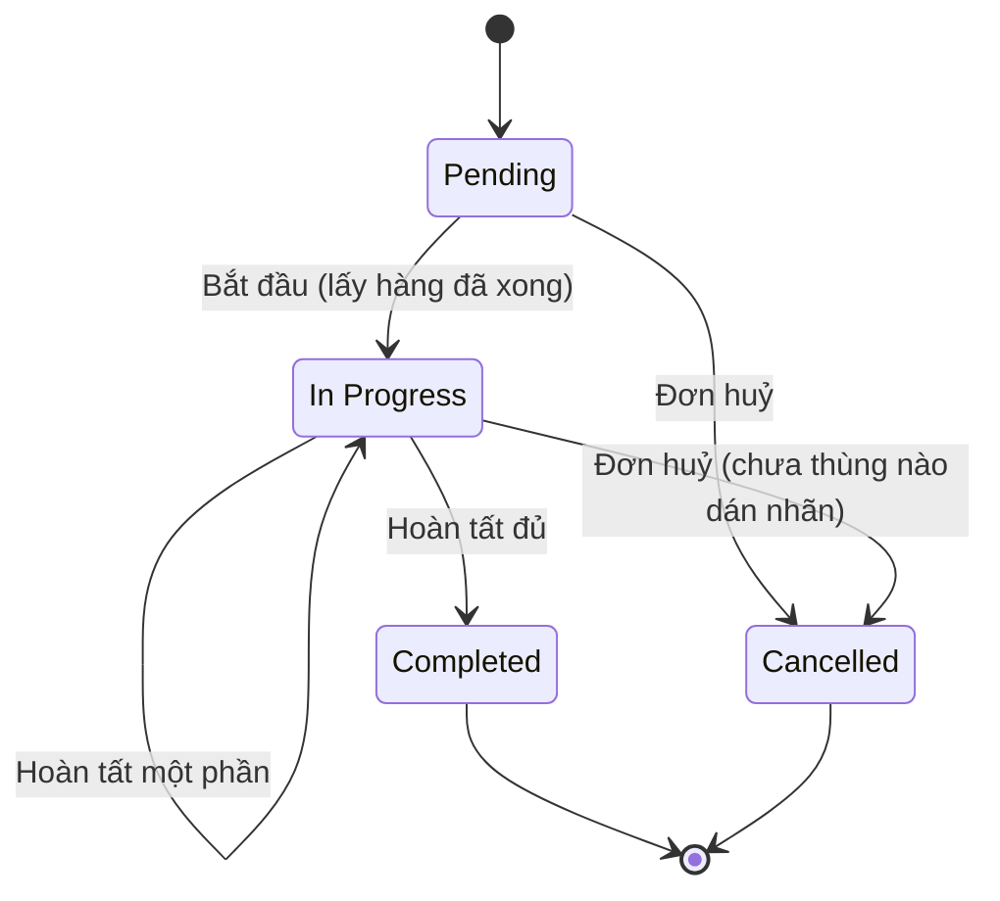
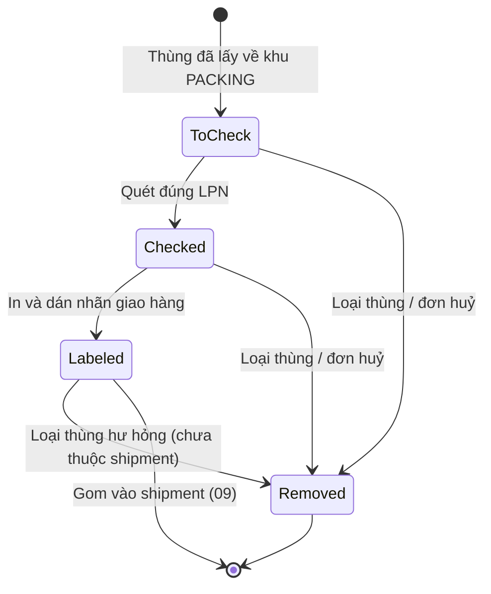

# 08 — Kiểm thùng & Dán nhãn giao hàng (Outbound Check & Labeling)

## 1. Mục đích (Purpose)

Kiểm lần cuối các **thùng thành phẩm (LPN)** đã [lấy](../07-picking/README.md) cho đơn — thùng lấy thẳng về khu kiểm & dán nhãn (`PACKING`) hoặc chuyển từ **khu chờ xuất (`STAGING`)** sang. Sau đó **dán nhãn giao hàng** lên từng thùng và **gom các thùng thành shipment** để bàn giao [Shipping](../09-shipping/README.md).

Module đảm bảo: **đúng đơn – đúng SKU – đủ số thùng – mỗi thùng có kích thước, khối lượng và nhãn giao hợp lệ**. Đây là **chốt kiểm soát cuối** trước khi hàng rời kho.

> Đã chốt 2026-11-04: thành phẩm về kho đã được đơn vị sản xuất **đóng thùng sẵn** và chỉ xuất **nguyên thùng** ([07](../07-picking/README.md)). **Thùng LPN chính là kiện giao**: kho **không đóng lại hàng** — không chọn loại kiện, không cân đo, không niêm phong, không mở bộ kiện. Kích thước và khối lượng của thùng lấy từ **quy cách thùng** khai báo cho SKU ([01](../01-product-creation/README.md)). SKU in theo mẫu của khách đã mang thiết kế ([12](../../ecommerce/12-product-design/README.md)), nên chỉ kiểm **đúng SKU / đủ số thùng**. Thư mục giữ tên `08-packing`; khu `PACKING` giữ mã kỹ thuật, nghĩa là khu kiểm & dán nhãn.

> **Đã chốt 2026-11-05:** mọi thùng của một SKU đúng **số cái chuẩn / thùng** ([03](../03-receipt/README.md) BR-13), nên mọi thùng có **cùng kích thước và cùng khối lượng thùng đầy** theo quy cách thùng; không có thùng nhỏ hơn chuẩn, không tính khối lượng riêng cho từng thùng. Xem [open-questions B24, E14](../../open-questions/README.md).

---

## 2. Actor liên quan

| Actor | Vai trò |
|-------|---------|
| **Nhân viên kho (kiểm thùng)** | Bắt đầu phiên kiểm thùng, quét LPN từng thùng, loại thùng hư hỏng, in & dán nhãn giao hàng, in lại nhãn hỏng, hoàn tất phiên. **Chỉ người bắt đầu phiên** được thao tác tiếp. |
| **Quản lý kho (Warehouse Manager)** — của kho xuất | **Cho chuyển cả tác vụ** của đơn từ khu chờ xuất sang khu kiểm & dán nhãn ([07](../07-picking/README.md) §4.3); xử lý khi thiếu thùng (phân bổ lại — [07](../07-picking/README.md) §4.4); thao tác thay nhân viên trên mọi phiên; cách ly thùng hư hỏng ([20](../20-inventory-control/README.md) §4.8); nhận cảnh báo đợt thanh toán `BEFORE_DELIVERY` chưa thu. |
| **Nhân viên Sale (Sales Staff)** | Cho phép giao một phần; quyết định với khách khi thiếu thùng mà không phân bổ lại được; treo đơn lý do `ADDRESS` khi địa chỉ giao không hợp lệ; nhắc khách thanh toán đợt `BEFORE_DELIVERY` ([17](../../ecommerce/17-order-management/README.md)). |
| **Hệ thống** | Chỉ mở phiên khi đã lấy hàng xong. Lấy kích thước, khối lượng, cờ cho phép xoay của thùng từ quy cách thùng của SKU. Tính khối lượng quy đổi. Gom thùng thành shipment. **Khoá huỷ đơn, đổi cách giao, đổi địa chỉ giao** khi thùng đầu tiên của đơn được dán nhãn ([17](../../ecommerce/17-order-management/README.md)). Cảnh báo đợt `BEFORE_DELIVERY` chưa thu. |

---

## 3. Input / Output

### Input

| Trường | Mô tả | Bắt buộc |
|--------|-------|----------|
| Thùng đã lấy của đơn | Phần lấy hàng của task đã `Picked` ([07](../07-picking/README.md)); các thùng LPN nằm ở khu `PACKING` — lấy thẳng, hoặc đã chuyển từ khu chờ xuất | Có |
| Số liệu quét | **Mã LPN** của từng thùng | Có |
| **Quy cách thùng của SKU** | Số cái chuẩn / thùng, kích thước D × R × C (cm), khối lượng thùng đầy (kg), cờ cho phép xoay (của Inventory Item) — khai báo ở [01](../01-product-creation/README.md) | Có |
| Thông tin giao hàng của đơn | Người nhận, điện thoại, địa chỉ giao ([17](../../ecommerce/17-order-management/README.md)); địa chỉ kho gửi / hoàn hàng ([06](../06-warehouse-map-slotting/README.md)) | Có |

### Output

| Kết quả | Dùng bởi |
|---------|----------|
| **Thùng giao (outbound carton)** — định danh bằng mã LPN; SKU, lô, số lượng, kích thước, khối lượng thực & quy đổi, cờ cho phép xoay | 09 Shipping (kể cả kế hoạch chuyến xe) |
| **Nhãn giao hàng** — in cho từng thùng đã kiểm, dán lên thùng cạnh nhãn LPN | Quét khi xếp xe, bàn giao |
| **Shipment** `Ready to Dispatch` — các thùng đã dán nhãn của lần hoàn tất, mã `<mã đơn>-S<n>` | 09 Shipping |
| **Cảnh báo đợt `BEFORE_DELIVERY` chưa thu** khi hoàn tất | Nhân viên kho, Quản lý kho, Sale |
| Cập nhật đơn: `Packed` (đã kiểm đủ thùng & dán nhãn) / `Partially Fulfilled` | 17 Order Management |

---

## 4. Luồng nghiệp vụ từng bước (Step-by-step)

### 4.1. Bắt đầu

1. **Hàng chờ kiểm** — đơn có phần lấy hàng `Picked`, thùng đã ở khu `PACKING`:
   - đơn lấy thẳng về `PACKING`; hoặc
   - đơn có thùng giữ ở khu chờ xuất, đã được Quản lý kho cho chuyển cả tác vụ sang khu kiểm & dán nhãn ([07](../07-picking/README.md) §4.3).

   Đơn còn `Awaiting Stock` chỉ hiện khi Sale đã **cho phép giao một phần** (giao trước phần đã có).
2. **Bắt đầu** — nhân viên kho bấm bắt đầu → phiên `In Progress`, ghi người bắt đầu. Từ đây **chỉ người đó** (hoặc Quản lý kho) thao tác.

### 4.2. Quét kiểm thùng

3. **Quét LPN từng thùng** — hệ thống kiểm thùng **đã được lấy cho chính task này** (dòng lấy hàng `Picked`), đúng SKU của dòng đơn và chưa được kiểm. Hợp lệ → thùng `Checked`.
   - Thùng không thuộc đơn này, hoặc LPN không đọc được → từ chối, báo Quản lý kho.
   - Quét lại thùng đã kiểm không ghi thêm.
   - Số cái trong thùng là số cái chuẩn / thùng của SKU; **không mở thùng để đếm**.
4. **Thùng hư hỏng bên ngoài** (móp, rách, ướt) → nhân viên **loại thùng** khỏi đơn → thùng `Removed`. Thùng vào hàng chờ cất lại của [07](../07-picking/README.md) §4.5 và được cất nguyên thùng vào khu `QUARANTINE` ([20](../20-inventory-control/README.md) §4.8). Phần thiếu của dòng đơn xử lý như thiếu hàng ([07](../07-picking/README.md) §4.4) hoặc giao một phần.

### 4.3. Dán nhãn giao hàng

5. **Kích thước & khối lượng** — hệ thống gán cho thùng `Checked` theo **quy cách thùng của SKU** ([01](../01-product-creation/README.md)): kích thước D × R × C, khối lượng thùng đầy, cờ cho phép xoay — giống nhau cho mọi thùng của SKU (§1). Tính **khối lượng quy đổi** = D × R × C / 6.000 (BR-09). SKU thiếu quy cách thùng → không in được nhãn (BR-07).
6. **In nhãn giao hàng** — cho từng thùng hoặc cả loạt thùng `Checked`. Nhãn gồm: mã đơn, mã LPN (mã vạch), SKU, số cái trong thùng, khối lượng, người nhận, điện thoại, địa chỉ giao, kho gửi / địa chỉ hoàn hàng, ký hiệu dễ vỡ / không xoay. Nhân viên **dán nhãn lên thùng** → thùng `Labeled`. Nhãn LPN giữ nguyên; mã kiện ở các bước sau chính là mã LPN.
7. **Khoá đơn khi dán nhãn** — khi **thùng đầu tiên** của đơn được dán nhãn giao hàng, đơn **không huỷ được, không đổi cách giao, không đổi địa chỉ giao** nữa ([17](../../ecommerce/17-order-management/README.md)); thông tin trên nhãn vì thế không thay đổi. Nhãn rách, mất → **in lại** theo mã LPN; nhãn cũ vô hiệu.

### 4.4. Hoàn tất

8. **Hoàn tất kiểm thùng** — hệ thống kiểm theo thứ tự:
   1. mọi thùng của phần lấy hàng đã `Labeled` hoặc `Removed`;
   2. có ít nhất một thùng `Labeled`;
   3. thiếu thùng so với dòng đơn (thùng bị loại, dòng lấy hàng bị thiếu) thì phải chọn **giao một phần** kèm **ghi chú**, và đơn phải được Sale cho phép giao một phần.

   Các thùng `Labeled` của lần hoàn tất gom thành **một shipment** `Ready to Dispatch`:
   - đủ thùng → phiên `Completed`, đơn `Packed`;
   - một phần → phiên vẫn `In Progress`, đơn `Partially Fulfilled`. Phần còn lại kiểm tiếp khi thùng được lấy bổ sung ([07](../07-picking/README.md) §4.3).
9. **Cảnh báo thanh toán** — nếu hợp đồng của đơn còn **đợt `BEFORE_DELIVERY` chưa thu đủ** ([15](../../ecommerce/15-payment/README.md)), kết quả hoàn tất kèm **cảnh báo số tiền** (không chặn). Bàn giao sẽ bị chặn tới khi đợt đó đã thu ([09](../09-shipping/README.md)).
10. Thùng đã thuộc shipment đưa ra khu chờ giao (Area `DISPATCH`) → [Shipping](../09-shipping/README.md). Đơn **giao nguyên chuyến** đi tiếp vào kế hoạch chuyến xe ([09 §4.2](../09-shipping/README.md#42-giao-nguyên-chuyến--lập-kế-hoạch-xếp-hàng-3d-load-planning)).

---

## 5. Trạng thái / Vòng đời (Lifecycle)

### 5.1. Phiên kiểm thùng (theo đơn)

| Trạng thái | Ý nghĩa | Chuyển tiếp cho phép | Ai thực hiện |
|------------|---------|----------------------|--------------|
| `Pending` | Chờ lấy hàng xong / chờ bắt đầu | → `In Progress`, → `Cancelled` | Nhân viên kho |
| `In Progress` | Đang quét kiểm & dán nhãn; chỉ người bắt đầu (hoặc Quản lý kho) thao tác | → `Completed` (hoàn tất đủ), → `In Progress` (hoàn tất một phần), → `Cancelled` | Nhân viên kho |
| `Completed` | Đã kiểm đủ thùng & dán nhãn; mọi thùng đã có shipment | *(cuối)* | Nhân viên kho |
| `Cancelled` | Đơn bị huỷ khi **chưa có thùng nào được dán nhãn**; thùng vào hàng chờ cất lại | *(cuối)* | Hệ thống |

### 5.2. Thùng giao (Outbound carton)

| Trạng thái | Ý nghĩa | Chuyển tiếp cho phép | Ai thực hiện |
|------------|---------|----------------------|--------------|
| `To Check` | Thùng đã lấy cho đơn, đang ở khu `PACKING`, chưa quét kiểm | → `Checked`, → `Removed` | Nhân viên kho |
| `Checked` | Đã quét đúng LPN; có kích thước & khối lượng theo quy cách thùng | → `Labeled`, → `Removed` | Nhân viên kho |
| `Labeled` | Đã in & dán nhãn giao hàng; gom vào shipment khi hoàn tất | → `Removed` (thùng hư hỏng, khi chưa thuộc shipment) | Nhân viên kho |
| `Removed` | Bị loại khỏi đơn (hư hỏng; hoặc đơn huỷ khi chưa thùng nào dán nhãn); nhãn giao (nếu có) bị huỷ; thùng vào hàng chờ cất lại | *(cuối)* | Nhân viên kho / Hệ thống |

> Sau khi vào shipment, vòng đời của thùng theo shipment ở [09](../09-shipping/README.md) §5.1.

---

## 6. Ràng buộc nghiệp vụ (Business Rules) & Edge case

### Business rules

- **BR-01:** Chỉ kiểm thùng khi phần lấy hàng của task đã `Picked` và thùng đã ở khu `PACKING` (thùng ở khu chờ xuất phải được chuyển sang trước — [07](../07-picking/README.md) BR-11). Hoàn tất khi thiếu thùng chỉ được nếu đơn **cho phép giao một phần**, kèm ghi chú.
- **BR-02:** **Thùng LPN là kiện giao.** Kho không mở thùng, không đóng lại hàng, không gộp nhiều thùng thành một kiện. Không chọn loại kiện, không cân đo, không niêm phong tại kho.
- **BR-03:** Mỗi thùng và mỗi shipment chỉ thuộc **một đơn**.
- **BR-04:** **Khoá đơn từ thùng đầu tiên dán nhãn.** Từ khi thùng đầu tiên của đơn được dán nhãn giao hàng, đơn không huỷ được, không đổi cách giao, không đổi địa chỉ giao ([17](../../ecommerce/17-order-management/README.md)). Đơn bị huỷ trước mốc đó → phiên `Cancelled`, thùng → `Removed`, thùng vào hàng chờ cất lại ([07](../07-picking/README.md) §4.5).
- **BR-05:** Chỉ thùng **đã lấy cho chính task đó** mới được kiểm; mỗi thùng kiểm một lần; quét lại không ghi thêm.
- **BR-06:** Chỉ **người bắt đầu phiên** thao tác trên phiên đó; Quản lý kho được thao tác thay.
- **BR-07:** **Kích thước & khối lượng thùng lấy từ quy cách thùng của SKU** ([01](../01-product-creation/README.md)); không nhập tay tại kho. SKU thiếu quy cách thùng thì không in được nhãn và không hoàn tất được tới khi quy cách được bổ sung. Đây là đầu vào của nhãn, bàn giao và kế hoạch xếp hàng ([09](../09-shipping/README.md)).
- **BR-08:** Nhãn giao hàng chỉ in cho thùng đã `Checked`. Nhãn rách / mất được in lại theo mã LPN, nhãn cũ vô hiệu; thùng không quét được nhãn bị chặn khi xếp xe / bàn giao ([09](../09-shipping/README.md)).
- **BR-09:** Khối lượng quy đổi = D × R × C (cm) / 6.000 (hệ số cấu hình được).
- **BR-10:** Kiểm thùng **không trừ tồn**: tồn đã trừ khi lấy thùng sang khu `PACKING`, hoặc khi chuyển cả tác vụ từ khu chờ xuất sang khu kiểm & dán nhãn ([07](../07-picking/README.md)).
- **BR-11:** Đợt thanh toán `BEFORE_DELIVERY` chưa thu **không chặn kiểm thùng**, chỉ sinh cảnh báo khi hoàn tất; việc chặn nằm ở bàn giao ([09](../09-shipping/README.md) BR-04).

### Edge case

| Tình huống | Hướng xử lý |
|------------|-------------|
| Thiếu thùng so với dòng đơn (lấy sót, dòng lấy hàng `Short`) | Không hoàn tất đủ được. Đơn cho phép giao một phần → hoàn tất một phần kèm ghi chú; nếu không → xử lý thiếu ở [07](../07-picking/README.md) |
| Thùng hư hỏng bên ngoài khi kiểm | Loại thùng (`Removed`); cất nguyên thùng vào khu `QUARANTINE` ([20](../20-inventory-control/README.md)); xử lý như thiếu hàng |
| Quét thùng không thuộc đơn / LPN lạ | Hệ thống từ chối; báo Quản lý kho kiểm lại phần lấy hàng ([07](../07-picking/README.md)) và tồn ([20](../20-inventory-control/README.md)) |
| Nhãn LPN rách, không quét được | Quản lý kho in lại nhãn LPN theo mã ([03](../03-receipt/README.md)), rồi quét kiểm |
| Nhân viên khác muốn làm tiếp phiên của người đã bắt đầu | Bị chặn; Quản lý kho làm thay hoặc phân công lại |
| Khách muốn huỷ đơn, đổi địa chỉ hoặc đổi cách giao sau khi thùng đầu tiên đã dán nhãn | Bị chặn (BR-04); Sale xử lý với khách theo [17](../../ecommerce/17-order-management/README.md) |
| SKU chưa khai báo quy cách thùng | Không in được nhãn; Quản lý kho bổ sung quy cách thùng ở [01](../01-product-creation/README.md) rồi in |
| Kích thước thực của thùng khác quy cách khai báo | Quản lý kho sửa quy cách thùng ở [01](../01-product-creation/README.md); thùng đã kiểm dùng quy cách mới khi in lại nhãn / lập kế hoạch xe |
| Đơn còn chờ hàng từ Đơn sản xuất (`Awaiting Stock`) | Chỉ kiểm & giao trước phần đã có khi Sale cho phép giao một phần; nếu không, Quản lý kho giữ thùng ở khu chờ xuất hoặc chờ đủ hàng ([07](../07-picking/README.md)) |
| Địa chỉ giao không hợp lệ | Phát hiện trước khi dán nhãn: Sale treo đơn lý do `ADDRESS` ([17](../../ecommerce/17-order-management/README.md)), liên hệ khách sửa rồi gỡ treo. Đã dán nhãn: không đổi được; xử lý theo kết quả giao ([09](../09-shipping/README.md)) |
| Hợp đồng còn đợt `BEFORE_DELIVERY` chưa thu | Hoàn tất vẫn được, kèm cảnh báo; bàn giao bị chặn tới khi đợt đó đã thu |

---

## 7. Liên kết với các module khác

| Module | Quan hệ |
|--------|---------|
| [07 · Picking](../07-picking/README.md) | Task `Picked` mở phiên kiểm thùng; thùng lấy thẳng về `PACKING` hoặc chuyển từ khu chờ xuất; lấy bổ sung cho đơn giao một phần; thùng bị loại / đơn huỷ (trước khi dán nhãn) → hàng chờ cất lại |
| [09 · Shipping](../09-shipping/README.md) | Nhận shipment `Ready to Dispatch` (thùng LPN, kích thước, khối lượng, cờ xoay, nhãn giao); mỗi thùng là một kiện, kể cả khi gửi `PARCEL` |
| [01 · Product Creation](../01-product-creation/README.md) | Quy cách thùng của SKU: số cái chuẩn / thùng, kích thước, khối lượng thùng đầy, cờ cho phép xoay |
| [17 · Order Management](../../ecommerce/17-order-management/README.md) | Đơn `Packed` / `Partially Fulfilled`; giao một phần do Sale quyết; thông tin giao hàng in trên nhãn; thùng đầu tiên dán nhãn là mốc hết huỷ, khoá cách giao và địa chỉ |
| [15 · Payment](../../ecommerce/15-payment/README.md) | Cảnh báo đợt `BEFORE_DELIVERY` của hợp đồng chưa thu khi hoàn tất |
| [20 · Inventory Control](../20-inventory-control/README.md) | Thùng LPN; thùng hư hỏng cách ly ở khu `QUARANTINE` |
| [03 · Receipt](../03-receipt/README.md) | Nhãn LPN cấp khi nhập kho; in lại nhãn LPN |
| [06 · Warehouse Map & Slotting](../06-warehouse-map-slotting/README.md) | Khu `PACKING` (kiểm & dán nhãn), khu chờ xuất `STAGING`, khu chờ giao `DISPATCH`; địa chỉ kho in trên nhãn |
| [00 · System Overview §5](../../00-system-overview/README.md) | Bước 2 của luồng Fulfillment |
