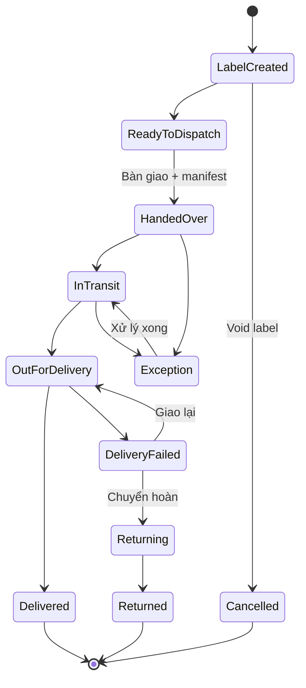

# 09 — Giao hàng cho đơn vị vận chuyển (Shipping)

## 1. Mục đích (Purpose)

Bàn giao các kiện hàng đã [đóng gói](../08-packing/README.md) cho **đơn vị vận chuyển ngoài (external carrier / 3PL)**, tạo **vận đơn (shipping label / AWB)**, ghi nhận **bàn giao (handover / manifest)**, và **theo dõi hành trình giao** đến khi đơn được giao thành công hoặc xử lý sự cố (giao thất bại, hoàn hàng).

Đây là **bước cuối của luồng Fulfillment trong phạm vi kho**. Sau khi giao thành công, [Order Management](../../ecommerce/17-order-management/README.md) đóng đơn.

---

## 2. Actor liên quan

| Actor | Vai trò |
|-------|---------|
| **Nhân viên kho / Dispatch Staff** | Quét kiện, gom chuyến, bàn giao cho tài xế hãng vận chuyển, ký nhận manifest |
| **Hệ thống (Carrier Integration)** | Kết nối API hãng vận chuyển: tạo nhãn, lấy tracking, nhận webhook cập nhật trạng thái |
| **Đơn vị vận chuyển (Carrier / 3PL)** | Nhận hàng, vận chuyển, cập nhật trạng thái, giao cho khách, xử lý hoàn |
| **Nhân viên Sale (Sales Staff)** | Theo dõi đơn trễ, xử lý khiếu nại giao hàng (CSKH), liên hệ khách |
| **Khách hàng** | Nhận hàng; theo dõi tracking; xác nhận nhận (hoặc từ chối) |

---

## 3. Input / Output

### Input

| Trường | Mô tả | Bắt buộc |
|--------|-------|----------|
| Kiện đã `Packed` | Package ID, khối lượng, kích thước, nội dung, giá trị khai báo | Có |
| Phương thức / dịch vụ vận chuyển | Khách chọn khi đặt, hoặc rule chọn hãng | Có |
| Địa chỉ giao & người nhận | Từ đơn hàng | Có |
| Địa chỉ gửi & địa chỉ hoàn hàng | Địa chỉ của kho xuất; địa chỉ hoàn hàng lấy `return_address` của kho, nếu không khai báo thì dùng địa chỉ kho (xem [06](../06-warehouse-map-slotting/README.md)) | Có |
| Điều khoản thu hộ (COD amount) nếu có | | Không |
| Tài khoản hãng vận chuyển & cấu hình dịch vụ | API key, hợp đồng giá | Có (cấu hình hệ thống) |
| Lịch lấy hàng (pickup schedule) / điểm gửi | | Không |

### Output

| Kết quả | Dùng bởi |
|---------|----------|
| **Shipping label / AWB** + **tracking number** | Dán lên kiện (08 Packing), gửi khách |
| **Shipment** — nhóm 1..n kiện của một đơn, có trạng thái & lịch sử tracking | 17 Order Management, khách hàng |
| **Manifest / bàn giao** — danh sách kiện giao cho hãng trong một lần | Đối soát với hãng vận chuyển |
| **Cập nhật trạng thái đơn**: `Shipped` → `In Transit` → `Delivered` / `Delivery Failed` / `Returned` | 17 Order Management, 15 Payment (đối soát COD) |
| **Chi phí vận chuyển thực tế** (từ hãng) | Đối soát cước, kế toán |
| **Sự kiện hoàn hàng (RTO – Return To Origin)** | 17 Order Management, quy trình nhập lại kho ([Receipt](../03-receipt/README.md)) |

---

## 4. Luồng nghiệp vụ từng bước (Step-by-step)

1. **Tạo nhãn vận đơn (Create label)** — thường thực hiện ngay tại [Packing](../08-packing/README.md): hệ thống gọi API hãng vận chuyển với thông tin kiện & địa chỉ → nhận `tracking number` + file nhãn. Nếu tạo lỗi (địa chỉ sai, quá tải hãng) → đơn `On Hold`, chuyển Order Management.
2. **Gom nhóm shipment** — các kiện của cùng một đơn (và cùng hãng) gộp thành một **shipment**.
3. **Lên chuyến / chờ hãng lấy hàng** — xếp kiện vào khu chờ giao theo hãng & khung giờ pickup; hoặc chuẩn bị mang ra điểm gửi.
4. **Bàn giao (Handover / Manifest)** — khi tài xế hãng đến: quét từng kiện, đối chiếu danh sách, in **manifest**, hai bên ký xác nhận. Trạng thái shipment → `Handed Over` / `Picked up by carrier`.
5. **Cập nhật đơn** — Order chuyển `Shipped`; gửi khách email/SMS kèm tracking link.
6. **Theo dõi hành trình (Tracking)** — hệ thống nhận **webhook / poll** trạng thái từ hãng: `In Transit`, `Out for Delivery`, `Delivered`, `Delivery Attempt Failed`, `Held at hub`, `Returning`…
7. **Giao thành công (Delivered)** — nhận sự kiện `Delivered` (kèm thời gian, người ký nhận / ảnh POD nếu có). Order chuyển `Delivered`.
8. **Giao thất bại (Delivery failed)** — hãng báo không giao được (khách vắng, từ chối, sai địa chỉ):
   - Hệ thống ghi nhận số lần thử; thông báo CSKH liên hệ khách.
   - Theo chính sách: hãng giao lại (re-attempt) hoặc chuyển hoàn (RTO).
9. **Hoàn hàng về kho (RTO / Return)** — kiện quay về; kho tiếp nhận qua luồng [Receipt](../03-receipt/README.md) dạng "hàng hoàn", kiểm tra tình trạng, nhập lại tồn (`Available` nếu nguyên vẹn / `Quarantine` nếu nghi hư / huỷ nếu hỏng). Order chuyển `Returned`.
10. **Đối soát COD & cước** — với đơn COD: đối chiếu tiền hãng thu hộ chuyển về ([15 Payment](../../ecommerce/15-payment/README.md)). Đối soát bảng cước thực tế với hãng.
11. **Đóng đơn** — khi `Delivered` và (nếu COD) tiền đã về → [Order Management](../../ecommerce/17-order-management/README.md) chuyển đơn `Completed` / `Closed`.

---

## 5. Trạng thái / Vòng đời (Lifecycle)

### Trạng thái Shipment

| Trạng thái | Ý nghĩa | Chuyển tiếp | Nguồn cập nhật |
|------------|---------|-------------|----------------|
| `Label Created` | Đã có nhãn & tracking, kiện chưa giao hãng | → `Ready to Dispatch`, → `Cancelled` (void label) | Hệ thống |
| `Ready to Dispatch` | Kiện ở khu chờ giao | → `Handed Over` | Dispatch Staff |
| `Handed Over` | Đã bàn giao hãng (có manifest) | → `In Transit`, → `Exception` | Dispatch Staff / Carrier |
| `In Transit` | Đang vận chuyển | → `Out for Delivery`, → `Exception` | Carrier webhook |
| `Out for Delivery` | Đang đi giao | → `Delivered`, → `Delivery Failed` | Carrier |
| `Delivery Failed` | Giao không thành công (1..n lần) | → `Out for Delivery` (thử lại), → `Returning` | Carrier |
| `Returning` | Đang hoàn về kho (RTO) | → `Returned` | Carrier |
| `Delivered` | Giao thành công | → *(đơn Completed)* | Carrier |
| `Returned` | Đã về kho & xử lý nhập lại | *(cuối)* | Warehouse |
| `Exception` | Sự cố (mất, hỏng, kẹt hải quan, tra soát) | → trạng thái phù hợp sau xử lý | CSKH / Carrier |
| `Cancelled` | Void nhãn trước khi bàn giao | *(cuối)* | Hệ thống |

---

## 6. Ràng buộc nghiệp vụ (Business Rules) & Edge case

### Business rules

- **BR-01:** Chỉ tạo nhãn cho kiện `Packed` hợp lệ (đúng khối lượng/kích thước, địa chỉ hợp lệ).
- **BR-02:** Nhãn đã tạo mà không giao (đơn huỷ, đóng lại kiện) **phải void** với hãng trong thời hạn cho phép để tránh bị tính cước.
- **BR-03:** Đơn chỉ chuyển `Shipped` khi **tất cả kiện** của đơn đã `Handed Over` — trừ khi chính sách cho phép giao lệch chuyến (split shipment).
- **BR-04:** Với đơn COD, số tiền thu hộ trên vận đơn phải khớp số phải thu của đơn (đã trừ phần đã thanh toán online nếu có).
- **BR-05:** Trạng thái đơn phía khách hàng phản ánh trạng thái shipment gần nhất; nhiều kiện → hiển thị trạng thái tổng hợp (ví dụ "đang giao" khi có ít nhất 1 kiện `Out for Delivery`).
- **BR-06:** RTO nhập lại kho phải qua [Receipt](../03-receipt/README.md) (không cộng thẳng tồn) để kiểm tra tình trạng hàng.
- **BR-07:** Chi phí vận chuyển thu của khách (nếu có) và cước trả hãng là hai khoản độc lập; đối soát riêng.

### Edge case

| Tình huống | Hướng xử lý |
|------------|-------------|
| API hãng vận chuyển lỗi/không phản hồi khi tạo nhãn | Retry theo hàng đợi; nếu vẫn lỗi → đơn `On Hold`, cảnh báo; cho chọn hãng thay thế |
| Địa chỉ giao sai/không giao tới (vùng hãng không phục vụ) | Chặn tạo nhãn; CSKH liên hệ khách đổi địa chỉ hoặc đổi hãng |
| Kiện thất lạc trong quá trình vận chuyển | `Exception`; mở tra soát với hãng; theo chính sách bồi thường / giao lại hàng mới |
| Hãng cập nhật `Delivered` nhưng khách báo chưa nhận | Giữ đơn ở trạng thái tranh chấp; đối chiếu POD; xử lý CSKH |
| Khách từ chối nhận (đổi ý) | `Delivery Failed` → `Returning` → `Returned`; áp phí/hoàn tiền theo chính sách |
| Một phần đơn giao được, một phần hỏng trên đường | Kiện hỏng vào `Exception`/RTO; kiện tốt vẫn `Delivered`; đơn ở trạng thái giao một phần |
| COD: tiền hãng chuyển về thiếu/chậm | Ghi nhận công nợ hãng; đối soát; không đóng đơn tài chính cho tới khi khớp |
| Nhiều hãng cho một đơn (kiện to đi hãng A, kiện nhỏ hãng B) | Mỗi kiện có tracking & hãng riêng; shipment gộp hiển thị nhiều tracking |

---

## 7. Liên kết với các module khác

| Module | Quan hệ |
|--------|---------|
| [08 · Packing](../08-packing/README.md) | Nhận kiện đã đóng; trả về nhãn & tracking để dán lên kiện |
| [17 · Order Management](../../ecommerce/17-order-management/README.md) | Đẩy trạng thái `Shipped` / `In Transit` / `Delivered` / `Returned`; nhận yêu cầu huỷ, đổi địa chỉ |
| [15 · Payment](../../ecommerce/15-payment/README.md) | Đối soát tiền COD hãng thu hộ; kích hoạt hoàn tiền khi RTO |
| [03 · Receipt](../03-receipt/README.md) | Hàng hoàn (RTO) nhập lại kho qua luồng Receipt dạng "return" |
| [16 · Sales Chat](../../ecommerce/16-sales-chat/README.md) | Kênh CSKH xử lý đơn trễ / khiếu nại giao hàng, chia sẻ tracking |
| [00 · System Overview §5](../../00-system-overview/README.md) | Bước 3 (cuối) của luồng Fulfillment |
