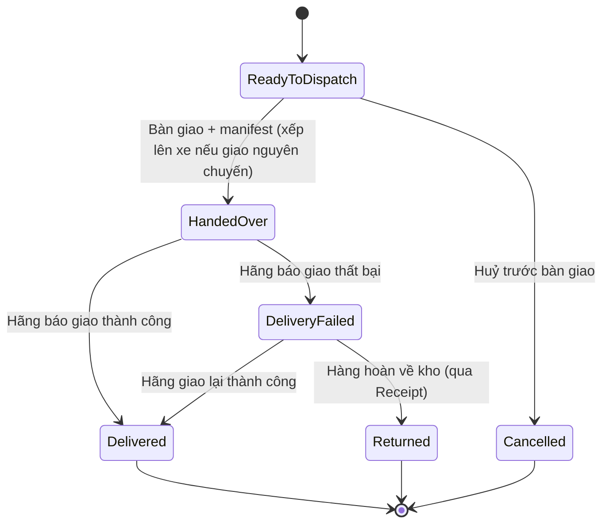
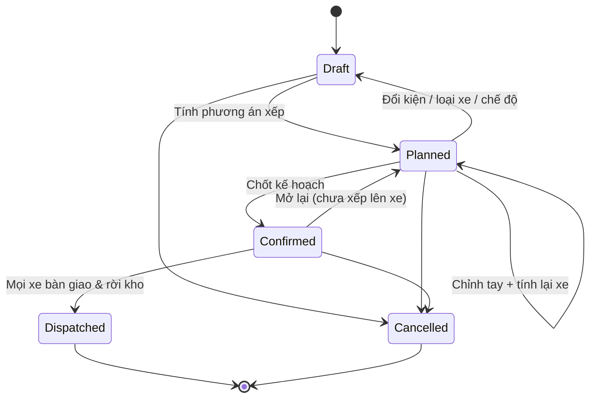

# 09 — Giao hàng cho đơn vị vận chuyển (Shipping)

## 1. Mục đích (Purpose)

Bàn giao các kiện hàng đã [đóng gói](../08-packing/README.md) cho **đơn vị vận chuyển ngoài (external carrier / 3PL)**, ghi nhận **bàn giao (handover / manifest)**, rồi ghi nhận **kết quả giao** (thành công / thất bại / hoàn về kho).

**Đơn vị vận chuyển là bên thứ ba và nằm ngoài hệ thống.** Hệ thống **không tích hợp API hãng, không lấy mã vận đơn, không theo dõi hành trình (tracking)**. Từ lúc bàn giao tới lúc có kết quả giao, kiện do hãng chịu trách nhiệm; nhân viên cập nhật kết quả khi hãng báo lại.

Đây là **bước cuối của luồng Fulfillment trong phạm vi kho**. Sau khi giao thành công, [Order Management](../../ecommerce/17-order-management/README.md) đóng đơn.

Module hỗ trợ **hai hình thức giao**:

| Hình thức | Áp dụng | Đặc trưng |
|-----------|---------|-----------|
| **Gửi kiện qua hãng vận chuyển (Parcel)** | Đơn khách thông thường | Kiện dán **nhãn kiện nội bộ** (in ở [08](../08-packing/README.md)); gom theo hãng, bàn giao cho tài xế hãng theo manifest ([§4.1](#41-gửi-kiện-qua-hãng-vận-chuyển-parcel)) |
| **Giao nguyên chuyến (Full Truckload – FTL)** | Đơn sỉ khối lượng lớn được chỉ định giao nguyên chuyến; lệnh chuyển kho ([10](../10-inter-warehouse-transfer/README.md)) đi xe tải / container | Thuê nguyên xe tải hoặc container; trước khi thuê xe, **lập kế hoạch xếp hàng 3D (Load Planning)** để biết cần loại xe nào, bao nhiêu chiếc, mỗi kiện đặt ở đâu trong thùng xe ([§4.2](#42-giao-nguyên-chuyến--lập-kế-hoạch-xếp-hàng-3d-load-planning)) |

> ⚠️ Giả định: đơn khách giao nguyên chuyến do **Điều phối đơn hàng (Order Coordinator)** chỉ định khi release đơn, khách không tự chọn hình thức này trên cổng khách hàng; phí vận chuyển và cách thu phần còn lại (đơn đặt cọc) cho đơn giao nguyên chuyến chưa xác định. Xem [open-questions](../../open-questions/README.md).

---

## 2. Actor liên quan

| Actor | Vai trò |
|-------|---------|
| **Nhân viên kho / Dispatch Staff** | Quét kiện, gom chuyến, bàn giao cho tài xế hãng vận chuyển, ký biên bản bàn giao (manifest); với giao nguyên chuyến: lập & chốt kế hoạch chuyến xe, kiểm tra / chỉnh tay trên mô hình 3D, xác nhận đã đặt xe, giám sát xếp hàng lên xe theo sơ đồ |
| **Quản lý kho (Warehouse Manager)** | Khai báo **danh mục loại xe** (kích thước lòng thùng, tải trọng, số chiếc sẵn có, giá thuê); xử lý kế hoạch chuyến xe bị huỷ / phải lập lại |
| **Điều phối đơn hàng (Order Coordinator)** | Chỉ định đơn giao nguyên chuyến khi release; cập nhật kết quả giao (**giao thành công / giao thất bại**) khi hãng báo lại; xử lý đơn giao thất bại |
| **Hệ thống (Load Planner)** | Tính phương án xếp kiện lên xe / container: số xe từng loại, vị trí & hướng đặt từng kiện, % lấp đầy; dựng mô hình 3D và sơ đồ xếp |
| **Đơn vị vận chuyển (Carrier / 3PL)** | Nhận kiện, vận chuyển, giao cho khách, thu hộ phần còn lại (nếu có), hoàn hàng về kho — **hoạt động ngoài hệ thống**; với giao nguyên chuyến: cung cấp xe tải / container theo kế hoạch chuyến xe đã chốt |
| **Nhân viên Sale (Sales Staff)** | Xử lý khiếu nại giao hàng (CSKH), liên hệ khách khi giao thất bại |
| **Khách hàng** | Nhận hàng (hoặc từ chối nhận) |

---

## 3. Input / Output

### Input

| Trường | Mô tả | Bắt buộc |
|--------|-------|----------|
| Kiện đã `Packed` | Package ID, khối lượng, kích thước (D × R × C), nội dung, giá trị khai báo; nhãn kiện nội bộ | Có |
| Hình thức giao | Gửi kiện qua hãng (mặc định) hoặc giao nguyên chuyến (Order Coordinator chỉ định khi release) | Có |
| Địa chỉ giao & người nhận | Từ đơn hàng | Có |
| Địa chỉ gửi & địa chỉ hoàn hàng | Địa chỉ của kho xuất; địa chỉ hoàn hàng lấy `return_address` của kho, nếu không khai báo thì dùng địa chỉ kho (xem [06](../06-warehouse-map-slotting/README.md)) | Có |
| Đơn vị vận chuyển | Hãng nhận kiện / nhận chuyến (chọn từ danh sách hãng đã khai báo: tên, liên hệ) | Có |
| Số tiền thu hộ nếu có | Phần còn lại của đơn đặt cọc, theo chính sách của khách | Không |
| Lịch lấy hàng (pickup schedule) / điểm gửi | Thoả thuận với hãng ngoài hệ thống | Không |

**Input bổ sung cho giao nguyên chuyến (Load Planning):**

| Trường | Mô tả | Bắt buộc |
|--------|-------|----------|
| **Danh sách kiện cần xếp** | Kiện `Packed` tại khu `DISPATCH` thuộc đơn giao nguyên chuyến hoặc lệnh chuyển kho: dài × rộng × cao, khối lượng, số lượng, **cờ cho phép xoay** (kế thừa từ SKU, Packer được ghi đè — xem [08](../08-packing/README.md)), đơn / dòng hàng mà kiện thuộc về. Có thể nhập danh sách kiện từ **file Excel theo mẫu** | Có |
| **Danh mục loại xe (Vehicle Type)** | Kích thước lòng thùng (dài × rộng × cao), tải trọng tối đa, số chiếc sẵn có, giá thuê. Cài sẵn container **20DC, 40DC, 40HC, 45HC**; xe tải được thêm bằng cách khai báo kích thước lòng thùng & tải trọng của từng loại | Có (cấu hình hệ thống) |
| **Chế độ chọn xe** | Một trong các chế độ ở [§4.2](#42-giao-nguyên-chuyến--lập-kế-hoạch-xếp-hàng-3d-load-planning) | Có (mặc định: *Một loại*) |
| Phân nhóm kiện chính / phụ | Chỉ dùng với chế độ *Ưu tiên + hàng chèn* | Không |

### Output

| Kết quả | Dùng bởi |
|---------|----------|
| **Shipment** — nhóm 1..n kiện của một đơn, có trạng thái giao | 17 Order Management, khách hàng |
| **Biên bản bàn giao (Manifest)** — danh sách kiện giao cho hãng trong một lần / một xe, có chữ ký hai bên | Đối soát với hãng vận chuyển |
| **Cập nhật trạng thái đơn**: `Shipped` → `Delivered` / `Delivery Failed` / `Returned` | 17 Order Management, 15 Payment (đối soát tiền thu hộ, ghi công nợ phải thu) |
| **Chi phí vận chuyển thực tế** (theo hoá đơn cước của hãng) | Đối soát cước, kế toán |
| **Sự kiện hoàn hàng (RTO – Return To Origin)** | 17 Order Management, quy trình nhập lại kho ([Receipt](../03-receipt/README.md)) |
| **Kế hoạch chuyến xe (Load Plan)** — với giao nguyên chuyến: số xe của từng loại; toạ độ (x, y, z) & hướng đặt của từng kiện; % lấp đầy thể tích & tải trọng của từng xe; danh sách kiện không xếp được | Dispatch Staff (đặt xe, xếp hàng lên xe), [10](../10-inter-warehouse-transfer/README.md) |
| **Mô hình 3D** của từng xe (xem & chỉnh tay được) và **sơ đồ xếp xuất PDF** | Dispatch Staff, tài xế / bốc xếp |

### Dữ liệu tối thiểu cần lưu (giao nguyên chuyến)

| Thực thể | Trường chính |
|----------|--------------|
| `VehicleType` | `id`, `name`, `inner_length`, `inner_width`, `inner_height`, `max_payload`, `available_count`, `rental_price?`, `is_preset`, `status` |
| `LoadPlan` | `id`, `code`, `warehouse_id`, `source_type` (đơn khách / TO), `selection_mode`, `status`, `confirmed_at?`, `dispatched_at?` |
| `LoadPlanVehicle` | `id`, `load_plan_id`, `vehicle_type_id`, `seq`, `volume_fill_pct`, `weight_fill_pct`, `manifest_ref?` |
| `LoadPlacement` | `load_plan_vehicle_id`, `package_id`, `x`, `y`, `z`, `orientation` |
| `LoadPlanUnplaced` | `load_plan_id`, `package_id`, `reason` |

---

## 4. Luồng nghiệp vụ từng bước (Step-by-step)

### 4.1. Gửi kiện qua hãng vận chuyển (Parcel)

1. **Chờ xuất** — kiện `Packed` (đã dán nhãn kiện nội bộ ở [Packing](../08-packing/README.md)) được đưa vào khu chờ xuất (khu `DISPATCH`). Các kiện của cùng một đơn (và cùng hãng) gộp thành một **shipment**, trạng thái `Ready to Dispatch`.
2. **Lên chuyến / chờ hãng lấy hàng** — xếp kiện theo hãng & khung giờ pickup đã hẹn với hãng (**ngoài hệ thống**: gọi điện, email…); hoặc chuẩn bị mang ra điểm gửi.
3. **Bàn giao (Handover / Manifest)** — khi tài xế hãng đến: quét từng kiện, đối chiếu danh sách, in **biên bản bàn giao (manifest)**, hai bên ký xác nhận. Shipment → `Handed Over`; đơn chuyển `Shipped`; gửi khách email/SMS báo đơn đã giao cho đơn vị vận chuyển (không kèm tracking).
4. **Ghi nhận kết quả giao** — theo §4.3.

### 4.2. Giao nguyên chuyến — Lập kế hoạch xếp hàng 3D (Load Planning)

Mục đích: từ danh sách kiện cần giao, hệ thống tính **cần loại xe nào, bao nhiêu chiếc**, và **mỗi kiện đặt ở vị trí nào trong thùng xe**; kết quả hiển thị 3D để kiểm tra trước khi thuê xe.

1. **Tạo kế hoạch chuyến xe (`Draft`)** — Dispatch Staff chọn các kiện `Packed` tại khu `DISPATCH` (của các đơn giao nguyên chuyến hoặc của một lệnh chuyển kho), hoặc nhập danh sách kiện từ file Excel theo mẫu; chọn các loại xe được dùng và **chế độ chọn xe**. Shipment của đơn khách ở `Ready to Dispatch`.
2. **Tính phương án xếp** — Load Planner xếp kiện theo **quy tắc xếp** (BR-10) và chế độ đã chọn → kế hoạch `Planned`. Hệ thống trả về số xe từng loại, toạ độ & hướng đặt từng kiện, % lấp đầy thể tích & tải trọng từng xe, danh sách kiện không xếp được.
3. **Kiểm tra trên mô hình 3D & chỉnh tay** — Dispatch Staff xem từng xe; có thể **kéo thả kiện** trên mô hình rồi **tính lại riêng xe đó**. Nếu còn kiện không xếp được: thêm xe / đổi loại xe / đổi chế độ rồi tính lại (quay về `Draft` nếu đổi danh sách kiện, loại xe hoặc chế độ), hoặc xác nhận để kiện lại khu `DISPATCH` cho chuyến sau.
4. **Chốt kế hoạch (`Confirmed`)** — khoá danh sách kiện & sơ đồ xếp; xuất **PDF sơ đồ xếp** cho từng xe.
5. **Đặt xe & bàn giao** — Dispatch Staff đặt xe với đơn vị vận chuyển theo số xe / loại xe của kế hoạch (**ngoài hệ thống**) và xác nhận trên hệ thống đã đặt xe. Khi xe đến: xếp kiện theo sơ đồ, quét từng kiện (hệ thống chặn kiện không thuộc xe này), in **manifest theo từng xe**, hai bên ký xác nhận. Shipment của các kiện → `Handed Over`; đơn khách → `Shipped`; lệnh chuyển kho → `In Transit` ([10](../10-inter-warehouse-transfer/README.md)). Khi mọi xe đã bàn giao & rời kho → kế hoạch `Dispatched`.
   > ⚠️ Giả định: việc đặt xe diễn ra ngoài hệ thống; hệ thống chỉ ghi nhận thông tin xe (biển số, tài xế) gắn với từng xe của kế hoạch. Xem [open-questions](../../open-questions/README.md).
6. **Ghi nhận kết quả giao** — không theo dõi hành trình; kết quả giao của đơn khách ghi nhận theo §4.3. Với lệnh chuyển kho, kho đích nhận hàng theo [10](../10-inter-warehouse-transfer/README.md).

**Chế độ chọn xe:**

| Chế độ | Cách chọn xe & xếp kiện |
|--------|-------------------------|
| **Một loại** | Chọn loại xe xếp tốt nhất, rồi dùng nhiều chiếc cùng loại đó |
| **Ít xe nhất** | Trộn nhiều loại xe để tổng số xe ít nhất |
| **Giữ nguyên dòng** | Các kiện cùng một dòng hàng đi chung một xe |
| **Ưu tiên + hàng chèn** | Hàng chính quyết định cần bao nhiêu xe; hàng phụ chỉ chèn vào chỗ trống còn lại |
| **Vượt sức chứa** | Xếp tối đa những kiện vừa với số xe sẵn có và báo phần phải bỏ lại |
| **Chỉnh tay** | Kéo thả kiện trên mô hình 3D, rồi tính lại một xe |

**Cách tính phương án (tóm tắt):** đặt từng kiện vào **góc trống thấp nhất và sâu nhất** mà kiện vừa và được đỡ chắc. Hệ thống thử nhiều thứ tự xếp ngẫu nhiên trong một khoảng thời gian giới hạn và giữ phương án tốt nhất, đánh giá theo thứ tự:

1. Ít kiện bị bỏ lại nhất;
2. Ít xe nhất;
3. Ít khoảng trống thừa nhất.

**Giới hạn phạm vi hiện tại** (chưa hỗ trợ — xem [open-questions](../../open-questions/README.md)):

- Chưa tính **chi phí thuê xe**: xe được chọn theo số xe và độ lấp đầy, không theo giá; giá thuê trong danh mục loại xe chỉ lưu để tham khảo.
- Chưa tính **phân bố trọng tâm**, **hàng dễ vỡ** hay **giới hạn chồng tầng**.
- Chưa sắp xếp theo **thứ tự điểm giao**: hàng giao trước chưa được đặt ở phía cửa xe.
- Chỉ đặt kiện **vuông góc với các cạnh thùng** (không đặt nghiêng).

### 4.3. Ghi nhận kết quả giao & sau giao (chung cho hai hình thức)

1. **Ghi nhận giao thành công** — khi hãng báo đã giao (ngoài hệ thống), Order Coordinator cập nhật shipment → `Delivered`; đơn chuyển `Delivered`.
2. **Ghi nhận giao thất bại** — khi hãng báo không giao được (khách vắng, từ chối, sai địa chỉ), Order Coordinator cập nhật shipment → `Delivery Failed` kèm lý do; CSKH liên hệ khách. Hãng có thể giao lại (ngoài hệ thống) — giao lại thành công thì cập nhật `Delivered`.
3. **Hoàn hàng về kho (RTO / Return)** — hãng trả kiện về kho; kho tiếp nhận qua luồng [Receipt](../03-receipt/README.md) dạng "hàng hoàn", kiểm tra tình trạng, nhập lại tồn (`Available` nếu nguyên vẹn / `Quarantine` nếu nghi hư / huỷ nếu hỏng). Shipment → `Returned`; đơn chuyển `Returned`.
4. **Đối soát thu tiền & cước** — đơn có thu hộ phần còn lại: đối chiếu tiền hãng chuyển về; đơn công nợ: ghi khoản công nợ phải thu từ ngày giao ([15 Payment](../../ecommerce/15-payment/README.md)). Đối soát bảng cước thực tế với hãng.
5. **Đóng đơn** — khi `Delivered` và tiền đã thu đủ (hoặc công nợ đã tất toán) → [Order Management](../../ecommerce/17-order-management/README.md) chuyển đơn `Completed` / `Closed`.

---

## 5. Trạng thái / Vòng đời (Lifecycle)

### Trạng thái Shipment

| Trạng thái | Ý nghĩa | Chuyển tiếp | Nguồn cập nhật |
|------------|---------|-------------|----------------|
| `Ready to Dispatch` | Kiện đã đóng gói, ở khu chờ xuất (với giao nguyên chuyến: có thể đã nằm trong kế hoạch chuyến xe) | → `Handed Over`, → `Cancelled` | Hệ thống / Dispatch Staff |
| `Handed Over` | Đã bàn giao hãng (có manifest); với giao nguyên chuyến: đã xếp lên xe theo sơ đồ & ký manifest của xe — đơn `Shipped` | → `Delivered`, → `Delivery Failed` | Dispatch Staff |
| `Delivered` | Hãng báo giao thành công | → *(đơn Completed)* | Order Coordinator |
| `Delivery Failed` | Hãng báo giao không thành công (kèm lý do, kể cả thất lạc) | → `Delivered` (hãng giao lại thành công), → `Returned` | Order Coordinator |
| `Returned` | Kiện đã hoàn về kho & xử lý nhập lại | *(cuối)* | Warehouse |
| `Cancelled` | Huỷ trước khi bàn giao (đơn huỷ, đóng lại kiện) | *(cuối)* | Hệ thống |

### Trạng thái Kế hoạch chuyến xe (Load Plan)

| Trạng thái | Ý nghĩa | Chuyển tiếp cho phép | Ai thực hiện |
|------------|---------|----------------------|--------------|
| `Draft` | Đang chọn kiện, loại xe, chế độ chọn xe | → `Planned`, → `Cancelled` | Dispatch Staff |
| `Planned` | Đã có phương án xếp; xem 3D, chỉnh tay & tính lại từng xe | → `Planned` (chỉnh tay, tính lại), → `Draft` (đổi kiện / loại xe / chế độ), → `Confirmed`, → `Cancelled` | Dispatch Staff / Load Planner |
| `Confirmed` | Đã chốt; khoá danh sách kiện & sơ đồ xếp; chờ đặt xe & xếp hàng | → `Dispatched`, → `Planned` (mở lại khi chưa bắt đầu xếp lên xe), → `Cancelled` | Dispatch Staff |
| `Dispatched` | Mọi xe đã xếp theo sơ đồ, ký manifest & rời kho | *(cuối)* | Dispatch Staff |
| `Cancelled` | Huỷ trước khi xe rời kho; kiện trở lại khu `DISPATCH` chờ kế hoạch khác | *(cuối)* | Dispatch Staff / Warehouse Manager |

---

## 6. Ràng buộc nghiệp vụ (Business Rules) & Edge case

### Business rules

- **BR-01:** Chỉ bàn giao / đưa vào kế hoạch chuyến xe các kiện `Packed` hợp lệ (có khối lượng và kích thước, địa chỉ hợp lệ, đã dán nhãn kiện nội bộ).
- **BR-02:** Hệ thống **không theo dõi hành trình** sau bàn giao. Trạng thái `Delivered` / `Delivery Failed` chỉ do nhân viên có quyền (Order Coordinator) cập nhật, dựa trên thông báo của hãng; mỗi lần cập nhật ghi người thực hiện và thời điểm.
- **BR-03:** Đơn chỉ chuyển `Shipped` khi **tất cả kiện** của đơn đã `Handed Over` — trừ khi chính sách cho phép giao lệch chuyến (split shipment).
- **BR-04:** Với đơn có thu hộ (phần còn lại của đơn đặt cọc), số tiền thu hộ ghi trên nhãn kiện và biên bản bàn giao phải khớp số phải thu của đơn (đã trừ phần đã thanh toán trước).
- **BR-05:** Trạng thái đơn phía khách hàng phản ánh trạng thái shipment gần nhất; nhiều kiện → hiển thị trạng thái tổng hợp (ví dụ "giao một phần" khi có kiện `Delivered` và kiện `Delivery Failed`).
- **BR-06:** RTO nhập lại kho phải qua [Receipt](../03-receipt/README.md) (không cộng thẳng tồn) để kiểm tra tình trạng hàng.
- **BR-07:** Chi phí vận chuyển thu của khách (nếu có) và cước trả hãng là hai khoản độc lập; đối soát riêng.

**Giao nguyên chuyến & Load Planning:**

- **BR-08:** Load Planning chỉ áp dụng cho **giao nguyên chuyến** (đơn khách được chỉ định giao nguyên chuyến và lệnh chuyển kho đi xe tải / container). Kiện gửi qua hãng vận chuyển không cần kế hoạch chuyến xe.
- **BR-09:** Chỉ đưa vào kế hoạch kiện `Packed` có **đủ kích thước & khối lượng**. Một kiện chỉ thuộc **tối đa một** kế hoạch chuyến xe chưa `Cancelled`.
- **BR-10:** Quy tắc xếp bắt buộc (ràng buộc cứng):
  - Kiện phải được đỡ **ít nhất 98% mặt đáy**; không lơ lửng, không chìa ra ngoài lòng thùng.
  - Tổng khối lượng các kiện trên một xe **không vượt tải trọng** của xe.
  - Kiện có cờ cho phép xoay được xoay theo **6 hướng**; kiện không cho phép xoay giữ nguyên hướng đặt.
  - **Chừa các góc gia cố** trên trần thùng.
  - Kiện chỉ đặt **vuông góc với các cạnh thùng**.
- **BR-11:** Chỉnh tay trên mô hình 3D vẫn phải thoả BR-10; vị trí vi phạm bị từ chối. Sau khi chỉnh, hệ thống tính lại xe bị chỉnh.
- **BR-12:** Số xe của một loại trong phương án **không vượt số chiếc sẵn có** của loại đó.
- **BR-13:** Kế hoạch chỉ được `Confirmed` khi mọi kiện đã có vị trí, hoặc các kiện không xếp được đã được Dispatch Staff xác nhận để lại.
- **BR-14:** Sau `Confirmed`, danh sách kiện và sơ đồ xếp bị khoá. Muốn sửa phải mở lại về `Planned` khi **chưa bắt đầu xếp lên xe**; đã bắt đầu xếp thì chỉ được huỷ kế hoạch có kiểm soát (dỡ kiện về khu `DISPATCH`).
- **BR-15:** Mỗi xe của kế hoạch có **manifest riêng**. Kế hoạch chỉ `Dispatched` khi **mọi xe** đã xếp theo sơ đồ, ký manifest & rời kho.

### Edge case

| Tình huống | Hướng xử lý |
|------------|-------------|
| Địa chỉ giao sai / vùng hãng không phục vụ | Phát hiện trước khi bàn giao: đơn `On Hold`, CSKH liên hệ khách đổi địa chỉ hoặc đổi hãng; nếu hãng báo sau bàn giao → `Delivery Failed` |
| Kiện thất lạc khi hãng vận chuyển | Hãng báo thất lạc → `Delivery Failed` với lý do "thất lạc"; khiếu nại / bồi thường với hãng xử lý ngoài hệ thống; giao lại hàng mới theo chính sách |
| Hãng báo đã giao nhưng khách báo chưa nhận | Giữ đơn ở trạng thái tranh chấp; CSKH xác minh với hãng (ngoài hệ thống); không tự đóng đơn |
| Khách từ chối nhận (đổi ý) | `Delivery Failed` → hàng hoàn về → `Returned`; áp phí / hoàn tiền theo chính sách |
| Một phần đơn giao được, một phần hỏng trên đường | Kiện tốt `Delivered`; kiện hỏng `Delivery Failed` → hoàn về; đơn ở trạng thái giao một phần |
| Tiền thu hộ hãng chuyển về thiếu / chậm | Ghi nhận công nợ hãng; đối soát; không đóng đơn tài chính cho tới khi khớp |
| Một đơn đi nhiều hãng (kiện to hãng A, kiện nhỏ hãng B) | Mỗi kiện bàn giao theo manifest của hãng tương ứng; đơn `Shipped` khi mọi kiện đã bàn giao |
| Load Planning: còn kiện không xếp được (kể cả kiện quá khổ / quá nặng so với mọi loại xe) | Hệ thống trả danh sách kiện bị bỏ lại kèm lý do; Dispatch Staff thêm xe / đổi loại xe / đổi chế độ rồi tính lại, hoặc xác nhận để kiện lại khu `DISPATCH` cho chuyến sau (đơn khách khi đó giao lệch chuyến theo chính sách split shipment) |
| Load Planning: kiện thiếu kích thước / khối lượng | Chặn tính phương án; yêu cầu cân đo lại kiện ở [08](../08-packing/README.md) |
| Chế độ *Giữ nguyên dòng*: các kiện của một dòng hàng không vừa một xe | Phần vượt được báo là không xếp được; Dispatch Staff chọn loại xe lớn hơn hoặc đổi chế độ |
| Xe thực tế đến khác loại / kích thước so với kế hoạch | Mở lại kế hoạch về `Planned` (chưa xếp lên xe), đổi loại xe & tính lại, chốt lại trước khi xếp; kiện không lên được ở lại khu `DISPATCH` cho chuyến sau |
| Quét nhầm kiện của xe / chuyến khác khi xếp xe | Hệ thống chặn, báo kiện thuộc xe / kế hoạch nào |
| Kiện thực tế không vừa vị trí trên sơ đồ khi xếp lên xe | Dừng xếp xe đó; đo lại kiện; nếu kích thước sai thì cập nhật ở [08](../08-packing/README.md) và huỷ / lập lại kế hoạch theo BR-14 |
| Đơn bị huỷ khi kiện đã nằm trong kế hoạch chuyến xe | Chưa xếp lên xe → mở lại kế hoạch, bỏ kiện & tính lại; đã xếp lên xe → dỡ kiện, xử lý theo [08](../08-packing/README.md) (mở kiện, put-back) |

---

## 7. Liên kết với các module khác

| Module | Quan hệ |
|--------|---------|
| [08 · Packing](../08-packing/README.md) | Nhận kiện đã đóng (kèm khối lượng, kích thước, nhãn kiện nội bộ); nhận kích thước, khối lượng & cờ cho phép xoay của kiện cho Load Planning |
| [10 · Inter-warehouse Transfer](../10-inter-warehouse-transfer/README.md) | Lệnh chuyển kho đi xe tải / container dùng Load Planning trước khi xuất kho nguồn (Dispatch) |
| [01 · Product Creation](../01-product-creation/README.md) | Cờ cho phép xoay của SKU là giá trị mặc định cho cờ xoay của kiện |
| [06 · Warehouse Map & Slotting](../06-warehouse-map-slotting/README.md) | Khu chờ xuất (`DISPATCH`); địa chỉ kho & địa chỉ hoàn hàng in trên nhãn kiện và biên bản |
| [17 · Order Management](../../ecommerce/17-order-management/README.md) | Đẩy trạng thái `Shipped` / `Delivered` / `Delivery Failed` / `Returned`; nhận yêu cầu huỷ, đổi địa chỉ; nhận chỉ định hình thức giao nguyên chuyến cho đơn |
| [15 · Payment](../../ecommerce/15-payment/README.md) | Đối soát tiền hãng thu hộ; giao hàng phát sinh khoản công nợ phải thu; kích hoạt hoàn tiền khi RTO |
| [03 · Receipt](../03-receipt/README.md) | Hàng hoàn (RTO) nhập lại kho qua luồng Receipt dạng "return" |
| [16 · Sales Chat](../../ecommerce/16-sales-chat/README.md) | Kênh CSKH xử lý đơn trễ / khiếu nại giao hàng |
| [00 · System Overview §5](../../00-system-overview/README.md) | Bước 3 (cuối) của luồng Fulfillment |
