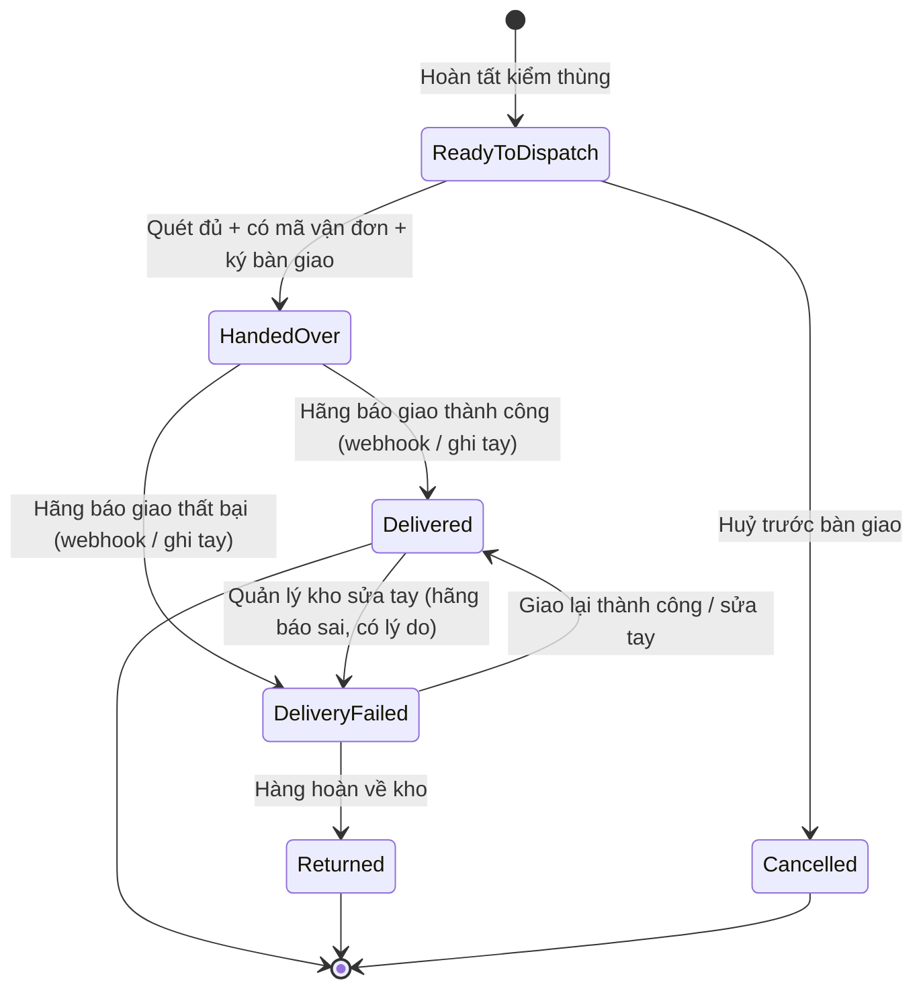
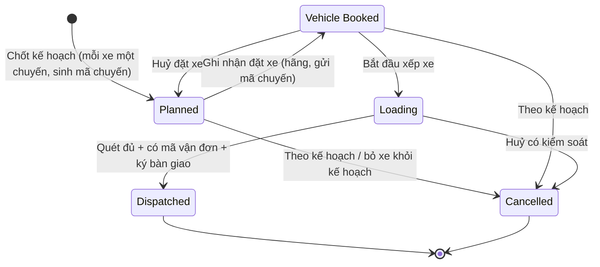
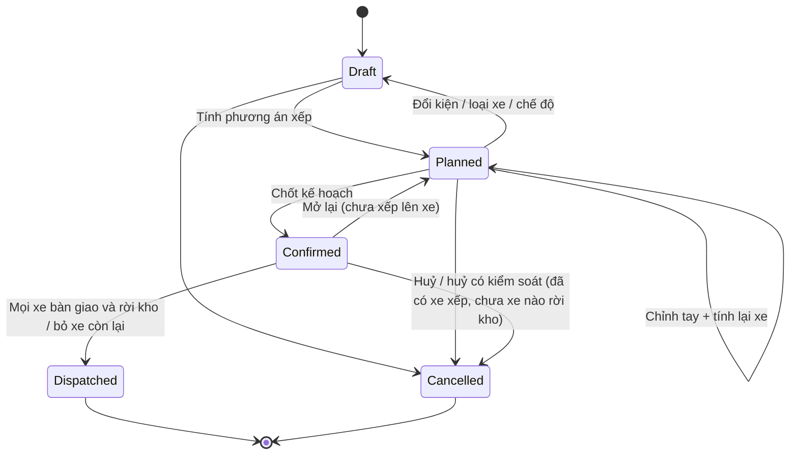

# 09 — Giao hàng cho đơn vị vận chuyển (Shipping)

## 1. Mục đích (Purpose)

Bàn giao các **shipment** đã [kiểm thùng & dán nhãn giao hàng](../08-packing/README.md) cho **đơn vị vận chuyển ngoài (external carrier / 3PL)** bằng **giao nguyên chuyến (Full Truckload – FTL)**: thuê nguyên xe tải hoặc container của hãng. Mọi đơn đều đi qua **kế hoạch xếp hàng 3D (Load Planning)** để biết cần loại xe nào, bao nhiêu chiếc, mỗi kiện đặt ở đâu; mỗi xe là một **chuyến bàn giao (Load)** có **mã chuyến nội bộ**, **mã vận đơn** của hãng, quét kiện và ký biên bản. Sau đó ghi nhận **kết quả giao**: thành công / thất bại / hoàn về kho — tự động từ **webhook** của hãng, hoặc ghi tay khi hãng không có webhook.

**Kiện (package)** trong module này là **thùng thành phẩm LPN** do đơn vị sản xuất đóng sẵn ([08](../08-packing/README.md) BR-02): mã kiện là mã LPN; kích thước, khối lượng, cờ cho phép xoay lấy từ **quy cách thùng** của SKU ([01](../01-product-creation/README.md)). Kho không đóng lại hàng.

**Đơn vị vận chuyển là bên thứ ba và nằm ngoài hệ thống.** Với hãng thông thường, đặt xe làm **ngoài hệ thống**; riêng hãng có kiểu kết nối **tích hợp API đặt xe** thì hệ thống **gọi API của hãng để đặt xe và huỷ đặt xe** (§4.1). Hỏi trạng thái chủ động vẫn là phạm vi sau. Hệ thống **nhận** các sự kiện hãng đẩy về qua **webhook** (mã vận đơn, biển số, tài xế, mốc hành trình, kết quả giao) với hãng được cấu hình có webhook; hãng không có webhook thì nhân viên nhập mã vận đơn và ghi kết quả giao bằng tay. Từ lúc bàn giao tới lúc có kết quả giao, kiện do hãng chịu trách nhiệm.

> ✅ Đã chốt 2026-11-05: chỉ còn **giao nguyên chuyến** (bỏ hình thức gửi kiện qua hãng); thêm **cấu hình kết nối hãng**, **mã chuyến nội bộ**, **mã vận đơn theo chuyến**, **nhận trạng thái giao qua webhook** và **mốc hành trình**. Thay quyết định cũ "không tích hợp API hãng, không lấy mã vận đơn, không theo dõi hành trình" ([open-questions](../../open-questions/README.md) E1, E4).
>
> ✅ Đã chốt 2026-11-06: thêm kiểu kết nối **tích hợp API đặt xe** cho hãng thuê xe theo chuyến có API (ví dụ đơn vị vận chuyển xe tải / van nội thành, một xe chạy nhiều điểm giao). **Mỗi chuyến = một đơn đặt xe ở hãng**: điểm lấy hàng là kho xuất, mỗi **điểm giao là một shipment**; mã đơn ở hãng là **mã vận đơn của chuyến**; kết quả giao về **theo từng điểm giao**. Hệ thống tạo đơn ở hãng khi **ghi nhận đặt xe**, huỷ đơn khi huỷ đặt xe. Các hãng khác (nguyên chuyến liên tỉnh, container) giữ cách kết nối cũ, chạy song song ([open-questions](../../open-questions/README.md) E1, E24–E26).

Đây là **bước cuối của luồng Fulfillment trong phạm vi kho**. Sau khi giao thành công, [Order Management](../../ecommerce/17-order-management/README.md) tự hoàn tất đơn.

**Ai giao, giao thế nào** *(Đã chốt 2026-11-04; vai trò cập nhật 2026-11-05 — chỉ giao nguyên chuyến, kết quả giao từ webhook hoặc Quản lý kho ghi tay)*:

| Bước | Ai làm | Làm thế nào |
|------|--------|-------------|
| Lập kế hoạch xếp xe | **Dispatch Staff** / Quản lý kho | Lập kế hoạch xếp hàng 3D từ các shipment ở khu xuất hàng, chốt kế hoạch; mỗi xe sinh một chuyến bàn giao có **mã chuyến nội bộ** (§4.2) |
| Chọn hãng & đặt xe | **Dispatch Staff** / Quản lý kho | Đặt xe với hãng (`Active`) theo kế hoạch đã chốt (ngoài hệ thống), **gửi hãng mã chuyến nội bộ** (in trên phiếu đặt xe), ghi nhận đặt xe trong hệ thống (§4.1, §4.2). Hãng **tích hợp API đặt xe**: ghi nhận đặt xe xong thì **hệ thống tự tạo đơn ở hãng** |
| Có mã vận đơn | **Hãng** (webhook) / Dispatch Staff, Quản lý kho | Hãng đẩy mã vận đơn, biển số, tài xế qua webhook; hoặc nhân viên **nhập hàng loạt từ file** / **nhập tay** từng chuyến (§4.4). Hãng tích hợp API đặt xe: mã vận đơn = mã đơn hãng trả về khi tạo đơn; biển số, tài xế về qua webhook khi tài xế nhận đơn |
| Bàn giao tại kho | **Dispatch Staff** ↔ tài xế / đại diện hãng | Quét từng kiện lên xe, ký biên bản bàn giao. **Bị chặn nếu chuyến chưa có mã vận đơn** (BR-23) hoặc **đợt thanh toán `BEFORE_DELIVERY` của hợp đồng chưa thu** (BR-04) |
| Vận chuyển & giao cho khách | **Đơn vị vận chuyển** (ngoài hệ thống) | Chở tới địa chỉ giao trên đơn, giao cho người nhận của khách; không thu tiền của khách. Hãng có webhook báo mốc hành trình & kết quả giao về hệ thống |
| Ghi nhận kết quả | **Hệ thống** (webhook) / **Quản lý kho** (của kho xuất) | Hệ thống tự cập nhật giao thành công / thất bại / hoàn hàng từ webhook (§4.5); Quản lý kho ghi tay khi hãng không có webhook / webhook chưa về, và sửa tay kèm lý do khi hãng báo sai (§4.3); hàng hoàn nhập lại kho qua [03](../03-receipt/README.md) (phiếu loại **Hàng hoàn**) |

Doanh nghiệp **không có đội xe riêng**: mọi lần giao đều do đơn vị vận chuyển thuê ngoài thực hiện. Khách thanh toán theo các **đợt của hợp đồng mua bán** bằng chuyển khoản ([15](../../ecommerce/15-payment/README.md)); không có thu hộ khi giao.

> ✅ Đã chốt 2026-11-05: **Module 09 không tính phí vận chuyển thu của khách**: phí này do Sale nhập thành **dòng phí vận chuyển** trên báo giá / đơn / hợp đồng mua bán, cộng vào tổng tiền và thu theo các đợt thanh toán ([14](../../ecommerce/14-cart-and-order/README.md) BR-20, [15](../../ecommerce/15-payment/README.md)). Ước tính tải và kế hoạch xếp xe ở đây không sinh ra phí cho khách.

---

## 2. Actor liên quan

| Actor | Vai trò |
|-------|---------|
| **Nhân viên kho / Dispatch Staff** | Lập kế hoạch chuyến xe, xem / chỉnh tay 3D, xác nhận để lại kiện không xếp được, chốt kế hoạch. **Ghi nhận đặt xe** (chọn hãng, gửi hãng mã chuyến nội bộ, in phiếu đặt xe; với hãng tích hợp API đặt xe: nhập giờ hẹn lấy hàng, xác nhận thứ tự điểm giao để hệ thống tạo đơn). **Nhập mã vận đơn** (từ file hoặc nhập tay), đính kèm **file vận đơn**. Bắt đầu xếp xe, quét kiện lên xe, ký bàn giao, dỡ kiện khỏi xe khi cần. |
| **Quản lý kho (Warehouse Manager)** — của kho xuất | Tất cả việc của Dispatch Staff. Thêm: khai báo **danh mục hãng vận chuyển** kèm **cấu hình kết nối** (kiểu kết nối, khoá bí mật / khoá API & xác thực header, mã dịch vụ hãng theo loại xe, ánh xạ lý do thất bại — §4.1) và **danh mục loại xe**; **ước tính tải** (kể cả ước tính thử từ file Excel — §4.0 bước 6); **huỷ có kiểm soát** kế hoạch / xe đã bắt đầu xếp và **bỏ xe khỏi kế hoạch** (quyền riêng, mặc định gán Quản lý kho và System Admin — BR-14); **sửa mã vận đơn sau khi chuyến rời kho** (kèm lý do); xem **nhật ký sự kiện** và **danh sách lỗi webhook**; **ghi tay** giao thành công / giao thất bại / hàng hoàn về (`Returned`) khi hãng không có webhook hoặc webhook chưa về; **sửa tay kết quả giao** kèm lý do khi hãng báo sai; quyết định hàng hoàn trong khu cách ly ([20](../20-inventory-control/README.md) §4.8). |
| **Hệ thống (Load Planner)** | Tính phương án xếp kiện lên xe / container: số xe từng loại, vị trí & hướng đặt từng kiện, % lấp đầy; dựng mô hình 3D. Ước tính tải và đối chiếu kế hoạch với ước tính. |
| **Hệ thống (nhận webhook hãng)** | Nhận sự kiện hãng đẩy về, xác thực (chữ ký hoặc thông tin xác thực trong header — theo kiểu kết nối), ghép đúng chuyến / shipment, điền mã vận đơn, ghi mốc hành trình, cập nhật kết quả giao; lưu nhật ký mọi sự kiện; đưa sự kiện không áp được vào danh sách lỗi (§4.5). |
| **Hệ thống (đặt xe qua API hãng)** *(✅ 2026-11-06)* | Với hãng tích hợp API đặt xe: **tạo đơn ở hãng** khi ghi nhận đặt xe (điểm lấy hàng = kho xuất, mỗi điểm giao = một shipment), lưu mã đơn làm mã vận đơn; **huỷ đơn ở hãng** khi huỷ đặt xe / huỷ có kiểm soát / mở lại kế hoạch; lưu nhật ký mọi lần gọi (§4.1, §4.2). |
| **Đơn vị vận chuyển (Carrier / 3PL)** | Cung cấp xe tải / container theo kế hoạch đã chốt; nhận kiện, vận chuyển, giao cho khách, hoàn hàng về kho — **hoạt động ngoài hệ thống**; không thu tiền của khách. Hãng có webhook: đẩy mã vận đơn, thông tin xe, mốc hành trình, kết quả giao (kèm POD nếu có), mỗi sự kiện mang mã chuyến nội bộ. Hãng **tích hợp API đặt xe**: nhận đơn hệ thống tạo, điều tài xế, đẩy trạng thái đơn và **trạng thái từng điểm giao** qua webhook — ghép theo mã đơn ở hãng (mã vận đơn) và mã shipment của điểm giao. |
| **Kế toán (Accountant)** | Ghi nhận tiền khách chuyển khoản vào đợt `BEFORE_DELIVERY` của hợp đồng — điều kiện mở chặn bàn giao ([15](../../ecommerce/15-payment/README.md)) |
| **Nhân viên Sale (Sales Staff)** | Xem **ước tính tải** để tham khảo số xe dự kiến; treo / gỡ treo đơn (ví dụ lý do `ADDRESS`); xử lý khiếu nại giao hàng (CSKH), liên hệ khách khi giao thất bại; gửi khách file vận đơn / POD khi khách xin qua chat ([16](../../ecommerce/16-sales-chat/README.md)) |
| **Khách hàng** | Nhận hàng (hoặc từ chối nhận). Xem trên trang đơn: tên hãng, mã vận đơn, biển số và các mốc hành trình của từng xe ([17](../../ecommerce/17-order-management/README.md)); không xem file vận đơn / POD |

---

## 3. Input / Output

### Input

| Trường | Mô tả | Bắt buộc |
|--------|-------|----------|
| Shipment `Ready to Dispatch` | Sinh khi hoàn tất kiểm thùng ([08](../08-packing/README.md)); gồm các thùng LPN đã kiểm & dán nhãn giao (mã LPN, khối lượng, kích thước, cờ xoay theo quy cách thùng) | Có |
| Tình trạng đợt `BEFORE_DELIVERY` | Các đợt thanh toán mốc `BEFORE_DELIVERY` trong hợp đồng mua bán của đơn và trạng thái thu (`Paid` hay chưa) ([15](../../ecommerce/15-payment/README.md)) | Có (khi bàn giao) |
| **Đơn vị vận chuyển** | Chọn từ **danh mục hãng** (mã, tên, người liên hệ, điện thoại, trạng thái `Active` / `Inactive`) khi ghi nhận đặt xe. Hãng `Inactive` không nhận chuyến mới. | Có (khi đặt xe) |
| **Cấu hình kết nối hãng** | Theo từng hãng: **kiểu kết nối** — webhook theo chuyến / không có webhook / **tích hợp API đặt xe** (§4.1); **khoá bí mật** để xác thực chữ ký sự kiện (webhook theo chuyến) hoặc **thông tin xác thực trong header** (tích hợp API đặt xe: API key / token); thông tin gọi API của hãng (môi trường staging / production, khoá API — không hiển thị lại sau khi lưu); **bảng ánh xạ lý do giao thất bại** của hãng sang mã lý do nội bộ | Có (cấu hình) |
| **Mã dịch vụ của hãng theo loại xe** *(✅ 2026-11-06)* | Với hãng tích hợp API đặt xe: mỗi loại xe trong danh mục ứng với một **mã dịch vụ** của hãng theo thành phố (ví dụ mã dịch vụ xe tải 1 tấn của từng thành phố) | Có (cấu hình, hãng tích hợp API) |
| Địa chỉ giao & người nhận | Từ đơn hàng | Có |
| Địa chỉ gửi & địa chỉ hoàn hàng | Địa chỉ kho xuất, cũng dùng làm địa chỉ hoàn hàng trên nhãn. ⚠️ Địa chỉ hoàn hàng riêng khai báo ở [06](../06-warehouse-map-slotting/README.md) chưa được dùng | Có |
| **Mã vận đơn & thông tin xe** | Theo từng chuyến: **mã vận đơn** của hãng; biển số, tên tài xế, điện thoại tài xế. Từ webhook, **file nhập theo mẫu** hoặc nhập tay (§4.4) | Mã vận đơn: Có (trước khi ký bàn giao) |
| File nhập mã vận đơn | File theo **mẫu của hệ thống** (§4.4) | Không |
| **File vận đơn** | PDF / ảnh / Excel của hãng, đính kèm chuyến | Không |
| Thông tin bàn giao | Người đại diện hãng, biển số xe, điện thoại tài xế (tuỳ chọn), xác nhận đã ký | Có (khi bàn giao) |
| **Sự kiện webhook của hãng** | Mã chuyến nội bộ, loại sự kiện, thời điểm hãng báo, chữ ký; tuỳ loại: mã vận đơn / biển số / tài xế, mã shipment, lý do thất bại, ảnh biên bản giao nhận (POD) (§4.5) | Không (chỉ hãng có webhook) |
| **Biên bản giao nhận (Proof of Delivery – POD)** | Ảnh / file biên bản giao nhận khi giao thành công: từ webhook, hoặc Quản lý kho tải lên khi ghi tay | Không |

**Input cho kế hoạch xếp hàng (Load Planning):**

| Trường | Mô tả | Bắt buộc |
|--------|-------|----------|
| **Danh sách kiện cần xếp** | Các shipment `Ready to Dispatch`, **nguyên shipment** (không lấy một phần), cùng một kho. Danh sách kiện trong **file Excel theo mẫu** chỉ dùng để **ước tính thử** ([§4.0](#40-ước-tính-tải-trước-khi-kiểm-thùng), bước 6), **không** dùng để tạo kế hoạch *(Quyết định 02/11/2026, LP2-9)*. | Có |
| **Danh mục loại xe (Vehicle Type)** | Mã, tên, loại (container / xe tải / bán tải), kích thước lòng thùng (mm), phần gia cố góc, kích thước cửa, tải trọng tối đa, **số chiếc sẵn có**, giá thuê (chỉ tham khảo), trạng thái. Cài sẵn container **20DC, 40DC, 40HC, 45HC**. | Có (cấu hình) |
| **Chế độ chọn xe** | Một trong các chế độ ở [§4.2](#42-giao-nguyên-chuyến--lập-kế-hoạch-xếp-hàng-3d-load-planning) | Có (mặc định: *Một loại*) |
| Phân nhóm kiện chính / phụ | Chỉ dùng với chế độ *Ưu tiên + hàng chèn* | Không |

### Output

| Kết quả | Dùng bởi |
|---------|----------|
| **Chuyến bàn giao (Load)** — một xe của kế hoạch; **mã chuyến nội bộ**; một hãng; danh sách shipment; mã vận đơn, biển số, tài xế; trạng thái (§5.2) | Dispatch Staff, Quản lý kho |
| **Phiếu đặt xe** — mã chuyến nội bộ, hãng, loại xe, kho xuất, sơ đồ xếp (PDF) của xe | Gửi hãng khi đặt xe |
| **Đơn đặt xe ở hãng** *(hãng tích hợp API đặt xe)* — điểm lấy hàng (kho xuất), các điểm giao theo thứ tự (mỗi điểm một shipment: địa chỉ, người nhận, mã shipment), giờ hẹn lấy, mã dịch vụ theo loại xe; mã đơn hãng trả về | Đơn vị vận chuyển (qua API); mã đơn làm mã vận đơn của chuyến |
| **Biên bản bàn giao (Manifest)** — danh sách kiện của chuyến; mã chuyến, mã vận đơn; người đại diện hãng, biển số, tài xế; xác nhận đã ký | Đối soát với hãng vận chuyển |
| **Cập nhật trạng thái đơn**: `Shipped` → `Delivered` / `Delivery Failed` / `Returned` | 17 Order Management, 15 Payment (mốc giao hàng của đợt `AFTER_DELIVERY`), [21 E-invoice](../../ecommerce/21-e-invoice/README.md) (shipment `Delivered` sinh hoá đơn nháp; **thời điểm hãng báo giao thành công** là ngày lập hoá đơn — ✅ đã chốt 2026-11-06) |
| **Thông tin vận chuyển cho khách** — tên hãng, mã vận đơn, biển số, **mốc hành trình** (đã lấy hàng, đang giao, đã giao) kèm thời điểm, theo từng xe | 17 Order Management (trang đơn ở cổng khách), thông báo "đã bàn giao vận chuyển" |
| **Mốc hành trình** — theo chuyến / shipment, kèm thời điểm hãng báo | 17 Order Management, Quản lý kho |
| **Nhật ký sự kiện webhook** & **danh sách lỗi** (chữ ký sai, không ghép được chuyến, cần xem xét) | Quản lý kho |
| **Kết quả nhập file mã vận đơn** — từng dòng hợp lệ / lỗi kèm lý do / "sẽ ghi đè"; file lưu làm file vận đơn của các chuyến được áp dụng | Dispatch Staff, Quản lý kho |
| **Sự kiện hoàn hàng (RTO – Return To Origin)** | 17 Order Management; nhập lại kho qua [03](../03-receipt/README.md) phiếu loại **Hàng hoàn**, vào khu `QUARANTINE` ([20](../20-inventory-control/README.md)) |
| **Ước tính tải** — số thùng, thể tích, khối lượng, số xe dự kiến; dòng thiếu quy cách thùng | Sale, Quản lý kho (tham khảo trước khi kiểm thùng / release) |
| **Kế hoạch chuyến xe (Load Plan)** — số xe từng loại; toạ độ (x, y, z) & hướng đặt từng kiện; % lấp đầy thể tích & tải trọng từng xe; kiện không xếp được kèm lý do | Dispatch Staff, Quản lý kho |
| **Đối chiếu kế hoạch với ước tính** (số kiện, thể tích, khối lượng, số xe) | Dispatch Staff, Quản lý kho |
| **Mô hình 3D** của từng xe (xem & chỉnh tay được) và **sơ đồ xếp xuất PDF** | Dispatch Staff, tài xế / bốc xếp |

### Dữ liệu tối thiểu cần lưu

| Thực thể | Trường chính |
|----------|--------------|
| `Carrier` | `id`, `code`, `name`, `contact_name`, `phone`, `status`, `connection_type` (`WEBHOOK_LOAD` / `MANUAL` / `API_BOOKING`), `webhook_enabled`, `webhook_secret?`, `webhook_auth_header?`, `api_environment?`, `api_key?`, `failure_reason_map` |
| `VehicleType` | `id`, `code`, `name`, `kind`, `inner_length`, `inner_width`, `inner_height`, `gusset`, `door_width?`, `door_height?`, `max_payload`, `available_count`, `rental_price?`, `carrier_service_codes?` (mã dịch vụ hãng theo thành phố), `status` |
| `CarrierBooking` *(✅ 2026-11-06)* | `load_id`, `carrier_id`, `carrier_order_id` (= mã vận đơn), `stops[]` (`seq`, `shipment_id`, `address`), `order_time`, `status`, `created_at`, `cancelled_at?`, `cancel_reason?`, `last_error?` |
| `LoadPlan` | `id`, `code`, `warehouse_id`, `selection_mode`, `status`, `confirmed_at?`, `dispatched_at?` |
| `LoadPlanVehicle` | `id`, `load_plan_id`, `vehicle_type_id`, `seq`, `volume_fill_pct`, `weight_fill_pct`, `needs_recalculation` |
| `LoadPlacement` | `load_plan_vehicle_id`, `lpn_id` (kiện = thùng LPN), `x`, `y`, `z`, `orientation` |
| `LoadPlanUnplaced` | `load_plan_id`, `lpn_id`, `reason`, `acknowledged` |
| `Load` | `id`, `code` (mã chuyến nội bộ), `warehouse_id`, `load_plan_vehicle_id`, `carrier_id?` (khi đặt xe), `status`, `waybill_no?`, `vehicle_plate?`, `driver_name?`, `driver_phone?`, `carrier_representative?`, `waybill_files[]`, `dispatched_at?` |
| `WaybillChange` | `load_id`, `old_waybill_no?`, `new_waybill_no`, `source` (`WEBHOOK` / `FILE` / `MANUAL`), `changed_by?`, `changed_at`, `reason?` |
| `WaybillImport` | `id`, `warehouse_id`, `file`, `uploaded_by`, `uploaded_at`, `rows_total`, `rows_applied`, `rows_rejected` |
| `ShipmentDelivery` | `shipment_id`, `status`, `failure_reason?`, `failure_note?`, `carrier_reason_raw?`, `pod_files[]`, `source` (`WEBHOOK` / `MANUAL`), `updated_by?`, `updated_at`, `correction_reason?` |
| `TrackingMilestone` | `load_id`, `shipment_id?`, `type` (`PICKED_UP` / `IN_TRANSIT` / `DELIVERED`), `carrier_reported_at`, `source` |
| `CarrierEvent` (nhật ký) | `id`, `carrier_id?`, `load_code?`, `shipment_code?`, `event_type`, `carrier_reported_at`, `received_at`, `payload`, `signature_valid`, `result` (`APPLIED` / `DUPLICATE` / `STALE` / `UNMATCHED` / `INVALID_SIGNATURE` / `NEEDS_REVIEW`), `resolved_by?`, `resolved_at?`, `resolution_note?` |

---

## 4. Luồng nghiệp vụ từng bước (Step-by-step)

### 4.0. Ước tính tải (trước khi kiểm thùng)

1. Sale / Quản lý kho **ước tính tải** cho một đơn, từ `Confirmed` tới khi kiểm thùng xong; đơn phải đã có **kho xuất** (Sale chọn khi `Confirmed` — [17](../../ecommerce/17-order-management/README.md)).
2. Hệ thống quy từng dòng thành **thùng**:
   - dòng **đã phân bổ**: dùng đúng các thùng LPN đã phân bổ ([07](../07-picking/README.md) BR-03);
   - dòng **chưa phân bổ**: lấy đúng **số thùng** của dòng (dòng đơn ghi số lượng theo số thùng — [01](../01-product-creation/README.md) BR-11).

   Kích thước & khối lượng mỗi thùng theo quy cách thùng, giống nhau cho mọi thùng của SKU ([08](../08-packing/README.md) BR-07). Rồi chạy thử xếp xe để ra **số xe dự kiến**.
3. Dòng có SKU thiếu quy cách thùng được **liệt kê** và ước tính bị đánh dấu **chưa đủ**. Không dòng nào quy được thì báo lỗi.
4. Ước tính mới **thay thế** ước tính cũ của cùng chứng từ. Tối đa 3.000 thùng mỗi lần ước tính.
5. Ước tính **chỉ để tham khảo** (dự kiến loại xe, số xe); không bao giờ chốt kế hoạch.
6. **Ước tính thử từ file Excel** *(Quyết định 02/11/2026, LP2-9)*: màn hình "Ước tính thử" đọc danh sách kiện từ **file Excel theo mẫu** (đọc ngay trên trình duyệt), chọn loại xe và chế độ chọn xe, rồi chạy thử xếp xe để xem số xe dự kiến và sơ đồ 3D (ghi rõ "Chạy thử — không lưu").
   - **Không lưu gì**: không tạo ước tính, không gắn với đơn nào, không tạo kế hoạch chuyến xe.
   - Dùng quyền tạo ước tính tải hiện có; cùng giới hạn tối đa 3.000 thùng.

### 4.1. Kết nối hãng vận chuyển & mã chuyến nội bộ

1. **Khai báo hãng** — Quản lý kho khai báo hãng trong **danh mục hãng**: mã, tên, người liên hệ, điện thoại, trạng thái `Active` / `Inactive`.
2. **Cấu hình kết nối** của từng hãng:

   | Thuộc tính | Ý nghĩa |
   |------------|---------|
   | **Kiểu kết nối** *(✅ 2026-11-06)* | **Webhook theo chuyến** — hãng đẩy sự kiện kèm mã chuyến nội bộ (§4.5). **Không có webhook** — mã vận đơn nhập bằng file / tay (§4.4), kết quả giao do Quản lý kho ghi tay (§4.3). **Tích hợp API đặt xe** — hệ thống tạo / huỷ đơn ở hãng (§4.2 bước 6), hãng đẩy trạng thái đơn và từng điểm giao qua webhook (§4.5) |
   | Khoá bí mật | Kiểu webhook theo chuyến: bắt buộc; dùng để **xác thực chữ ký** từng sự kiện. Quản lý kho đổi khoá khi hãng cấp khoá mới; khoá không hiển thị lại sau khi lưu |
   | Xác thực header & khoá API | Kiểu tích hợp API đặt xe: **khoá API** để gọi hãng (staging / production) và **thông tin xác thực hãng gửi kèm header** của webhook (API key / Bearer / Basic — khi hãng không ký sự kiện); không hiển thị lại sau khi lưu |
   | Mã dịch vụ theo loại xe | Kiểu tích hợp API đặt xe: mỗi loại xe ứng với mã dịch vụ của hãng theo thành phố; kích thước lòng xe, tải trọng do Quản lý kho khai báo theo thực tế |
   | Ánh xạ lý do giao thất bại | Bảng lý do của hãng → mã lý do nội bộ (§4.3 bước 3). Lý do không có trong bảng → `OTHER`, ghi chú là lý do gốc của hãng |

   > ⚠️ Giả định: hãng tích hợp API đặt xe chỉ có dịch vụ **nội thành theo từng thành phố** (mã dịch vụ gắn thành phố) và xe **khoảng 500 kg – 2 tấn**; kho xuất và mọi điểm giao của chuyến phải cùng thành phố của mã dịch vụ. Tài liệu API của hãng không nêu kích thước lòng xe. Xem [open-questions E24](../../open-questions/README.md).

   > ⚠️ Giả định: với kiểu webhook theo chuyến, mỗi sự kiện được hãng **ký bằng khoá bí mật** dùng chung giữa hãng và hệ thống; sự kiện có chữ ký sai không được áp dụng. Với hãng tích hợp API đặt xe không ký sự kiện, sự kiện phải mang **đúng thông tin xác thực trong header**; sai → không áp dụng. Xem [open-questions E15](../../open-questions/README.md).

   > ⚠️ Giả định: lý do giao thất bại của hãng **không có trong bảng ánh xạ** được ghi `OTHER`, ghi chú là lý do gốc của hãng. Xem [open-questions E22](../../open-questions/README.md).

3. **Mã chuyến nội bộ** — khi chốt kế hoạch, hệ thống sinh cho mỗi chuyến (mỗi xe) một **mã chuyến nội bộ** duy nhất. Khi đặt xe (§4.2 bước 6), Dispatch Staff **gửi hãng mã chuyến** (in trên **phiếu đặt xe**). Mỗi sự kiện webhook của hãng phải mang mã chuyến này để ghép đúng chuyến. Với hãng tích hợp API đặt xe, mã chuyến được ghi vào ghi chú của đơn ở hãng; sự kiện ghép theo **mã đơn ở hãng** (mã vận đơn của chuyến) và **mã shipment của điểm giao** (§4.5).
   - Chuyến bị huỷ (huỷ có kiểm soát, mở lại kế hoạch) giữ nguyên mã cũ; chuyến mới sinh ra có **mã mới**, phải gửi lại hãng khi đặt xe (hãng tích hợp API đặt xe: tạo đơn mới).
4. **Phạm vi sau:** hệ thống **chủ động gọi API** hãng để **hỏi trạng thái**, và đặt xe qua API với các hãng khác; đọc file theo định dạng riêng của từng hãng.

### 4.2. Giao nguyên chuyến — Lập kế hoạch xếp hàng 3D (Load Planning)

Mục đích: từ danh sách kiện cần giao, hệ thống tính **cần loại xe nào, bao nhiêu chiếc**, và **mỗi kiện đặt ở vị trí nào trong thùng xe**. Kết quả hiển thị 3D để kiểm tra trước khi thuê xe. **Mọi shipment đều đi qua kế hoạch xếp xe**; một kế hoạch / một xe chở được **nhiều đơn** của cùng một kho.

1. **Tạo kế hoạch chuyến xe (`Draft`)** — Dispatch Staff chọn **nguyên shipment** ở khu `DISPATCH` (kế hoạch luôn lập từ shipment trong hệ thống; file Excel không tạo được kế hoạch — chỉ dùng để ước tính thử ở §4.0 bước 6), chọn các loại xe được dùng và **chế độ chọn xe**.
   - Kế hoạch chỉ chứa shipment đã kiểm thùng, thuộc **một kho** (kho xuất của các đơn).
2. **Tính phương án xếp** — Load Planner xếp kiện theo **quy tắc xếp** (BR-10) và chế độ đã chọn → kế hoạch `Planned`. Hệ thống trả về:
   - số xe từng loại;
   - toạ độ & hướng đặt từng kiện;
   - % lấp đầy thể tích & tải trọng từng xe;
   - **kiện không xếp được kèm lý do**: quá khổ, quá nặng, hết xe sẵn có, hết chỗ, hết thời gian tìm, hoặc để ra ngoài bằng tay.
3. **Kiểm tra trên mô hình 3D & chỉnh tay** — Dispatch Staff xem từng xe; có thể **kéo thả kiện** rồi **tính lại riêng xe đó**. Còn kiện không xếp được thì:
   - thêm xe / đổi loại xe / đổi chế độ rồi tính lại (quay về `Draft` nếu đổi danh sách kiện, loại xe hoặc chế độ); hoặc
   - **xác nhận để lại** các kiện đó. Không được để lại phần của đơn **không cho giao một phần**.
4. **Đối chiếu với ước tính** — xem số kiện (đưa vào = đã xếp + không xếp), thể tích, khối lượng, số xe so với ước tính của đơn. Hệ thống gắn cờ:
   - chưa có ước tính / ước tính chưa đủ / ước tính có thùng không xếp được;
   - nhiều / ít xe hơn, nhiều / ít kiện hơn;
   - thể tích hoặc khối lượng **vượt ước tính trên 10%**.
5. **Chốt kế hoạch (`Confirmed`)** — cần:
   - ít nhất một kiện đã xếp;
   - không xe nào đang chờ tính lại;
   - sơ đồ hợp lệ (BR-10);
   - kiện không xếp được đã được xác nhận để lại.

   Khi chốt, hệ thống:
   - khoá danh sách kiện & sơ đồ xếp; xuất **PDF sơ đồ xếp** cho từng xe;
   - tạo **một chuyến bàn giao `Planned` cho mỗi xe**, mỗi chuyến một **mã chuyến nội bộ** (§4.1 bước 3);
   - trả các kiện để lại về khu `DISPATCH`.
6. **Đặt xe** — Dispatch Staff đặt xe với hãng (**ngoài hệ thống**), **gửi hãng mã chuyến nội bộ** (phiếu đặt xe), rồi **ghi nhận đặt xe** cho từng chuyến: chọn hãng (`Active`), nhập biển số / tài xế / mã vận đơn nếu đã có → `Vehicle Booked`.
   - Đặt lại trước khi xếp thì thay thông tin cũ.
   - **Huỷ đặt xe** (bắt buộc lý do) → chuyến về `Planned`, chỉ khi chưa bắt đầu xếp; thông tin đặt xe (hãng, mã vận đơn, biển số, tài xế) bị xoá khỏi chuyến, vẫn lưu trong lịch sử.
   - **Mã vận đơn** & thông tin xe có thể về sau đó: qua webhook, nhập từ file hoặc nhập tay (§4.4).
   - **Hãng tích hợp API đặt xe** *(✅ 2026-11-06)* — không đặt ngoài hệ thống. Dispatch Staff chọn hãng, nhập **giờ hẹn lấy hàng**, xác nhận thứ tự điểm giao → hệ thống **tạo đơn ở hãng**:
     - điểm 0 = kho xuất; điểm 1..n = địa chỉ giao của từng shipment trên xe (người nhận, điện thoại, **mã shipment** làm mã tham chiếu của điểm), theo thứ tự Dispatch Staff xác nhận;
     - mã dịch vụ theo loại xe của chuyến và thành phố của kho; mã chuyến nội bộ ghi vào ghi chú đơn; không thu hộ, doanh nghiệp trả cước;
     - tạo thành công → mã đơn ở hãng là **mã vận đơn** của chuyến, chuyến `Vehicle Booked`; biển số, tài xế về qua webhook khi tài xế nhận đơn;
     - tạo lỗi (sai khu vực, sai dịch vụ, hãng không phản hồi…) → chuyến giữ `Planned`, báo lỗi kèm lý do để Dispatch Staff sửa hoặc chọn hãng khác (BR-29).
   - Huỷ đặt xe / mở lại kế hoạch / huỷ có kiểm soát chuyến đã đặt qua API → hệ thống **huỷ đơn ở hãng**; hãng chỉ cho huỷ khi tài xế **chưa lấy hàng**, huỷ lỗi thì báo Dispatch Staff xử lý trực tiếp với hãng (BR-29).

     > ⚠️ Giả định: đơn ở hãng được tạo **khi ghi nhận đặt xe** (giờ hẹn lấy = giờ Dispatch Staff nhập), nên chuyến có mã vận đơn trước khi xếp; thứ tự điểm giao do Dispatch Staff xác nhận (kế hoạch xếp chưa sắp theo thứ tự điểm giao — [open-questions E11](../../open-questions/README.md)). Xem [open-questions E26](../../open-questions/README.md).
7. **Bắt đầu xếp xe** → chuyến `Loading`. Từ đây kế hoạch **bị khoá** (BR-14); muốn dừng xe hoặc kế hoạch chỉ có **huỷ có kiểm soát** (BR-14).
   - **Huỷ có kiểm soát** cả kế hoạch hoặc một xe, và **bỏ xe khỏi kế hoạch** (xe còn `Planned` khi mọi xe khác đã rời kho): Quản lý kho / System Admin, bắt buộc mã lý do + ghi chú (BR-14) *(Quyết định 02/11/2026)*.
   - Đơn không cho giao một phần phải có đủ phần còn lại trong kế hoạch.
   - Đơn còn đợt `BEFORE_DELIVERY` chưa thu được **cảnh báo** khi bắt đầu xếp (không chặn); việc chặn nằm ở bước ký bàn giao (BR-04).
   - Kiện bị để lại được **tách sang shipment mới** `Ready to Dispatch` để đi chuyến sau (nhãn giao hàng không ghi mã shipment nên không phải in lại).
8. **Quét & bàn giao từng xe** — quét mã LPN trên nhãn giao hàng của từng kiện. Hệ thống chặn kiện:
   - không thuộc shipment nào (chưa kiểm & dán nhãn ở [08](../08-packing/README.md)), hoặc shipment không còn `Ready to Dispatch`;
   - không thuộc xe này (thuộc xe / chuyến khác, kho khác) — hệ thống chỉ ra xe đúng;
   - nhãn rách, không quét được (phải in lại — [08](../08-packing/README.md) BR-08).

   Khi tài xế hãng đến, **ký bàn giao**. Điều kiện (BR-18):
   - **đã quét đủ mọi kiện** của xe (thiếu thì hệ thống liệt kê từng kiện chưa quét);
   - chuyến **đã có mã vận đơn** (BR-23);
   - nhập người đại diện hãng, biển số (nếu chưa có), xác nhận **đã ký**; mã chữ ký / ảnh biên bản tuỳ chọn cho tới khi có chức năng tải ảnh *(Quyết định 21/10/2026)*;
   - mọi shipment trên xe được phép đi: hợp đồng của đơn không còn **đợt `BEFORE_DELIVERY` chưa thu** (BR-04), đơn không đang treo, đơn không cho giao một phần thì không thiếu kiện.

   Bàn giao là **tất cả hoặc không**: chỉ một shipment không được phép đi thì **cả xe bị từ chối**, kèm danh sách đơn và số tiền đợt còn thiếu. Muốn cho xe đi mà không có shipment đó thì dỡ kiện qua **huỷ có kiểm soát** xe đó (bước 9, BR-14).

   Ký xong → chuyến `Dispatched`.
   - Shipment chuyển `Handed Over` ở **xe cuối cùng chở nó**. Đơn chuyển `Shipped` (hoặc `Partially Fulfilled` nếu còn phần chưa giao).
   - Gửi khách thông báo **"đã bàn giao vận chuyển"** kèm **tên hãng, mã vận đơn, biển số** của xe ([17](../../ecommerce/17-order-management/README.md) BR-27); đơn đi nhiều xe thì báo theo từng xe.

     > ⚠️ Giả định: thông báo này chỉ gửi vào **hộp thông báo** của khách, **không gửi email** ([00 §6](../../00-system-overview/README.md)). Xem [open-questions E23](../../open-questions/README.md).
   - Mọi xe đã bàn giao → kế hoạch `Dispatched`.
9. **Đơn không huỷ được** khi đã có thùng dán nhãn giao hàng ([08](../08-packing/README.md) BR-04), nên kiện trong kế hoạch không bị gỡ vì huỷ đơn. Khi cần bỏ kiện khỏi kế hoạch (thùng hư hỏng, đơn chưa thu đợt `BEFORE_DELIVERY`):
   - chưa có xe nào bắt đầu xếp → mở lại kế hoạch về `Planned` (BR-14), gỡ kiện, các xe bị ảnh hưởng **chờ tính lại**;
   - kiện đã nằm trên xe đang xếp → Quản lý kho **huỷ có kiểm soát** xe đó (BR-14), **quét dỡ kiện** *(✅ Đã chốt 2026-11-05)*:
     - kiện bị gỡ **bị loại khỏi kế hoạch** (lý do `REMOVED_FROM_VEHICLE`), trả về khu `DISPATCH` chờ kế hoạch khác;
     - chuyến `Planned` mới của xe (mã chuyến mới) dùng **sơ đồ tính lại cho các kiện còn lại** của xe (hệ thống tính lại riêng xe đó, xuất lại PDF sơ đồ xếp); không còn kiện nào thì xe bị huỷ, không sinh chuyến mới.
10. **Theo dõi & kết quả giao** — sau khi xe rời kho, hệ thống nhận mốc hành trình và kết quả giao từ webhook của hãng (§4.5); hãng không có webhook thì Quản lý kho ghi tay kết quả (§4.3).

**Chế độ chọn xe:**

| Chế độ | Cách chọn xe & xếp kiện |
|--------|-------------------------|
| **Một loại** | Chọn loại xe xếp tốt nhất, rồi dùng nhiều chiếc cùng loại đó |
| **Ít xe nhất** | Trộn nhiều loại xe để tổng số xe ít nhất |
| **Giữ nguyên dòng** | Các kiện cùng một dòng hàng đi chung một xe |
| **Ưu tiên + hàng chèn** | Hàng chính quyết định cần bao nhiêu xe; hàng phụ chỉ chèn vào chỗ trống còn lại |
| **Vượt sức chứa** | Xếp tối đa những kiện vừa với số xe sẵn có và báo phần phải bỏ lại |
| **Chỉnh tay** | Kéo thả kiện trên mô hình 3D, rồi tính lại một xe |

**Cách tính phương án (tóm tắt):** đặt kiện vào **góc trống sâu nhất** (gần vách đầu thùng xe nhất) mà còn có kiện vừa và được đỡ chắc; nếu nhiều chỗ cùng độ sâu thì chọn chỗ **thấp nhất**, rồi chỗ **bên trái nhất**. Hàng được xếp thành từng lớp từ vách đầu thùng ra phía cửa *(Quyết định 02/11/2026)*. Hệ thống thử nhiều thứ tự xếp ngẫu nhiên trong một khoảng thời gian giới hạn và giữ phương án tốt nhất. Thời gian tìm có **hai giới hạn** *(Quyết định 02/11/2026)*: ngân sách tìm kiếm mặc định **5 giây**, và một **giới hạn cứng theo thời gian thực khoảng 12 giây**; hết giới hạn cứng thì trả về **phương án tốt nhất tìm được tới lúc đó** (kiện chưa kịp xếp báo lý do hết thời gian tìm). Phương án được đánh giá theo thứ tự:

1. Ít kiện bị bỏ lại nhất;
2. Ít xe nhất;
3. Ít khoảng trống thừa nhất.

**Giới hạn phạm vi hiện tại** (chưa hỗ trợ — xem [open-questions](../../open-questions/README.md)):

- Chưa tính **chi phí thuê xe**: xe được chọn theo số xe và độ lấp đầy, không theo giá; giá thuê trong danh mục loại xe chỉ lưu để tham khảo.
- Chưa tính **phân bố trọng tâm**, **hàng dễ vỡ** hay **giới hạn chồng tầng**.
- Chưa sắp xếp theo **thứ tự điểm giao**: hàng giao trước chưa được đặt ở phía cửa xe.
- Chỉ đặt kiện **vuông góc với các cạnh thùng** (không đặt nghiêng).

### 4.3. Ghi nhận kết quả giao & sau giao

1. **Nguồn kết quả giao:**
   - Hãng **có webhook** → hệ thống tự cập nhật theo sự kiện hãng đẩy về (§4.5).
   - Hãng **không có webhook**, hoặc webhook chưa về → **Quản lý kho** ghi tay khi hãng báo lại (điện thoại, email… ngoài hệ thống).
2. **Giao thành công** — shipment → `Delivered`; ghi mốc hành trình "đã giao"; đơn cập nhật theo các shipment. **Biên bản giao nhận (POD)** đính kèm shipment: hãng gửi kèm sự kiện, hoặc Quản lý kho tải lên khi ghi tay. Hệ thống tạo **hoá đơn nháp** cho shipment để Kế toán phát hành; **ngày lập hoá đơn = thời điểm hãng báo giao thành công** (từ webhook), hoặc ngày giao Quản lý kho ghi theo hãng báo lại ([21](../../ecommerce/21-e-invoice/README.md) §4.1).

   > ⚠️ Giả định: POD là **tuỳ chọn** — thiếu POD vẫn ghi nhận được giao thành công. Xem [open-questions E16](../../open-questions/README.md).
3. **Giao thất bại** — shipment → `Delivery Failed`, **bắt buộc lý do**. Từ webhook: lý do của hãng ánh xạ sang mã nội bộ theo cấu hình hãng (§4.1), lưu kèm lý do gốc. Ghi tay: Quản lý kho chọn mã.

   | Lý do | Ý nghĩa |
   |-------|---------|
   | `CUSTOMER_ABSENT` | Khách vắng |
   | `REFUSED` | Khách từ chối nhận |
   | `WRONG_ADDRESS` | Sai địa chỉ |
   | `LOST` | Thất lạc |
   | `DAMAGED` | Hư hỏng |
   | `OTHER` | Lý do khác — **bắt buộc ghi chú** (từ webhook: ghi chú là lý do gốc của hãng) |

   CSKH liên hệ khách. Hãng có thể giao lại (ngoài hệ thống); giao lại thành công thì cập nhật `Delivered` (từ webhook hoặc ghi tay).
4. **Hoàn hàng về kho (RTO / Return)** — từ `Delivery Failed`, hãng trả kiện về kho xuất; hãng báo hoàn hàng (webhook) hoặc Quản lý kho ghi tay → shipment `Returned`; đơn chuyển `Returned`. Kho nhập lại hàng qua [03](../03-receipt/README.md) bằng **phiếu nhập loại Hàng hoàn** tham chiếu shipment:
   - quét LPN từng thùng; chỉ nhận thùng thuộc shipment đó;
   - mọi thùng nhập **thẳng vào khu `QUARANTINE`** (tồn `Quarantine` — [20](../20-inventory-control/README.md) §4.4, §4.8), không cộng thẳng vào tồn khả dụng;
   - **Quản lý kho** quyết định từng thùng: **gỡ cách ly** đưa lại tồn khả dụng (cất về bin qua [05](../05-putaway/README.md)), hoặc **ghi giảm** bằng điều chỉnh tồn có duyệt ([20](../20-inventory-control/README.md) §4.3).

   Thùng hoàn về là **SKU riêng của khách**, nên sau khi gỡ cách ly có thể dùng cho đơn sau của chính khách đó.
5. **Sửa tay kết quả giao** — khi hãng báo sai, **Quản lý kho** sửa kết quả của shipment, **bắt buộc lý do**; ghi người, thời điểm, kết quả cũ → mới. Sửa `Delivered` → `Delivery Failed`: hoá đơn nháp của shipment bị huỷ; hoá đơn đã phát hành thì hệ thống tạo nháp **điều chỉnh giảm toàn bộ** cho Kế toán ([21](../../ecommerce/21-e-invoice/README.md) §4.4, §4.5).

   > ⚠️ Giả định: sửa tay được `Delivered` → `Delivery Failed` (và ngược lại) khi đơn **chưa hoàn tất**; mốc giao hàng của đợt `AFTER_DELIVERY` ([15](../../ecommerce/15-payment/README.md)) tính lại theo kết quả mới. Sau khi Quản lý kho sửa tay, sự kiện webhook tiếp theo của shipment đó **không tự áp** mà vào danh sách lỗi (`NEEDS_REVIEW`) để Quản lý kho xem. Xem [open-questions E17](../../open-questions/README.md).
6. **Thanh toán sau giao & cước** ([15 Payment](../../ecommerce/15-payment/README.md)):
   - Hợp đồng có đợt `AFTER_DELIVERY`: ngày giao thành công là mốc tính hạn (+ N ngày) của đợt; đợt đó là **công nợ phải thu** có kỳ hạn của khách.
   - Đối soát bảng cước thực tế với hãng (theo mã vận đơn của từng chuyến).
7. **Đóng đơn** — [Order Management](../../ecommerce/17-order-management/README.md) tự hoàn tất đơn sau thời hạn đổi / trả khi không còn nợ.

### 4.4. Mã vận đơn theo chuyến

Mỗi chuyến (một xe) có **một mã vận đơn** của hãng, kèm biển số, tên tài xế, điện thoại tài xế. Mã vận đơn chỉ điền được cho chuyến **đã ghi nhận đặt xe** (đã có hãng), chưa `Cancelled`. Ba cách điền:

| Cách | Ai làm | Ghi chú |
|------|--------|---------|
| **(1) Webhook** | Hãng (hệ thống tự điền) | Hãng đẩy mã vận đơn, biển số, tài xế kèm mã chuyến (§4.5) |
| **(2) Nhập hàng loạt từ file** | Dispatch Staff / Quản lý kho | File theo **mẫu của hệ thống**, nhiều chuyến một lần |
| **(3) Nhập tay** | Dispatch Staff / Quản lý kho | Từng chuyến, trên màn hình chuyến |
| **(4) Từ API đặt xe** *(✅ 2026-11-06)* | Hệ thống | Hãng tích hợp API đặt xe: mã đơn hãng trả về khi tạo đơn (§4.2 bước 6). Không nhập tay / file; muốn đổi thì huỷ đơn và đặt lại |

**Nhập hàng loạt từ file:**

1. Tải **file mẫu** của hệ thống. Cột:

   | Cột | Bắt buộc |
   |-----|----------|
   | Mã chuyến (mã chuyến nội bộ) | Có |
   | Mã vận đơn | Có |
   | Biển số | Không |
   | Tên tài xế | Không |
   | Điện thoại tài xế | Không |

2. Tải file lên → hệ thống hiện **xem trước**, **kiểm từng dòng**:

   | Kiểm tra | Kết quả nếu không đạt |
   |----------|-----------------------|
   | Mã chuyến tồn tại | Dòng lỗi |
   | Chuyến thuộc kho người nhập được gán | Dòng lỗi |
   | Chuyến đã ghi nhận đặt xe (đã có hãng), **chưa rời kho**, chưa `Cancelled` | Dòng lỗi |
   | Mã vận đơn **không trùng** với chuyến khác của cùng hãng, **kể cả giữa các dòng trong file** | Dòng lỗi |
   | Chuyến đã có mã vận đơn | Dòng hợp lệ, báo **"sẽ ghi đè"** |

3. Xác nhận → hệ thống **áp dụng các dòng hợp lệ**; dòng lỗi giữ trong kết quả nhập kèm lý do, sửa file rồi nhập lại.

   > ⚠️ Giả định: file có dòng lỗi vẫn **áp dụng một phần** (các dòng hợp lệ), không bắt buộc cả file hợp lệ. Xem [open-questions E18](../../open-questions/README.md).
4. File đã nhập được **lưu làm file vận đơn** của các chuyến được áp dụng.
5. **Phạm vi sau:** đọc file theo **định dạng riêng của từng hãng**.

**Quy tắc mã vận đơn** (BR-23, BR-24):

- **Bắt buộc có mã vận đơn trước khi ký bàn giao.**
- Mã vận đơn **không trùng trong cùng hãng** (chuyến `Cancelled` không tính).

  > ⚠️ Giả định: mã vận đơn là duy nhất **trong phạm vi một hãng** (hai hãng khác nhau có thể trùng mã). Xem [open-questions E19](../../open-questions/README.md).
- **Sửa:** trước khi chuyến rời kho, Dispatch Staff / Quản lý kho sửa được (nhập tay, file, hoặc webhook mới ghi đè). Sau khi rời kho, **chỉ Quản lý kho** sửa, **bắt buộc lý do**; webhook mang mã vận đơn khác với mã hiện có của chuyến đã rời kho không tự ghi đè mà vào danh sách lỗi. Mọi lần đổi lưu lịch sử (mã cũ → mới, nguồn, người, thời điểm, lý do).

  > ⚠️ Giả định: webhook mang mã vận đơn khác khi chuyến đã rời kho thì **không ghi đè**, vào danh sách lỗi để Quản lý kho kiểm với hãng. Xem [open-questions E22](../../open-questions/README.md).
- **File vận đơn** (PDF / ảnh / Excel của hãng) đính kèm chuyến: **tuỳ chọn**. Khách không xem file vận đơn (xin Sale qua chat).

### 4.5. Nhận trạng thái giao qua webhook

Áp dụng cho hãng có kiểu kết nối **webhook theo chuyến** hoặc **tích hợp API đặt xe** (§4.1).

1. **Nhận sự kiện** — hãng gửi sự kiện tới địa chỉ webhook của hệ thống.
   - Webhook theo chuyến: mỗi sự kiện mang **mã chuyến nội bộ**, loại sự kiện, thời điểm hãng báo, chữ ký; tuỳ loại có thêm mã vận đơn / biển số / tài xế, mã shipment, lý do thất bại, POD.
   - Hãng tích hợp API đặt xe: sự kiện mức **đơn** (mã đơn ở hãng, trạng thái, trạng thái phụ, thời điểm nhận / lấy hàng / hoàn tất, thông tin tài xế) hoặc mức **điểm giao** (mã đơn kèm số thứ tự điểm, mã shipment của điểm, trạng thái điểm, **thời điểm hoàn tất / thất bại của điểm**, lý do thất bại, POD nếu có).
2. **Lưu nhật ký** — **mọi** sự kiện đều được lưu: thời điểm hãng báo, thời điểm hệ thống nhận, nội dung, kết quả xử lý.
3. **Xác thực** — webhook theo chuyến: **chữ ký** bằng khoá bí mật của hãng; hãng tích hợp API đặt xe: **thông tin xác thực trong header** đã cấu hình. Sai → **danh sách lỗi**, không áp dụng.
4. **Ghép chuyến** — webhook theo chuyến: theo **mã chuyến** (chuyến của đúng hãng đó); hãng tích hợp API đặt xe: theo **mã đơn ở hãng** = mã vận đơn của chuyến. Không ghép được (mã không tồn tại, chuyến của hãng khác, chuyến đã `Cancelled`) → **danh sách lỗi**.
5. **Ghép shipment** — một xe chở nhiều đơn:
   - sự kiện giao thành công / giao thất bại / hoàn hàng **kèm mã shipment** → áp cho đúng shipment đó;
   - Hãng tích hợp API đặt xe: sự kiện **điểm giao** áp cho shipment của điểm đó (mã shipment / số thứ tự điểm lúc tạo đơn);
   - sự kiện chỉ ở **mức chuyến** (không kèm mã shipment) → áp cho **mọi shipment trên chuyến** (với hãng tích hợp API đặt xe: chỉ dùng cho mốc hành trình và thông tin xe, không dùng cho kết quả giao).

   > ⚠️ Giả định: hãng gửi sự kiện giao thành công / thất bại **kèm mã shipment** (in trên biên bản bàn giao) để áp đúng đơn khi một xe chở nhiều đơn. Xem [open-questions E20](../../open-questions/README.md).
6. **Kiểm trùng / cũ:**
   - sự kiện **trùng** (cùng chuyến, shipment, loại sự kiện, thời điểm hãng báo) → chỉ ghi một lần;
   - sự kiện **cũ hơn** trạng thái hiện tại (thời điểm hãng báo sớm hơn sự kiện đã áp dụng gần nhất cho shipment / chuyến đó) → bỏ qua, vẫn lưu nhật ký.
7. **Áp dụng** theo bảng ánh xạ:

   | Hãng báo | Hệ thống |
   |----------|----------|
   | Mã vận đơn / biển số / tài xế | Điền vào chuyến (§4.4); chuyến đã rời kho mà mã vận đơn khác mã hiện có → danh sách lỗi |
   | Đã lấy hàng / đang giao | Ghi **mốc hành trình** (không đổi trạng thái shipment / đơn) |
   | Giao thành công (kèm POD nếu có) | Shipment & đơn → `Delivered`; ghi mốc "đã giao"; POD đính kèm |
   | Giao thất bại (kèm lý do) | → `Delivery Failed`; lý do của hãng ánh xạ sang mã lý do nội bộ (`CUSTOMER_ABSENT`, `REFUSED`, `WRONG_ADDRESS`, `LOST`, `DAMAGED`, `OTHER`) |
   | Hoàn hàng | → `Returned`; kho nhập lại qua phiếu Hàng hoàn ([03](../03-receipt/README.md)) như §4.3 bước 4. Shipment chưa ở `Delivery Failed` → hệ thống tự ghi trước `Delivery Failed` (lý do `OTHER`, ghi chú "hãng báo hoàn hàng") rồi mới `Returned`, hai bước liên tiếp trong cùng lần xử lý sự kiện |

   > ⚠️ Giả định: hãng báo **hoàn hàng** khi shipment chưa có sự kiện giao thất bại (còn `Handed Over`) thì hệ thống tự ghi `Delivery Failed` (lý do `OTHER`, ghi chú "hãng báo hoàn hàng") rồi `Returned` trong cùng lần xử lý — vì vòng đời đơn không có chuyển `Shipped` → `Returned` ([17](../../ecommerce/17-order-management/README.md)). Xem [open-questions E21](../../open-questions/README.md).

   **Ánh xạ trạng thái của hãng tích hợp API đặt xe** *(✅ 2026-11-06)*:

   | Hãng báo | Hệ thống |
   |-------------|----------|
   | Đơn: tài xế nhận đơn (kèm thông tin tài xế) | Điền biển số, tài xế vào chuyến (§4.4) |
   | Tài xế huỷ sau khi nhận → đơn quay lại tìm tài xế | Xoá biển số / tài xế cũ khỏi chuyến (giữ lịch sử), chờ tài xế mới |
   | Đơn: tài xế tới kho / đang chạy | Mốc hành trình **đã lấy hàng** / **đang giao** (chuyến phải đã ký bàn giao — `Dispatched`) |
   | Điểm giao hoàn tất | Shipment của điểm → `Delivered`; **thời điểm hoàn tất của điểm** là thời điểm hãng báo giao thành công (ngày lập hoá đơn — [21](../../ecommerce/21-e-invoice/README.md) §4.1) |
   | Điểm giao thất bại (kèm lý do) | Shipment của điểm → `Delivery Failed`; lý do ánh xạ theo bảng của hãng |
   | Đơn hoàn tất, đang hoàn / đã hoàn hàng | Mốc hành trình hoàn hàng; khi **đã hoàn** → các shipment `Delivery Failed` của chuyến → `Returned`, kho nhập lại qua phiếu Hàng hoàn |
   | Đơn bị huỷ (trước khi lấy hàng) | Chuyến chưa ký bàn giao → về `Planned`, xoá thông tin đặt xe (giữ lịch sử), báo Dispatch Staff đặt lại; chuyến đã ký bàn giao → danh sách lỗi |

   > ✅ Đã chốt 2026-11-06 (đã thử trên môi trường thử nghiệm của hãng): trạng thái **hoàn tất** của điểm giao nghĩa là **giao thành công** cho người nhận; thời điểm hoàn tất của điểm là thời điểm hãng báo giao thành công. Xem [open-questions E25](../../open-questions/README.md).

   Sự kiện mốc / kết quả chỉ áp cho chuyến đã `Dispatched`. Sự kiện không hợp lệ với trạng thái hiện tại (ví dụ giao thành công khi chuyến chưa rời kho) → danh sách lỗi (`NEEDS_REVIEW`).
8. **Danh sách lỗi** — Quản lý kho xem các sự kiện chữ ký sai, không ghép được chuyến, cần xem xét; xử lý bằng cách ghi tay / sửa tay kết quả (§4.3) hoặc nhập mã vận đơn (§4.4), rồi đánh dấu đã xử lý kèm ghi chú. Sự kiện trong danh sách lỗi không bao giờ tự áp lại.
9. **Mốc hành trình** — đã lấy hàng, đang giao, đã giao, kèm thời điểm hãng báo; theo chuyến (áp cho mọi shipment trên xe) hoặc theo shipment. Khách thấy các mốc này cùng tên hãng, mã vận đơn, biển số trên trang đơn, theo từng xe ([17](../../ecommerce/17-order-management/README.md) BR-27).

---

## 5. Trạng thái / Vòng đời (Lifecycle)

### 5.1. Shipment

| Trạng thái | Ý nghĩa | Chuyển tiếp cho phép | Ai thực hiện |
|------------|---------|----------------------|--------------|
| `Ready to Dispatch` | Sinh khi hoàn tất kiểm thùng ([08](../08-packing/README.md)); ở khu xuất hàng `DISPATCH` (có thể đã nằm trong kế hoạch chuyến xe) | → `Handed Over`, → `Cancelled` | Hệ thống / Dispatch Staff |
| `Handed Over` | Đã quét lên xe & ký bàn giao (chuyến có mã vận đơn); nhận mốc hành trình (không đổi trạng thái) | → `Delivered`, → `Delivery Failed` | Dispatch Staff |
| `Delivered` | Hãng báo giao thành công (kèm POD nếu có) | *(cuối)*; → `Delivery Failed` chỉ khi **Quản lý kho sửa tay** kèm lý do vì hãng báo sai, đơn chưa hoàn tất (⚠️ §4.3 bước 5) | Hệ thống (webhook) / Quản lý kho |
| `Delivery Failed` | Hãng báo giao không thành công (kèm lý do); hoặc hệ thống tự ghi (lý do `OTHER`) ngay trước `Returned` khi hãng báo hoàn hàng cho shipment còn `Handed Over` (⚠️ §4.5) | → `Delivered` (giao lại thành công, hoặc sửa tay), → `Returned` | Hệ thống (webhook) / Quản lý kho |
| `Returned` | Kiện đã hoàn về kho; thùng nhập lại qua phiếu Hàng hoàn ([03](../03-receipt/README.md)) vào khu `QUARANTINE` | *(cuối)* | Hệ thống (webhook) / Quản lý kho |
| `Cancelled` | Huỷ trước khi bàn giao, có lý do (ví dụ mọi thùng của shipment hư hỏng phải loại); thùng vào hàng chờ cất lại ([07](../07-picking/README.md) §4.5); thùng hư hỏng được cất vào khu `QUARANTINE` như ở [08](../08-packing/README.md). Không phát sinh do huỷ đơn: đơn đã có thùng dán nhãn thì không huỷ được ([08](../08-packing/README.md) BR-04) | *(cuối)* | Quản lý kho |

### 5.2. Chuyến bàn giao (Load)

| Trạng thái | Ý nghĩa | Chuyển tiếp cho phép | Ai thực hiện |
|------------|---------|----------------------|--------------|
| `Planned` | Một xe của kế hoạch đã chốt; đã có **mã chuyến nội bộ**; chưa đặt xe | → `Vehicle Booked`, → `Cancelled` (theo kế hoạch; hoặc **bỏ xe khỏi kế hoạch** khi mọi xe khác đã rời kho — BR-14) | Hệ thống (khi chốt kế hoạch, hoặc khi một xe bị huỷ có kiểm soát) |
| `Vehicle Booked` | Đã đặt xe với một hãng (`Active`), đã gửi hãng mã chuyến; mã vận đơn, biển số, tài xế điền dần (webhook / file / tay — §4.4) | → `Loading`, → `Planned` (huỷ đặt xe, có lý do), → `Cancelled` (theo kế hoạch) | Dispatch Staff |
| `Loading` | Đang quét kiện lên xe | → `Dispatched` (quét đủ, có mã vận đơn, ký bàn giao), → `Cancelled` (chỉ **huỷ có kiểm soát**, sinh chuyến `Planned` mới — mã chuyến mới — cùng sơ đồ, hoặc sơ đồ tính lại nếu có kiện bị gỡ — BR-14) | Dispatch Staff |
| `Dispatched` | Đã ký bàn giao, xe rời kho; sau đó nhận mốc hành trình & kết quả giao của các shipment (không đổi trạng thái chuyến) | *(cuối)* | Dispatch Staff |
| `Cancelled` | Huỷ, có lý do; shipment & kiện trở lại khu `DISPATCH`. Xe đã xếp bị huỷ có kiểm soát: kiện còn trên xe bị **khoá tới khi quét dỡ** *(Quyết định 02/11/2026)*. Sự kiện webhook mang mã chuyến này không còn được áp dụng | *(cuối)* | Theo kế hoạch (Dispatch Staff / Quản lý kho); Quản lý kho / System Admin (huỷ có kiểm soát; bỏ xe `Planned` khỏi kế hoạch) |

Xe của kế hoạch đang `Loading` bị **huỷ có kiểm soát** → chuyến `Cancelled` và hệ thống sinh chuyến `Planned` mới (mã chuyến mới) cho xe đó: cùng sơ đồ nếu không gỡ kiện nào; nếu có kiện bị gỡ khỏi xe thì các kiện đó bị loại khỏi kế hoạch (`REMOVED_FROM_VEHICLE`) và chuyến mới dùng **sơ đồ tính lại cho các kiện còn lại** (BR-14) *(✅ Đã chốt 2026-11-05)*. **Bỏ xe khỏi kế hoạch** áp dụng cho xe còn `Planned` (chưa đặt xe) khi mọi xe khác đã rời kho: chuyến `Cancelled`, kế hoạch `Dispatched`, kiện chờ kế hoạch mới (BR-14) *(Quyết định 02/11/2026)*.

### 5.3. Kế hoạch chuyến xe (Load Plan)

| Trạng thái | Ý nghĩa | Chuyển tiếp cho phép | Ai thực hiện |
|------------|---------|----------------------|--------------|
| `Draft` | Đang chọn kiện, loại xe, chế độ chọn xe | → `Planned`, → `Cancelled` | Dispatch Staff |
| `Planned` | Đã có phương án xếp; xem 3D, chỉnh tay & tính lại từng xe; xác nhận để lại kiện không xếp được | → `Planned` (chỉnh tay, tính lại), → `Draft` (đổi kiện / loại xe / chế độ), → `Confirmed`, → `Cancelled` | Dispatch Staff / Load Planner |
| `Confirmed` | Đã chốt; khoá danh sách kiện & sơ đồ; mỗi xe một chuyến bàn giao | → `Dispatched` (mọi xe bàn giao & rời kho, hoặc **bỏ xe** `Planned` còn lại khỏi kế hoạch), → `Planned` (mở lại, có lý do, khi chưa xe nào bắt đầu xếp), → `Cancelled` (có lý do, khi chưa xe nào bắt đầu xếp), → `Cancelled` (**huỷ có kiểm soát** khi đã có xe xếp, chưa xe nào `Dispatched`; không mở lại — BR-14) | Dispatch Staff; huỷ có kiểm soát / bỏ xe: Quản lý kho, System Admin |
| `Dispatched` | Mọi xe đã ký bàn giao & rời kho (xe `Planned` không có xe thay thì đã bị bỏ khỏi kế hoạch) | *(cuối)* | Hệ thống |
| `Cancelled` | Huỷ; kiện trở lại khu `DISPATCH` chờ kế hoạch khác (kiện còn trên xe đã xếp: khoá tới khi quét dỡ, BR-14) | *(cuối)* | Dispatch Staff / Quản lý kho / System Admin |

**Kiện được trả khỏi kế hoạch vì:**

| Lý do | Ý nghĩa |
|-------|---------|
| `INPUTS_CHANGED` | Đổi danh sách kiện / loại xe / chế độ |
| `LEFT_BEHIND` | Kiện không xếp được, đã xác nhận để lại |
| `PLAN_CANCELLED` | Kế hoạch bị huỷ |
| `VEHICLE_DROPPED` | Xe `Planned` bị bỏ khỏi kế hoạch khi các xe khác đã rời kho *(Quyết định 02/11/2026)* |
| `REMOVED_FROM_VEHICLE` | Kiện bị gỡ khỏi xe đang xếp qua huỷ có kiểm soát (thùng hư hỏng, đơn chưa thu đợt `BEFORE_DELIVERY`…); trả về khu `DISPATCH` chờ kế hoạch khác *(✅ Đã chốt 2026-11-05)* |

---

## 6. Ràng buộc nghiệp vụ (Business Rules) & Edge case

### Business rules

- **BR-01:** Chỉ bàn giao / đưa vào kế hoạch chuyến xe các thùng **đã kiểm & dán nhãn giao hàng** ([08](../08-packing/README.md)) thuộc shipment `Ready to Dispatch`, có khối lượng và kích thước theo quy cách thùng, nhãn **quét được**.
- **BR-02:** **Nguồn kết quả giao.**
  - `Delivered` / `Delivery Failed` / `Returned` cập nhật **tự động từ webhook** của hãng (§4.5); hoặc do **Quản lý kho** của kho xuất **ghi tay** khi hãng không có webhook / webhook chưa về, và **sửa tay kèm lý do** khi hãng báo sai (§4.3).
  - Mỗi lần cập nhật ghi nguồn (webhook / tay), người hoặc sự kiện, thời điểm; cập nhật lại cùng trạng thái không đổi gì.
  - Hệ thống **không chủ động gọi API** hãng để hỏi trạng thái — phạm vi sau. Ngoại lệ *(✅ 2026-11-06)*: với hãng **tích hợp API đặt xe** hệ thống gọi API để **tạo / huỷ đơn đặt xe** (BR-29).
- **BR-03:** Đơn chỉ chuyển `Shipped` khi **tất cả kiện** của đơn đã `Handed Over`. Còn phần chưa giao thì đơn ở `Partially Fulfilled`; điều này chỉ xảy ra khi đơn được Sale cho phép giao một phần.
- **BR-04:** **Chặn bàn giao theo hợp đồng.** Shipment của đơn chỉ được bàn giao khi **mọi đợt thanh toán mốc `BEFORE_DELIVERY`** trong hợp đồng mua bán của đơn đã `Paid` ([15](../../ecommerce/15-payment/README.md)); đợt `Partially Paid` vẫn bị chặn. Đợt `AFTER_DELIVERY` không chặn bàn giao. Hệ thống **không thu tiền khi giao** (không có thu hộ). *(Đã chốt 2026-11-04.)*

  > ✅ Đã chốt 2026-11-05: với đơn giao nhiều lần (giao một phần), **mọi** đợt `BEFORE_DELIVERY` của hợp đồng phải thu trước **lần bàn giao đầu tiên**; gắn từng đợt `BEFORE_DELIVERY` với từng lần giao là phạm vi sau. Xem [open-questions](../../open-questions/README.md).
- **BR-05:** Trạng thái đơn phía khách hàng phản ánh trạng thái shipment. Nhiều kiện → hiển thị trạng thái tổng hợp (ví dụ "giao một phần"). Khách xem tên hãng, mã vận đơn, biển số và mốc hành trình theo từng xe; không xem file vận đơn / POD.
- **BR-06:** Hàng hoàn (RTO) nhập lại kho **chỉ qua [03](../03-receipt/README.md) phiếu loại Hàng hoàn** (không cộng thẳng tồn): chỉ nhận thùng thuộc shipment, nhập thẳng vào khu `QUARANTINE`; Quản lý kho quyết định gỡ cách ly hoặc ghi giảm có duyệt ([20](../20-inventory-control/README.md)).
- **BR-07:** Phí vận chuyển thu của khách (nếu có) và cước trả hãng là hai khoản độc lập; đối soát riêng. **09 không tính phí thu của khách**: phí đó là **dòng phí vận chuyển** Sale nhập trên báo giá / đơn / hợp đồng ([14](../../ecommerce/14-cart-and-order/README.md) BR-20), thu theo các đợt thanh toán ([15](../../ecommerce/15-payment/README.md)) *(✅ Đã chốt 2026-11-05)*.

**Giao nguyên chuyến & Load Planning:**

- **BR-08:** **Mọi đơn giao bằng giao nguyên chuyến** ([17](../../ecommerce/17-order-management/README.md) BR-16); mọi shipment rời kho phải đi qua **kế hoạch chuyến xe** và một chuyến bàn giao sinh từ kế hoạch. Không có hình thức gửi kiện qua hãng *(✅ Đã chốt 2026-11-05)*.
- **BR-09:** Chỉ đưa vào kế hoạch **nguyên shipment** có đủ kích thước & khối lượng. Một kiện chỉ thuộc **tối đa một** kế hoạch chuyến xe chưa `Cancelled`. Một kế hoạch chỉ chứa shipment thuộc một kho; một kế hoạch / một xe chở được nhiều đơn.
- **BR-10:** Quy tắc xếp bắt buộc (ràng buộc cứng):
  - Kiện phải được đỡ **ít nhất 98% mặt đáy**; không lơ lửng, không chìa ra ngoài lòng thùng.
  - Tổng khối lượng các kiện trên một xe **không vượt tải trọng** của xe.
  - Kiện có cờ cho phép xoay được xoay theo **6 hướng**; kiện không cho phép xoay giữ nguyên hướng đặt.
  - **Chừa các góc gia cố** trên trần thùng.
  - Kiện chỉ đặt **vuông góc với các cạnh thùng**.
- **BR-11:** Chỉnh tay trên mô hình 3D vẫn phải thoả BR-10; vị trí vi phạm bị từ chối. Sau khi chỉnh, hệ thống tính lại xe bị chỉnh.
- **BR-12:** Số xe của một loại trong phương án **không vượt số chiếc sẵn có** của loại đó. Loại xe `Inactive` không được đề xuất cho kế hoạch mới.
- **BR-13:** Kế hoạch chỉ được `Confirmed` khi:
  - mọi kiện đã có vị trí, hoặc kiện không xếp được đã được xác nhận để lại;
  - không xe nào đang chờ tính lại.

  Không được để lại phần của đơn không cho giao một phần.
- **BR-14:** Sau `Confirmed`, danh sách kiện và sơ đồ xếp bị khoá. Muốn sửa phải mở lại về `Planned` (kèm lý do) khi **chưa xe nào bắt đầu xếp**. Mở lại huỷ các chuyến của kế hoạch, kể cả chuyến đã đặt xe. Đã bắt đầu xếp thì **không mở lại** và **không huỷ thường** được; chỉ có **huỷ có kiểm soát** *(Quyết định 29/10/2026 và 02/11/2026)*:
  - Chỉ **huỷ, không bao giờ mở lại**. Huỷ **cả kế hoạch** hoặc **một xe**. Xe bị huỷ được dỡ hàng; xe đó quay về `Planned` (chuyến mới, mã chuyến mới) để thuê xe khác, các xe còn lại vẫn chạy tiếp. Chuyến mới dùng cùng sơ đồ xếp, **trừ khi có kiện bị gỡ khỏi xe**: kiện bị gỡ bị loại khỏi kế hoạch (lý do `REMOVED_FROM_VEHICLE`, trả về khu `DISPATCH` chờ kế hoạch khác) và chuyến mới dùng **sơ đồ tính lại cho các kiện còn lại**; xe không còn kiện nào thì bị huỷ, không sinh chuyến mới *(✅ Đã chốt 2026-11-05)*.
  - Có **bất kỳ xe nào đã `Dispatched`** (đã rời kho) thì **không huỷ cả kế hoạch** được; huỷ từng xe còn lại.
  - Lý do là mã (`XE_HONG`, `SAI_XE`, `KIEN_KHONG_VUA`, `KHAC`) **kèm ghi chú bắt buộc với mọi mã**. Quyền riêng, mặc định gán **Quản lý kho** và **System Admin** (cấp theo mã quyền — [00 §2.3](../../00-system-overview/README.md)).
  - Kế hoạch / xe bị huỷ chuyển `Cancelled` ngay, nhưng kiện còn trên xe bị **khoá tới khi quét dỡ từng kiện** (Quản lý kho có thể xác nhận không quét khi nhãn hỏng, ghi người + thời điểm + ghi chú). Kiện đã tách "để lại" giữ nguyên.
  - Đã có **một lần huỷ có kiểm soát** thì kế hoạch **coi như đã bắt đầu xếp**: không mở lại về `Planned`, không huỷ thường.
  - **"Bỏ xe khỏi kế hoạch"** *(Quyết định 02/11/2026)* — dùng khi các xe khác đã rời kho và không có xe thay cho xe này:
    - Quyền riêng như huỷ có kiểm soát; bắt buộc **mã lý do và ghi chú**.
    - Chỉ cho xe `Planned` của kế hoạch `Confirmed`, khi **mọi xe còn lại đã `Dispatched`** (ít nhất một xe). Xe đã đặt (`Vehicle Booked`) phải **huỷ đặt xe trước**.
    - Kết quả: chuyến của xe đó `Cancelled` kèm mã + ghi chú, xe bị gỡ khỏi kế hoạch, kế hoạch chuyển `Dispatched`; kiện của xe đó được trả khỏi kế hoạch với lý do `VEHICLE_DROPPED` và chờ lập kế hoạch mới.
    - Bị từ chối nếu một kiện khác của cùng shipment đã rời kho trên xe đã `Dispatched`; với đơn không cho giao một phần, bị từ chối nếu shipment khác của đơn đó đã rời kho.
- **BR-15:** Mỗi xe của kế hoạch là **một chuyến bàn giao** có biên bản riêng. Kế hoạch chỉ `Dispatched` khi **mọi xe** đã ký bàn giao & rời kho.

**Chuyến bàn giao:**

- **BR-16:** Một chuyến chỉ một hãng (`Active`, chọn khi ghi nhận đặt xe) và một kho. Kiện của xe / kho khác bị chặn khi quét. Đổi hãng chỉ bằng huỷ đặt xe rồi đặt lại, khi chuyến chưa bắt đầu xếp.
- **BR-17:** **Kiện là thùng LPN.** Quét kiện bằng mã LPN (trên nhãn LPN hoặc nhãn giao hàng). Kích thước, khối lượng và cờ cho phép xoay dùng cho bàn giao và Load Planning lấy từ quy cách thùng của SKU ([01](../01-product-creation/README.md), [08](../08-packing/README.md) BR-07); kho không đo lại.
- **BR-18:** Bàn giao là **tất cả hoặc không**:
  - phải quét đủ mọi kiện của chuyến;
  - chuyến phải **có mã vận đơn** (BR-23);
  - phải xác nhận đã ký, có người đại diện hãng và biển số;
  - mọi shipment phải được đơn cho phép đi: đợt `BEFORE_DELIVERY` đã thu (BR-04), không đang treo, không thiếu phần khi đơn không cho giao một phần.
- **BR-19:** Chuyến chỉ thay đổi qua kế hoạch (chốt, mở lại, huỷ), ghi nhận / huỷ đặt xe, hoặc qua huỷ có kiểm soát / bỏ xe khỏi kế hoạch (BR-14). Không có huỷ chuyến riêng lẻ ngoài các đường này.
- **BR-20:** Ước tính tải **chỉ để tham khảo**; không chốt kế hoạch, không chặn kiểm thùng.

**Kết nối hãng, mã vận đơn & webhook** *(✅ Đã chốt 2026-11-05)*:

- **BR-21:** **Cấu hình kết nối hãng** do Quản lý kho khai báo trong danh mục hãng: **kiểu kết nối** (webhook theo chuyến / không có webhook / tích hợp API đặt xe); **khoá bí mật** bắt buộc với webhook theo chuyến; **khoá API và thông tin xác thực header** bắt buộc với tích hợp API đặt xe; mã dịch vụ hãng theo loại xe; bảng ánh xạ lý do thất bại. Sự kiện webhook phải qua **xác thực** — chữ ký (webhook theo chuyến) hoặc header (hãng tích hợp API đặt xe); sai thì không áp dụng (⚠️ giả định — §4.1).
- **BR-22:** Mỗi chuyến có **mã chuyến nội bộ** duy nhất, sinh khi tạo chuyến, in trên phiếu đặt xe và gửi hãng khi đặt xe. Sự kiện webhook ghép chuyến theo mã chuyến của đúng hãng — với hãng tích hợp API đặt xe theo **mã đơn ở hãng** (mã vận đơn của chuyến); chuyến `Cancelled` không nhận sự kiện.
- **BR-23:** **Bắt buộc có mã vận đơn trước khi ký bàn giao.** Mỗi chuyến một mã vận đơn; mã vận đơn **không trùng với chuyến khác của cùng hãng** (chuyến `Cancelled` không tính), kể cả giữa các dòng trong cùng file nhập (⚠️ giả định — §4.4).
- **BR-24:** **Sửa mã vận đơn:** trước khi chuyến rời kho — Dispatch Staff / Quản lý kho (tay, file, webhook ghi đè); sau khi rời kho — **chỉ Quản lý kho, bắt buộc lý do**, webhook không tự ghi đè. Mọi thay đổi lưu lịch sử.
- **BR-25:** **Nhập mã vận đơn từ file** chỉ theo file mẫu của hệ thống; kiểm từng dòng trước khi áp dụng (§4.4); chỉ **áp dụng các dòng hợp lệ** (⚠️ giả định); dòng ghi đè mã đã có phải được báo trước ở bước xem trước. File đã nhập lưu làm file vận đơn của các chuyến được áp dụng.
- **BR-26:** **Áp sự kiện webhook:** sự kiện giao thành công / thất bại / hoàn hàng kèm mã shipment áp cho đúng shipment đó; với hãng tích hợp API đặt xe, sự kiện **điểm giao** áp cho shipment của điểm đó, kết quả giao không bao giờ áp ở mức chuyến; sự kiện mức chuyến của hãng webhook theo chuyến áp cho mọi shipment trên chuyến (⚠️ giả định — §4.5). Đã lấy hàng / đang giao chỉ ghi **mốc hành trình**, không đổi trạng thái. Hoàn hàng cho shipment chưa `Delivery Failed` → tự ghi `Delivery Failed` (`OTHER`, "hãng báo hoàn hàng") rồi `Returned` (⚠️ giả định — §4.5).
- **BR-27:** Sự kiện **trùng** chỉ ghi một lần; sự kiện **cũ hơn** trạng thái hiện tại bị bỏ qua. Sự kiện **chữ ký sai**, **không ghép được chuyến** hoặc **không hợp lệ với trạng thái hiện tại** → **danh sách lỗi** cho Quản lý kho; không tự áp lại. **Mọi** sự kiện lưu **nhật ký** (thời điểm hãng báo, thời điểm nhận, nội dung, kết quả xử lý).
- **BR-28:** **File vận đơn** và **POD** là tuỳ chọn (⚠️ giả định với POD — §4.3); thiếu không chặn bàn giao / ghi nhận giao thành công. Khách không xem file vận đơn / POD.
- **BR-29:** **Đặt xe qua API hãng** *(✅ Đã chốt 2026-11-06)* — áp cho hãng kiểu **tích hợp API đặt xe**:
  - **Mỗi chuyến = một đơn ở hãng**: điểm lấy hàng là kho xuất; **mỗi shipment trên xe là một điểm giao** (mã shipment làm mã tham chiếu của điểm); mã đơn hãng là mã vận đơn của chuyến (BR-23 vẫn áp dụng).
  - Hệ thống **tạo đơn khi ghi nhận đặt xe**; tạo lỗi thì chuyến giữ `Planned`, không có mã vận đơn, Dispatch Staff sửa hoặc chọn hãng khác.
  - Huỷ đặt xe, mở lại kế hoạch, huỷ có kiểm soát hoặc gỡ shipment khỏi xe đã đặt → hệ thống **huỷ đơn ở hãng** rồi (nếu cần) tạo đơn mới cho chuyến mới; hãng không cho huỷ (tài xế đã lấy hàng) hoặc huỷ lỗi → báo Dispatch Staff xử lý trực tiếp với hãng.
  - Kho xuất và mọi điểm giao phải thuộc **khu vực phục vụ** của mã dịch vụ (ví dụ cùng thành phố — ⚠️ giả định E24); điểm giao ngoài khu vực thì chọn hãng khác cho chuyến.
  - Mọi lần gọi API hãng (tạo, huỷ) lưu nhật ký (yêu cầu, kết quả, lỗi).

### Edge case

| Tình huống | Hướng xử lý |
|------------|-------------|
| Địa chỉ giao sai / vùng hãng không phục vụ | Phát hiện trước bàn giao: Sale treo đơn lý do `ADDRESS`, liên hệ khách đổi địa chỉ (chỉ trước khi thùng đầu tiên dán nhãn — [08](../08-packing/README.md) BR-04) hoặc Dispatch Staff đổi hãng (huỷ đặt xe rồi đặt lại, khi chưa bắt đầu xếp). Hãng báo sau bàn giao → `Delivery Failed` lý do `WRONG_ADDRESS`. |
| Kiện thất lạc khi hãng vận chuyển | `Delivery Failed` lý do `LOST`; khiếu nại / bồi thường với hãng ngoài hệ thống; giao lại hàng mới theo chính sách |
| Kiện hư hỏng khi giao | `Delivery Failed` lý do `DAMAGED`; hàng hoàn về → `Returned` |
| Hãng báo đã giao nhưng khách báo chưa nhận | Giữ đơn ở trạng thái tranh chấp; CSKH xác minh với hãng (ngoài hệ thống), đối chiếu POD nếu có; đơn không tự hoàn tất khi còn yêu cầu trả hàng mở. Hãng xác nhận báo sai → Quản lý kho sửa tay kết quả kèm lý do |
| Khách từ chối nhận | `Delivery Failed` lý do `REFUSED` → hàng hoàn về → `Returned`; nhập lại qua phiếu Hàng hoàn vào `QUARANTINE`; áp phí / hoàn tiền theo chính sách |
| Hàng hoàn về nguyên vẹn | Quản lý kho gỡ cách ly → tồn khả dụng, cất về bin ([05](../05-putaway/README.md)); dùng được cho đơn sau của chính khách (SKU riêng) |
| Hàng hoàn về hư hỏng | Giữ ở `QUARANTINE`; ghi giảm cả thùng bằng điều chỉnh `DAMAGED` có duyệt ([20](../20-inventory-control/README.md)); khiếu nại hãng ngoài hệ thống |
| Hãng hoàn về thùng không thuộc shipment | Phiếu Hàng hoàn không nhận thùng đó ([03](../03-receipt/README.md)); Quản lý kho xử lý với hãng ngoài hệ thống |
| Khách mới chuyển một phần đợt `BEFORE_DELIVERY` (`Partially Paid`) | Vẫn chặn bàn giao; Sale nhắc khách qua chat ([16](../../ecommerce/16-sales-chat/README.md)); xe chờ, hoặc dỡ kiện của đơn đó như dòng dưới |
| Xe đã xếp nhưng một đơn trên xe chưa thu đợt `BEFORE_DELIVERY` | Ký bàn giao xe đó bị chặn; chờ Kế toán ghi nhận tiền, hoặc dỡ kiện của đơn đó (Quản lý kho huỷ có kiểm soát xe đó — BR-14; kiện bị khoá tới khi quét dỡ). Kiện của đơn đó bị loại khỏi kế hoạch, chờ ở khu `DISPATCH`; chuyến `Planned` mới của xe dùng sơ đồ tính lại cho các kiện còn lại |
| Tài xế đã đến, xếp xong nhưng chuyến chưa có mã vận đơn | Chặn ký bàn giao; Dispatch Staff nhập tay mã vận đơn (lấy từ tài xế / hãng) rồi ký |
| Nhãn giao rách, không quét được | Hệ thống không nhận kiện; in lại nhãn theo mã LPN ở [08](../08-packing/README.md) rồi quét lại |
| Một đơn đi nhiều xe / nhiều hãng | Mỗi xe một chuyến, một hãng, một mã vận đơn; đơn `Shipped` khi mọi kiện đã bàn giao. Khách thấy thông tin và mốc hành trình theo từng xe |
| Load Planning: còn kiện không xếp được | Hệ thống trả danh sách kèm lý do; Dispatch Staff thêm xe / đổi loại xe / đổi chế độ rồi tính lại, hoặc xác nhận để lại. Khi bắt đầu xếp xe, kiện để lại tách thành shipment mới cho chuyến sau. |
| Load Planning: kiện thiếu kích thước / khối lượng | Chặn tính phương án; Quản lý kho bổ sung quy cách thùng của SKU ở [01](../01-product-creation/README.md) |
| Chế độ *Giữ nguyên dòng*: các kiện của một dòng hàng không vừa một xe | Phần vượt được báo là không xếp được; Dispatch Staff chọn loại xe lớn hơn hoặc đổi chế độ |
| Xe thực tế đến khác loại / kích thước so với kế hoạch | Mở lại kế hoạch về `Planned` (chưa xếp lên xe), đổi loại xe & tính lại, chốt lại trước khi xếp; kiện không lên được ở lại khu `DISPATCH` |
| Quét nhầm kiện của xe / chuyến khác khi xếp xe | Hệ thống chặn, báo kiện thuộc xe nào |
| Thùng thực tế không vừa vị trí trên sơ đồ khi xếp lên xe | Dừng xếp xe đó; kiểm quy cách thùng của SKU ([01](../01-product-creation/README.md)), sửa nếu sai. Kế hoạch đã khoá thì xử lý với Quản lý kho (huỷ có kiểm soát xe đó nếu cần, mã `KIEN_KHONG_VUA` — BR-14) |
| Xe hỏng / xe đến sai sau khi đã bắt đầu xếp | Quản lý kho **huỷ có kiểm soát** xe đó (mã `XE_HONG` / `SAI_XE` + ghi chú), quét dỡ kiện; xe quay về `Planned` (mã chuyến mới) cùng sơ đồ để thuê xe khác, gửi hãng mã chuyến mới; các xe còn lại chạy tiếp (BR-14) |
| Các xe khác đã rời kho, còn một xe `Planned` không có xe thay | Quản lý kho **bỏ xe khỏi kế hoạch** (mã lý do + ghi chú; xe đã đặt thì huỷ đặt xe trước); kế hoạch `Dispatched`, kiện trả về với lý do `VEHICLE_DROPPED`, chờ kế hoạch mới (BR-14) |
| Ước tính tải lệch nhiều so với kế hoạch (vượt > 10%) | Cờ cảnh báo trên đối chiếu; Dispatch Staff kiểm lại quy cách thùng của SKU |
| File nhập mã vận đơn có dòng lỗi (mã chuyến sai, chuyến kho khác, đã rời kho, mã vận đơn trùng trong hãng / trong file) | Xem trước báo lỗi từng dòng; chỉ áp dụng các dòng hợp lệ; sửa file và nhập lại các dòng lỗi |
| Mã vận đơn nhập tay / webhook trùng với chuyến khác của cùng hãng | Từ chối (nhập tay báo lỗi; webhook vào danh sách lỗi) |
| Webhook báo mã vận đơn khác mã hiện có khi chuyến đã rời kho | Không ghi đè; vào danh sách lỗi; Quản lý kho kiểm với hãng, sửa kèm lý do nếu đúng |
| Sự kiện webhook chữ ký sai | Không áp dụng; vào danh sách lỗi; Quản lý kho kiểm khoá bí mật với hãng (đổi khoá nếu hãng đã cấp khoá mới) |
| Sự kiện mang mã chuyến không tồn tại / của hãng khác / chuyến đã huỷ (ví dụ mã cũ trước huỷ có kiểm soát) | Không ghép được → danh sách lỗi; Quản lý kho báo hãng dùng mã chuyến mới, ghi tay kết quả nếu cần |
| Hãng gửi một sự kiện nhiều lần | Chỉ ghi một lần; các bản trùng vẫn lưu nhật ký |
| Sự kiện về không theo thứ tự (ví dụ "đang giao" tới sau "giao thành công") | Sự kiện cũ hơn bị bỏ qua, không lùi trạng thái; vẫn lưu nhật ký |
| Xe chở nhiều đơn, hãng chỉ báo "giao thành công" mức chuyến | Áp cho mọi shipment trên chuyến; đơn nào thực tế chưa nhận thì Quản lý kho sửa tay kèm lý do |
| Hãng báo hoàn hàng khi shipment còn `Handed Over` (chưa có sự kiện thất bại) | Hệ thống tự ghi `Delivery Failed` (lý do `OTHER`, ghi chú "hãng báo hoàn hàng") rồi `Returned` trong cùng lần xử lý sự kiện (⚠️ giả định — §4.5); Quản lý kho sửa lý do thất bại nếu biết lý do thật |
| Hãng có webhook nhưng sự kiện không về | Quản lý kho ghi tay kết quả giao như hãng không có webhook; sự kiện về sau trùng kết quả thì bỏ qua, khác kết quả thì vào danh sách lỗi |
| Lý do thất bại của hãng không có trong bảng ánh xạ | Ghi `OTHER`, ghi chú là lý do gốc của hãng; Quản lý kho bổ sung bảng ánh xạ |
| Hãng tích hợp API: tạo đơn lỗi khi ghi nhận đặt xe (điểm giao ngoài khu vực, sai mã dịch vụ, hãng không phản hồi) | Chuyến giữ `Planned`, báo lỗi kèm lý do; Dispatch Staff sửa địa chỉ / loại xe hoặc chọn hãng khác (BR-29) |
| Hãng tích hợp API: tài xế huỷ sau khi đã nhận đơn | Đơn quay lại tìm tài xế; hệ thống xoá biển số / tài xế cũ khỏi chuyến (giữ lịch sử), chờ tài xế mới (§4.5) |
| Hãng tích hợp API: không tìm được tài xế / hãng huỷ đơn trước khi lấy hàng | Chuyến chưa ký bàn giao → về `Planned`, Dispatch Staff đặt lại (cùng hãng hoặc hãng khác) |
| Hãng tích hợp API: cần gỡ một shipment khỏi xe đã đặt | Huỷ có kiểm soát / mở lại kế hoạch như thường; hệ thống huỷ đơn cũ ở hãng và tạo đơn mới với các điểm giao còn lại khi đặt lại (BR-29) |
| Hãng tích hợp API: kho và khách khác thành phố | Không dùng hãng đó cho chuyến; chọn hãng nguyên chuyến khác (⚠️ E24) |
| Quản lý kho sửa `Delivered` → `Delivery Failed` khi hoá đơn của shipment đã phát hành | Hoá đơn đã phát hành không sửa được; hệ thống tạo nháp điều chỉnh giảm toàn bộ, Kế toán phát hành ([21](../../ecommerce/21-e-invoice/README.md) §4.4 — ⚠️ giả định) |

---

## 7. Liên kết với các module khác

| Module | Quan hệ |
|--------|---------|
| [08 · Kiểm thùng & Dán nhãn giao hàng](../08-packing/README.md) | Nhận shipment `Ready to Dispatch` (thùng LPN, kích thước, khối lượng, cờ xoay, nhãn giao); nhãn hỏng phải in lại; đơn đã có thùng dán nhãn không huỷ được |
| [07 · Picking](../07-picking/README.md) | Các thùng đã phân bổ dùng cho ước tính tải; shipment huỷ → thùng cất lại |
| [01 · Product Creation](../01-product-creation/README.md) | Quy cách thùng của SKU (số cái chuẩn / thùng, kích thước, khối lượng thùng đầy, cờ cho phép xoay) cho ước tính tải, Load Planning và nhãn |
| [06 · Warehouse Map & Slotting](../06-warehouse-map-slotting/README.md) | Khu xuất hàng (`DISPATCH`) — nơi kiểm thùng & dán nhãn, gom shipment, chờ xe; địa chỉ kho in trên nhãn kiện và biên bản |
| [17 · Order Management](../../ecommerce/17-order-management/README.md) | Mọi đơn giao nguyên chuyến (17 BR-16); kết quả giao từ webhook / ghi tay và thông tin vận chuyển khách xem (17 BR-27); kho xuất do Sale chọn ở đơn; giao một phần do Sale quyết; trạng thái `Shipped` / `Partially Fulfilled` / `Delivered` / `Delivery Failed` / `Returned`; đơn không huỷ được từ khi thùng đầu tiên dán nhãn; trang đơn & thông báo "đã bàn giao vận chuyển" hiển thị tên hãng, mã vận đơn, biển số, mốc hành trình theo từng xe |
| [13 · Catalog](../../ecommerce/13-catalog/README.md) | Cổng khách hàng: khách xem thông tin vận chuyển của đơn (tên hãng, mã vận đơn, biển số, mốc hành trình) |
| [15 · Payment](../../ecommerce/15-payment/README.md) | Chặn bàn giao khi đợt `BEFORE_DELIVERY` của hợp đồng chưa thu; ngày giao thành công (từ webhook hoặc ghi tay) là mốc đến hạn của đợt `AFTER_DELIVERY` |
| [14 · Quote, Order & Contract](../../ecommerce/14-cart-and-order/README.md) | Hợp đồng mua bán của đơn: điều khoản giao hàng, lịch các đợt thanh toán; **dòng phí vận chuyển** thu của khách do Sale nhập ở 14 (09 không tính phí) |
| [03 · Receipt](../03-receipt/README.md) | Hàng hoàn (RTO) nhập lại kho qua phiếu nhập loại **Hàng hoàn** (quét LPN, chỉ nhận thùng thuộc shipment), vào khu `QUARANTINE` |
| [20 · Inventory Control](../20-inventory-control/README.md) | Hàng hoàn ở `Quarantine`; Quản lý kho gỡ cách ly hoặc ghi giảm bằng điều chỉnh có duyệt |
| [05 · Putaway](../05-putaway/README.md) | Hàng hoàn đã gỡ cách ly được cất lại về bin |
| [16 · Sales Chat](../../ecommerce/16-sales-chat/README.md) | Kênh CSKH xử lý đơn trễ / khiếu nại giao hàng; khách xin file vận đơn / POD qua Sale |
| [21 · E-invoice](../../ecommerce/21-e-invoice/README.md) | Shipment `Delivered` (kèm ngày giao thành công) sinh hoá đơn nháp; sửa tay kết quả giao → huỷ nháp hoặc điều chỉnh giảm hoá đơn đã phát hành |
| [00 · System Overview §5](../../00-system-overview/README.md) | Bước 3 (cuối) của luồng Fulfillment |
| Hãng tích hợp API đặt xe (ngoài hệ thống) | Hệ thống tạo / huỷ đơn (mỗi chuyến một đơn, mỗi shipment một điểm giao); hãng đẩy trạng thái đơn và từng điểm giao qua webhook (BR-29, §4.5) |
