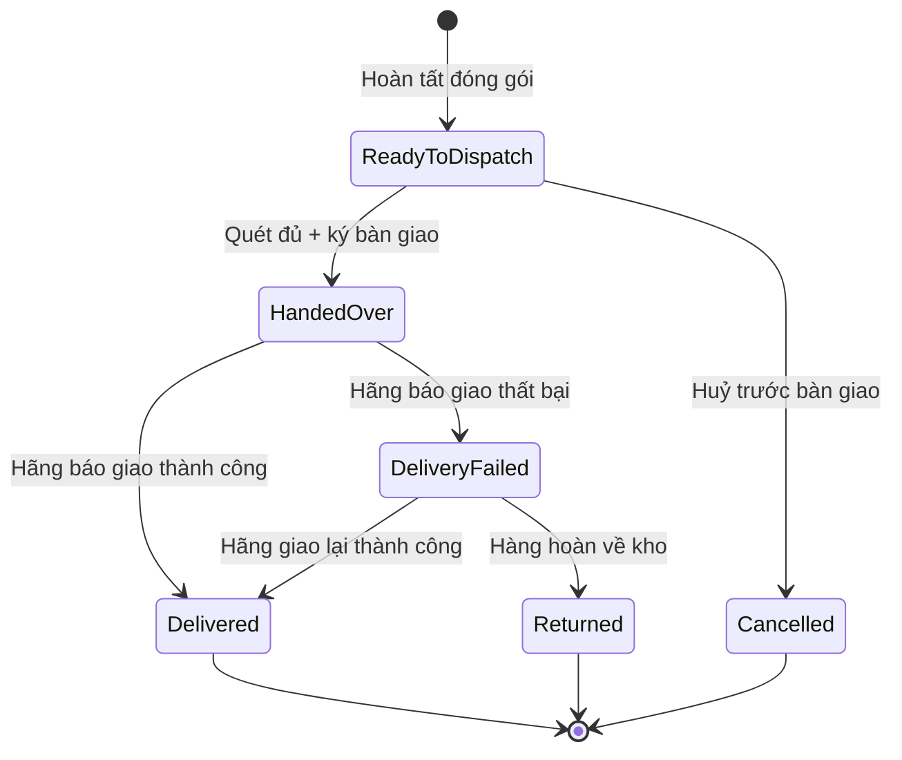
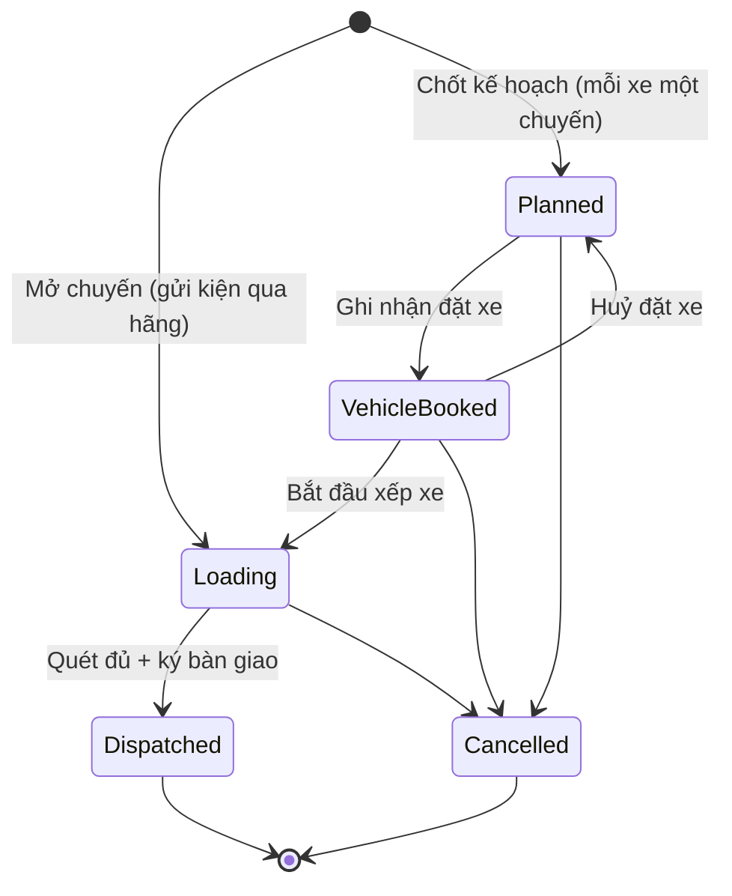
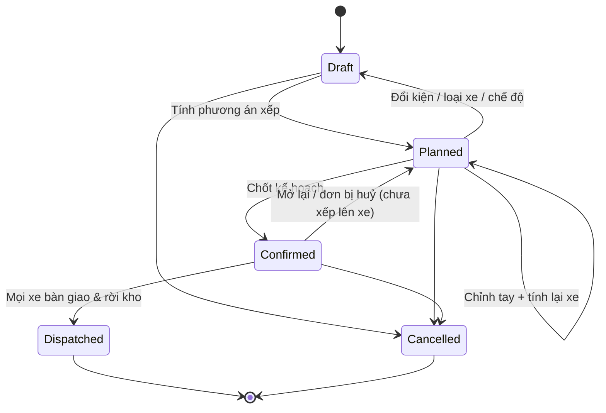

# 09 — Giao hàng cho đơn vị vận chuyển (Shipping)

## 1. Mục đích (Purpose)

Bàn giao các **shipment** đã [đóng gói](../08-packing/README.md) cho **đơn vị vận chuyển ngoài (external carrier / 3PL)** qua **chuyến bàn giao (Load)**, có quét kiện và ký biên bản. Sau đó ghi nhận **kết quả giao**: thành công / thất bại / hoàn về kho.

**Đơn vị vận chuyển là bên thứ ba và nằm ngoài hệ thống.** Hệ thống **không tích hợp API hãng, không lấy mã vận đơn, không theo dõi hành trình (tracking)**. Từ lúc bàn giao tới lúc có kết quả giao, kiện do hãng chịu trách nhiệm; nhân viên cập nhật kết quả khi hãng báo lại.

Đây là **bước cuối của luồng Fulfillment trong phạm vi kho**. Sau khi giao thành công, [Order Management](../../ecommerce/17-order-management/README.md) tự hoàn tất đơn.

Module hỗ trợ **hai hình thức giao** (Điều phối chọn theo từng đơn — [17](../../ecommerce/17-order-management/README.md) §4.2):

| Hình thức | Áp dụng | Đặc trưng |
|-----------|---------|-----------|
| **Gửi kiện qua hãng vận chuyển (Parcel)** — mặc định | Đơn khách thông thường | Mở một **chuyến bàn giao** cho một hãng, quét kiện, ký biên bản ([§4.1](#41-gửi-kiện-qua-hãng-vận-chuyển-parcel)) |
| **Giao nguyên chuyến (Full Truckload – FTL)** | Đơn sỉ khối lượng lớn được chỉ định giao nguyên chuyến; lệnh chuyển kho ([10](../10-inter-warehouse-transfer/README.md)) đi xe tải / container | Thuê nguyên xe tải hoặc container. Trước khi thuê xe, **lập kế hoạch xếp hàng 3D (Load Planning)** để biết cần loại xe nào, bao nhiêu chiếc, mỗi kiện đặt ở đâu; mỗi xe là một chuyến bàn giao ([§4.2](#42-giao-nguyên-chuyến--lập-kế-hoạch-xếp-hàng-3d-load-planning)) |

> ⚠️ Giả định: khách không tự chọn hình thức giao nguyên chuyến trên cổng khách hàng; phí vận chuyển cho đơn giao nguyên chuyến chưa xác định. Xem [open-questions](../../open-questions/README.md).

---

## 2. Actor liên quan

| Actor | Vai trò |
|-------|---------|
| **Nhân viên kho / Dispatch Staff** | Mở chuyến bàn giao, gán shipment, quét kiện lên xe, ký bàn giao. Gán hãng cho shipment. Với giao nguyên chuyến: lập kế hoạch chuyến xe, xem / chỉnh tay 3D, xác nhận để lại kiện không xếp được, chốt kế hoạch, ghi nhận đặt xe, bắt đầu xếp xe, dỡ kiện của đơn bị huỷ. |
| **Quản lý kho (Warehouse Manager)** | Tất cả việc của Dispatch Staff. Thêm: khai báo **danh mục hãng vận chuyển** và **danh mục loại xe**; **huỷ chuyến bàn giao**; ghi nhận hàng hoàn về (`Returned`). |
| **Điều phối đơn hàng (Order Coordinator)** | Chọn hình thức giao cho đơn. **Ước tính tải** trước khi đóng gói. Ghi nhận **giao thành công / giao thất bại** khi hãng báo lại; ghi nhận hàng hoàn về. |
| **Hệ thống (Load Planner)** | Tính phương án xếp kiện lên xe / container: số xe từng loại, vị trí & hướng đặt từng kiện, % lấp đầy; dựng mô hình 3D. Ước tính tải và đối chiếu kế hoạch với ước tính. |
| **Đơn vị vận chuyển (Carrier / 3PL)** | Nhận kiện, vận chuyển, giao cho khách, thu hộ phần còn lại (nếu có), hoàn hàng về kho — **hoạt động ngoài hệ thống**. Với giao nguyên chuyến: cung cấp xe tải / container theo kế hoạch đã chốt. |
| **Nhân viên Sale (Sales Staff)** | Xử lý khiếu nại giao hàng (CSKH), liên hệ khách khi giao thất bại |
| **Khách hàng** | Nhận hàng (hoặc từ chối nhận) |

---

## 3. Input / Output

### Input

| Trường | Mô tả | Bắt buộc |
|--------|-------|----------|
| Shipment `Ready to Dispatch` | Sinh khi hoàn tất đóng gói ([08](../08-packing/README.md)); gồm kiện đã niêm phong (mã kiện, khối lượng, kích thước, cờ xoay), hình thức giao copy từ đơn, số tiền thu hộ | Có |
| **Đơn vị vận chuyển** | Chọn từ **danh mục hãng** (mã, tên, người liên hệ, điện thoại, trạng thái `Active` / `Inactive`). Hãng `Inactive` không nhận chuyến mới. | Có |
| Địa chỉ giao & người nhận | Từ đơn hàng | Có |
| Địa chỉ gửi & địa chỉ hoàn hàng | Địa chỉ kho xuất; địa chỉ hoàn hàng lấy `return_address` của kho, nếu không khai báo thì dùng địa chỉ kho (xem [06](../06-warehouse-map-slotting/README.md)) | Có |
| Thông tin bàn giao | Người đại diện hãng, biển số xe, điện thoại tài xế (tuỳ chọn), xác nhận đã ký | Có (khi bàn giao) |
| Lịch lấy hàng (pickup schedule) / điểm gửi | Thoả thuận với hãng ngoài hệ thống | Không |

**Input bổ sung cho giao nguyên chuyến (Load Planning):**

| Trường | Mô tả | Bắt buộc |
|--------|-------|----------|
| **Danh sách kiện cần xếp** | Các shipment **giao nguyên chuyến**, `Ready to Dispatch`, **nguyên shipment** (không lấy một phần), của **đơn khách** hoặc **một lệnh chuyển kho** — không trộn hai loại. Có thể nhập danh sách kiện từ **file Excel theo mẫu**. | Có |
| **Danh mục loại xe (Vehicle Type)** | Mã, tên, loại (container / xe tải / bán tải), kích thước lòng thùng (mm), phần gia cố góc, kích thước cửa, tải trọng tối đa, **số chiếc sẵn có**, giá thuê (chỉ tham khảo), trạng thái. Cài sẵn container **20DC, 40DC, 40HC, 45HC**. | Có (cấu hình) |
| **Chế độ chọn xe** | Một trong các chế độ ở [§4.2](#42-giao-nguyên-chuyến--lập-kế-hoạch-xếp-hàng-3d-load-planning) | Có (mặc định: *Một loại*) |
| Phân nhóm kiện chính / phụ | Chỉ dùng với chế độ *Ưu tiên + hàng chèn* | Không |

### Output

| Kết quả | Dùng bởi |
|---------|----------|
| **Chuyến bàn giao (Load)** — một hãng, một xe; danh sách shipment; trạng thái (§5.2) | Dispatch Staff |
| **Biên bản bàn giao (Manifest)** — danh sách kiện của chuyến; người đại diện hãng, biển số, tài xế; xác nhận đã ký | Đối soát với hãng vận chuyển |
| **Cập nhật trạng thái đơn**: `Shipped` → `Delivered` / `Delivery Failed` / `Returned` | 17 Order Management, 15 Payment (khoản công nợ, tiền thu hộ) |
| **Số tiền thu hộ chốt theo shipment** lúc bàn giao | 15 Payment |
| **Sự kiện hoàn hàng (RTO – Return To Origin)** | 17 Order Management, nhập lại kho ([Receipt](../03-receipt/README.md)) |
| **Ước tính tải** — số thùng, thể tích, khối lượng, số xe dự kiến; dòng thiếu dữ liệu đóng gói | Điều phối (trước khi đóng gói / release) |
| **Kế hoạch chuyến xe (Load Plan)** — số xe từng loại; toạ độ (x, y, z) & hướng đặt từng kiện; % lấp đầy thể tích & tải trọng từng xe; kiện không xếp được kèm lý do | Dispatch Staff, [10](../10-inter-warehouse-transfer/README.md) |
| **Đối chiếu kế hoạch với ước tính** (số kiện, thể tích, khối lượng, số xe) | Dispatch Staff, Điều phối |
| **Mô hình 3D** của từng xe (xem & chỉnh tay được) và **sơ đồ xếp xuất PDF** | Dispatch Staff, tài xế / bốc xếp |

### Dữ liệu tối thiểu cần lưu (giao nguyên chuyến)

| Thực thể | Trường chính |
|----------|--------------|
| `VehicleType` | `id`, `code`, `name`, `kind`, `inner_length`, `inner_width`, `inner_height`, `gusset`, `door_width?`, `door_height?`, `max_payload`, `available_count`, `rental_price?`, `status` |
| `LoadPlan` | `id`, `code`, `warehouse_id`, `source_type` (đơn khách / TO), `selection_mode`, `status`, `confirmed_at?`, `dispatched_at?` |
| `LoadPlanVehicle` | `id`, `load_plan_id`, `vehicle_type_id`, `seq`, `volume_fill_pct`, `weight_fill_pct`, `needs_recalculation` |
| `LoadPlacement` | `load_plan_vehicle_id`, `package_id`, `x`, `y`, `z`, `orientation` |
| `LoadPlanUnplaced` | `load_plan_id`, `package_id`, `reason`, `acknowledged` |
| `Load` | `id`, `warehouse_id`, `carrier_id`, `load_plan_vehicle_id?`, `status`, `vehicle_plate`, `driver_phone?`, `carrier_representative`, `dispatched_at?` |

---

## 4. Luồng nghiệp vụ từng bước (Step-by-step)

### 4.0. Ước tính tải (trước khi đóng gói)

1. Điều phối / Quản lý kho **ước tính tải** cho một đơn hoặc một lệnh chuyển kho:
   - **Đơn:** từ `Confirmed` tới khi đóng gói xong; đơn `Confirmed` phải chọn kho.
   - **Lệnh chuyển kho:** từ `Draft` tới `Picking`.
2. Hệ thống quy từng dòng thành **thùng** theo quy cách đóng gói của Inventory Item ([01](../01-product-creation/README.md)), theo thứ tự ưu tiên:
   1. đơn vị giao hàng mặc định;
   2. đơn vị đóng gói lớn nhất;
   3. hộp của sản phẩm;
   4. đơn vị lẻ.

   Rồi chạy thử xếp xe để ra **số xe dự kiến**. Các thùng của một bộ kiện được giữ chung một xe.
3. Dòng thiếu kích thước / khối lượng được **liệt kê** và ước tính bị đánh dấu **chưa đủ**. Không dòng nào quy được thì báo lỗi.
4. Ước tính mới **thay thế** ước tính cũ của cùng chứng từ. Tối đa 3.000 thùng mỗi lần ước tính.
5. Ước tính **chỉ để tham khảo** (chọn xe, chọn hình thức giao); không bao giờ chốt kế hoạch.

### 4.1. Gửi kiện qua hãng vận chuyển (Parcel)

1. **Chờ xuất** — shipment `Ready to Dispatch` ở khu chờ xuất (khu `DISPATCH`). Gán **hãng** cho shipment (chỉ hãng `Active`, chỉ khi shipment chưa nằm trên chuyến nào).
2. **Mở chuyến bàn giao** — Dispatch Staff mở chuyến cho **một hãng** (biển số, tài xế có thể nhập sau) → chuyến `Loading`. Thêm các shipment cùng hãng, cùng kho vào chuyến.
3. **Quét kiện lên xe** — quét từng kiện. Hệ thống chặn kiện:
   - chưa niêm phong, hoặc shipment không còn `Ready to Dispatch`;
   - đã nằm trên chuyến khác;
   - thuộc kho khác, hoặc shipment không có trong biên bản của chuyến;
   - của hãng khác;
   - của đơn giao nguyên chuyến (phải đi theo kế hoạch xe);
   - có **nhãn lỗi thời** (phải in lại — [08](../08-packing/README.md) BR-09).
4. **Bàn giao & ký** — khi tài xế hãng đến, ký bàn giao. Điều kiện:
   - **đã quét đủ mọi kiện** (thiếu thì hệ thống liệt kê từng kiện chưa quét);
   - nhập người đại diện hãng, biển số (nếu chưa có), xác nhận **đã ký**.

   Bàn giao là **tất cả hoặc không**: chỉ một shipment không được phép đi (đơn còn nợ tiền phải thu trước giao, đơn đang treo, đơn không cho giao một phần mà thiếu kiện) thì **cả chuyến bị từ chối**. Bỏ shipment đó khỏi chuyến để các shipment còn lại đi.
5. **Kết quả** — chuyến `Dispatched`; shipment → `Handed Over`; **số tiền thu hộ chốt theo từng shipment**. Đơn chuyển `Shipped` (hoặc `Partially Fulfilled` nếu còn phần chưa giao). Gửi khách thông báo đơn đã giao cho đơn vị vận chuyển (không kèm tracking).
6. **Huỷ chuyến** — Quản lý kho huỷ chuyến chưa rời kho, kèm lý do; shipment và kiện trở lại khu `DISPATCH`.

### 4.2. Giao nguyên chuyến — Lập kế hoạch xếp hàng 3D (Load Planning)

Mục đích: từ danh sách kiện cần giao, hệ thống tính **cần loại xe nào, bao nhiêu chiếc**, và **mỗi kiện đặt ở vị trí nào trong thùng xe**. Kết quả hiển thị 3D để kiểm tra trước khi thuê xe.

1. **Tạo kế hoạch chuyến xe (`Draft`)** — Dispatch Staff chọn **nguyên shipment** giao nguyên chuyến ở khu `DISPATCH` (hoặc nhập danh sách kiện từ file Excel theo mẫu), chọn các loại xe được dùng và **chế độ chọn xe**.
   - Kế hoạch chỉ chứa **đơn khách** hoặc **một lệnh chuyển kho** đã đóng gói, không trộn hai loại.
2. **Tính phương án xếp** — Load Planner xếp kiện theo **quy tắc xếp** (BR-10) và chế độ đã chọn → kế hoạch `Planned`. Hệ thống trả về:
   - số xe từng loại;
   - toạ độ & hướng đặt từng kiện;
   - % lấp đầy thể tích & tải trọng từng xe;
   - **kiện không xếp được kèm lý do**: quá khổ, quá nặng, hết xe sẵn có, hết chỗ, hết thời gian tìm, hoặc để ra ngoài bằng tay.
3. **Kiểm tra trên mô hình 3D & chỉnh tay** — Dispatch Staff xem từng xe; có thể **kéo thả kiện** rồi **tính lại riêng xe đó**. Còn kiện không xếp được thì:
   - thêm xe / đổi loại xe / đổi chế độ rồi tính lại (quay về `Draft` nếu đổi danh sách kiện, loại xe hoặc chế độ); hoặc
   - **xác nhận để lại** các kiện đó. Không được để lại phần của đơn **không cho giao một phần**, hay của lệnh chuyển kho (lệnh chuyển kho đi nguyên lô).
4. **Đối chiếu với ước tính** — xem số kiện (đưa vào = đã xếp + không xếp), thể tích, khối lượng, số xe so với ước tính của đơn. Hệ thống gắn cờ:
   - chưa có ước tính / ước tính chưa đủ / ước tính có thùng không xếp được;
   - nhiều / ít xe hơn, nhiều / ít kiện hơn;
   - thể tích hoặc khối lượng **vượt ước tính trên 10%**.
5. **Chốt kế hoạch (`Confirmed`)** — cần:
   - ít nhất một kiện đã xếp;
   - không xe nào đang chờ tính lại;
   - sơ đồ hợp lệ, bộ kiện không bị tách xe;
   - kiện không xếp được đã được xác nhận để lại.

   Khi chốt, hệ thống:
   - khoá danh sách kiện & sơ đồ xếp; xuất **PDF sơ đồ xếp** cho từng xe;
   - tạo **một chuyến bàn giao `Planned` cho mỗi xe**;
   - trả các kiện để lại về khu `DISPATCH`.
6. **Đặt xe** — Dispatch Staff đặt xe với hãng (**ngoài hệ thống**), rồi **ghi nhận đặt xe** cho từng chuyến → `Vehicle Booked`.
   - Đặt lại trước khi xếp thì thay thông tin cũ.
   - **Huỷ đặt xe** (bắt buộc lý do) → chuyến về `Planned`, chỉ khi chưa bắt đầu xếp.
7. **Bắt đầu xếp xe** → chuyến `Loading`. Từ đây kế hoạch **bị khoá** (BR-14).
   - Đơn không cho giao một phần phải có đủ phần còn lại trong kế hoạch.
   - Kiện bị để lại được **tách sang shipment mới** `Ready to Dispatch` (nhãn cũ thành lỗi thời) để đi chuyến sau.
8. **Quét & bàn giao từng xe** — quét từng kiện (hệ thống chặn kiện không thuộc xe này và chỉ ra xe đúng), ký bàn giao như §4.1 bước 4 → chuyến `Dispatched`.
   - Shipment chuyển `Handed Over` ở **xe cuối cùng chở nó**.
   - Lệnh chuyển kho chỉ rời kho nguồn khi **xe cuối cùng của kế hoạch** đã ký ([10](../10-inter-warehouse-transfer/README.md)).
   - Mọi xe đã bàn giao → kế hoạch `Dispatched`.
9. **Đơn bị huỷ khi đã nằm trong kế hoạch:**
   - Kiện của đơn bị gỡ khỏi kế hoạch; các xe bị ảnh hưởng **chờ tính lại**; kế hoạch `Confirmed` chưa có xe nào đang xếp quay về `Planned`.
   - Nếu kiện đã nằm trên xe đang xếp → **dỡ kiện**: bàn giao bị chặn tới khi đã quét dỡ hết. Xe không còn gì để chở thì bị huỷ.
10. **Ghi nhận kết quả giao** — không theo dõi hành trình. Đơn khách ghi nhận kết quả theo §4.3; lệnh chuyển kho do kho đích nhận theo [10](../10-inter-warehouse-transfer/README.md).

**Chế độ chọn xe:**

| Chế độ | Cách chọn xe & xếp kiện |
|--------|-------------------------|
| **Một loại** | Chọn loại xe xếp tốt nhất, rồi dùng nhiều chiếc cùng loại đó |
| **Ít xe nhất** | Trộn nhiều loại xe để tổng số xe ít nhất |
| **Giữ nguyên dòng** | Các kiện cùng một dòng hàng đi chung một xe |
| **Ưu tiên + hàng chèn** | Hàng chính quyết định cần bao nhiêu xe; hàng phụ chỉ chèn vào chỗ trống còn lại |
| **Vượt sức chứa** | Xếp tối đa những kiện vừa với số xe sẵn có và báo phần phải bỏ lại |
| **Chỉnh tay** | Kéo thả kiện trên mô hình 3D, rồi tính lại một xe |

**Cách tính phương án (tóm tắt):** đặt từng kiện vào **góc trống thấp nhất và sâu nhất** mà kiện vừa và được đỡ chắc. Hệ thống thử nhiều thứ tự xếp ngẫu nhiên trong một khoảng thời gian giới hạn (mặc định 5 giây) và giữ phương án tốt nhất, đánh giá theo thứ tự:

1. Ít kiện bị bỏ lại nhất;
2. Ít xe nhất;
3. Ít khoảng trống thừa nhất.

**Giới hạn phạm vi hiện tại** (chưa hỗ trợ — xem [open-questions](../../open-questions/README.md)):

- Chưa tính **chi phí thuê xe**: xe được chọn theo số xe và độ lấp đầy, không theo giá; giá thuê trong danh mục loại xe chỉ lưu để tham khảo.
- Chưa tính **phân bố trọng tâm**, **hàng dễ vỡ** hay **giới hạn chồng tầng**.
- Chưa sắp xếp theo **thứ tự điểm giao**: hàng giao trước chưa được đặt ở phía cửa xe.
- Chỉ đặt kiện **vuông góc với các cạnh thùng** (không đặt nghiêng).

### 4.3. Ghi nhận kết quả giao & sau giao (chung cho hai hình thức)

1. **Giao thành công** — khi hãng báo đã giao (ngoài hệ thống), **Điều phối** cập nhật shipment → `Delivered`; đơn cập nhật theo các shipment.
2. **Giao thất bại** — **Điều phối** cập nhật shipment → `Delivery Failed`, **bắt buộc lý do**:

   | Lý do | Ý nghĩa |
   |-------|---------|
   | `CUSTOMER_ABSENT` | Khách vắng |
   | `REFUSED` | Khách từ chối nhận |
   | `WRONG_ADDRESS` | Sai địa chỉ |
   | `LOST` | Thất lạc |
   | `DAMAGED` | Hư hỏng |
   | `OTHER` | Lý do khác — **bắt buộc ghi chú** |

   CSKH liên hệ khách. Hãng có thể giao lại (ngoài hệ thống); giao lại thành công thì cập nhật `Delivered`.
3. **Hoàn hàng về kho (RTO / Return)** — từ `Delivery Failed`, hãng trả kiện về. Điều phối / Quản lý kho ghi nhận shipment → `Returned`. Kho tiếp nhận qua luồng [Receipt](../03-receipt/README.md) dạng "hàng hoàn", kiểm tra tình trạng, nhập lại tồn (`Available` nếu nguyên vẹn / `Quarantine` nếu nghi hư / huỷ nếu hỏng). Đơn chuyển `Returned`.
4. **Đối soát tiền & cước** ([15 Payment](../../ecommerce/15-payment/README.md)):
   - Đơn có thu hộ: khoản công nợ **do nhà vận chuyển thu**; kế toán ghi nhận tiền hãng nộp về.
   - Đơn công nợ: mở khoản công nợ phải thu từ ngày giao.
   - Đối soát bảng cước thực tế với hãng.
5. **Đóng đơn** — [Order Management](../../ecommerce/17-order-management/README.md) tự hoàn tất đơn sau thời hạn đổi / trả khi không còn nợ.

---

## 5. Trạng thái / Vòng đời (Lifecycle)

### 5.1. Shipment

| Trạng thái | Ý nghĩa | Chuyển tiếp cho phép | Ai thực hiện |
|------------|---------|----------------------|--------------|
| `Ready to Dispatch` | Sinh khi hoàn tất đóng gói; ở khu chờ xuất (có thể đã nằm trong kế hoạch chuyến xe) | → `Handed Over`, → `Cancelled` | Hệ thống / Dispatch Staff |
| `Handed Over` | Đã quét lên xe & ký bàn giao; số tiền thu hộ đã chốt | → `Delivered`, → `Delivery Failed` | Dispatch Staff |
| `Delivered` | Hãng báo giao thành công | *(cuối)* | Điều phối |
| `Delivery Failed` | Hãng báo giao không thành công (kèm lý do) | → `Delivered` (giao lại thành công), → `Returned` | Điều phối |
| `Returned` | Kiện đã hoàn về kho | *(cuối)* | Điều phối / Quản lý kho |
| `Cancelled` | Huỷ trước khi bàn giao (đơn huỷ, mở lại kiện) | *(cuối)* | Hệ thống |

### 5.2. Chuyến bàn giao (Load)

| Trạng thái | Ý nghĩa | Chuyển tiếp cho phép | Ai thực hiện |
|------------|---------|----------------------|--------------|
| `Planned` | *(Chỉ giao nguyên chuyến)* Một xe của kế hoạch đã chốt; chưa đặt xe | → `Vehicle Booked`, → `Cancelled` (theo kế hoạch) | Hệ thống (khi chốt kế hoạch) |
| `Vehicle Booked` | *(Chỉ giao nguyên chuyến)* Đã ghi nhận đặt xe | → `Loading`, → `Planned` (huỷ đặt xe, có lý do), → `Cancelled` (theo kế hoạch) | Dispatch Staff |
| `Loading` | Đang quét kiện lên xe. Gửi kiện qua hãng: mở chuyến là vào thẳng trạng thái này. | → `Dispatched`, → `Cancelled` | Dispatch Staff |
| `Dispatched` | Đã ký bàn giao, xe rời kho | *(cuối)* | Dispatch Staff |
| `Cancelled` | Huỷ, có lý do; shipment & kiện trở lại khu `DISPATCH` | *(cuối)* | Quản lý kho (gửi kiện qua hãng); theo kế hoạch (giao nguyên chuyến) |

### 5.3. Kế hoạch chuyến xe (Load Plan)

| Trạng thái | Ý nghĩa | Chuyển tiếp cho phép | Ai thực hiện |
|------------|---------|----------------------|--------------|
| `Draft` | Đang chọn kiện, loại xe, chế độ chọn xe | → `Planned`, → `Cancelled` | Dispatch Staff |
| `Planned` | Đã có phương án xếp; xem 3D, chỉnh tay & tính lại từng xe; xác nhận để lại kiện không xếp được | → `Planned` (chỉnh tay, tính lại), → `Draft` (đổi kiện / loại xe / chế độ), → `Confirmed`, → `Cancelled` | Dispatch Staff / Load Planner |
| `Confirmed` | Đã chốt; khoá danh sách kiện & sơ đồ; mỗi xe một chuyến bàn giao | → `Dispatched`, → `Planned` (mở lại, có lý do, khi chưa xe nào bắt đầu xếp), → `Cancelled` (có lý do, khi chưa xe nào bắt đầu xếp) | Dispatch Staff |
| `Dispatched` | Mọi xe đã ký bàn giao & rời kho | *(cuối)* | Hệ thống |
| `Cancelled` | Huỷ; kiện trở lại khu `DISPATCH` chờ kế hoạch khác | *(cuối)* | Dispatch Staff / Quản lý kho |

**Kiện được trả khỏi kế hoạch vì:**

| Lý do | Ý nghĩa |
|-------|---------|
| `INPUTS_CHANGED` | Đổi danh sách kiện / loại xe / chế độ |
| `LEFT_BEHIND` | Kiện không xếp được, đã xác nhận để lại |
| `PLAN_CANCELLED` | Kế hoạch bị huỷ |
| `ORDER_CANCELLED` | Đơn bị huỷ |

---

## 6. Ràng buộc nghiệp vụ (Business Rules) & Edge case

### Business rules

- **BR-01:** Chỉ bàn giao / đưa vào kế hoạch chuyến xe các kiện **đã niêm phong** (có khối lượng và kích thước) của shipment `Ready to Dispatch`, nhãn **không lỗi thời**.
- **BR-02:** Hệ thống **không theo dõi hành trình** sau bàn giao.
  - `Delivered` / `Delivery Failed` chỉ do **Điều phối** cập nhật, dựa trên thông báo của hãng.
  - `Returned` do Điều phối hoặc Quản lý kho cập nhật.
  - Mỗi lần cập nhật ghi người và thời điểm; cập nhật lại cùng trạng thái không đổi gì.
- **BR-03:** Đơn chỉ chuyển `Shipped` khi **tất cả kiện** của đơn đã `Handed Over`. Còn phần chưa giao thì đơn ở `Partially Fulfilled`; điều này chỉ xảy ra khi đơn được Sale cho phép giao một phần.
- **BR-04:** **Số tiền thu hộ** chốt theo từng shipment lúc bàn giao, phải khớp với nhãn kiện (lệch → nhãn lỗi thời, phải in lại). **Giao nguyên chuyến không bao giờ thu hộ.**
- **BR-05:** Trạng thái đơn phía khách hàng phản ánh trạng thái shipment. Nhiều kiện → hiển thị trạng thái tổng hợp (ví dụ "giao một phần").
- **BR-06:** RTO nhập lại kho phải qua [Receipt](../03-receipt/README.md) (không cộng thẳng tồn) để kiểm tra tình trạng hàng.
- **BR-07:** Chi phí vận chuyển thu của khách (nếu có) và cước trả hãng là hai khoản độc lập; đối soát riêng.

**Giao nguyên chuyến & Load Planning:**

- **BR-08:** Load Planning chỉ áp dụng cho **giao nguyên chuyến** (đơn khách được chỉ định giao nguyên chuyến và lệnh chuyển kho đi xe tải / container). Kiện gửi qua hãng vận chuyển không cần kế hoạch chuyến xe.
- **BR-09:** Chỉ đưa vào kế hoạch **nguyên shipment** có đủ kích thước & khối lượng. Một kiện chỉ thuộc **tối đa một** kế hoạch chuyến xe chưa `Cancelled`. Một kế hoạch chỉ chứa đơn khách **hoặc** một lệnh chuyển kho.
- **BR-10:** Quy tắc xếp bắt buộc (ràng buộc cứng):
  - Kiện phải được đỡ **ít nhất 98% mặt đáy**; không lơ lửng, không chìa ra ngoài lòng thùng.
  - Tổng khối lượng các kiện trên một xe **không vượt tải trọng** của xe.
  - Kiện có cờ cho phép xoay được xoay theo **6 hướng**; kiện không cho phép xoay giữ nguyên hướng đặt.
  - **Chừa các góc gia cố** trên trần thùng.
  - Kiện chỉ đặt **vuông góc với các cạnh thùng**.
- **BR-11:** Chỉnh tay trên mô hình 3D vẫn phải thoả BR-10; vị trí vi phạm bị từ chối. Sau khi chỉnh, hệ thống tính lại xe bị chỉnh.
- **BR-12:** Số xe của một loại trong phương án **không vượt số chiếc sẵn có** của loại đó. Loại xe `Inactive` không được đề xuất cho kế hoạch mới.
- **BR-13:** Kế hoạch chỉ được `Confirmed` khi:
  - mọi kiện đã có vị trí, hoặc kiện không xếp được đã được xác nhận để lại;
  - không xe nào đang chờ tính lại.

  Không được để lại phần của đơn không cho giao một phần, hay của lệnh chuyển kho.
- **BR-14:** Sau `Confirmed`, danh sách kiện và sơ đồ xếp bị khoá. Muốn sửa phải mở lại về `Planned` (kèm lý do) khi **chưa xe nào bắt đầu xếp**. Mở lại huỷ các chuyến của kế hoạch, kể cả chuyến đã đặt xe. Đã bắt đầu xếp thì không mở lại / huỷ kế hoạch được.
- **BR-15:** Mỗi xe của kế hoạch là **một chuyến bàn giao** có biên bản riêng. Kế hoạch chỉ `Dispatched` khi **mọi xe** đã ký bàn giao & rời kho.

**Chuyến bàn giao:**

- **BR-16:** Một chuyến chỉ một hãng (`Active`) và một kho. Shipment, kiện của hãng khác / kho khác bị chặn. Gán hãng cho shipment chỉ khi shipment chưa nằm trên chuyến nào.
- **BR-17:** Bộ kiện (kit) **đi chung một xe**; kế hoạch tách bộ kiện ra hai xe không chốt được.
- **BR-18:** Bàn giao là **tất cả hoặc không**:
  - phải quét đủ mọi kiện của chuyến;
  - phải xác nhận đã ký, có người đại diện hãng và biển số;
  - mọi shipment phải được đơn cho phép đi: không còn nợ tiền phải thu trước giao, không đang treo, không thiếu phần khi đơn không cho giao một phần.
- **BR-19:** Huỷ chuyến gửi kiện qua hãng chỉ do **Quản lý kho**, kèm lý do, khi chuyến chưa rời kho. Chuyến của kế hoạch xe chỉ thay đổi qua kế hoạch.
- **BR-20:** Ước tính tải **chỉ để tham khảo**; không chốt kế hoạch, không chặn đóng gói.

### Edge case

| Tình huống | Hướng xử lý |
|------------|-------------|
| Địa chỉ giao sai / vùng hãng không phục vụ | Phát hiện trước bàn giao: Điều phối treo đơn lý do `ADDRESS`, CSKH liên hệ khách đổi địa chỉ hoặc đổi hãng. Hãng báo sau bàn giao → `Delivery Failed` lý do `WRONG_ADDRESS`. |
| Kiện thất lạc khi hãng vận chuyển | `Delivery Failed` lý do `LOST`; khiếu nại / bồi thường với hãng ngoài hệ thống; giao lại hàng mới theo chính sách |
| Kiện hư hỏng khi giao | `Delivery Failed` lý do `DAMAGED`; hàng hoàn về → `Returned` |
| Hãng báo đã giao nhưng khách báo chưa nhận | Giữ đơn ở trạng thái tranh chấp; CSKH xác minh với hãng (ngoài hệ thống); đơn không tự hoàn tất khi còn yêu cầu trả hàng mở |
| Khách từ chối nhận | `Delivery Failed` lý do `REFUSED` → hàng hoàn về → `Returned`; áp phí / hoàn tiền theo chính sách |
| Một shipment của chuyến chưa đủ điều kiện (còn nợ tiền, đơn treo) | Cả chuyến bị từ chối bàn giao; bỏ shipment đó khỏi chuyến rồi ký cho các shipment còn lại |
| Quét kiện có nhãn lỗi thời | Hệ thống chặn; in lại nhãn ở [08](../08-packing/README.md) rồi quét lại |
| Tiền thu hộ hãng chuyển về thiếu / chậm | Khoản công nợ do nhà vận chuyển thu ở `Partially Paid`; đối soát với hãng, không đòi khách ([15](../../ecommerce/15-payment/README.md)) |
| Một đơn đi nhiều hãng | Mỗi shipment gán một hãng, bàn giao trên chuyến của hãng đó; đơn `Shipped` khi mọi kiện đã bàn giao |
| Load Planning: còn kiện không xếp được | Hệ thống trả danh sách kèm lý do; Dispatch Staff thêm xe / đổi loại xe / đổi chế độ rồi tính lại, hoặc xác nhận để lại. Khi bắt đầu xếp xe, kiện để lại tách thành shipment mới cho chuyến sau. |
| Load Planning: kiện thiếu kích thước / khối lượng | Chặn tính phương án; yêu cầu cân đo lại kiện ở [08](../08-packing/README.md) |
| Chế độ *Giữ nguyên dòng*: các kiện của một dòng hàng không vừa một xe | Phần vượt được báo là không xếp được; Dispatch Staff chọn loại xe lớn hơn hoặc đổi chế độ |
| Xe thực tế đến khác loại / kích thước so với kế hoạch | Mở lại kế hoạch về `Planned` (chưa xếp lên xe), đổi loại xe & tính lại, chốt lại trước khi xếp; kiện không lên được ở lại khu `DISPATCH` |
| Quét nhầm kiện của xe / chuyến khác khi xếp xe | Hệ thống chặn, báo kiện thuộc xe nào |
| Kiện thực tế không vừa vị trí trên sơ đồ khi xếp lên xe | Dừng xếp xe đó; đo lại kiện. Kế hoạch đã khoá thì xử lý với Quản lý kho (huỷ chuyến của xe đó nếu cần) |
| Đơn bị huỷ khi kiện đã nằm trong kế hoạch | Chưa xếp lên xe → gỡ kiện, xe chờ tính lại, kế hoạch về `Planned`. Đã ở trên xe đang xếp → quét dỡ kiện trước khi bàn giao; xe không còn gì để chở thì bị huỷ. |
| Ước tính tải lệch nhiều so với kế hoạch (vượt > 10%) | Cờ cảnh báo trên đối chiếu; Dispatch Staff kiểm lại kích thước kiện / dữ liệu đóng gói của SKU |

---

## 7. Liên kết với các module khác

| Module | Quan hệ |
|--------|---------|
| [08 · Packing](../08-packing/README.md) | Nhận shipment `Ready to Dispatch` (kiện, kích thước, khối lượng, cờ xoay, nhãn); nhãn lỗi thời phải in lại |
| [10 · Inter-warehouse Transfer](../10-inter-warehouse-transfer/README.md) | Lệnh chuyển kho đi nguyên chuyến dùng Load Planning; hàng rời kho nguồn khi xe cuối ký |
| [01 · Product Creation](../01-product-creation/README.md) | Quy cách đóng gói & kích thước SKU cho ước tính tải; cờ cho phép xoay mặc định của kiện |
| [06 · Warehouse Map & Slotting](../06-warehouse-map-slotting/README.md) | Khu chờ xuất (`DISPATCH`); địa chỉ kho & địa chỉ hoàn hàng in trên nhãn kiện và biên bản |
| [17 · Order Management](../../ecommerce/17-order-management/README.md) | Hình thức giao chọn ở đơn; giao một phần do Sale quyết; trạng thái `Shipped` / `Partially Fulfilled` / `Delivered` / `Delivery Failed` / `Returned`; huỷ đơn → gỡ / dỡ kiện |
| [15 · Payment](../../ecommerce/15-payment/README.md) | Chặn bàn giao khi còn nợ tiền phải thu trước giao; tiền thu hộ chốt theo shipment; giao hàng phát sinh khoản công nợ |
| [03 · Receipt](../03-receipt/README.md) | Hàng hoàn (RTO) nhập lại kho qua luồng Receipt dạng "return" |
| [16 · Sales Chat](../../ecommerce/16-sales-chat/README.md) | Kênh CSKH xử lý đơn trễ / khiếu nại giao hàng |
| [00 · System Overview §5](../../00-system-overview/README.md) | Bước 3 (cuối) của luồng Fulfillment |
