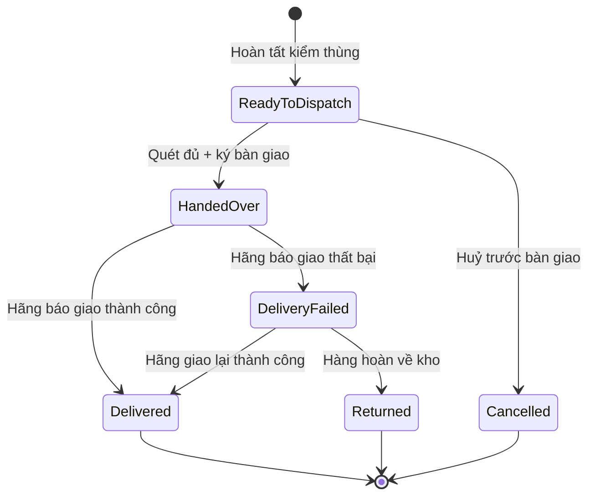
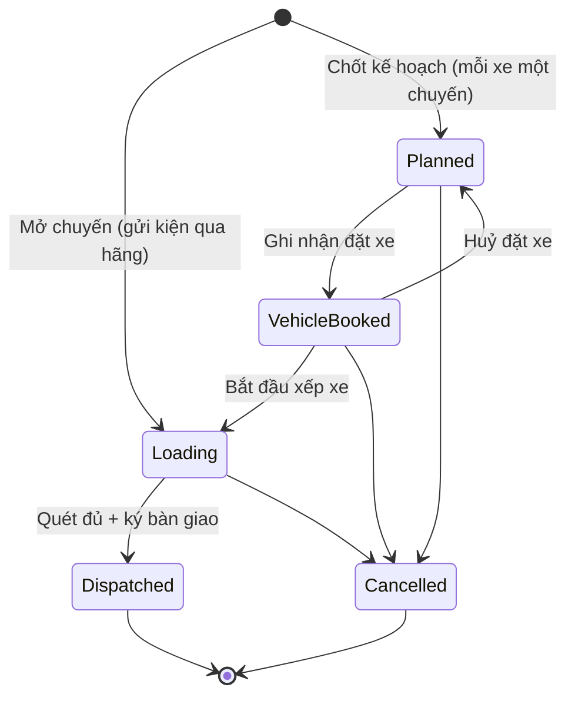
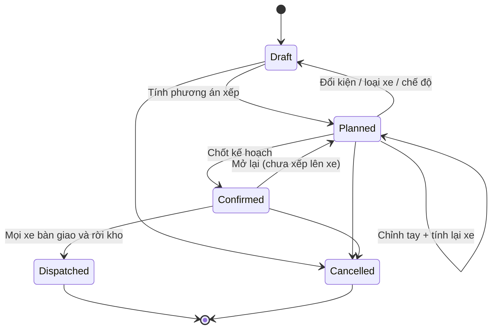

# 09 — Giao hàng cho đơn vị vận chuyển (Shipping)

## 1. Mục đích (Purpose)

Bàn giao các **shipment** đã [kiểm thùng & dán nhãn giao hàng](../08-packing/README.md) cho **đơn vị vận chuyển ngoài (external carrier / 3PL)** qua **chuyến bàn giao (Load)**, có quét kiện và ký biên bản. Sau đó ghi nhận **kết quả giao**: thành công / thất bại / hoàn về kho.

**Kiện (package)** trong module này là **thùng thành phẩm LPN** do đơn vị sản xuất đóng sẵn ([08](../08-packing/README.md) BR-02): mã kiện là mã LPN; kích thước, khối lượng, cờ cho phép xoay lấy từ **quy cách thùng** của SKU ([01](../01-product-creation/README.md)). Kho không đóng lại hàng.

**Đơn vị vận chuyển là bên thứ ba và nằm ngoài hệ thống.** Hệ thống **không tích hợp API hãng, không lấy mã vận đơn, không theo dõi hành trình (tracking)**. Từ lúc bàn giao tới lúc có kết quả giao, kiện do hãng chịu trách nhiệm; nhân viên cập nhật kết quả khi hãng báo lại.

Đây là **bước cuối của luồng Fulfillment trong phạm vi kho**. Sau khi giao thành công, [Order Management](../../ecommerce/17-order-management/README.md) tự hoàn tất đơn.

Module hỗ trợ **hai hình thức giao** (Sale chọn theo từng đơn — [17](../../ecommerce/17-order-management/README.md) §4.2):

| Hình thức | Áp dụng | Đặc trưng |
|-----------|---------|-----------|
| **Gửi kiện qua hãng vận chuyển (Parcel)** — mặc định | Đơn khách thông thường | Mở một **chuyến bàn giao** cho một hãng, quét kiện, ký biên bản ([§4.1](#41-gửi-kiện-qua-hãng-vận-chuyển-parcel)) |
| **Giao nguyên chuyến (Full Truckload – FTL)** | Đơn sỉ khối lượng lớn được chỉ định giao nguyên chuyến | Thuê nguyên xe tải hoặc container. Trước khi thuê xe, **lập kế hoạch xếp hàng 3D (Load Planning)** để biết cần loại xe nào, bao nhiêu chiếc, mỗi kiện đặt ở đâu; mỗi xe là một chuyến bàn giao ([§4.2](#42-giao-nguyên-chuyến--lập-kế-hoạch-xếp-hàng-3d-load-planning)) |

**Ai giao, giao thế nào** *(Đã chốt 2026-11-04; vai trò cập nhật 2026-11-05 — Sale chọn hình thức giao, Quản lý kho ghi nhận kết quả)*:

| Bước | Ai làm | Làm thế nào |
|------|--------|-------------|
| Chọn hình thức giao | **Sale** | Chọn gửi kiện hoặc giao nguyên chuyến cho đơn ([17](../../ecommerce/17-order-management/README.md)), theo điều khoản giao hàng trong hợp đồng mua bán ([14](../../ecommerce/14-cart-and-order/README.md)) |
| Chọn hãng & thuê / đặt xe | **Dispatch Staff** / Quản lý kho | Gửi kiện: gán hãng (`Active`) cho shipment, hẹn hãng tới lấy hàng theo lịch thoả thuận (ngoài hệ thống). Giao nguyên chuyến: đặt xe theo kế hoạch xếp hàng đã chốt, ghi nhận đặt xe trong hệ thống |
| Bàn giao tại kho | **Dispatch Staff** ↔ tài xế / đại diện hãng | Quét từng kiện lên xe, ký biên bản bàn giao. **Bị chặn nếu đợt thanh toán `BEFORE_DELIVERY` của hợp đồng chưa thu** (BR-04) |
| Vận chuyển & giao cho khách | **Đơn vị vận chuyển** (ngoài hệ thống) | Chở tới địa chỉ giao trên đơn, giao cho người nhận của khách; không thu tiền của khách |
| Ghi nhận kết quả | **Quản lý kho** (của kho xuất) | Cập nhật giao thành công / thất bại / hoàn về khi hãng báo lại; hàng hoàn nhập lại kho qua [03](../03-receipt/README.md) (phiếu loại **Hàng hoàn**) |

Doanh nghiệp **không có đội xe riêng**: mọi lần giao đều do đơn vị vận chuyển thuê ngoài thực hiện. Khách thanh toán theo các **đợt của hợp đồng mua bán** bằng chuyển khoản ([15](../../ecommerce/15-payment/README.md)); không có thu hộ khi giao.

> ⚠️ Giả định: khách không tự chọn hình thức giao trên cổng khách hàng; phí vận chuyển (nếu thu của khách) ghi trong điều khoản giao hàng của hợp đồng mua bán, cách tính phí cho đơn giao nguyên chuyến chưa xác định. Xem [open-questions](../../open-questions/README.md).

---

## 2. Actor liên quan

| Actor | Vai trò |
|-------|---------|
| **Nhân viên kho / Dispatch Staff** | Mở chuyến bàn giao, gán shipment, quét kiện lên xe, ký bàn giao. Gán hãng cho shipment. Với giao nguyên chuyến: lập kế hoạch chuyến xe, xem / chỉnh tay 3D, xác nhận để lại kiện không xếp được, chốt kế hoạch, ghi nhận đặt xe, bắt đầu xếp xe, dỡ kiện khỏi xe khi cần. |
| **Quản lý kho (Warehouse Manager)** — của kho xuất | Tất cả việc của Dispatch Staff. Thêm: khai báo **danh mục hãng vận chuyển** và **danh mục loại xe**; **ước tính tải**; **huỷ chuyến bàn giao**; ghi nhận **giao thành công / giao thất bại** khi hãng báo lại; ghi nhận hàng hoàn về (`Returned`) và quyết định hàng hoàn trong khu cách ly ([20](../20-inventory-control/README.md) §4.8). |
| **Hệ thống (Load Planner)** | Tính phương án xếp kiện lên xe / container: số xe từng loại, vị trí & hướng đặt từng kiện, % lấp đầy; dựng mô hình 3D. Ước tính tải và đối chiếu kế hoạch với ước tính. |
| **Đơn vị vận chuyển (Carrier / 3PL)** | Nhận kiện, vận chuyển, giao cho khách, hoàn hàng về kho — **hoạt động ngoài hệ thống**; không thu tiền của khách. Với giao nguyên chuyến: cung cấp xe tải / container theo kế hoạch đã chốt. |
| **Kế toán (Accountant)** | Ghi nhận tiền khách chuyển khoản vào đợt `BEFORE_DELIVERY` của hợp đồng — điều kiện mở chặn bàn giao ([15](../../ecommerce/15-payment/README.md)) |
| **Nhân viên Sale (Sales Staff)** | **Chọn hình thức giao** cho đơn (gửi kiện / nguyên chuyến — [17](../../ecommerce/17-order-management/README.md)); xem **ước tính tải** để chọn; treo / gỡ treo đơn (ví dụ lý do `ADDRESS`); xử lý khiếu nại giao hàng (CSKH), liên hệ khách khi giao thất bại |
| **Khách hàng** | Nhận hàng (hoặc từ chối nhận) |

---

## 3. Input / Output

### Input

| Trường | Mô tả | Bắt buộc |
|--------|-------|----------|
| Shipment `Ready to Dispatch` | Sinh khi hoàn tất kiểm thùng ([08](../08-packing/README.md)); gồm các thùng LPN đã kiểm & dán nhãn giao (mã LPN, khối lượng, kích thước, cờ xoay theo quy cách thùng), hình thức giao copy từ đơn | Có |
| Tình trạng đợt `BEFORE_DELIVERY` | Các đợt thanh toán mốc `BEFORE_DELIVERY` trong hợp đồng mua bán của đơn và trạng thái thu (`Paid` hay chưa) ([15](../../ecommerce/15-payment/README.md)) | Có (khi bàn giao) |
| **Đơn vị vận chuyển** | Chọn từ **danh mục hãng** (mã, tên, người liên hệ, điện thoại, trạng thái `Active` / `Inactive`). Hãng `Inactive` không nhận chuyến mới. | Có |
| Địa chỉ giao & người nhận | Từ đơn hàng | Có |
| Địa chỉ gửi & địa chỉ hoàn hàng | Địa chỉ kho xuất, cũng dùng làm địa chỉ hoàn hàng trên nhãn. ⚠️ Địa chỉ hoàn hàng riêng khai báo ở [06](../06-warehouse-map-slotting/README.md) chưa được dùng | Có |
| Thông tin bàn giao | Người đại diện hãng, biển số xe, điện thoại tài xế (tuỳ chọn), xác nhận đã ký | Có (khi bàn giao) |
| Lịch lấy hàng (pickup schedule) / điểm gửi | Thoả thuận với hãng ngoài hệ thống | Không |

**Input bổ sung cho giao nguyên chuyến (Load Planning):**

| Trường | Mô tả | Bắt buộc |
|--------|-------|----------|
| **Danh sách kiện cần xếp** | Các shipment của **đơn khách giao nguyên chuyến**, `Ready to Dispatch`, **nguyên shipment** (không lấy một phần), cùng một kho. Có thể nhập danh sách kiện từ **file Excel theo mẫu**. | Có |
| **Danh mục loại xe (Vehicle Type)** | Mã, tên, loại (container / xe tải / bán tải), kích thước lòng thùng (mm), phần gia cố góc, kích thước cửa, tải trọng tối đa, **số chiếc sẵn có**, giá thuê (chỉ tham khảo), trạng thái. Cài sẵn container **20DC, 40DC, 40HC, 45HC**. | Có (cấu hình) |
| **Chế độ chọn xe** | Một trong các chế độ ở [§4.2](#42-giao-nguyên-chuyến--lập-kế-hoạch-xếp-hàng-3d-load-planning) | Có (mặc định: *Một loại*) |
| Phân nhóm kiện chính / phụ | Chỉ dùng với chế độ *Ưu tiên + hàng chèn* | Không |

### Output

| Kết quả | Dùng bởi |
|---------|----------|
| **Chuyến bàn giao (Load)** — một hãng, một xe; danh sách shipment; trạng thái (§5.2) | Dispatch Staff |
| **Biên bản bàn giao (Manifest)** — danh sách kiện của chuyến; người đại diện hãng, biển số, tài xế; xác nhận đã ký | Đối soát với hãng vận chuyển |
| **Cập nhật trạng thái đơn**: `Shipped` → `Delivered` / `Delivery Failed` / `Returned` | 17 Order Management, 15 Payment (mốc giao hàng của đợt `AFTER_DELIVERY`) |
| **Sự kiện hoàn hàng (RTO – Return To Origin)** | 17 Order Management; nhập lại kho qua [03](../03-receipt/README.md) phiếu loại **Hàng hoàn**, vào khu `QUARANTINE` ([20](../20-inventory-control/README.md)) |
| **Ước tính tải** — số thùng, thể tích, khối lượng, số xe dự kiến; dòng thiếu quy cách thùng | Sale (chọn hình thức giao), Quản lý kho (trước khi kiểm thùng / release) |
| **Kế hoạch chuyến xe (Load Plan)** — số xe từng loại; toạ độ (x, y, z) & hướng đặt từng kiện; % lấp đầy thể tích & tải trọng từng xe; kiện không xếp được kèm lý do | Dispatch Staff, Quản lý kho |
| **Đối chiếu kế hoạch với ước tính** (số kiện, thể tích, khối lượng, số xe) | Dispatch Staff, Quản lý kho |
| **Mô hình 3D** của từng xe (xem & chỉnh tay được) và **sơ đồ xếp xuất PDF** | Dispatch Staff, tài xế / bốc xếp |

### Dữ liệu tối thiểu cần lưu (giao nguyên chuyến)

| Thực thể | Trường chính |
|----------|--------------|
| `VehicleType` | `id`, `code`, `name`, `kind`, `inner_length`, `inner_width`, `inner_height`, `gusset`, `door_width?`, `door_height?`, `max_payload`, `available_count`, `rental_price?`, `status` |
| `LoadPlan` | `id`, `code`, `warehouse_id`, `selection_mode`, `status`, `confirmed_at?`, `dispatched_at?` |
| `LoadPlanVehicle` | `id`, `load_plan_id`, `vehicle_type_id`, `seq`, `volume_fill_pct`, `weight_fill_pct`, `needs_recalculation` |
| `LoadPlacement` | `load_plan_vehicle_id`, `lpn_id` (kiện = thùng LPN), `x`, `y`, `z`, `orientation` |
| `LoadPlanUnplaced` | `load_plan_id`, `lpn_id`, `reason`, `acknowledged` |
| `Load` | `id`, `warehouse_id`, `carrier_id`, `load_plan_vehicle_id?`, `status`, `vehicle_plate`, `driver_phone?`, `carrier_representative`, `dispatched_at?` |

---

## 4. Luồng nghiệp vụ từng bước (Step-by-step)

### 4.0. Ước tính tải (trước khi kiểm thùng)

1. Sale / Quản lý kho **ước tính tải** cho một đơn, từ `Confirmed` tới khi kiểm thùng xong; đơn phải đã có **kho xuất** (Sale chọn khi `Confirmed` — [17](../../ecommerce/17-order-management/README.md)).
2. Hệ thống quy từng dòng thành **thùng**:
   - dòng **đã phân bổ**: dùng đúng các thùng LPN đã phân bổ ([07](../07-picking/README.md) BR-03);
   - dòng **chưa phân bổ**: lấy đúng **số thùng** của dòng (dòng đơn ghi số lượng theo số thùng — [01](../01-product-creation/README.md) BR-11).

   Kích thước & khối lượng mỗi thùng theo quy cách thùng, giống nhau cho mọi thùng của SKU ([08](../08-packing/README.md) BR-07). Rồi chạy thử xếp xe để ra **số xe dự kiến**.
3. Dòng có SKU thiếu quy cách thùng được **liệt kê** và ước tính bị đánh dấu **chưa đủ**. Không dòng nào quy được thì báo lỗi.
4. Ước tính mới **thay thế** ước tính cũ của cùng chứng từ. Tối đa 3.000 thùng mỗi lần ước tính.
5. Ước tính **chỉ để tham khảo** (chọn xe, chọn hình thức giao); không bao giờ chốt kế hoạch.

### 4.1. Gửi kiện qua hãng vận chuyển (Parcel)

1. **Chờ xuất** — shipment `Ready to Dispatch` ở khu chờ giao (khu `DISPATCH`). Gán **hãng** cho shipment (chỉ hãng `Active`, chỉ khi shipment chưa nằm trên chuyến nào).
2. **Mở chuyến bàn giao** — Dispatch Staff mở chuyến cho **một hãng** (biển số, tài xế có thể nhập sau) → chuyến `Loading`. Thêm các shipment cùng hãng, cùng kho vào chuyến.
3. **Quét kiện lên xe** — quét mã LPN trên nhãn giao hàng của từng thùng. Hệ thống chặn kiện:
   - không thuộc shipment nào (chưa kiểm & dán nhãn ở [08](../08-packing/README.md)), hoặc shipment không còn `Ready to Dispatch`;
   - đã nằm trên chuyến khác;
   - thuộc kho khác, hoặc shipment không có trong biên bản của chuyến;
   - của hãng khác;
   - của đơn giao nguyên chuyến (phải đi theo kế hoạch xe);
   - nhãn rách, không quét được (phải in lại — [08](../08-packing/README.md) BR-08).
4. **Bàn giao & ký** — khi tài xế hãng đến, ký bàn giao. Điều kiện:
   - **đã quét đủ mọi kiện** (thiếu thì hệ thống liệt kê từng kiện chưa quét);
   - nhập người đại diện hãng, biển số (nếu chưa có), xác nhận **đã ký**; mã chữ ký / ảnh biên bản tuỳ chọn cho tới khi có chức năng tải ảnh *(Quyết định 21/10/2026)*.

   Bàn giao là **tất cả hoặc không**: chỉ một shipment không được phép đi (hợp đồng của đơn còn **đợt `BEFORE_DELIVERY` chưa thu** — BR-04, đơn đang treo, đơn không cho giao một phần mà thiếu kiện) thì **cả chuyến bị từ chối**, kèm danh sách đơn và số tiền đợt còn thiếu. Bỏ shipment đó khỏi chuyến để các shipment còn lại đi; shipment bị bỏ chờ ở khu `DISPATCH` tới khi Kế toán ghi nhận đủ tiền ([15](../../ecommerce/15-payment/README.md)).
5. **Kết quả** — chuyến `Dispatched`; shipment → `Handed Over`. Đơn chuyển `Shipped` (hoặc `Partially Fulfilled` nếu còn phần chưa giao). Gửi khách thông báo đơn đã giao cho đơn vị vận chuyển (không kèm tracking).
6. **Huỷ chuyến** — Quản lý kho huỷ chuyến chưa rời kho, kèm lý do; shipment và kiện trở lại khu `DISPATCH`.

### 4.2. Giao nguyên chuyến — Lập kế hoạch xếp hàng 3D (Load Planning)

Mục đích: từ danh sách kiện cần giao, hệ thống tính **cần loại xe nào, bao nhiêu chiếc**, và **mỗi kiện đặt ở vị trí nào trong thùng xe**. Kết quả hiển thị 3D để kiểm tra trước khi thuê xe.

1. **Tạo kế hoạch chuyến xe (`Draft`)** — Dispatch Staff chọn **nguyên shipment** giao nguyên chuyến ở khu `DISPATCH` (hoặc nhập danh sách kiện từ file Excel theo mẫu), chọn các loại xe được dùng và **chế độ chọn xe**.
   - Kế hoạch chỉ chứa shipment của **đơn khách giao nguyên chuyến** đã kiểm thùng, thuộc **một kho** (kho xuất của các đơn).
2. **Tính phương án xếp** — Load Planner xếp kiện theo **quy tắc xếp** (BR-10) và chế độ đã chọn → kế hoạch `Planned`. Hệ thống trả về:
   - số xe từng loại;
   - toạ độ & hướng đặt từng kiện;
   - % lấp đầy thể tích & tải trọng từng xe;
   - **kiện không xếp được kèm lý do**: quá khổ, quá nặng, hết xe sẵn có, hết chỗ, hết thời gian tìm, hoặc để ra ngoài bằng tay.
3. **Kiểm tra trên mô hình 3D & chỉnh tay** — Dispatch Staff xem từng xe; có thể **kéo thả kiện** rồi **tính lại riêng xe đó**. Còn kiện không xếp được thì:
   - thêm xe / đổi loại xe / đổi chế độ rồi tính lại (quay về `Draft` nếu đổi danh sách kiện, loại xe hoặc chế độ); hoặc
   - **xác nhận để lại** các kiện đó. Không được để lại phần của đơn **không cho giao một phần**.
4. **Đối chiếu với ước tính** — xem số kiện (đưa vào = đã xếp + không xếp), thể tích, khối lượng, số xe so với ước tính của đơn. Hệ thống gắn cờ:
   - chưa có ước tính / ước tính chưa đủ / ước tính có thùng không xếp được;
   - nhiều / ít xe hơn, nhiều / ít kiện hơn;
   - thể tích hoặc khối lượng **vượt ước tính trên 10%**.
5. **Chốt kế hoạch (`Confirmed`)** — cần:
   - ít nhất một kiện đã xếp;
   - không xe nào đang chờ tính lại;
   - sơ đồ hợp lệ (BR-10);
   - kiện không xếp được đã được xác nhận để lại.

   Khi chốt, hệ thống:
   - khoá danh sách kiện & sơ đồ xếp; xuất **PDF sơ đồ xếp** cho từng xe;
   - tạo **một chuyến bàn giao `Planned` cho mỗi xe**;
   - trả các kiện để lại về khu `DISPATCH`.
6. **Đặt xe** — Dispatch Staff đặt xe với hãng (**ngoài hệ thống**), rồi **ghi nhận đặt xe** cho từng chuyến → `Vehicle Booked`.
   - Đặt lại trước khi xếp thì thay thông tin cũ.
   - **Huỷ đặt xe** (bắt buộc lý do) → chuyến về `Planned`, chỉ khi chưa bắt đầu xếp.
7. **Bắt đầu xếp xe** → chuyến `Loading`. Từ đây kế hoạch **bị khoá** (BR-14).
   - Đơn không cho giao một phần phải có đủ phần còn lại trong kế hoạch.
   - Đơn còn đợt `BEFORE_DELIVERY` chưa thu được **cảnh báo** khi bắt đầu xếp (không chặn); việc chặn nằm ở bước ký bàn giao (BR-04).
   - Kiện bị để lại được **tách sang shipment mới** `Ready to Dispatch` để đi chuyến sau (nhãn giao hàng không ghi mã shipment nên không phải in lại).
8. **Quét & bàn giao từng xe** — quét từng kiện (hệ thống chặn kiện không thuộc xe này và chỉ ra xe đúng), ký bàn giao như §4.1 bước 4 → chuyến `Dispatched`.
   - Shipment chuyển `Handed Over` ở **xe cuối cùng chở nó**.
   - Mọi xe đã bàn giao → kế hoạch `Dispatched`.
9. **Đơn không huỷ được** khi đã có thùng dán nhãn giao hàng ([08](../08-packing/README.md) BR-04), nên kiện trong kế hoạch không bị gỡ vì huỷ đơn. Khi cần bỏ kiện khỏi kế hoạch (thùng hư hỏng, đơn chưa thu đợt `BEFORE_DELIVERY`):
   - chưa có xe nào bắt đầu xếp → mở lại kế hoạch về `Planned` (BR-14), gỡ kiện, các xe bị ảnh hưởng **chờ tính lại**;
   - kiện đã nằm trên xe đang xếp → Quản lý kho huỷ chuyến của xe đó, **quét dỡ kiện**; xe không còn gì để chở thì bị huỷ.
10. **Ghi nhận kết quả giao** — không theo dõi hành trình. Quản lý kho ghi nhận kết quả theo §4.3.

**Chế độ chọn xe:**

| Chế độ | Cách chọn xe & xếp kiện |
|--------|-------------------------|
| **Một loại** | Chọn loại xe xếp tốt nhất, rồi dùng nhiều chiếc cùng loại đó |
| **Ít xe nhất** | Trộn nhiều loại xe để tổng số xe ít nhất |
| **Giữ nguyên dòng** | Các kiện cùng một dòng hàng đi chung một xe |
| **Ưu tiên + hàng chèn** | Hàng chính quyết định cần bao nhiêu xe; hàng phụ chỉ chèn vào chỗ trống còn lại |
| **Vượt sức chứa** | Xếp tối đa những kiện vừa với số xe sẵn có và báo phần phải bỏ lại |
| **Chỉnh tay** | Kéo thả kiện trên mô hình 3D, rồi tính lại một xe |

**Cách tính phương án (tóm tắt):** đặt từng kiện vào **góc trống thấp nhất và sâu nhất** mà kiện vừa và được đỡ chắc. Hệ thống thử nhiều thứ tự xếp ngẫu nhiên trong một khoảng thời gian giới hạn (mặc định 5 giây) và giữ phương án tốt nhất, đánh giá theo thứ tự:

1. Ít kiện bị bỏ lại nhất;
2. Ít xe nhất;
3. Ít khoảng trống thừa nhất.

**Giới hạn phạm vi hiện tại** (chưa hỗ trợ — xem [open-questions](../../open-questions/README.md)):

- Chưa tính **chi phí thuê xe**: xe được chọn theo số xe và độ lấp đầy, không theo giá; giá thuê trong danh mục loại xe chỉ lưu để tham khảo.
- Chưa tính **phân bố trọng tâm**, **hàng dễ vỡ** hay **giới hạn chồng tầng**.
- Chưa sắp xếp theo **thứ tự điểm giao**: hàng giao trước chưa được đặt ở phía cửa xe.
- Chỉ đặt kiện **vuông góc với các cạnh thùng** (không đặt nghiêng).

### 4.3. Ghi nhận kết quả giao & sau giao (chung cho hai hình thức)

1. **Giao thành công** — khi hãng báo đã giao (ngoài hệ thống), **Quản lý kho** cập nhật shipment → `Delivered`; đơn cập nhật theo các shipment.
2. **Giao thất bại** — **Quản lý kho** cập nhật shipment → `Delivery Failed`, **bắt buộc lý do**:

   | Lý do | Ý nghĩa |
   |-------|---------|
   | `CUSTOMER_ABSENT` | Khách vắng |
   | `REFUSED` | Khách từ chối nhận |
   | `WRONG_ADDRESS` | Sai địa chỉ |
   | `LOST` | Thất lạc |
   | `DAMAGED` | Hư hỏng |
   | `OTHER` | Lý do khác — **bắt buộc ghi chú** |

   CSKH liên hệ khách. Hãng có thể giao lại (ngoài hệ thống); giao lại thành công thì cập nhật `Delivered`.
3. **Hoàn hàng về kho (RTO / Return)** — từ `Delivery Failed`, hãng trả kiện về kho xuất. Quản lý kho ghi nhận shipment → `Returned`; đơn chuyển `Returned`. Kho nhập lại hàng qua [03](../03-receipt/README.md) bằng **phiếu nhập loại Hàng hoàn** tham chiếu shipment:
   - quét LPN từng thùng; chỉ nhận thùng thuộc shipment đó;
   - mọi thùng nhập **thẳng vào khu `QUARANTINE`** (tồn `Quarantine` — [20](../20-inventory-control/README.md) §4.4, §4.8), không cộng thẳng vào tồn khả dụng;
   - **Quản lý kho** quyết định từng thùng: **gỡ cách ly** đưa lại tồn khả dụng (cất về bin qua [05](../05-putaway/README.md)), hoặc **ghi giảm** bằng điều chỉnh tồn có duyệt ([20](../20-inventory-control/README.md) §4.3).

   Thùng hoàn về là **SKU riêng của khách**, nên sau khi gỡ cách ly có thể dùng cho đơn sau của chính khách đó.
4. **Thanh toán sau giao & cước** ([15 Payment](../../ecommerce/15-payment/README.md)):
   - Hợp đồng có đợt `AFTER_DELIVERY`: ngày giao thành công là mốc tính hạn (+ N ngày) của đợt; đợt đó là **công nợ phải thu** có kỳ hạn của khách.
   - Đối soát bảng cước thực tế với hãng.
5. **Đóng đơn** — [Order Management](../../ecommerce/17-order-management/README.md) tự hoàn tất đơn sau thời hạn đổi / trả khi không còn nợ.

---

## 5. Trạng thái / Vòng đời (Lifecycle)

### 5.1. Shipment

| Trạng thái | Ý nghĩa | Chuyển tiếp cho phép | Ai thực hiện |
|------------|---------|----------------------|--------------|
| `Ready to Dispatch` | Sinh khi hoàn tất kiểm thùng ([08](../08-packing/README.md)); ở khu chờ giao `DISPATCH` (có thể đã nằm trong kế hoạch chuyến xe) | → `Handed Over`, → `Cancelled` | Hệ thống / Dispatch Staff |
| `Handed Over` | Đã quét lên xe & ký bàn giao | → `Delivered`, → `Delivery Failed` | Dispatch Staff |
| `Delivered` | Hãng báo giao thành công | *(cuối)* | Quản lý kho |
| `Delivery Failed` | Hãng báo giao không thành công (kèm lý do) | → `Delivered` (giao lại thành công), → `Returned` | Quản lý kho |
| `Returned` | Kiện đã hoàn về kho; thùng nhập lại qua phiếu Hàng hoàn ([03](../03-receipt/README.md)) vào khu `QUARANTINE` | *(cuối)* | Quản lý kho |
| `Cancelled` | Huỷ trước khi bàn giao, có lý do (ví dụ mọi thùng của shipment hư hỏng phải loại); thùng vào hàng chờ cất lại ([07](../07-picking/README.md) §4.5); thùng hư hỏng được cất vào khu `QUARANTINE` như ở [08](../08-packing/README.md). Không phát sinh do huỷ đơn: đơn đã có thùng dán nhãn thì không huỷ được ([08](../08-packing/README.md) BR-04) | *(cuối)* | Quản lý kho |

### 5.2. Chuyến bàn giao (Load)

| Trạng thái | Ý nghĩa | Chuyển tiếp cho phép | Ai thực hiện |
|------------|---------|----------------------|--------------|
| `Planned` | *(Chỉ giao nguyên chuyến)* Một xe của kế hoạch đã chốt; chưa đặt xe | → `Vehicle Booked`, → `Cancelled` (theo kế hoạch) | Hệ thống (khi chốt kế hoạch) |
| `Vehicle Booked` | *(Chỉ giao nguyên chuyến)* Đã ghi nhận đặt xe | → `Loading`, → `Planned` (huỷ đặt xe, có lý do), → `Cancelled` (theo kế hoạch) | Dispatch Staff |
| `Loading` | Đang quét kiện lên xe. Gửi kiện qua hãng: mở chuyến là vào thẳng trạng thái này. | → `Dispatched`, → `Cancelled` | Dispatch Staff |
| `Dispatched` | Đã ký bàn giao, xe rời kho | *(cuối)* | Dispatch Staff |
| `Cancelled` | Huỷ, có lý do; shipment & kiện trở lại khu `DISPATCH` | *(cuối)* | Quản lý kho (gửi kiện qua hãng); theo kế hoạch (giao nguyên chuyến) |

### 5.3. Kế hoạch chuyến xe (Load Plan)

| Trạng thái | Ý nghĩa | Chuyển tiếp cho phép | Ai thực hiện |
|------------|---------|----------------------|--------------|
| `Draft` | Đang chọn kiện, loại xe, chế độ chọn xe | → `Planned`, → `Cancelled` | Dispatch Staff |
| `Planned` | Đã có phương án xếp; xem 3D, chỉnh tay & tính lại từng xe; xác nhận để lại kiện không xếp được | → `Planned` (chỉnh tay, tính lại), → `Draft` (đổi kiện / loại xe / chế độ), → `Confirmed`, → `Cancelled` | Dispatch Staff / Load Planner |
| `Confirmed` | Đã chốt; khoá danh sách kiện & sơ đồ; mỗi xe một chuyến bàn giao | → `Dispatched`, → `Planned` (mở lại, có lý do, khi chưa xe nào bắt đầu xếp), → `Cancelled` (có lý do, khi chưa xe nào bắt đầu xếp) | Dispatch Staff |
| `Dispatched` | Mọi xe đã ký bàn giao & rời kho | *(cuối)* | Hệ thống |
| `Cancelled` | Huỷ; kiện trở lại khu `DISPATCH` chờ kế hoạch khác | *(cuối)* | Dispatch Staff / Quản lý kho |

**Kiện được trả khỏi kế hoạch vì:**

| Lý do | Ý nghĩa |
|-------|---------|
| `INPUTS_CHANGED` | Đổi danh sách kiện / loại xe / chế độ |
| `LEFT_BEHIND` | Kiện không xếp được, đã xác nhận để lại |
| `PLAN_CANCELLED` | Kế hoạch bị huỷ |

---

## 6. Ràng buộc nghiệp vụ (Business Rules) & Edge case

### Business rules

- **BR-01:** Chỉ bàn giao / đưa vào kế hoạch chuyến xe các thùng **đã kiểm & dán nhãn giao hàng** ([08](../08-packing/README.md)) thuộc shipment `Ready to Dispatch`, có khối lượng và kích thước theo quy cách thùng, nhãn **quét được**.
- **BR-02:** Hệ thống **không theo dõi hành trình** sau bàn giao.
  - `Delivered` / `Delivery Failed` / `Returned` chỉ do **Quản lý kho** của kho xuất cập nhật, dựa trên thông báo của hãng.
  - Mỗi lần cập nhật ghi người và thời điểm; cập nhật lại cùng trạng thái không đổi gì.
- **BR-03:** Đơn chỉ chuyển `Shipped` khi **tất cả kiện** của đơn đã `Handed Over`. Còn phần chưa giao thì đơn ở `Partially Fulfilled`; điều này chỉ xảy ra khi đơn được Sale cho phép giao một phần.
- **BR-04:** **Chặn bàn giao theo hợp đồng.** Shipment của đơn chỉ được bàn giao khi **mọi đợt thanh toán mốc `BEFORE_DELIVERY`** trong hợp đồng mua bán của đơn đã `Paid` ([15](../../ecommerce/15-payment/README.md)); đợt `Partially Paid` vẫn bị chặn. Áp dụng cho **cả gửi kiện và giao nguyên chuyến**. Đợt `AFTER_DELIVERY` không chặn bàn giao. Hệ thống **không thu tiền khi giao** (không có thu hộ). *(Đã chốt 2026-11-04.)*

  > ⚠️ Giả định: với đơn giao nhiều lần (giao một phần), **mọi** đợt `BEFORE_DELIVERY` của hợp đồng phải thu trước **lần bàn giao đầu tiên**; gắn từng đợt `BEFORE_DELIVERY` với từng lần giao là phạm vi sau. Xem [open-questions](../../open-questions/README.md).
- **BR-05:** Trạng thái đơn phía khách hàng phản ánh trạng thái shipment. Nhiều kiện → hiển thị trạng thái tổng hợp (ví dụ "giao một phần").
- **BR-06:** Hàng hoàn (RTO) nhập lại kho **chỉ qua [03](../03-receipt/README.md) phiếu loại Hàng hoàn** (không cộng thẳng tồn): chỉ nhận thùng thuộc shipment, nhập thẳng vào khu `QUARANTINE`; Quản lý kho quyết định gỡ cách ly hoặc ghi giảm có duyệt ([20](../20-inventory-control/README.md)).
- **BR-07:** Chi phí vận chuyển thu của khách (nếu có) và cước trả hãng là hai khoản độc lập; đối soát riêng.

**Giao nguyên chuyến & Load Planning:**

- **BR-08:** Load Planning chỉ áp dụng cho **đơn khách được chỉ định giao nguyên chuyến**. Kiện gửi qua hãng vận chuyển không cần kế hoạch chuyến xe.
- **BR-09:** Chỉ đưa vào kế hoạch **nguyên shipment** có đủ kích thước & khối lượng. Một kiện chỉ thuộc **tối đa một** kế hoạch chuyến xe chưa `Cancelled`. Một kế hoạch chỉ chứa shipment của đơn khách giao nguyên chuyến, thuộc một kho.
- **BR-10:** Quy tắc xếp bắt buộc (ràng buộc cứng):
  - Kiện phải được đỡ **ít nhất 98% mặt đáy**; không lơ lửng, không chìa ra ngoài lòng thùng.
  - Tổng khối lượng các kiện trên một xe **không vượt tải trọng** của xe.
  - Kiện có cờ cho phép xoay được xoay theo **6 hướng**; kiện không cho phép xoay giữ nguyên hướng đặt.
  - **Chừa các góc gia cố** trên trần thùng.
  - Kiện chỉ đặt **vuông góc với các cạnh thùng**.
- **BR-11:** Chỉnh tay trên mô hình 3D vẫn phải thoả BR-10; vị trí vi phạm bị từ chối. Sau khi chỉnh, hệ thống tính lại xe bị chỉnh.
- **BR-12:** Số xe của một loại trong phương án **không vượt số chiếc sẵn có** của loại đó. Loại xe `Inactive` không được đề xuất cho kế hoạch mới.
- **BR-13:** Kế hoạch chỉ được `Confirmed` khi:
  - mọi kiện đã có vị trí, hoặc kiện không xếp được đã được xác nhận để lại;
  - không xe nào đang chờ tính lại.

  Không được để lại phần của đơn không cho giao một phần.
- **BR-14:** Sau `Confirmed`, danh sách kiện và sơ đồ xếp bị khoá. Muốn sửa phải mở lại về `Planned` (kèm lý do) khi **chưa xe nào bắt đầu xếp**. Mở lại huỷ các chuyến của kế hoạch, kể cả chuyến đã đặt xe. Đã bắt đầu xếp thì không mở lại / huỷ kế hoạch được.
- **BR-15:** Mỗi xe của kế hoạch là **một chuyến bàn giao** có biên bản riêng. Kế hoạch chỉ `Dispatched` khi **mọi xe** đã ký bàn giao & rời kho.

**Chuyến bàn giao:**

- **BR-16:** Một chuyến chỉ một hãng (`Active`) và một kho. Shipment, kiện của hãng khác / kho khác bị chặn. Gán hãng cho shipment chỉ khi shipment chưa nằm trên chuyến nào.
- **BR-17:** **Kiện là thùng LPN.** Quét kiện bằng mã LPN (trên nhãn LPN hoặc nhãn giao hàng). Kích thước, khối lượng và cờ cho phép xoay dùng cho bàn giao và Load Planning lấy từ quy cách thùng của SKU ([01](../01-product-creation/README.md), [08](../08-packing/README.md) BR-07); kho không đo lại.
- **BR-18:** Bàn giao là **tất cả hoặc không**:
  - phải quét đủ mọi kiện của chuyến;
  - phải xác nhận đã ký, có người đại diện hãng và biển số;
  - mọi shipment phải được đơn cho phép đi: đợt `BEFORE_DELIVERY` đã thu (BR-04), không đang treo, không thiếu phần khi đơn không cho giao một phần.
- **BR-19:** Huỷ chuyến gửi kiện qua hãng chỉ do **Quản lý kho**, kèm lý do, khi chuyến chưa rời kho. Chuyến của kế hoạch xe chỉ thay đổi qua kế hoạch.
- **BR-20:** Ước tính tải **chỉ để tham khảo**; không chốt kế hoạch, không chặn kiểm thùng.

### Edge case

| Tình huống | Hướng xử lý |
|------------|-------------|
| Địa chỉ giao sai / vùng hãng không phục vụ | Phát hiện trước bàn giao: Sale treo đơn lý do `ADDRESS`, liên hệ khách đổi địa chỉ (chỉ trước khi thùng đầu tiên dán nhãn — [08](../08-packing/README.md) BR-04) hoặc Dispatch Staff đổi hãng. Hãng báo sau bàn giao → `Delivery Failed` lý do `WRONG_ADDRESS`. |
| Kiện thất lạc khi hãng vận chuyển | `Delivery Failed` lý do `LOST`; khiếu nại / bồi thường với hãng ngoài hệ thống; giao lại hàng mới theo chính sách |
| Kiện hư hỏng khi giao | `Delivery Failed` lý do `DAMAGED`; hàng hoàn về → `Returned` |
| Hãng báo đã giao nhưng khách báo chưa nhận | Giữ đơn ở trạng thái tranh chấp; CSKH xác minh với hãng (ngoài hệ thống); đơn không tự hoàn tất khi còn yêu cầu trả hàng mở |
| Khách từ chối nhận | `Delivery Failed` lý do `REFUSED` → hàng hoàn về → `Returned`; nhập lại qua phiếu Hàng hoàn vào `QUARANTINE`; áp phí / hoàn tiền theo chính sách |
| Hàng hoàn về nguyên vẹn | Quản lý kho gỡ cách ly → tồn khả dụng, cất về bin ([05](../05-putaway/README.md)); dùng được cho đơn sau của chính khách (SKU riêng) |
| Hàng hoàn về hư hỏng | Giữ ở `QUARANTINE`; ghi giảm cả thùng bằng điều chỉnh `DAMAGED` có duyệt ([20](../20-inventory-control/README.md)); khiếu nại hãng ngoài hệ thống |
| Hãng hoàn về thùng không thuộc shipment | Phiếu Hàng hoàn không nhận thùng đó ([03](../03-receipt/README.md)); Quản lý kho xử lý với hãng ngoài hệ thống |
| Một shipment của chuyến chưa đủ điều kiện (đợt `BEFORE_DELIVERY` chưa thu, đơn treo) | Cả chuyến bị từ chối bàn giao; bỏ shipment đó khỏi chuyến rồi ký cho các shipment còn lại |
| Khách mới chuyển một phần đợt `BEFORE_DELIVERY` (`Partially Paid`) | Vẫn chặn bàn giao; Sale nhắc khách qua chat ([16](../../ecommerce/16-sales-chat/README.md)); shipment chờ ở khu `DISPATCH` |
| Xe giao nguyên chuyến đã xếp nhưng một đơn trên xe chưa thu đợt `BEFORE_DELIVERY` | Ký bàn giao xe đó bị chặn; chờ Kế toán ghi nhận tiền, hoặc dỡ kiện của đơn đó (Quản lý kho huỷ chuyến của xe, mở lại kế hoạch nếu cần) |
| Nhãn giao rách, không quét được | Hệ thống không nhận kiện; in lại nhãn theo mã LPN ở [08](../08-packing/README.md) rồi quét lại |
| Một đơn đi nhiều hãng | Mỗi shipment gán một hãng, bàn giao trên chuyến của hãng đó; đơn `Shipped` khi mọi kiện đã bàn giao |
| Load Planning: còn kiện không xếp được | Hệ thống trả danh sách kèm lý do; Dispatch Staff thêm xe / đổi loại xe / đổi chế độ rồi tính lại, hoặc xác nhận để lại. Khi bắt đầu xếp xe, kiện để lại tách thành shipment mới cho chuyến sau. |
| Load Planning: kiện thiếu kích thước / khối lượng | Chặn tính phương án; Quản lý kho bổ sung quy cách thùng của SKU ở [01](../01-product-creation/README.md) |
| Chế độ *Giữ nguyên dòng*: các kiện của một dòng hàng không vừa một xe | Phần vượt được báo là không xếp được; Dispatch Staff chọn loại xe lớn hơn hoặc đổi chế độ |
| Xe thực tế đến khác loại / kích thước so với kế hoạch | Mở lại kế hoạch về `Planned` (chưa xếp lên xe), đổi loại xe & tính lại, chốt lại trước khi xếp; kiện không lên được ở lại khu `DISPATCH` |
| Quét nhầm kiện của xe / chuyến khác khi xếp xe | Hệ thống chặn, báo kiện thuộc xe nào |
| Thùng thực tế không vừa vị trí trên sơ đồ khi xếp lên xe | Dừng xếp xe đó; kiểm quy cách thùng của SKU ([01](../01-product-creation/README.md)), sửa nếu sai. Kế hoạch đã khoá thì xử lý với Quản lý kho (huỷ chuyến của xe đó, mở lại kế hoạch nếu cần) |
| Ước tính tải lệch nhiều so với kế hoạch (vượt > 10%) | Cờ cảnh báo trên đối chiếu; Dispatch Staff kiểm lại quy cách thùng của SKU |

---

## 7. Liên kết với các module khác

| Module | Quan hệ |
|--------|---------|
| [08 · Kiểm thùng & Dán nhãn giao hàng](../08-packing/README.md) | Nhận shipment `Ready to Dispatch` (thùng LPN, kích thước, khối lượng, cờ xoay, nhãn giao); nhãn hỏng phải in lại; đơn đã có thùng dán nhãn không huỷ được |
| [07 · Picking](../07-picking/README.md) | Các thùng đã phân bổ dùng cho ước tính tải; shipment huỷ → thùng cất lại |
| [01 · Product Creation](../01-product-creation/README.md) | Quy cách thùng của SKU (số cái chuẩn / thùng, kích thước, khối lượng thùng đầy, cờ cho phép xoay) cho ước tính tải, Load Planning và nhãn |
| [06 · Warehouse Map & Slotting](../06-warehouse-map-slotting/README.md) | Khu chờ giao (`DISPATCH`); địa chỉ kho in trên nhãn kiện và biên bản |
| [17 · Order Management](../../ecommerce/17-order-management/README.md) | Kho xuất và hình thức giao do Sale chọn ở đơn; giao một phần do Sale quyết; trạng thái `Shipped` / `Partially Fulfilled` / `Delivered` / `Delivery Failed` / `Returned`; đơn không huỷ được từ khi thùng đầu tiên dán nhãn |
| [15 · Payment](../../ecommerce/15-payment/README.md) | Chặn bàn giao khi đợt `BEFORE_DELIVERY` của hợp đồng chưa thu; ngày giao thành công là mốc đến hạn của đợt `AFTER_DELIVERY` |
| [14 · Quote, Order & Contract](../../ecommerce/14-cart-and-order/README.md) | Hợp đồng mua bán của đơn: điều khoản giao hàng, lịch các đợt thanh toán |
| [03 · Receipt](../03-receipt/README.md) | Hàng hoàn (RTO) nhập lại kho qua phiếu nhập loại **Hàng hoàn** (quét LPN, chỉ nhận thùng thuộc shipment), vào khu `QUARANTINE` |
| [20 · Inventory Control](../20-inventory-control/README.md) | Hàng hoàn ở `Quarantine`; Quản lý kho gỡ cách ly hoặc ghi giảm bằng điều chỉnh có duyệt |
| [05 · Putaway](../05-putaway/README.md) | Hàng hoàn đã gỡ cách ly được cất lại về bin |
| [16 · Sales Chat](../../ecommerce/16-sales-chat/README.md) | Kênh CSKH xử lý đơn trễ / khiếu nại giao hàng |
| [00 · System Overview §5](../../00-system-overview/README.md) | Bước 3 (cuối) của luồng Fulfillment |
