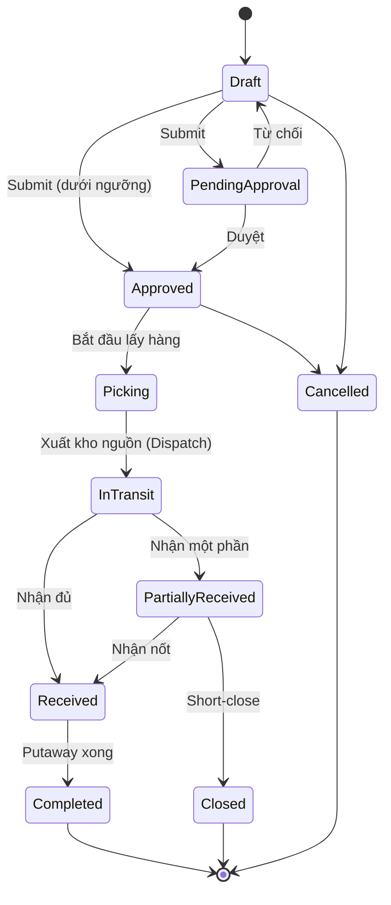

# 10 — Chuyển hàng giữa các kho (Inter-warehouse Transfer)

## 1. Mục đích (Purpose)

Di chuyển tồn kho **từ kho này sang kho khác** (khác địa điểm vật lý) để: cân bằng tồn giữa các kho, đưa hàng đến gần vùng nhu cầu, gom hàng phục vụ chiến dịch, hoặc giải phóng kho quá tải.

Đặc trưng: có **giai đoạn quá cảnh (in-transit)** — hàng đã rời kho nguồn nhưng chưa tới kho đích; hệ thống phải theo dõi tồn "đang trên đường" và tránh thất thoát.

---

## 2. Actor liên quan

| Actor | Vai trò |
|-------|---------|
| **Nhân viên kế hoạch tồn kho (Inventory Planner)** | Đề xuất & tạo lệnh chuyển kho, xác định số lượng, kho nguồn/đích (có thể do Quản lý kho kiêm nhiệm) |
| **Người giữ quyền duyệt TO (Approver)** | Phê duyệt lệnh chuyển vượt giá trị/ngưỡng — là quyền phê duyệt theo [Role Registry](../../00-system-overview/README.md), không phải chức danh riêng |
| **Nhân viên kho nguồn** | Pick & đóng gói hàng chuyển đi, xác nhận xuất |
| **Đơn vị vận chuyển nội bộ / hãng vận chuyển** | Vận chuyển giữa hai kho |
| **Nhân viên kho đích** | Nhận, kiểm đếm, putaway hàng chuyển đến |

---

## 3. Input / Output

### Input

| Trường | Mô tả | Bắt buộc |
|--------|-------|----------|
| Kho nguồn (from warehouse) & kho đích (to warehouse) | Khác nhau | Có |
| **Dòng chuyển (transfer lines)** | SKU, số lượng yêu cầu, (lô/serial nếu áp dụng) | Có |
| Lý do chuyển | Rebalancing / demand / campaign / overflow | Không (khuyến nghị) |
| Ngày mong muốn nhận | | Không |
| Phương thức vận chuyển & chi phí | | Không |

### Output

| Kết quả | Dùng bởi |
|---------|----------|
| **Transfer Order (TO) number** | Truy vết, đối soát giữa hai kho |
| **Xuất kho nguồn** — giảm tồn kho nguồn, tăng tồn `In-Transit` | Tồn kho, báo cáo |
| **Nhập kho đích** — giảm `In-Transit`, tăng tồn kho đích (qua putaway) | Tồn kho, 05 Putaway |
| **Chênh lệch vận chuyển** (hao hụt, hư hỏng trên đường) | Điều chỉnh tồn, điều tra |
| Cập nhật tồn khả dụng để bán ở cả hai kho | 13 Catalog / 14 Order (ATP theo kho) |

---

## 4. Luồng nghiệp vụ từng bước (Step-by-step)

1. **Tạo lệnh chuyển kho (Create Transfer Order)** — Planner chọn kho nguồn, kho đích, thêm dòng SKU & số lượng. TO ở `Draft`.
2. **Kiểm tra khả dụng tại kho nguồn** — số lượng yêu cầu ≤ tồn `Available` tại kho nguồn (không tính hàng đã allocate cho đơn khách).
3. **Gửi duyệt (Submit)** — nếu vượt ngưỡng → `Pending Approval`; duyệt → `Approved`.
4. **Phân bổ & pick tại kho nguồn** — hệ thống phân bổ (allocate) tồn theo vị trí/lô (FEFO); sinh pick task nội bộ. NV kho nguồn lấy hàng.
5. **Đóng gói & xuất kho nguồn (Ship from source)** — đóng kiện, ghi khối lượng & kích thước. Nếu đi **xe tải / container** (xe thuê hoặc xe nội bộ): lập **kế hoạch chuyến xe** bằng Load Planning 3D và xếp kiện lên xe theo sơ đồ ([09 §4.2](../09-shipping/README.md#42-giao-nguyên-chuyến--lập-kế-hoạch-xếp-hàng-3d-load-planning)). Xác nhận **Dispatch**. Tồn kho nguồn **giảm**, chuyển sang trạng thái **`In-Transit`** gắn với TO.
6. **Vận chuyển** — theo dõi hành trình (nếu qua hãng vận chuyển: có tracking; nếu xe nội bộ: cập nhật thủ công).
7. **Nhận tại kho đích (Receive at destination)** — NV kho đích tạo phiếu nhận tham chiếu **TO** (không phải PO): kiểm đếm số lượng thực nhận, kiểm tra tình trạng.
8. **Đối chiếu chênh lệch** — so số nhận với số xuất:
   - Khớp → tiếp tục.
   - Thiếu/hỏng → ghi nhận **transfer discrepancy**; điều tra (mất trên đường / đếm sai khi xuất); điều chỉnh tồn `In-Transit` tương ứng.
9. **Putaway tại kho đích** — hàng nhận sinh putaway task ([05](../05-putaway/README.md)) với gợi ý vị trí từ [Slotting](../06-warehouse-map-slotting/README.md) của kho đích. Tồn `In-Transit` → tồn `Available` tại kho đích.
10. **Đóng lệnh chuyển (Close TO)** — khi toàn bộ dòng đã nhận & putaway (hoặc chốt chênh lệch) → `Completed` / `Closed`.

---

## 5. Trạng thái / Vòng đời (Lifecycle)

| Trạng thái | Ý nghĩa | Chuyển tiếp | Ai |
|------------|---------|-------------|----|
| `Draft` | Đang soạn | → `Pending Approval`, → `Approved`, → `Cancelled` | Planner |
| `Pending Approval` | Chờ duyệt | → `Approved`, → `Draft` (từ chối) | Approver |
| `Approved` | Đã duyệt, chờ pick tại nguồn | → `Picking`, → `Cancelled` | Kho nguồn |
| `Picking` | Đang lấy hàng tại kho nguồn | → `In Transit`, → `Approved` (huỷ pick) | Kho nguồn |
| `In Transit` | Đã xuất kho nguồn, đang trên đường | → `Partially Received`, → `Received` | Vận chuyển / Kho đích |
| `Partially Received` | Kho đích đã nhận một phần | → `Received`, → `Closed` (short-close) | Kho đích |
| `Received` | Kho đích đã nhận đủ (chờ putaway) | → `Completed` | Kho đích |
| `Completed` / `Closed` | Đã putaway & đối chiếu xong | *(cuối)* | System / Manager |
| `Cancelled` | Huỷ khi **chưa xuất** kho nguồn | *(cuối)* | Planner / Approver |

---

## 6. Ràng buộc nghiệp vụ (Business Rules) & Edge case

### Business rules

- **BR-01:** Kho nguồn ≠ kho đích. Chuyển trong cùng kho dùng [Intra-warehouse Transfer](../11-intra-warehouse-transfer/README.md).
- **BR-02:** Chỉ chuyển được tồn `Available` (không lấy hàng đã allocate cho đơn khách, `Blocked`, `Quarantine`).
- **BR-03:** Tồn `In-Transit` **thuộc về TO**, không khả dụng để bán ở bất kỳ kho nào cho tới khi nhận & putaway tại kho đích. (Trừ khi bật ATP tính cả in-transit cho kho đích — ⚠️ Giả định, xem [open-questions](../../open-questions/README.md).)
- **BR-04:** TO chỉ `Cancelled` khi chưa xuất kho nguồn. Sau khi `In Transit` chỉ có thể `Closed` (kèm xử lý hàng thực tế).
- **BR-05:** Chênh lệch xuất/nhận phải được ghi nhận & điều chỉnh có lý do; không để tồn `In-Transit` "treo" vô thời hạn — có ngưỡng cảnh báo quá hạn.
- **BR-06:** Nhận tại kho đích **bắt buộc qua phiếu nhận** (kiểm đếm), không cộng thẳng tồn theo số xuất.
- **BR-07:** Giá trị/định giá tồn khi chuyển kho theo chính sách kế toán (giữ nguyên giá vốn hay cộng chi phí vận chuyển) — cấu hình hệ thống.

### Edge case

| Tình huống | Hướng xử lý |
|------------|-------------|
| Hàng hụt khi nhận (mất trên đường) | Ghi transfer discrepancy; điều chỉnh giảm `In-Transit`; mở điều tra / claim với hãng vận chuyển |
| Hàng hỏng khi tới kho đích | Nhận vào `Quarantine` tại kho đích; không putaway vùng picking; xử lý huỷ/khắc phục |
| Kho nguồn cần gấp lại số hàng đã xuất | Không thu hồi giữa đường; tạo TO ngược chiều hoặc điều phối từ kho khác |
| Đơn khách phát sinh cần đúng lô đang In-Transit | Không allocate hàng In-Transit; chờ nhận xong hoặc lấy lô khác |
| Nhận nhiều đợt cho một TO (giao lắt nhắt) | `Partially Received`; mỗi đợt một phiếu nhận tham chiếu TO |
| Sai kho đích (chọn nhầm) khi đã In-Transit | Nhận tại kho thực nhận, rồi tạo TO mới chuyển tiếp đến kho đúng |
| TO treo `In-Transit` quá lâu | Cảnh báo Manager; buộc đối chiếu & đóng (nhận thực tế hoặc ghi mất mát) |

---

## 7. Liên kết với các module khác

| Module | Quan hệ |
|--------|---------|
| [03 · Receipt](../03-receipt/README.md) | Nhận tại kho đích dùng cơ chế phiếu nhận, chứng từ nguồn là TO thay vì PO |
| [05 · Putaway](../05-putaway/README.md) | Hàng nhận tại kho đích sinh putaway task |
| [06 · Warehouse Map & Slotting](../06-warehouse-map-slotting/README.md) | Gợi ý vị trí đích tại kho nhận; đề xuất chuyển bớt khi kho nguồn quá tải |
| [07 · Picking](../07-picking/README.md) | Pick tại kho nguồn dùng cơ chế picking nội bộ; không được đụng hàng đã allocate cho đơn khách |
| [09 · Shipping](../09-shipping/README.md) | TO đi xe tải / container dùng Load Planning (kế hoạch chuyến xe) trước khi xuất kho nguồn |
| [11 · Intra-warehouse Transfer](../11-intra-warehouse-transfer/README.md) | Phân biệt: intra = trong một kho, inter = giữa các kho |
| [13 · Catalog](../../ecommerce/13-catalog/README.md) / [14 · Order](../../ecommerce/14-cart-and-order/README.md) | Ảnh hưởng tồn khả dụng theo từng kho; hỗ trợ chiến lược bán theo khu vực |
| [00 · System Overview §5](../../00-system-overview/README.md) | Luồng Transfer |
