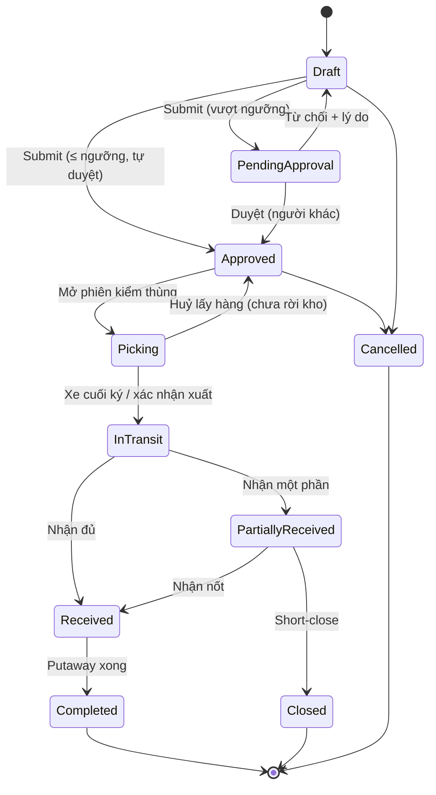

# 10 — Chuyển hàng giữa các kho (Inter-warehouse Transfer)

## 1. Mục đích (Purpose)

Di chuyển tồn kho **từ kho này sang kho khác** (khác địa điểm vật lý). Mục đích:

- cân bằng tồn giữa các kho;
- đưa hàng đến gần vùng nhu cầu;
- gom hàng phục vụ chiến dịch;
- giải phóng kho quá tải.

Đặc trưng: có **giai đoạn quá cảnh (in-transit)** — hàng đã rời kho nguồn nhưng chưa tới kho đích. Hệ thống phải theo dõi tồn "đang trên đường" và tránh thất thoát.

> Đã chốt 2026-11-04: mọi tồn nằm trong **thùng LPN** do bộ phận sản xuất đóng sẵn; lệnh chuyển kho **chuyển nguyên thùng** — không mở thùng, không lấy lẻ, không đóng lại hàng. Thùng LPN chính là kiện chuyển đi. Phân bổ cho lệnh dùng cùng quy tắc nguyên thùng với đơn khách ([07](../07-picking/README.md) BR-03). *(Đã chốt 2026-11-05)* Dòng chuyển ghi **số thùng**; mọi thùng của SKU đúng số cái chuẩn nên phân bổ = chọn **đủ N thùng** theo FEFO / FIFO.

Lệnh chuyển kho có **hai cách giao**:

| Cách giao | Kiểm thùng & xuất kho nguồn |
|-----------|-----------------------------|
| **Nguyên chuyến (`FULL_TRUCKLOAD`)** — mặc định | Kiểm thùng theo **phiên kiểm thùng chuyển kho**, lập **kế hoạch chuyến xe 3D** ([09 §4.2](../09-shipping/README.md#42-giao-nguyên-chuyến--lập-kế-hoạch-xếp-hàng-3d-load-planning)); hàng rời kho nguồn khi **xe cuối cùng** ký bàn giao |
| **Gửi kiện (`PARCEL`)** | Nhân viên kho xác nhận xuất kho bằng cách **quét LPN** từng thùng gửi đi |

---

## 2. Actor liên quan

| Actor | Vai trò |
|-------|---------|
| **Nhân viên kế hoạch tồn kho (Inventory Planner)** | Tạo, sửa (khi `Draft`), gửi duyệt, huỷ lệnh chuyển kho |
| **Quản lý kho (Warehouse Manager)** | Như Planner; thêm **duyệt / từ chối** lệnh vượt ngưỡng (không được duyệt lệnh do chính mình gửi) |
| **Nhân viên kho nguồn** | Lấy & quét kiểm các thùng chuyển đi, dán nhãn (phiên kiểm thùng chuyển kho), huỷ lấy hàng khi hàng chưa rời kho, xác nhận xuất bằng quét LPN (cách giao gửi kiện), xếp xe & ký bàn giao ([09](../09-shipping/README.md)) |
| **Đơn vị vận chuyển nội bộ / hãng vận chuyển** | Vận chuyển giữa hai kho |
| **Nhân viên kho đích** | Nhận, kiểm đếm, putaway hàng chuyển đến |

- Người dùng phải được gán vào **kho nguồn hoặc kho đích** mới thấy và thao tác lệnh.
- Lấy hàng và xuất kho cần được gán vào **kho nguồn**.

---

## 3. Input / Output

### Input

| Trường | Mô tả | Bắt buộc |
|--------|-------|----------|
| Kho nguồn (from warehouse) & kho đích (to warehouse) | Khác nhau; cả hai đang hoạt động | Có |
| **Dòng chuyển (transfer lines)** | SKU, **số thùng** yêu cầu (số nguyên ≥ 1; hiển thị kèm số cái), (lô nếu áp dụng); mỗi SKU + lô một dòng. Kho nguồn phải có đủ số thùng tự do (BR-13) | Có |
| Cách giao | Nguyên chuyến (mặc định) / gửi kiện | Có |
| Lý do chuyển | `REBALANCING` (cân bằng tồn) / `DEMAND` (nhu cầu) / `CAMPAIGN` (chiến dịch) / `OVERFLOW` (kho quá tải) / `OTHER` | Không |
| Ngày mong muốn nhận | | Không |

### Output

| Kết quả | Dùng bởi |
|---------|----------|
| **Transfer Order (TO) number** | Truy vết, đối soát giữa hai kho |
| **Giữ các thùng LPN cho lệnh** tại kho nguồn khi mở phiên kiểm thùng chuyển kho | [20](../20-inventory-control/README.md) |
| **Xuất kho nguồn** — giảm tồn kho nguồn theo số thùng (dòng sổ `TRANSFER_OUT`, thùng → `Consumed` ở kho nguồn), tồn `In-Transit` thuộc lệnh | Tồn kho, báo cáo |
| **Nhập kho đích** — giảm `In-Transit`, tăng tồn kho đích (qua putaway) | Tồn kho, 05 Putaway |
| **Chênh lệch vận chuyển** (hao hụt, hư hỏng trên đường) | Điều chỉnh tồn, điều tra |
| Cập nhật tồn khả dụng để bán ở cả hai kho | 13 Catalog / 14 Order (ATP theo kho) |

---

## 4. Luồng nghiệp vụ từng bước (Step-by-step)

1. **Tạo lệnh chuyển kho** — Planner / Quản lý kho chọn kho nguồn, kho đích, cách giao, thêm dòng SKU & số thùng → TO `Draft`.
   - Khi lưu, hệ thống kiểm **mỗi dòng phải đủ số thùng tự do tại kho nguồn ngay lúc đó** (BR-13); thùng đã giữ cho đơn khách không được tính.
   - Còn `Draft` thì sửa được kho, lý do, ngày, dòng, cách giao.
2. **Gửi duyệt (Submit)** — tổng **số thùng** yêu cầu **≤ ngưỡng** (mặc định **100 thùng**, cấu hình được — BR-08) → TO tự `Approved`, người gửi được ghi là người duyệt. **Vượt ngưỡng** → `Pending Approval`.
3. **Duyệt** — Quản lý kho **khác người gửi** duyệt → `Approved`, hoặc từ chối (bắt buộc lý do) → về `Draft`.
4. **Lấy & kiểm thùng tại kho nguồn** — tuỳ cách giao:
   - **Nguyên chuyến:** nhân viên kho mở **phiên kiểm thùng chuyển kho** → TO `Picking`. Hệ thống **phân bổ và giữ đủ số thùng** của từng dòng theo FEFO / FIFO ([07](../07-picking/README.md) BR-03). Nhân viên lấy từng thùng, **quét LPN** để kiểm (đúng thùng đã giữ cho lệnh) và dán nhãn chuyển kho như [08](../08-packing/README.md) — không mở thùng, không đóng lại hàng; kích thước & khối lượng lấy từ quy cách thùng của SKU. Thùng không lấy được (không thấy, hư hỏng) → chọn giao một phần kèm **ghi chú**; chỉ các thùng đã kiểm còn được giữ.
   - **Gửi kiện:** nhân viên kho lấy thùng (ngoài phiên kiểm thùng chuyển kho).
5. **Xuất kho nguồn (Dispatch):**
   - **Nguyên chuyến:** lập **kế hoạch chuyến xe** cho đúng lệnh này (một kế hoạch chỉ một lệnh, không trộn đơn khách), xếp xe & ký bàn giao từng xe ([09 §4.2](../09-shipping/README.md#42-giao-nguyên-chuyến--lập-kế-hoạch-xếp-hàng-3d-load-planning)). Lệnh đi **nguyên lô**: không được để lại kiện. Khi **xe cuối cùng** ký → TO `In Transit`, tồn kho nguồn giảm đúng các thùng đã kiểm.
   - **Gửi kiện:** nhân viên kho xác nhận xuất bằng cách **quét LPN từng thùng gửi đi** → TO `In Transit`. Hệ thống kiểm thùng đúng SKU / lô của dòng, ở kho nguồn, đang tự do (không giữ cho đơn khách, không ở khu chờ xuất), số thùng mỗi dòng không vượt số thùng yêu cầu và có ít nhất một thùng. Tồn kho nguồn giảm theo đúng các thùng đã quét.

   Tồn đã xuất **thuộc về lệnh**, không thuộc kho nào.
6. **Huỷ lấy hàng** — khi hàng **chưa rời kho**, TO `Picking` → `Approved`:
   - nhả giữ các thùng;
   - huỷ kế hoạch chuyến xe của lệnh (bị chặn nếu đã có xe bắt đầu xếp);
   - huỷ nhãn chuyển kho;
   - đóng phiên kiểm thùng chuyển kho.

   Tồn chưa từng bị trừ và vẫn ghi ở bin cũ nên không phải cất lại trên hệ thống; nhân viên đưa thùng về đúng bin. Đã có hàng rời kho trên xe → không huỷ được.
7. **Vận chuyển** — hệ thống **không theo dõi hành trình** (dù đi xe nội bộ hay thuê hãng vận chuyển). Tồn nằm ở trạng thái `In-Transit` gắn với TO cho tới khi kho đích xác nhận nhận hàng ở bước 8.
8. **Nhận tại kho đích (Receive at destination)** — NV kho đích tạo phiếu nhận tham chiếu **TO** (không phải Yêu cầu sản xuất): kiểm đếm số thùng thực nhận, kiểm tra tình trạng.
9. **Đối chiếu chênh lệch** — so số thùng nhận với số thùng xuất:
   - Khớp → tiếp tục.
   - Thiếu / hỏng → ghi nhận **transfer discrepancy**; điều tra (mất trên đường / đếm sai khi xuất); điều chỉnh tồn `In-Transit` tương ứng.
10. **Putaway tại kho đích** — hàng nhận sinh putaway task ([05](../05-putaway/README.md)) với gợi ý vị trí từ [Slotting](../06-warehouse-map-slotting/README.md) của kho đích. Tồn `In-Transit` → tồn `Available` tại kho đích.
11. **Đóng lệnh chuyển (Close TO)** — khi toàn bộ dòng đã nhận & putaway (hoặc chốt chênh lệch) → `Completed` / `Closed`.

> ⚠️ Giả định: các bước 8–11 (nhận tại kho đích, đối chiếu chênh lệch, cất hàng, đóng lệnh) thuộc **phạm vi giai đoạn sau** — hệ thống chưa có chức năng nhận hàng của lệnh chuyển kho, kể cả việc nhận lại thùng theo đúng mã LPN cũ tại kho đích. Lệnh hiện dừng ở `In Transit` sau khi xuất kho nguồn. Xem [open-questions C26](../../open-questions/README.md).

---

## 5. Trạng thái / Vòng đời (Lifecycle)

| Trạng thái | Ý nghĩa | Chuyển tiếp cho phép | Ai thực hiện |
|------------|---------|----------------------|--------------|
| `Draft` | Đang soạn; sửa được | → `Pending Approval` (vượt ngưỡng), → `Approved` (≤ ngưỡng), → `Cancelled` | Planner / Quản lý kho |
| `Pending Approval` | Chờ duyệt | → `Approved`, → `Draft` (từ chối, có lý do) | Quản lý kho (khác người gửi) |
| `Approved` | Đã duyệt, chờ lấy & kiểm thùng tại nguồn | → `Picking`, → `Cancelled` | Kho nguồn |
| `Picking` | Đang lấy & kiểm thùng tại kho nguồn; các thùng đã giữ cho lệnh | → `In Transit`, → `Approved` (huỷ lấy hàng, khi hàng chưa rời kho) | Kho nguồn |
| `In Transit` | Đã xuất kho nguồn, đang trên đường | → `Partially Received`, → `Received` | Vận chuyển / Kho đích |
| `Partially Received` | Kho đích đã nhận một phần *(phạm vi sau)* | → `Received`, → `Closed` (short-close) | Kho đích |
| `Received` | Kho đích đã nhận đủ, chờ putaway *(phạm vi sau)* | → `Completed` | Kho đích |
| `Completed` / `Closed` | Đã putaway & đối chiếu xong *(phạm vi sau)* | *(cuối)* | System / Manager |
| `Cancelled` | Huỷ (có lý do) khi **chưa xuất** kho nguồn | *(cuối)* | Planner / Quản lý kho |

---

## 6. Ràng buộc nghiệp vụ (Business Rules) & Edge case

### Business rules

- **BR-01:** Kho nguồn ≠ kho đích; cả hai đang hoạt động. Chuyển trong cùng kho dùng [Intra-warehouse Transfer](../11-intra-warehouse-transfer/README.md).
- **BR-02:** Chỉ chuyển được tồn `Available` tự do (không lấy hàng đã giữ / phân bổ cho đơn khách, hàng ở khu chờ xuất `STAGING`, hàng `Quarantine` / `Expired`). Mỗi dòng phải đủ số thùng tự do tại kho nguồn khi lưu lệnh.
- **BR-03:** Tồn `In-Transit` **thuộc về TO**, không khả dụng để bán ở bất kỳ kho nào cho tới khi nhận & putaway tại kho đích. (Trừ khi bật ATP tính cả in-transit cho kho đích — ⚠️ Giả định, xem [open-questions](../../open-questions/README.md).)
- **BR-04:** TO chỉ `Cancelled` (kèm lý do) khi chưa xuất kho nguồn. Sau khi `In Transit` chỉ có thể `Closed` (kèm xử lý hàng thực tế).
- **BR-05:** Chênh lệch xuất / nhận phải được ghi nhận & điều chỉnh có lý do (kiểm kê / điều chỉnh tồn có duyệt — [20](../20-inventory-control/README.md)); không để tồn `In-Transit` "treo" vô thời hạn — có ngưỡng cảnh báo quá hạn.
- **BR-06:** Nhận tại kho đích **bắt buộc qua phiếu nhận** (kiểm đếm), không cộng thẳng tồn theo số xuất.
- **BR-07:** Giá trị / định giá tồn khi chuyển kho theo chính sách kế toán (giữ nguyên giá vốn hay cộng chi phí vận chuyển) — cấu hình hệ thống.
- **BR-08:** **Ngưỡng duyệt** tính theo **tổng số thùng yêu cầu**, mặc định 100 thùng (⚠️ giả định: giữ con số mặc định 100, nay tính theo thùng thay vì đơn vị cơ sở — xem [open-questions](../../open-questions/README.md)). ≤ ngưỡng thì tự duyệt khi gửi; vượt ngưỡng thì **bốn mắt**: người duyệt / từ chối không được là người gửi.
- **BR-09:** Lệnh **nguyên chuyến** chỉ xuất qua kế hoạch chuyến xe; không xác nhận xuất thủ công. Lệnh **gửi kiện** xác nhận xuất thủ công.
- **BR-10:** Kế hoạch chuyến xe của lệnh chuyển kho chỉ chứa **một lệnh**, không trộn đơn khách. Lệnh đi **nguyên lô** (không để lại kiện). Hàng rời kho nguồn khi **xe cuối cùng** của kế hoạch ký bàn giao.
- **BR-11:** Huỷ lấy hàng chỉ khi **chưa có hàng rời kho** và chưa có xe bắt đầu xếp. Huỷ nhả giữ các thùng, huỷ nhãn / kế hoạch xe.
- **BR-12:** Kiểm được ít thùng hơn yêu cầu phải có **ghi chú**; chỉ các thùng đã kiểm được xuất.
- **BR-13:** **Chuyển nguyên thùng.** Lệnh chỉ chuyển thùng LPN nguyên, không mở thùng, không lấy lẻ, không đóng lại hàng; thùng LPN là kiện chuyển đi. Số lượng mỗi dòng là **số thùng**; phân bổ = chọn đủ N thùng tự do ở kho nguồn theo [07](../07-picking/README.md) BR-03. Thùng xuất đi rời tồn kho nguồn (`Consumed`); xuất gửi kiện xác nhận bằng quét LPN từng thùng.

### Edge case

| Tình huống | Hướng xử lý |
|------------|-------------|
| Kho nguồn không đủ số thùng tự do khi lập lệnh | Hệ thống từ chối lưu dòng đó; giảm số thùng hoặc chọn kho nguồn khác |
| Người lập lệnh vượt ngưỡng cũng là quản lý duy nhất | Không tự duyệt được; cần quản lý khác hoặc System Admin |
| Thùng đã giữ cho lệnh không thấy / hư hỏng khi lấy | Không chuyển thùng đó; thùng hư hỏng cách ly ([20](../20-inventory-control/README.md) §4.8), thùng không thấy kiểm kê; hoàn tất giao một phần kèm ghi chú hoặc lập lệnh bổ sung |
| Chỉ kiểm được một phần số thùng yêu cầu | Hoàn tất giao một phần kèm ghi chú; phần còn lại lập lệnh mới nếu cần |
| Muốn dừng khi đang kiểm thùng | Huỷ lấy hàng (chưa rời kho): nhả giữ thùng, huỷ nhãn / kế hoạch xe, TO về `Approved` |
| Muốn huỷ khi đã có xe rời kho | Không được; chờ nhận tại kho đích rồi lập lệnh ngược chiều |
| Hàng hụt khi nhận (mất trên đường) | Ghi transfer discrepancy; điều chỉnh giảm `In-Transit`; mở điều tra / claim với hãng vận chuyển |
| Hàng hỏng khi tới kho đích | Nhận vào `Quarantine` tại kho đích; không putaway vùng picking; xử lý huỷ / khắc phục |
| Kho nguồn cần gấp lại số hàng đã xuất | Không thu hồi giữa đường; tạo TO ngược chiều hoặc điều phối từ kho khác |
| Đơn khách phát sinh cần đúng lô đang In-Transit | Không phân bổ hàng In-Transit; chờ nhận xong hoặc lấy lô khác |
| Nhận nhiều đợt cho một TO | `Partially Received`; mỗi đợt một phiếu nhận tham chiếu TO |
| Sai kho đích (chọn nhầm) khi đã In-Transit | Nhận tại kho thực nhận, rồi tạo TO mới chuyển tiếp đến kho đúng |
| TO treo `In-Transit` quá lâu | Cảnh báo Manager; buộc đối chiếu & đóng (nhận thực tế hoặc ghi mất mát) |

---

## 7. Liên kết với các module khác

| Module | Quan hệ |
|--------|---------|
| [03 · Receipt](../03-receipt/README.md) | Nhận tại kho đích dùng cơ chế phiếu nhận, chứng từ nguồn là TO thay vì Yêu cầu sản xuất |
| [05 · Putaway](../05-putaway/README.md) | Hàng nhận tại kho đích sinh putaway task |
| [06 · Warehouse Map & Slotting](../06-warehouse-map-slotting/README.md) | Gợi ý vị trí đích tại kho nhận; đề xuất chuyển bớt khi kho nguồn quá tải |
| [07 · Picking](../07-picking/README.md) | Phân bổ đủ N thùng theo FEFO / FIFO (BR-03) dùng cho dòng chuyển kho |
| [08 · Kiểm thùng & Dán nhãn giao hàng](../08-packing/README.md) | Phiên kiểm thùng chuyển kho dùng cùng quy tắc: quét LPN, thùng là kiện, kích thước theo quy cách thùng, nhãn |
| [09 · Shipping](../09-shipping/README.md) | Lệnh nguyên chuyến dùng kế hoạch chuyến xe; xe cuối ký thì hàng rời kho nguồn; ước tính tải cho lệnh chuyển |
| [11 · Intra-warehouse Transfer](../11-intra-warehouse-transfer/README.md) | Phân biệt: intra = trong một kho, inter = giữa các kho |
| [13 · Catalog](../../ecommerce/13-catalog/README.md) / [14 · Order](../../ecommerce/14-cart-and-order/README.md) | Ảnh hưởng tồn khả dụng theo từng kho; hỗ trợ chiến lược bán theo khu vực |
| [20 · Inventory Control](../20-inventory-control/README.md) | Giữ hàng cho lệnh chuyển; dòng sổ `TRANSFER_OUT`; chênh lệch xử lý bằng kiểm kê và điều chỉnh tồn có duyệt; thùng LPN |
| [00 · System Overview §5](../../00-system-overview/README.md) | Luồng Transfer |
