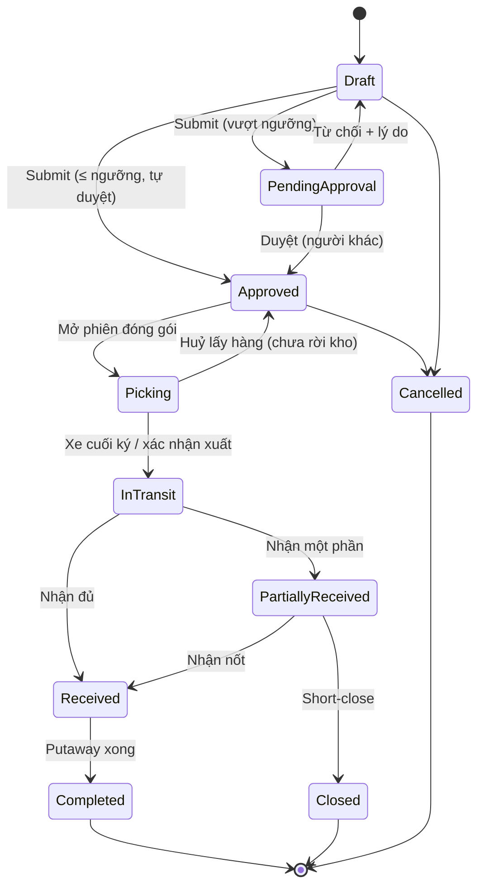

# 10 — Chuyển hàng giữa các kho (Inter-warehouse Transfer)

## 1. Mục đích (Purpose)

Di chuyển tồn kho **từ kho này sang kho khác** (khác địa điểm vật lý). Mục đích:

- cân bằng tồn giữa các kho;
- đưa hàng đến gần vùng nhu cầu;
- gom hàng phục vụ chiến dịch;
- giải phóng kho quá tải.

Đặc trưng: có **giai đoạn quá cảnh (in-transit)** — hàng đã rời kho nguồn nhưng chưa tới kho đích. Hệ thống phải theo dõi tồn "đang trên đường" và tránh thất thoát.

Lệnh chuyển kho có **hai cách giao**:

| Cách giao | Đóng gói & xuất kho nguồn |
|-----------|---------------------------|
| **Nguyên chuyến (`FULL_TRUCKLOAD`)** — mặc định | Đóng gói theo phiên đóng gói chuyển kho, lập **kế hoạch chuyến xe 3D** ([09 §4.2](../09-shipping/README.md#42-giao-nguyên-chuyến--lập-kế-hoạch-xếp-hàng-3d-load-planning)); hàng rời kho nguồn khi **xe cuối cùng** ký bàn giao |
| **Gửi kiện (`PARCEL`)** | Nhân viên kho xác nhận xuất kho thủ công, nhập số lượng thực xuất từng dòng |

---

## 2. Actor liên quan

| Actor | Vai trò |
|-------|---------|
| **Nhân viên kế hoạch tồn kho (Inventory Planner)** | Tạo, sửa (khi `Draft`), gửi duyệt, huỷ lệnh chuyển kho |
| **Quản lý kho (Warehouse Manager)** | Như Planner; thêm **duyệt / từ chối** lệnh vượt ngưỡng (không được duyệt lệnh do chính mình gửi) |
| **Nhân viên kho nguồn** | Đóng gói hàng chuyển đi (phiên đóng gói chuyển kho), huỷ lấy hàng khi hàng chưa rời kho, xác nhận xuất (cách giao gửi kiện), xếp xe & ký bàn giao ([09](../09-shipping/README.md)) |
| **Đơn vị vận chuyển nội bộ / hãng vận chuyển** | Vận chuyển giữa hai kho |
| **Nhân viên kho đích** | Nhận, kiểm đếm, putaway hàng chuyển đến |

- Người dùng phải được gán vào **kho nguồn hoặc kho đích** mới thấy và thao tác lệnh.
- Lấy hàng và xuất kho cần được gán vào **kho nguồn**.

---

## 3. Input / Output

### Input

| Trường | Mô tả | Bắt buộc |
|--------|-------|----------|
| Kho nguồn (from warehouse) & kho đích (to warehouse) | Khác nhau; cả hai đang hoạt động | Có |
| **Dòng chuyển (transfer lines)** | SKU, số lượng yêu cầu, (lô nếu áp dụng); mỗi SKU + lô một dòng | Có |
| Cách giao | Nguyên chuyến (mặc định) / gửi kiện | Có |
| Lý do chuyển | `REBALANCING` (cân bằng tồn) / `DEMAND` (nhu cầu) / `CAMPAIGN` (chiến dịch) / `OVERFLOW` (kho quá tải) / `OTHER` | Không |
| Ngày mong muốn nhận | | Không |

### Output

| Kết quả | Dùng bởi |
|---------|----------|
| **Transfer Order (TO) number** | Truy vết, đối soát giữa hai kho |
| **Giữ hàng cho lệnh** tại kho nguồn khi bắt đầu đóng gói | [20](../20-inventory-control/README.md) |
| **Xuất kho nguồn** — giảm tồn kho nguồn (dòng sổ `TRANSFER_OUT`), tồn `In-Transit` thuộc lệnh | Tồn kho, báo cáo |
| **Nhập kho đích** — giảm `In-Transit`, tăng tồn kho đích (qua putaway) | Tồn kho, 05 Putaway |
| **Chênh lệch vận chuyển** (hao hụt, hư hỏng trên đường) | Điều chỉnh tồn, điều tra |
| Cập nhật tồn khả dụng để bán ở cả hai kho | 13 Catalog / 14 Order (ATP theo kho) |

---

## 4. Luồng nghiệp vụ từng bước (Step-by-step)

1. **Tạo lệnh chuyển kho** — Planner / Quản lý kho chọn kho nguồn, kho đích, cách giao, thêm dòng SKU & số lượng → TO `Draft`.
   - Khi lưu, hệ thống kiểm **mỗi dòng phải đủ tồn tại kho nguồn ngay lúc đó**; hàng đã giữ cho đơn khách không được tính.
   - Còn `Draft` thì sửa được kho, lý do, ngày, dòng, cách giao.
2. **Gửi duyệt (Submit)** — tổng số lượng yêu cầu **≤ ngưỡng** (mặc định **100 đơn vị**, cấu hình được) → TO tự `Approved`, người gửi được ghi là người duyệt. **Vượt ngưỡng** → `Pending Approval`.
3. **Duyệt** — Quản lý kho **khác người gửi** duyệt → `Approved`, hoặc từ chối (bắt buộc lý do) → về `Draft`.
4. **Đóng gói tại kho nguồn** — tuỳ cách giao:
   - **Nguyên chuyến:** nhân viên kho mở **phiên đóng gói chuyển kho** → TO `Picking`, hệ thống **giữ toàn bộ số lượng yêu cầu** tại kho nguồn. Đóng kiện như [08](../08-packing/README.md) (cân đo, niêm phong). Thùng **LPN nguyên đai** chưa mở có thể **gửi nguyên thùng** thành một kiện; thùng phải ở kho nguồn, đang trong kho, chưa đóng gói, và vừa phần còn lại của một dòng. Gửi **ít hơn yêu cầu** phải chọn giao một phần kèm **ghi chú**; chỉ phần đã đóng còn được giữ.
   - **Gửi kiện:** nhân viên kho lấy & đóng hàng (ngoài phiên đóng gói chuyển kho).
5. **Xuất kho nguồn (Dispatch):**
   - **Nguyên chuyến:** lập **kế hoạch chuyến xe** cho đúng lệnh này (một kế hoạch chỉ một lệnh, không trộn đơn khách), xếp xe & ký bàn giao từng xe ([09 §4.2](../09-shipping/README.md#42-giao-nguyên-chuyến--lập-kế-hoạch-xếp-hàng-3d-load-planning)). Lệnh đi **nguyên lô**: không được để lại kiện. Khi **xe cuối cùng** ký → TO `In Transit`, tồn kho nguồn giảm đúng phần đã đóng.
   - **Gửi kiện:** nhân viên kho xác nhận xuất, nhập **số lượng thực xuất** từng dòng (0 tới số yêu cầu, tổng ≥ 1) → TO `In Transit`. Tồn kho nguồn giảm theo FIFO / FEFO, thùng nguyên trước ([07](../07-picking/README.md) BR-03), không đụng hàng đã giữ cho đơn khách.

   Tồn đã xuất **thuộc về lệnh**, không thuộc kho nào.
6. **Huỷ lấy hàng** — khi hàng **chưa rời kho**, TO `Picking` → `Approved`:
   - nhả giữ hàng;
   - huỷ kế hoạch chuyến xe của lệnh (bị chặn nếu đã có xe bắt đầu xếp);
   - huỷ kiện & nhãn;
   - đóng phiên đóng gói.

   Hàng chưa từng bị trừ nên không phải cất lại. Đã có hàng rời kho trên xe → không huỷ được.
7. **Vận chuyển** — hệ thống **không theo dõi hành trình** (dù đi xe nội bộ hay thuê hãng vận chuyển). Tồn nằm ở trạng thái `In-Transit` gắn với TO cho tới khi kho đích xác nhận nhận hàng ở bước 8.
8. **Nhận tại kho đích (Receive at destination)** — NV kho đích tạo phiếu nhận tham chiếu **TO** (không phải PO): kiểm đếm số lượng thực nhận, kiểm tra tình trạng.
9. **Đối chiếu chênh lệch** — so số nhận với số xuất:
   - Khớp → tiếp tục.
   - Thiếu / hỏng → ghi nhận **transfer discrepancy**; điều tra (mất trên đường / đếm sai khi xuất); điều chỉnh tồn `In-Transit` tương ứng.
10. **Putaway tại kho đích** — hàng nhận sinh putaway task ([05](../05-putaway/README.md)) với gợi ý vị trí từ [Slotting](../06-warehouse-map-slotting/README.md) của kho đích. Tồn `In-Transit` → tồn `Available` tại kho đích.
11. **Đóng lệnh chuyển (Close TO)** — khi toàn bộ dòng đã nhận & putaway (hoặc chốt chênh lệch) → `Completed` / `Closed`.

> ⚠️ Giả định: các bước 8–11 (nhận tại kho đích, đối chiếu chênh lệch, cất hàng, đóng lệnh) thuộc **phạm vi giai đoạn sau** — hệ thống chưa có chức năng nhận hàng của lệnh chuyển kho. Lệnh hiện dừng ở `In Transit` sau khi xuất kho nguồn. Xem [open-questions C26](../../open-questions/README.md).

---

## 5. Trạng thái / Vòng đời (Lifecycle)

| Trạng thái | Ý nghĩa | Chuyển tiếp cho phép | Ai thực hiện |
|------------|---------|----------------------|--------------|
| `Draft` | Đang soạn; sửa được | → `Pending Approval` (vượt ngưỡng), → `Approved` (≤ ngưỡng), → `Cancelled` | Planner / Quản lý kho |
| `Pending Approval` | Chờ duyệt | → `Approved`, → `Draft` (từ chối, có lý do) | Quản lý kho (khác người gửi) |
| `Approved` | Đã duyệt, chờ đóng gói tại nguồn | → `Picking`, → `Cancelled` | Kho nguồn |
| `Picking` | Đang đóng gói tại kho nguồn; hàng đã giữ | → `In Transit`, → `Approved` (huỷ lấy hàng, khi hàng chưa rời kho) | Kho nguồn |
| `In Transit` | Đã xuất kho nguồn, đang trên đường | → `Partially Received`, → `Received` | Vận chuyển / Kho đích |
| `Partially Received` | Kho đích đã nhận một phần *(phạm vi sau)* | → `Received`, → `Closed` (short-close) | Kho đích |
| `Received` | Kho đích đã nhận đủ, chờ putaway *(phạm vi sau)* | → `Completed` | Kho đích |
| `Completed` / `Closed` | Đã putaway & đối chiếu xong *(phạm vi sau)* | *(cuối)* | System / Manager |
| `Cancelled` | Huỷ (có lý do) khi **chưa xuất** kho nguồn | *(cuối)* | Planner / Quản lý kho |

---

## 6. Ràng buộc nghiệp vụ (Business Rules) & Edge case

### Business rules

- **BR-01:** Kho nguồn ≠ kho đích; cả hai đang hoạt động. Chuyển trong cùng kho dùng [Intra-warehouse Transfer](../11-intra-warehouse-transfer/README.md).
- **BR-02:** Chỉ chuyển được tồn `Available` (không lấy hàng đã giữ / phân bổ cho đơn khách, `Blocked`, `Quarantine`). Mỗi dòng phải đủ tồn tại kho nguồn khi lưu lệnh.
- **BR-03:** Tồn `In-Transit` **thuộc về TO**, không khả dụng để bán ở bất kỳ kho nào cho tới khi nhận & putaway tại kho đích. (Trừ khi bật ATP tính cả in-transit cho kho đích — ⚠️ Giả định, xem [open-questions](../../open-questions/README.md).)
- **BR-04:** TO chỉ `Cancelled` (kèm lý do) khi chưa xuất kho nguồn. Sau khi `In Transit` chỉ có thể `Closed` (kèm xử lý hàng thực tế).
- **BR-05:** Chênh lệch xuất / nhận phải được ghi nhận & điều chỉnh có lý do (kiểm kê / điều chỉnh tồn có duyệt — [20](../20-inventory-control/README.md)); không để tồn `In-Transit` "treo" vô thời hạn — có ngưỡng cảnh báo quá hạn.
- **BR-06:** Nhận tại kho đích **bắt buộc qua phiếu nhận** (kiểm đếm), không cộng thẳng tồn theo số xuất.
- **BR-07:** Giá trị / định giá tồn khi chuyển kho theo chính sách kế toán (giữ nguyên giá vốn hay cộng chi phí vận chuyển) — cấu hình hệ thống.
- **BR-08:** **Ngưỡng duyệt** tính theo **tổng số lượng yêu cầu** (đơn vị cơ sở), mặc định 100. ≤ ngưỡng thì tự duyệt khi gửi; vượt ngưỡng thì **bốn mắt**: người duyệt / từ chối không được là người gửi.
- **BR-09:** Lệnh **nguyên chuyến** chỉ xuất qua kế hoạch chuyến xe; không xác nhận xuất thủ công. Lệnh **gửi kiện** xác nhận xuất thủ công.
- **BR-10:** Kế hoạch chuyến xe của lệnh chuyển kho chỉ chứa **một lệnh**, không trộn đơn khách. Lệnh đi **nguyên lô** (không để lại kiện). Hàng rời kho nguồn khi **xe cuối cùng** của kế hoạch ký bàn giao.
- **BR-11:** Huỷ lấy hàng chỉ khi **chưa có hàng rời kho** và chưa có xe bắt đầu xếp. Huỷ nhả giữ hàng, huỷ kiện / nhãn / kế hoạch xe.
- **BR-12:** Đóng gói ít hơn yêu cầu phải có **ghi chú**; chỉ phần đã đóng được xuất.

### Edge case

| Tình huống | Hướng xử lý |
|------------|-------------|
| Kho nguồn không đủ tồn khi lập lệnh | Hệ thống từ chối lưu dòng đó; giảm số lượng hoặc chọn kho nguồn khác |
| Người lập lệnh vượt ngưỡng cũng là quản lý duy nhất | Không tự duyệt được; cần quản lý khác hoặc System Admin |
| Có thùng LPN nguyên đai đúng SKU / lô | Gửi nguyên thùng thành một kiện, không cần mở thùng |
| Chỉ đóng được một phần số yêu cầu | Hoàn tất giao một phần kèm ghi chú; phần còn lại lập lệnh mới nếu cần |
| Muốn dừng khi đang đóng gói | Huỷ lấy hàng (chưa rời kho): nhả giữ, huỷ kiện / kế hoạch xe, TO về `Approved` |
| Muốn huỷ khi đã có xe rời kho | Không được; chờ nhận tại kho đích rồi lập lệnh ngược chiều |
| Hàng hụt khi nhận (mất trên đường) | Ghi transfer discrepancy; điều chỉnh giảm `In-Transit`; mở điều tra / claim với hãng vận chuyển |
| Hàng hỏng khi tới kho đích | Nhận vào `Quarantine` tại kho đích; không putaway vùng picking; xử lý huỷ / khắc phục |
| Kho nguồn cần gấp lại số hàng đã xuất | Không thu hồi giữa đường; tạo TO ngược chiều hoặc điều phối từ kho khác |
| Đơn khách phát sinh cần đúng lô đang In-Transit | Không phân bổ hàng In-Transit; chờ nhận xong hoặc lấy lô khác |
| Nhận nhiều đợt cho một TO | `Partially Received`; mỗi đợt một phiếu nhận tham chiếu TO |
| Sai kho đích (chọn nhầm) khi đã In-Transit | Nhận tại kho thực nhận, rồi tạo TO mới chuyển tiếp đến kho đúng |
| TO treo `In-Transit` quá lâu | Cảnh báo Manager; buộc đối chiếu & đóng (nhận thực tế hoặc ghi mất mát) |

---

## 7. Liên kết với các module khác

| Module | Quan hệ |
|--------|---------|
| [03 · Receipt](../03-receipt/README.md) | Nhận tại kho đích dùng cơ chế phiếu nhận, chứng từ nguồn là TO thay vì PO |
| [05 · Putaway](../05-putaway/README.md) | Hàng nhận tại kho đích sinh putaway task |
| [06 · Warehouse Map & Slotting](../06-warehouse-map-slotting/README.md) | Gợi ý vị trí đích tại kho nhận; đề xuất chuyển bớt khi kho nguồn quá tải |
| [08 · Packing](../08-packing/README.md) | Phiên đóng gói chuyển kho dùng cùng quy tắc kiện (cân đo, niêm phong, nhãn) |
| [09 · Shipping](../09-shipping/README.md) | Lệnh nguyên chuyến dùng kế hoạch chuyến xe; xe cuối ký thì hàng rời kho nguồn; ước tính tải cho lệnh chuyển |
| [11 · Intra-warehouse Transfer](../11-intra-warehouse-transfer/README.md) | Phân biệt: intra = trong một kho, inter = giữa các kho |
| [13 · Catalog](../../ecommerce/13-catalog/README.md) / [14 · Order](../../ecommerce/14-cart-and-order/README.md) | Ảnh hưởng tồn khả dụng theo từng kho; hỗ trợ chiến lược bán theo khu vực |
| [20 · Inventory Control](../20-inventory-control/README.md) | Giữ hàng cho lệnh chuyển; dòng sổ `TRANSFER_OUT`; chênh lệch xử lý bằng kiểm kê và điều chỉnh tồn có duyệt; thùng LPN |
| [00 · System Overview §5](../../00-system-overview/README.md) | Luồng Transfer |
