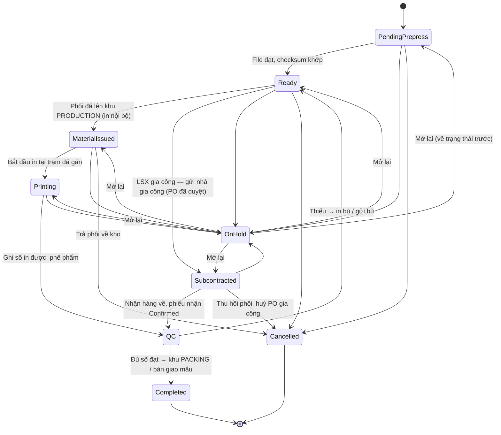
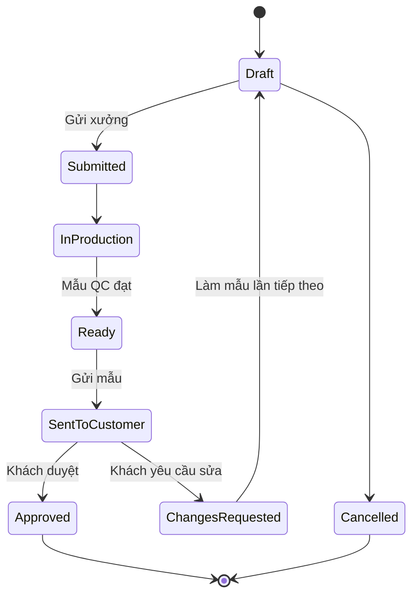

# 19 — Sản xuất / In ly & bao bì (Production: Sample & Order)

> Module số 19 được bổ sung sau khi bộ tài liệu đã đánh số 01–18. Về thứ tự luồng nghiệp vụ, module này nằm **giữa [17 · Order Management](../../ecommerce/17-order-management/README.md) và [07 · Picking](../07-picking/README.md) / [08 · Packing](../08-packing/README.md)**.

## 1. Mục đích (Purpose)

Biến **phôi** (ly, hộp, túi chưa in) thành **thành phẩm in theo thiết kế của khách sỉ** tại **xưởng in nội bộ** đặt trong kho (print-on-demand). Module quản lý **lệnh sản xuất (LSX — Production Order)** từ lúc nhận yêu cầu tới lúc thành phẩm sẵn sàng đóng gói.

Có **hai loại sản xuất**, dùng chung một xưởng và chung các bước tại xưởng:

| Loại | Sinh ra từ | Mục đích |
|------|-----------|----------|
| **Sản xuất mẫu (`SAMPLE`)** | **Yêu cầu làm mẫu** gắn với báo giá — *chưa có đơn bán* | Làm vài sản phẩm để khách duyệt trước khi đặt số lượng lớn. **Bắt buộc với thiết kế mới.** |
| **Sản xuất đơn hàng (`ORDER`)** | Dòng tuỳ chỉnh của **đơn bán** khi Order Coordinator **release** đơn ([17](../../ecommerce/17-order-management/README.md)) | Sản xuất số lượng khách đặt, QC theo **mẫu đã được khách duyệt** |

Module quản lý:

- **Lệnh sản xuất** — mỗi dòng đơn tùy chỉnh (hoặc mỗi lần làm mẫu) sinh một lệnh, đi kèm bản thiết kế chốt (design snapshot) và file sẵn sàng in (print-ready file) từ [12 · Product Design](../../ecommerce/12-product-design/README.md).
- **Kiểm file in (prepress)**, **cấp phôi** từ bin lên xưởng qua luồng [Picking](../07-picking/README.md), **hàng đợi** và **trạm in (Print Station)** theo kỹ thuật in.
- **Kiểm tra chất lượng thành phẩm** và **bàn giao thẳng sang khu đóng gói** (Area `PACKING`) — thành phẩm không cất lại lên bin.

Sản xuất mặc định diễn ra tại xưởng nội bộ. Khi **xưởng nội bộ không đủ công suất**, Quản lý kho có thể **tách một phần LSX `ORDER` đưa gia công ngoài** (§4.7): phần tách ra thành một **LSX con** do **nhà gia công** in, hàng về phải qua nhận hàng và QC như hàng in nội bộ. **Lệnh mẫu luôn in nội bộ.**

---

## 2. Actor liên quan

| Actor | Vai trò |
|-------|---------|
| **Nhân viên sản xuất (Production Staff)** | Kiểm file in (prepress); nhận lệnh tại trạm, in, báo số lượng đạt / hỏng (phế phẩm kèm lý do), bàn giao thành phẩm cho QC |
| **Quản lý kho (Warehouse Manager)** | Điều phối xưởng: khai báo trạm in & công suất, gán lệnh cho trạm in, đổi ưu tiên, xử lý lệnh `On Hold`; duyệt huỷ lệnh đã in; **quyết định tách LSX đưa gia công ngoài**; duyệt chênh lệch đối soát phôi gia công |
| **Nhân viên QC (QC Staff)** | Kiểm mẫu và thành phẩm (in nội bộ hoặc gia công) so với design snapshot / mẫu đã duyệt; kết luận đạt / không đạt |
| **Nhân viên kho (Warehouse Staff)** | Vai *Picker*: lấy phôi từ bin mang lên khu `PRODUCTION`; xuất phôi gửi nhà gia công (khi mình cấp phôi); chuyển thành phẩm đạt sang khu `PACKING` |
| **Nhân viên mua hàng (Procurement Staff)** | Hoàn thiện và gửi duyệt **PO gia công** sinh ra khi tách LSX ([02](../02-purchase-order/README.md)) |
| **Nhà gia công (Subcontractor)** | Nhà cung cấp có năng lực in gia công; nhận file in (và phôi, nếu mình cấp), in, trả thành phẩm. **Không dùng hệ thống** — mọi trạng thái do nhân viên mình ghi nhận |
| **Nhân viên Sale (Sales Staff)** | Tạo yêu cầu làm mẫu; gửi mẫu cho khách; ghi nhận khách duyệt hoặc yêu cầu sửa; liên hệ khách khi file in lỗi |
| **Điều phối đơn hàng (Order Coordinator)** | Release đơn — điểm sinh LSX `ORDER` ([17](../../ecommerce/17-order-management/README.md)) |
| **Khách hàng sỉ (B2B Customer)** | Duyệt mẫu hoặc yêu cầu sửa trên cổng khách hàng |
| **Hệ thống (Production Scheduler)** | Sinh LSX, kiểm checksum thiết kế, sinh lệnh lấy phôi, chặn vượt số lượng, xếp hàng đợi các lệnh `Ready` theo ưu tiên, ước tính ngày xong theo công suất trạm, đồng bộ trạng thái đơn |

---

## 3. Input / Output

### Input

| Dữ liệu | Mô tả | Nguồn |
|---------|-------|-------|
| **Nguồn lệnh** | Yêu cầu làm mẫu (`SAMPLE`) hoặc dòng đơn đã release (`ORDER`) | Sale (§4.1) / [17 · Order Management](../../ecommerce/17-order-management/README.md) |
| **Dòng đơn tùy chỉnh** | Order number, dòng hàng, SKU phôi, số lượng (đã quy về đơn vị cơ sở), hạn giao dự kiến | [17 · Order Management](../../ecommerce/17-order-management/README.md) |
| **Design snapshot + print-ready file** | Bản thiết kế chốt (đã khách xác nhận, bất biến) + checksum và file in đúng chuẩn (`PRINT_READY`: bleed, DPI, hệ màu) | [12 · Product Design](../../ecommerce/12-product-design/README.md) |
| **Mẫu đã duyệt** | Với `ORDER`: mẫu khách đã duyệt cho cặp (thiết kế, phôi) — chuẩn QC | §4.1 |
| **Kỹ thuật in (print method)** | Kỹ thuật in của sản phẩm (in lụa, in offset khô, in UV, flexo…) — dùng để chọn trạm in phù hợp | [01 · Product Creation](../01-product-creation/README.md) |
| **Tồn phôi** | Phôi `Available` tại bin của kho xuất (Coordinator đã chọn khi release) | Tồn kho theo vị trí ([06](../06-warehouse-map-slotting/README.md)) |
| **Trạm in & công suất** | Danh sách trạm, kỹ thuật in, công suất/ngày, trạng thái | Warehouse Manager khai báo |
| **Thông tin gia công** | Khi tách gia công: số lượng tách, nhà gia công, **cách gia công** (`SUPPLIED_BLANKS` — mình cấp phôi / `FULL_SERVICE` — nhà gia công tự lo phôi), đơn giá, hạn trả hàng | Warehouse Manager (§4.7) |

### Output

| Kết quả | Dùng bởi |
|---------|----------|
| **Lệnh sản xuất** (mã theo prefix kho, ví dụ `HN-MO-000123`) + dòng thời gian trạng thái, số in được, số đạt, số phế phẩm kèm lý do | Warehouse Manager, Production Staff, [17](../../ecommerce/17-order-management/README.md), báo cáo |
| **Lệnh lấy phôi** (pick task có đích là khu `PRODUCTION`) | [07 · Picking](../07-picking/README.md) |
| **Ngày xong dự kiến** của từng lệnh | [17](../../ecommerce/17-order-management/README.md), [16 · Sales Chat](../../ecommerce/16-sales-chat/README.md) (trả lời khách) |
| **Kết quả QC thành phẩm** (đạt / không đạt + lý do) | Warehouse Manager, báo cáo chất lượng |
| **Thành phẩm đạt** tại khu `PACKING`, gắn với dòng đơn | [08 · Packing](../08-packing/README.md) |
| **Mẫu đã duyệt** (khoá thiết kế, làm chuẩn QC) | Báo giá & đơn bán ([14](../../ecommerce/14-cart-and-order/README.md)), LSX `ORDER` sau này |
| **Chứng từ điều chỉnh tồn có lý do** — xuất huỷ (`SCRAP`) cho phôi in hỏng / QC không đạt, và `SAMPLE` cho phôi dùng làm mẫu; nguồn = lệnh sản xuất ([20 §4.3](../20-inventory-control/README.md)) | Tồn kho, Kế toán, báo cáo chi phí |
| **Sự kiện trạng thái đơn**: mọi lệnh của đơn `Completed` → đơn rời `In Production`, chuyển `Ready to Fulfill` | [17](../../ecommerce/17-order-management/README.md) |
| **LSX con gia công** + **PO gia công** (loại `SUBCONTRACT`) | Xưởng, Mua hàng ([02](../02-purchase-order/README.md)), đối chiếu hoá đơn ([04](../04-invoice/README.md)) |
| **Phiếu xuất phôi gửi gia công** (chỉ `SUPPLIED_BLANKS`) — phôi chuyển sang vị trí ảo "tại nhà gia công", vẫn là tồn của mình nhưng **không tính ATP** | Tồn kho, đối soát phôi |
| **Biên bản đối soát phôi gia công**: phôi gửi = thành phẩm đạt + phế phẩm trả về + phôi chưa dùng trả về + hao hụt | Quản lý kho, trừ phí gia công khi hao hụt vượt mức cho phép |

### Dữ liệu tối thiểu cần lưu

| Thực thể | Trường chính |
|----------|--------------|
| `ProductionOrder` | `id`, `code`, `type` (`SAMPLE` / `ORDER`), `warehouse_id`, `order_id?`, `order_line_id?`, `sample_request_id?`, `parent_id?` (LSX con gia công), `sku`, `quantity`, `design_snapshot_id`, `design_checksum`, `print_file_ref`, `approved_sample_id?`, `print_method`, `due_date`, `priority`, `queue_position?`, `station_id?`, `station_assigned_by?`, `estimated_done_at?`, `qty_printed`, `qty_good`, `qty_scrap`, `rework_count`, `mode` (`IN_HOUSE` / `SUBCONTRACTED`), `subcontractor_id?`, `subcontract_method?` (`SUPPLIED_BLANKS` / `FULL_SERVICE`), `subcontract_po_id?`, `status`, `status_before_hold?`, `hold_reason?` |
| `PrintStation` | `id`, `warehouse_id`, `code`, `name`, `print_method`, `capacity_per_day`, `status` (`Active` / `Maintenance` / `Inactive`) |
| `SampleRequest` | `id`, `customer_id`, `quote_id`, `sku`, `design_snapshot_id`, `quantity`, `due_date`, `round`, `feedback?`, `status` |

---

## 4. Luồng nghiệp vụ từng bước (Step-by-step)

### 4.1. Sản xuất mẫu (`SAMPLE`)

1. **Tạo yêu cầu làm mẫu** — Sale chọn khách, phôi (SKU), thiết kế đã chốt, số lượng mẫu, hạn, gắn với báo giá. Yêu cầu ở `Draft`.
2. **Gửi xưởng** — Sale gửi yêu cầu → `Submitted`; hệ thống giữ chỗ phôi theo yêu cầu và sinh **LSX `SAMPLE`**.
3. **Xưởng làm mẫu** — các bước tại xưởng ở §4.3 – §4.6 (QC đối chiếu design snapshot / file in). Yêu cầu ở `In Production`.
4. **Mẫu xong** — LSX `Completed`; phôi dùng làm mẫu trừ tồn bằng điều chỉnh có lý do `SAMPLE`; mẫu đạt bàn giao cho Sale. Yêu cầu → `Ready`.
5. **Gửi mẫu cho khách** — bàn giao trực tiếp hoặc chuyển phát (ngoài hệ thống); Sale ghi nhận đã gửi → `Sent to Customer`.
6. **Khách phản hồi** trên cổng khách hàng (hoặc Sale ghi nhận hộ):
   - **Duyệt** → `Approved`: **khoá thiết kế** cho cặp (thiết kế, phôi); từ đây báo giá có thể được chấp nhận và đơn có thể sản xuất.
   - **Yêu cầu sửa** kèm góp ý → `Changes Requested` → Sale chỉnh thiết kế ([12](../../ecommerce/12-product-design/README.md)) → tạo lần mẫu tiếp theo (quay lại bước 1, tăng số lần).

### 4.2. Khởi tạo lệnh sản xuất đơn hàng (`ORDER`)

1. **Release đơn** — Order Coordinator chọn kho xuất và release đơn ([17](../../ecommerce/17-order-management/README.md)). Dòng hàng thường đi Picking; **mỗi dòng tuỳ chỉnh sinh 1 LSX `ORDER`**, gắn design snapshot + print-ready file + mẫu đã duyệt. Lệnh ở `Pending Prepress`; đơn chuyển `In Production`.
   - Dòng có **thiết kế mới chưa có mẫu được duyệt** → không được release (BR-08).
   - Đơn **đặt cọc** chưa nhận đủ tiền cọc → không được release (BR-09).
2. Từ đây LSX `ORDER` đi các bước tại xưởng §4.3 – §4.6; QC đối chiếu với **mẫu đã duyệt**.

### 4.3. Kiểm file trước sản xuất (prepress) — chung cho hai loại

1. Production Staff mở file `PRINT_READY` của lệnh (`Pending Prepress`), kiểm **checksum khớp thiết kế đã khoá**, kiểm vùng in:
   - Đạt → lệnh chuyển `Ready`.
   - Lỗi file → lệnh `On Hold` (lý do: file lỗi); Sale liên hệ khách qua [chat](../../ecommerce/16-sales-chat/README.md) theo quy trình thay đổi thiết kế của [12](../../ecommerce/12-product-design/README.md).

### 4.4. Hàng đợi & gán trạm in (lệnh ở `Ready`)

Hàng đợi và trạm in là **thuộc tính của lệnh `Ready`**, không phải trạng thái riêng:

1. **Vị trí trong hàng đợi** — lệnh `Ready` xếp theo ưu tiên: **hạn hoàn thành** gần trước, sau đó **thời điểm release đơn** (với mẫu: thời điểm gửi yêu cầu). Warehouse Manager có thể nâng ưu tiên (đơn hoả tốc) kèm lý do.
2. **Gán trạm in** — Warehouse Manager gán lệnh `Ready` cho một trạm `Active` có **cùng kỹ thuật in** với lệnh (ghi trạm được gán, người gán, thời điểm gán). Hệ thống ước tính **ngày xong dự kiến** = tổng số lượng các lệnh đang xếp trước trên trạm ÷ công suất/ngày của trạm. Gán lại trạm (ví dụ trạm chuyển `Maintenance`) không đổi trạng thái lệnh.

> ⚠️ Giả định: hàng đợi xưởng xếp theo **hạn hoàn thành rồi thời điểm release**; công suất/ngày của trạm chỉ dùng để **ước tính ngày xong**, hệ thống **không tự lập lịch** theo công suất từng máy in. Xem [open-questions](../../open-questions/README.md) (B10).

### 4.5. Cấp phôi

1. **Sinh lệnh lấy phôi** — với lệnh `Ready` in nội bộ, hệ thống phân bổ phôi (reservation của dòng đơn / yêu cầu mẫu chuyển thành allocation tại bin & lô cụ thể) và sinh pick task sang [07 · Picking](../07-picking/README.md), **đích là khu `PRODUCTION`**. Chỉ cấp phôi theo LSX và **không vượt số còn thiếu** của LSX (BR-03).
2. **Picker lấy phôi** theo luồng picking chuẩn (quét vị trí → SKU/lô → số lượng), mang lên khu `PRODUCTION` và quét bàn giao. Phôi vẫn ở trạng thái `Allocated` cho dòng đơn, đổi vị trí sang khu `PRODUCTION`. Lệnh chuyển `Material Issued`.
   - Không đủ phôi (short pick không phân bổ lại được) → lệnh `On Hold` (thiếu phôi); báo bộ phận mua hàng ([02](../02-purchase-order/README.md)); [17](../../ecommerce/17-order-management/README.md) xử lý như thiếu hàng.

> ⚠️ Giả định: **không xuất dư phôi** để bù hao hụt; hao hụt được bù bằng vòng in bù (§4.6). Xem [open-questions](../../open-questions/README.md).

### 4.6. In, QC & bàn giao đóng gói

1. **In** — Production Staff quét mã lệnh tại trạm đã gán → lệnh `Printing`; in theo print-ready file. Máy hỏng giữa chừng → `On Hold` (máy hỏng), số đã in được ghi nhận.
2. **Báo kết quả in** — Production Staff nhập **số lượng in được** và **số phế phẩm kèm lý do** (in lỗi, hỏng phôi…); phôi hỏng trừ tồn bằng điều chỉnh có lý do `SCRAP`. Bàn giao thành phẩm cho QC → lệnh `QC`.
3. **QC thành phẩm** — QC Staff đối chiếu từng thành phẩm (nội dung, vị trí in, màu sắc trong dung sai, lỗi in): `SAMPLE` đối chiếu design snapshot / file in; `ORDER` đối chiếu **mẫu đã duyệt**. Ghi số đạt / không đạt; không đạt tính là phế phẩm (xuất huỷ lý do `SCRAP`).
   - **Đủ số lượng đạt** → với `ORDER`: thành phẩm chuyển sang khu `PACKING` (quét mã vị trí khu `PACKING` để xác nhận bàn giao); với `SAMPLE`: mẫu bàn giao cho Sale (§4.1 bước 4). Lệnh `Completed`.
   - **Thiếu số lượng đạt** → **in bù**: lệnh quay về `Ready` (giữ vị trí hàng đợi, trạm đã gán) để cấp phôi mới cho **phần còn thiếu** (§4.5). Phần đã đạt được giữ lại ở khu `PRODUCTION`, chờ đủ số lượng rồi bàn giao cùng. Hết phôi → `On Hold` (thiếu phôi). Số lần in bù vượt ngưỡng → `On Hold` (BR-19).
4. **Cập nhật đơn** — khi **mọi lệnh sản xuất** của đơn (kể cả LSX con gia công) đã `Completed`, đơn rời `In Production` → `Ready to Fulfill` (xem [17](../../ecommerce/17-order-management/README.md) §4.2) và đi [đóng gói](../08-packing/README.md) (đóng gói đối chiếu thiết kế):
   - Đơn **chỉ gồm hàng tùy chỉnh**: không cần picking thành phẩm; hệ thống sinh packing task ngay.
   - Đơn **hỗn hợp**: dòng hàng thường được lấy song song trong lúc in; packing chỉ bắt đầu khi cả hai phần đã ở khu `PACKING`.

### 4.7. Gia công ngoài (chỉ LSX `ORDER`)

Dùng khi xưởng nội bộ không kịp hạn. Hệ thống **không tự lập lịch theo công suất máy** (xem B10): Quản lý kho tự quyết dựa trên hàng đợi, ngày xong dự kiến của các trạm và dashboard xưởng. Có **hai cách gia công**, chọn mỗi lần tách:

| Cách | Phôi | Mình trả |
|------|------|----------|
| **`SUPPLIED_BLANKS` — mình cấp phôi** | Mình xuất phôi gửi nhà gia công; phôi chưa dùng và phế phẩm phải trả về để đối soát | Phí gia công |
| **`FULL_SERVICE` — nhà gia công lo phôi** | Nhà gia công tự mua phôi; mình chỉ gửi file in và mẫu đã duyệt | Giá thành phẩm |

1. **Tách LSX** — Quản lý kho mở một LSX `ORDER` đang `Pending Prepress`, `Ready` hoặc `On Hold`, nhập số lượng đưa gia công (nhỏ hơn phần **chưa xuất phôi**), chọn nhà gia công, cách gia công, đơn giá và hạn trả hàng.
   - Hệ thống sinh **LSX con** (chế độ gia công — `SUBCONTRACTED`), cùng dòng đơn, cùng thiết kế đã khoá và mẫu đã duyệt; LSX gốc giảm số lượng tương ứng. Muốn đưa **toàn bộ** LSX đi gia công thì đổi chế độ của chính LSX đó sang gia công, không sinh LSX con.
   - Phôi đã giữ chỗ / phân bổ cho phần tách: `SUPPLIED_BLANKS` → chuyển sang LSX con; `FULL_SERVICE` → nhả giữ chỗ (pick task phần tương ứng bị huỷ).
   - LSX con kế thừa kết quả kiểm file nếu LSX gốc đã `Ready`; nếu chưa, LSX con qua **kiểm file nội bộ** như thường (§4.3).
   - Hệ thống tạo **PO gia công** (loại `SUBCONTRACT`, `Draft`): một dòng là thành phẩm của LSX con × số lượng × đơn giá.
2. **Duyệt PO gia công** — Procurement Staff kiểm tra và gửi duyệt theo hạn mức như PO thường ([02](../02-purchase-order/README.md)). LSX con chỉ được gửi đi khi PO đã `Approved`.
3. **Gửi gia công** —
   - `SUPPLIED_BLANKS`: Warehouse Staff xuất phôi, quét từng phôi; phôi chuyển sang vị trí ảo **"tại nhà gia công"** (vẫn là tồn của mình, **không tính ATP**); in **phiếu xuất gia công** kèm file in và mẫu đã duyệt.
   - `FULL_SERVICE`: chỉ gửi file in và mẫu đã duyệt.
   - LSX con `Ready` → `Subcontracted`. Vận chuyển giữa hai bên làm ngoài hệ thống.
4. **Nhận hàng về** — theo phiếu nhận của PO gia công ([03](../03-receipt/README.md)): đếm thành phẩm; với `SUPPLIED_BLANKS` đếm thêm **phế phẩm và phôi chưa dùng trả về** (phôi chưa dùng nhập lại kho).
   - **Đối soát phôi** (`SUPPLIED_BLANKS`): phôi gửi = thành phẩm nhận + phế phẩm trả về + phôi trả về + hao hụt. Hao hụt vượt **mức cho phép** → chênh lệch, Quản lý kho duyệt, trừ vào tiền gia công.
   - Phiếu nhận `Confirmed` → LSX con → `QC`.
5. **QC** — QC Staff kiểm như hàng in nội bộ, đối chiếu **mẫu đã duyệt** (BR-05). Sản phẩm không đạt tính là phế phẩm của nhà gia công, không trả tiền phần đó.
6. **Thiếu số đạt** — LSX con quay về `Ready`; Quản lý kho chọn **gửi bù cho nhà gia công** (bổ sung PO) hoặc **in bù nội bộ** (tách tiếp một LSX con in nội bộ).
7. **Hoàn tất** — đủ số đạt → thành phẩm sang khu `PACKING`, LSX con `Completed`. Đơn chỉ `Ready to Fulfill` khi **mọi LSX của dòng** (gốc và con) đã xong (BR-06).
8. **Thanh toán** — hoá đơn của nhà gia công đối chiếu ba chiều PO / phiếu nhận / hoá đơn theo **số đạt QC**, trừ khoản hao hụt đã duyệt ([04](../04-invoice/README.md)).

> ⚠️ Giả định: **mức hao hụt cho phép** khi gia công cấu hình theo từng nhà gia công (mặc định 2%). Xem [open-questions](../../open-questions/README.md).

> ⚠️ Giả định: nhà gia công **không dùng hệ thống**; mọi trạng thái do nhân viên mình ghi nhận. Xem [open-questions](../../open-questions/README.md).

### 4.8. Huỷ & thay đổi

1. **Huỷ đơn / huỷ dòng** trước khi lệnh `Printing` → lệnh `Cancelled`; phôi đã lên khu `PRODUCTION` (`Material Issued`) được **put-back** về bin ([07](../07-picking/README.md) BR-05). Khi đã `Printing` → theo BR-10.
2. **Yêu cầu thay đổi thiết kế** sau khi đặt: chỉ nhận khi lệnh **chưa tới `Printing`** (với LSX con gia công: chưa `Subcontracted`) — lệnh `On Hold` (chờ khách), dòng đơn huỷ & tạo lại theo quy trình của [12](../../ecommerce/12-product-design/README.md) / [17](../../ecommerce/17-order-management/README.md). Thiết kế mới → phải làm mẫu lại (BR-08).

---

## 5. Trạng thái / Vòng đời (Lifecycle)

### 5.1. Trạng thái lệnh sản xuất

| Trạng thái | Ý nghĩa | Chuyển tiếp cho phép | Ai thực hiện |
|------------|---------|----------------------|--------------|
| `Pending Prepress` | Vừa sinh từ dòng đơn / yêu cầu mẫu, chờ kiểm file in | → `Ready`, → `On Hold` (file lỗi), → `Cancelled` | System / Production Staff |
| `Ready` | File đạt; nằm trong hàng đợi (vị trí hàng đợi, trạm in được gán, ngày xong dự kiến); chờ cấp phôi (hoặc chờ phôi in bù) | → `Material Issued` (in nội bộ), → `Subcontracted` (LSX gia công), → `On Hold`, → `Cancelled` | Warehouse Manager (gán trạm) / Picker / Warehouse Staff |
| `Material Issued` | *Chỉ in nội bộ:* phôi đã ở khu `PRODUCTION` | → `Printing`, → `On Hold`, → `Cancelled` (put-back phôi về bin) | Production Staff |
| `Printing` | *Chỉ in nội bộ:* đang in tại trạm đã gán | → `QC`, → `On Hold` (máy hỏng) | Production Staff |
| `Subcontracted` | *Chỉ LSX gia công:* đã gửi nhà gia công, chờ hàng về | → `QC` (phiếu nhận `Confirmed`), → `On Hold` (nhà gia công trễ / sự cố), → `Cancelled` (thu hồi phôi, huỷ PO gia công) | Warehouse Staff / System |
| `QC` | Đang kiểm thành phẩm (in nội bộ hoặc gia công) | → `Completed` (đủ số đạt), → `Ready` (thiếu → in bù / gửi bù) | QC Staff |
| `On Hold` | Tạm dừng kèm lý do: file lỗi, thiếu phôi, máy hỏng, chờ khách, nhà gia công trễ, khác (ví dụ vượt ngưỡng in bù) | → trạng thái trước khi treo (`Pending Prepress` / `Ready` / `Material Issued` / `Printing` / `Subcontracted`) | Warehouse Manager / Production Staff |
| `Completed` | Đủ thành phẩm đạt; đã bàn giao khu `PACKING` (`ORDER`) hoặc bàn giao mẫu cho Sale (`SAMPLE`) | *(cuối)* | QC Staff / System |
| `Cancelled` | Bị huỷ trước khi in (hoặc khi đang in theo BR-10) | *(cuối)* | System / Warehouse Manager |

> Hàng đợi và trạm in là **thuộc tính của lệnh `Ready`** (vị trí hàng đợi, trạm được gán, người gán, ngày xong dự kiến), không phải trạng thái. Tách gia công **không đổi trạng thái** của LSX gốc; chỉ giảm số lượng và sinh LSX con. LSX gia công đi nhánh `Ready → Subcontracted → QC`; LSX in nội bộ đi nhánh `Ready → Material Issued → Printing → QC`; hai nhánh không giao nhau.

### 5.2. Tồn phôi trong luồng sản xuất

| Chặng | Vị trí | Trạng thái tồn |
|-------|--------|----------------|
| Chưa cấp | Bin lưu trữ | `Available` (đã giữ hàng cho dòng đơn / yêu cầu mẫu) → `Allocated` khi sinh lệnh lấy phôi |
| Đã cấp, đang in, chờ QC | Area `PRODUCTION` | `Allocated` cho dòng đơn |
| Gửi gia công (`SUPPLIED_BLANKS`) | Vị trí ảo "tại nhà gia công" | Tồn của mình, **không tính ATP**; chỉ rời vị trí qua phiếu nhận hoặc điều chỉnh có lý do (hao hụt) |
| Thành phẩm đạt (`ORDER`) | Area `PACKING` | `Staged`, chờ Packing |
| Phôi dùng làm mẫu (`SAMPLE`) | — | Trừ tồn bằng điều chỉnh có lý do `SAMPLE` |
| In hỏng / QC không đạt | — | Xuất huỷ (scrap): giảm tồn qua chứng từ điều chỉnh lý do `SCRAP`, có lệnh sản xuất làm nguồn |

Thành phẩm **vẫn là Inventory Item của SKU phôi** (không sinh SKU mới); dấu hiệu phân biệt là liên kết tới lệnh sản xuất và design snapshot.

### 5.3. Yêu cầu làm mẫu (Sample Request)

| Trạng thái | Ý nghĩa | Chuyển tiếp cho phép | Ai thực hiện |
|------------|---------|----------------------|--------------|
| `Draft` | Sale đang soạn | → `Submitted`, → `Cancelled` | Sale |
| `Submitted` | Đã gửi xưởng, đã sinh LSX `SAMPLE` | → `In Production` | System |
| `In Production` | Xưởng đang làm mẫu | → `Ready` | Xưởng |
| `Ready` | Mẫu xong, QC đạt | → `Sent to Customer` | Sale |
| `Sent to Customer` | Đã gửi mẫu cho khách | → `Approved`, → `Changes Requested` | Khách / Sale |
| `Changes Requested` | Khách yêu cầu sửa, kèm góp ý | → `Draft` (lần mẫu tiếp theo) | Sale |
| `Approved` | Khách duyệt; thiết kế bị khoá, làm chuẩn QC | *(cuối)* | Khách / Sale |
| `Cancelled` | Huỷ (bắt buộc ghi lý do) | *(cuối)* | Sale |

---

## 6. Ràng buộc nghiệp vụ (Business Rules) & Edge case

### Business rules

- **BR-01:** Mỗi dòng tuỳ chỉnh của đơn (hoặc mỗi yêu cầu làm mẫu) có **đúng 1 LSX**; tạo lại không sinh LSX trùng (ngoại lệ duy nhất: LSX con khi tách gia công, BR-12). Lệnh luôn gắn một design snapshot đã khách xác nhận (bất biến, kèm checksum) và một print-ready file.
- **BR-02:** Không được in khi chưa qua kiểm file, hoặc checksum file không khớp thiết kế đã khoá.
- **BR-03:** Chỉ cấp phôi theo LSX, và không vượt số còn thiếu của LSX. Lệnh in nội bộ chỉ sang `Printing` khi phôi đã được quét bàn giao tại khu `PRODUCTION` (`Material Issued`).
- **BR-04:** Số đạt + số phế phẩm = số đã in. Phế phẩm bắt buộc có lý do; phôi in hỏng hoặc thành phẩm QC không đạt phải **xuất huỷ có chứng từ** (điều chỉnh tồn lý do `SCRAP`, nguồn = lệnh sản xuất — [20 §4.3](../20-inventory-control/README.md)) — không trừ âm thầm.
- **BR-05:** Phải qua QC mới được `Completed`; LSX `ORDER` QC theo **mẫu đã được khách duyệt**. Thành phẩm chỉ rời khu `PRODUCTION` khi QC kết luận đạt; bàn giao sang khu `PACKING` phải quét mã vị trí.
- **BR-06:** Đơn chỉ rời `In Production` khi **mọi LSX của đơn** (gốc và con) đã `Completed` (hoặc dòng đó đã huỷ).
- **BR-07:** Design snapshot và print-ready file của lệnh **không sửa được**; không đổi thiết kế sau khi LSX đã sang `Printing` (LSX con: `Subcontracted`). Muốn đổi thiết kế trước mốc đó phải huỷ dòng & tạo lại.
- **BR-08:** Dòng đơn có **thiết kế mới** (chưa có mẫu `Approved` cho cặp thiết kế + phôi) **không được release** sang sản xuất. Đặt lại thiết kế đã có mẫu duyệt thì không cần làm mẫu.
- **BR-09:** Đơn **đặt cọc** chỉ được release sang sản xuất khi tiền cọc đã về ([15](../../ecommerce/15-payment/README.md)).
- **BR-10:** Huỷ khi LSX đã `Printing` (hoặc LSX con đã `Subcontracted` và nhà gia công đã in): theo chính sách [17](../../ecommerce/17-order-management/README.md) — từ chối huỷ, hoặc huỷ có tính phí sản xuất; sản phẩm đã in tính là phế phẩm.
- **BR-11:** Chỉ LSX `ORDER` được đưa gia công ngoài. LSX `SAMPLE` **luôn in nội bộ** vì mẫu là chuẩn QC cho các đơn sau.
- **BR-12:** Chỉ tách phần **chưa xuất phôi** của LSX gốc, khi LSX gốc đang `Pending Prepress`, `Ready` hoặc `On Hold`; số tách phải lớn hơn 0 và nhỏ hơn phần chưa xuất phôi.
- **BR-13:** Nhà gia công phải là nhà cung cấp `Active` được đánh dấu **gia công in**; LSX con chỉ được gửi đi khi **PO gia công đã `Approved`**.
- **BR-14:** File gửi nhà gia công là file `PRINT_READY` đã qua kiểm file với checksum khớp thiết kế đã khoá (như BR-02). Sau khi gửi, thiết kế bị khoá như khi `Printing` (BR-07).
- **BR-15:** Phôi gửi gia công là **tồn của mình** ở vị trí "tại nhà gia công", **không tính ATP**, và chỉ rời vị trí đó qua phiếu nhận (thành phẩm, phôi trả về) hoặc điều chỉnh có lý do (hao hụt) — không trừ âm thầm.
- **BR-16:** LSX con chỉ `Completed` khi phiếu nhận đã `Confirmed`, đối soát phôi đã xong (`SUPPLIED_BLANKS`) và QC đạt đủ số.
- **BR-17:** Hao hụt vượt mức cho phép phải được Quản lý kho duyệt và ghi thành **khoản trừ** khi đối chiếu hoá đơn gia công. Sản phẩm không đạt QC không được trả tiền.
- **BR-18:** Lệnh `Ready` in nội bộ chỉ được gán cho trạm **`Active`**, **cùng kho** và **cùng kỹ thuật in** với lệnh; lệnh chỉ sang `Printing` tại trạm đã được gán.
- **BR-19:** In bù chỉ cấp phôi cho **phần còn thiếu**; số lần in bù (`rework_count`) vượt ngưỡng cấu hình → lệnh `On Hold` chờ Warehouse Manager.  ⚠️ Giả định — xem [open-questions](../../open-questions/README.md) (B17).
- **BR-20:** Lệnh sản xuất chỉ được giao cho **kho có khu `PRODUCTION` và trạm in `Active` đúng kỹ thuật in**; với dòng đơn, điều kiện này được kiểm tra ở bước chọn kho xuất của [17](../../ecommerce/17-order-management/README.md).  ⚠️ Giả định — xem [open-questions](../../open-questions/README.md) (B16).

### Edge case

| Tình huống | Hướng xử lý |
|------------|-------------|
| File in lỗi phát hiện ở prepress (sai kích thước vùng in, độ phân giải thấp, checksum lệch) | Lệnh `On Hold` (file lỗi); Sale liên hệ khách qua chat; sửa theo quy trình thay đổi thiết kế của 12; thiết kế mới → với đơn hàng phải làm mẫu lại (BR-08) |
| Thiếu phôi khi cấp (tồn lệch thực tế) | Thử phân bổ lại lô/vị trí khác; vẫn thiếu → lệnh `On Hold` (thiếu phôi), báo mua hàng; 17 xử lý như thiếu hàng (chờ nhập / đổi biến thể / huỷ + hoàn tiền) |
| Hết phôi khi cần in bù | Lệnh `On Hold` (thiếu phôi); báo mua hàng; Warehouse Manager quyết định chờ hàng hay giao thiếu (báo khách qua Sale) |
| Trạm in hỏng giữa ca | Trạm chuyển `Maintenance`; các lệnh `Ready` / `Material Issued` đã gán trạm đó được gán lại trạm khác (không đổi trạng thái); lệnh đang `Printing` → `On Hold` (máy hỏng), số đã in được ghi nhận; tính lại ngày xong dự kiến |
| In hỏng một phần số lượng | Phần hỏng xuất huỷ; lệnh quay về `Ready` để cấp phôi in bù phần thiếu; phần đạt giữ tại khu `PRODUCTION` |
| QC không đạt toàn bộ | Toàn bộ xuất huỷ; lệnh quay về `Ready` để in bù; ghi nhận lỗi trạm/nhân sự để theo dõi chất lượng |
| Vượt ngưỡng in bù | Lệnh `On Hold`; Warehouse Manager kiểm tra file / trạm / phôi, quyết định in tiếp hoặc liên hệ khách |
| Khách huỷ khi lệnh còn `Ready` / `Material Issued` | Lệnh `Cancelled`; put-back phôi về bin; hoàn tiền / cấn trừ theo 15 |
| Khách huỷ khi lệnh đã `Printing` hoặc sau đó | Theo BR-10 |
| Khách không phản hồi mẫu | Yêu cầu mẫu ở `Sent to Customer`; Sale nhắc khách; quá hạn báo giá thì báo giá hết hiệu lực |
| Khách yêu cầu sửa mẫu nhiều lần | Mỗi lần là một vòng mẫu mới; lưu lịch sử góp ý và số lần |
| Packing phát hiện thành phẩm không khớp thiết kế / mẫu đã duyệt (lọt QC) | Packing `Verification Failed` → thành phẩm lỗi xuất huỷ, lệnh mở lại ở `Ready` để in bù |
| Hạn giao dự kiến vượt cam kết với khách do hàng đợi dài | Cảnh báo Warehouse Manager nâng ưu tiên / gán trạm khác / tách một phần đưa gia công (§4.7); 17 & Sale thông báo khách ngày giao mới |
| Đơn hỗn hợp, hàng thường đã staged nhưng lệnh in chậm | Hàng thường chờ tại khu `PACKING`; hoặc tách giao theo chính sách split shipment ([17](../../ecommerce/17-order-management/README.md), open-questions D9) |
| Nhà gia công trả hàng trễ | LSX con `On Hold` (nhà gia công trễ); Quản lý kho nhắc nhà gia công, hoặc tách phần còn thiếu in bù nội bộ |
| Nhà gia công trả thiếu hoặc QC không đạt | LSX con quay về `Ready`; gửi bù nhà gia công hoặc in bù nội bộ (§4.7 bước 6); phần không đạt không trả tiền |
| Nhà gia công làm mất / hỏng phôi quá mức cho phép | Chênh lệch đối soát; Quản lý kho duyệt; trừ vào hoá đơn gia công (BR-17) |
| Khách huỷ đơn khi LSX con đang `Subcontracted` | Theo BR-10 và [17](../../ecommerce/17-order-management/README.md): nhà gia công chưa in → thu hồi phôi, huỷ PO; đã in → trả phí theo PO, thành phẩm tính là phế phẩm |
| Không có nhà gia công nào đang hoạt động | Không tách được; LSX tiếp tục chờ xưởng nội bộ, Sale báo khách lùi hạn |

> ⚠️ Giả định: **phí làm mẫu** chưa chốt (miễn phí, hoặc tính vào báo giá). Xem [open-questions](../../open-questions/README.md).

> ⚠️ Giả định: **mẫu được gửi cho khách ngoài hệ thống** (bàn giao trực tiếp hoặc chuyển phát); hệ thống chỉ ghi nhận đã gửi. Xem [open-questions](../../open-questions/README.md).

---

## 7. Liên kết với các module khác

| Module | Quan hệ |
|--------|---------|
| [17 · Order Management](../../ecommerce/17-order-management/README.md) | Release đơn sinh LSX `ORDER`; chọn kho xuất có xưởng; nhận sự kiện đơn rời `In Production` → `Ready to Fulfill`; xử lý huỷ / thay đổi, chính sách huỷ khi đang in |
| [12 · Product Design](../../ecommerce/12-product-design/README.md) | Cung cấp design snapshot (đã khách xác nhận, bất biến), checksum và print-ready file cho lệnh; nhận yêu cầu sửa thiết kế khi file lỗi hoặc khách yêu cầu sửa mẫu |
| [14 · Cart & Order](../../ecommerce/14-cart-and-order/README.md) | Báo giá cần mẫu `Approved` (thiết kế mới) trước khi khách chấp nhận |
| [15 · Payment](../../ecommerce/15-payment/README.md) | Đơn đặt cọc chỉ release khi tiền cọc đã về; hoàn tiền / cấn trừ khi huỷ |
| [07 · Picking](../07-picking/README.md) | Lấy phôi từ bin lên khu `PRODUCTION` (pick task đích `PRODUCTION`); put-back khi huỷ; thành phẩm không pick lại trên kệ |
| [08 · Packing](../08-packing/README.md) | Nhận thành phẩm đạt QC tại khu `PACKING`, đối chiếu thiết kế / mẫu đã duyệt; báo ngược khi phát hiện sai thiết kế |
| [06 · Warehouse Map & Slotting](../06-warehouse-map-slotting/README.md) | Khai báo khu `PRODUCTION`; mã vị trí để quét bàn giao phôi & thành phẩm; vị trí ảo "tại nhà gia công" |
| [01 · Product Creation](../01-product-creation/README.md) | Kỹ thuật in của sản phẩm; Inventory Item của SKU là phôi |
| [02 · Purchase Order](../02-purchase-order/README.md) | Nhận cảnh báo thiếu phôi để đặt thêm; **PO gia công** (loại `SUBCONTRACT`) sinh khi tách LSX, duyệt theo hạn mức như PO thường |
| [03 · Receipt](../03-receipt/README.md) | Nhận thành phẩm gia công về, đếm phôi / phế phẩm trả về, đối soát phôi; phiếu nhận `Confirmed` đưa LSX con sang `QC` |
| [04 · Invoice](../04-invoice/README.md) | Đối chiếu hoá đơn gia công theo số đạt QC, trừ hao hụt đã duyệt |
| [16 · Sales Chat](../../ecommerce/16-sales-chat/README.md) | Trả lời khách về tiến độ & ngày xong dự kiến; trao đổi với khách về mẫu và file lỗi |
| [00 · System Overview §5](../../00-system-overview/README.md) | Chặng sản xuất (mẫu và đơn hàng) giữa Order và Fulfillment |
| [20 · Inventory Control](../20-inventory-control/README.md) | Phôi ở trạng thái tồn `In Production`; xuất huỷ `SCRAP`, phôi mẫu `SAMPLE`, hao hụt gia công `SUBCONTRACT_LOSS` qua điều chỉnh tồn có duyệt |
