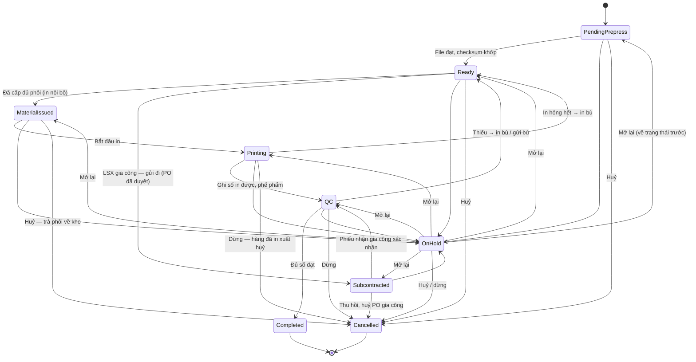
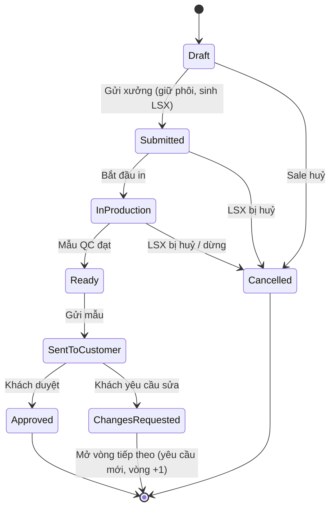

# 19 — Sản xuất / In ly & bao bì (Production: Sample & Order)

> Module số 19 được bổ sung sau khi bộ tài liệu đã đánh số 01–18. Về thứ tự luồng nghiệp vụ, module này nằm **giữa [17 · Order Management](../../ecommerce/17-order-management/README.md) và [07 · Picking](../07-picking/README.md) / [08 · Packing](../08-packing/README.md)**.

## 1. Mục đích (Purpose)

Biến **phôi** (ly, hộp, túi chưa in) thành **thành phẩm in theo thiết kế của khách sỉ** tại **xưởng in nội bộ** đặt trong kho (print-on-demand). Module quản lý **lệnh sản xuất (LSX — Production Order)** từ lúc nhận yêu cầu tới lúc thành phẩm sẵn sàng đóng gói.

Có **hai loại sản xuất**, dùng chung một xưởng và chung các bước tại xưởng:

| Loại | Sinh ra từ | Mục đích |
|------|-----------|----------|
| **Sản xuất mẫu (`SAMPLE`)** | **Yêu cầu làm mẫu** gắn với báo giá — *chưa có đơn bán* | Làm vài sản phẩm để khách duyệt trước khi đặt số lượng lớn. **Bắt buộc với thiết kế mới.** |
| **Sản xuất đơn hàng (`ORDER`)** | Dòng tuỳ chỉnh của **đơn bán** khi Order Coordinator **release** đơn ([17](../../ecommerce/17-order-management/README.md)) | Sản xuất số lượng khách đặt, QC theo **mẫu đã được khách duyệt** |

Module quản lý:

- **Lệnh sản xuất** — mỗi dòng đơn tùy chỉnh (hoặc mỗi lần làm mẫu) sinh một lệnh, gắn bản thiết kế chốt (design snapshot) và file sẵn sàng in (print-ready file) từ [12 · Product Design](../../ecommerce/12-product-design/README.md).
- **Kiểm file in (prepress)**.
- **Cấp phôi** bằng **quét xuất vật tư** sang khu `PRODUCTION`.
- **In, báo phế phẩm, kiểm tra chất lượng thành phẩm** theo từng vòng.
- **Bàn giao thẳng sang khu đóng gói** (Area `PACKING`) — thành phẩm không cất lại lên bin.
- **Dashboard xưởng**.

Sản xuất mặc định diễn ra tại xưởng nội bộ. Khi **xưởng nội bộ không đủ công suất**, Quản lý kho có thể **tách một phần LSX `ORDER` đưa gia công ngoài** (§4.8). **Lệnh mẫu luôn in nội bộ.**

> ⚠️ Giả định: các phần sau thuộc **phạm vi giai đoạn sau** (xem [open-questions B10, B17](../../open-questions/README.md)):
> - **trạm in** (khai báo, gán lệnh cho trạm theo kỹ thuật in, công suất);
> - **độ ưu tiên** và **vị trí trong hàng đợi**;
> - **ngày xong dự kiến**;
> - **ngưỡng số lần in bù**.
>
> Hiện lệnh `Ready` chỉ được xếp theo **hạn hoàn thành** rồi **thời điểm tạo**. Ai được giao lệnh thì in, không cần gán trạm.

---

## 2. Actor liên quan

| Actor | Vai trò |
|-------|---------|
| **Nhân viên sản xuất (Production Staff)** | Kiểm file in (prepress: đạt / lỗi). Bắt đầu in. Báo số in được và phế phẩm kèm lý do. **Treo lệnh** kèm lý do. Xem / tải file in. |
| **Quản lý kho (Warehouse Manager)** | Như Production Staff. Thêm: **mở lại lệnh treo**; **huỷ** / **dừng** lệnh; **tách / chuyển LSX sang gia công**, gửi bù, đưa phần còn thiếu về in nội bộ; duyệt hao hụt gia công; **duyệt xuất huỷ** (phế phẩm, phôi mẫu, hao hụt). Ghi kết quả QC được. |
| **Nhân viên QC (QC Staff)** | **Ghi kết quả QC** từng vòng (đạt / không đạt), chọn khu `PACKING` khi xong. Không treo lệnh, không kiểm file. |
| **Nhân viên kho (Warehouse Staff)** | **Quét xuất phôi** sang khu `PRODUCTION`. Gửi hàng gia công. Đối soát / thu hồi phôi gia công. |
| **Nhân viên mua hàng (Procurement Staff)** | Hoàn thiện và gửi duyệt **PO gia công** ([02](../02-purchase-order/README.md)). Được báo khi lệnh treo vì thiếu phôi. |
| **Nhà gia công (Subcontractor)** | Nhà cung cấp có năng lực in gia công; nhận file in (và phôi, nếu mình cấp), in, trả thành phẩm. **Không dùng hệ thống** — mọi trạng thái do nhân viên mình ghi nhận. |
| **Nhân viên Sale (Sales Staff)** | Tạo, sửa, gửi, huỷ **yêu cầu làm mẫu**; ghi đã gửi mẫu; ghi khách duyệt / yêu cầu sửa hộ khách; mở vòng mẫu tiếp theo. Được báo khi file in lỗi / chờ khách. |
| **Điều phối đơn hàng (Order Coordinator)** | Release đơn — điểm sinh LSX `ORDER` ([17](../../ecommerce/17-order-management/README.md)) |
| **Khách hàng sỉ (B2B Customer)** | **Duyệt mẫu** hoặc **yêu cầu sửa** vòng mẫu của mình trên cổng khách hàng |
| **Hệ thống** | Sinh LSX; kiểm checksum thiết kế; giữ phôi cho lệnh (không hết hạn); chặn cấp phôi vượt số cần; tự giữ thêm phôi khi in bù hoặc treo `BLANKS_SHORT`; gửi xuất huỷ cho người duyệt; đồng bộ trạng thái đơn và yêu cầu mẫu; báo người phụ trách khi lệnh bị treo. |

- Mọi thao tác chỉ trong phạm vi **kho được gán**.

---

## 3. Input / Output

### Input

| Dữ liệu | Mô tả | Nguồn |
|---------|-------|-------|
| **Nguồn lệnh** | Yêu cầu làm mẫu (`SAMPLE`) hoặc dòng đơn đã release (`ORDER`) | Sale (§4.1) / [17 · Order Management](../../ecommerce/17-order-management/README.md) |
| **Dòng đơn tùy chỉnh** | Order number, dòng hàng, SKU phôi, số lượng (đơn vị cơ sở), hạn giao | [17 · Order Management](../../ecommerce/17-order-management/README.md) |
| **Design snapshot + print-ready file** | Bản thiết kế chốt (đã khách xác nhận, bất biến) + checksum, file `PRINT_READY` | [12 · Product Design](../../ecommerce/12-product-design/README.md) |
| **Mẫu đã duyệt** | Với `ORDER`: vòng mẫu `Approved` cho (khách, thiết kế, phôi) — chuẩn QC | §4.1 |
| **Tồn phôi** | Phôi `Available` tại bin của kho xuất | Tồn kho theo vị trí ([20](../20-inventory-control/README.md)) |
| **Số liệu in** | Số in được (≥ 1), phế phẩm từng dòng: số lượng + lý do (`PRINT_DEFECT` / `DAMAGED_BLANK` / `QC_FAILED` / `SETUP` / `OTHER` — bắt buộc ghi chú) | Production Staff |
| **Kết quả QC** | Số đạt / không đạt của vòng; khu `PACKING` nhận thành phẩm | QC Staff |
| **Thông tin gia công** | Khi tách gia công: số lượng tách, nhà gia công, **cách gia công** (`SUPPLIED_BLANKS` — mình cấp phôi / `FULL_SERVICE` — nhà gia công tự lo phôi), đơn giá, hạn trả hàng | Quản lý kho (§4.8) |

### Output

| Kết quả | Dùng bởi |
|---------|----------|
| **Lệnh sản xuất** (mã `LSX-yyyyMMdd-NNNN`) + lịch sử trạng thái, số in được, số đạt, phế phẩm kèm lý do, các vòng QC | Quản lý kho, Production Staff, [17](../../ecommerce/17-order-management/README.md), báo cáo |
| **Phiếu xuất phôi** (quét xuất vật tư sang khu `PRODUCTION`; danh sách phôi còn chờ cấp) | Nhân viên kho, [20 · Inventory Control](../20-inventory-control/README.md) |
| **Kết quả QC thành phẩm** theo vòng | Quản lý kho, báo cáo chất lượng |
| **Thành phẩm đạt** tại khu `PACKING`, gắn với dòng đơn | [08 · Packing](../08-packing/README.md) |
| **Mẫu đã duyệt** (khoá thiết kế + phôi, làm chuẩn QC) | Báo giá & đơn bán ([14](../../ecommerce/14-cart-and-order/README.md)), LSX `ORDER` sau này |
| **Đề nghị xuất huỷ** chờ duyệt: `SCRAP` (in hỏng / QC không đạt), `SAMPLE` (phôi làm mẫu), `SUBCONTRACT_LOSS` (hao hụt gia công), `OTHER` (hàng đã in của lệnh bị huỷ / dừng), `EXPIRED` (phôi hết hạn khi trả về) — [20 §4.3](../20-inventory-control/README.md) | Quản lý kho, Kế toán |
| **Sự kiện trạng thái đơn**: mọi lệnh của đơn `Completed` → đơn rời `In Production`, chuyển `Ready to Fulfill` | [17](../../ecommerce/17-order-management/README.md) |
| **Thông báo khi lệnh bị treo**: file lỗi / chờ khách → Sale; thiếu phôi → mua hàng; lý do khác → Quản lý kho | Người phụ trách |
| **Dashboard xưởng** (§4.10) | Quản lý kho, Sale |
| **LSX con gia công** + **PO gia công** (loại `SUBCONTRACT`) + **quyết toán gia công** | Xưởng, Mua hàng ([02](../02-purchase-order/README.md)), đối chiếu hoá đơn ([04](../04-invoice/README.md)) |

### Dữ liệu tối thiểu cần lưu

| Thực thể | Trường chính |
|----------|--------------|
| `ProductionOrder` | `id`, `code`, `type` (`SAMPLE` / `ORDER`), `warehouse_id`, `order_id?`, `order_line_id?`, `sample_request_id?`, `parent_id?` (LSX con gia công), `origin?` (`SHORTFALL` / `REPLACEMENT`), `sku`, `quantity`, `design_snapshot_id`, `design_checksum`, `approved_sample_id?`, `due_date`, `qty_printed`, `qty_good`, `qty_scrap`, `mode` (`IN_HOUSE` / `SUBCONTRACTED`), `subcontractor_id?`, `subcontract_method?`, `subcontract_po_id?`, `status`, `status_before_hold?`, `hold_reason?`, `prepress_checked_by/at?` |
| `ProductionScrap` | `production_order_id`, `quantity`, `reason`, `note?`, `recorded_by/at` |
| `ProductionQcResult` | `production_order_id`, `round`, `passed`, `failed`, `recorded_by/at` |
| `SampleRequest` | `id`, `customer_id`, `quote_id?`, `sku`, `design_snapshot_id`, `quantity`, `due_date`, `round`, `previous_round_id?`, `feedback?`, `status` |

---

## 4. Luồng nghiệp vụ từng bước (Step-by-step)

### 4.1. Sản xuất mẫu (`SAMPLE`)

1. **Tạo yêu cầu làm mẫu** — Sale chọn khách, phôi (SKU), thiết kế đã xác nhận, số lượng mẫu, hạn, kho → `Draft`. Còn `Draft` thì sửa được.
2. **Gửi xưởng** — Sale gửi → `Submitted`. Hệ thống kiểm:
   - khách `Active`;
   - kho đang hoạt động và trong phạm vi;
   - phôi đang bán được;
   - snapshot đã xác nhận;
   - **ATP đủ** số lượng mẫu.

   Đạt thì **giữ phôi** (khoản giữ của sản xuất **không hết hạn**) và sinh **LSX `SAMPLE`**.
3. **Xưởng làm mẫu** — các bước §4.3 – §4.7. Bắt đầu in → yêu cầu `In Production`. QC đối chiếu **file in**.
4. **Mẫu xong** — LSX `Completed`. Phôi làm mẫu được đề nghị xuất huỷ lý do `SAMPLE`. Yêu cầu → `Ready`.
5. **Gửi mẫu cho khách** — bàn giao trực tiếp hoặc chuyển phát (ngoài hệ thống); Sale ghi nhận đã gửi → `Sent to Customer`.
6. **Khách phản hồi** trên cổng khách hàng, hoặc Sale ghi hộ:
   - **Duyệt** → `Approved`: **khoá thiết kế + phôi**; từ đây báo giá có thể được chấp nhận và đơn có thể sản xuất.
   - **Yêu cầu sửa** kèm góp ý (1–2.000 ký tự) → `Changes Requested` (kết thúc vòng này).
7. **Vòng mẫu tiếp theo** — sau `Changes Requested` (hoặc khi vòng bị huỷ do lệnh sản xuất bị huỷ), Sale mở **vòng tiếp theo**: một **yêu cầu mới** ở `Draft`, số vòng +1, liên kết vòng trước. Mỗi vòng chỉ có một vòng tiếp theo. Thường kèm thiết kế đã sửa ([12](../../ecommerce/12-product-design/README.md) — tạo bản sửa).
8. **Huỷ** — Sale huỷ yêu cầu `Draft`, bắt buộc lý do (≤ 500 ký tự). Huỷ / dừng LSX `SAMPLE` thì vòng mẫu đó cũng bị huỷ.

### 4.2. Khởi tạo lệnh sản xuất đơn hàng (`ORDER`)

1. **Release đơn** — Order Coordinator chọn kho xuất và release đơn ([17](../../ecommerce/17-order-management/README.md)).
   - Dòng hàng thường đi Picking.
   - **Mỗi dòng tuỳ chỉnh sinh 1 LSX `ORDER`**, gắn design snapshot và mẫu đã duyệt. Lệnh ở `Pending Prepress`; đơn chuyển `In Production`.
   - Một đơn sinh đủ lệnh cho mọi dòng in, hoặc không sinh lệnh nào.
   - Dòng có **thiết kế mới chưa có mẫu được duyệt** → không được release (BR-08).
   - Đơn **đặt cọc** chưa nhận đủ tiền cọc → không được release (BR-09).
2. Từ đây LSX `ORDER` đi các bước §4.3 – §4.7; QC đối chiếu với **mẫu đã duyệt**.

### 4.3. Kiểm file trước sản xuất (prepress) — chung cho hai loại

1. Production Staff tải file `PRINT_READY` của lệnh `Pending Prepress` (link ngắn hạn, đã kiểm checksum) và kiểm file.
   - **Đạt** → hệ thống **kiểm lại checksum** file lưu trữ với thiết kế đã khoá → lệnh `Ready`. Lệch checksum → từ chối.
   - **Lỗi** (bắt buộc ghi chú) → lệnh `On Hold` lý do **`FILE_REJECTED`**, báo Sale. Sale liên hệ khách qua [chat](../../ecommerce/16-sales-chat/README.md) theo quy trình thay đổi thiết kế của [12](../../ecommerce/12-product-design/README.md).

### 4.4. Hàng đợi (lệnh ở `Ready`)

1. Lệnh `Ready` xếp theo **hạn hoàn thành** gần trước, rồi **thời điểm tạo lệnh**.
2. Trạm in, độ ưu tiên, ngày xong dự kiến: phạm vi sau (xem §1). Ai được giao lệnh thì in.

### 4.5. Cấp phôi

1. **Danh sách phôi chờ cấp** — với lệnh `Ready` in nội bộ, phôi đã được **giữ cho lệnh** tại bin & lô cụ thể. Nhân viên kho xem danh sách các khoản phôi còn chờ cấp. **Không qua pick task** của [07](../07-picking/README.md).
2. **Quét xuất phôi** — nhân viên kho quét vị trí và SKU / mã vạch (tuỳ chọn), xuất **trọn một khoản giữ** sang một khu `PRODUCTION` của kho đó.
   - Phôi chuyển sang trạng thái tồn **`In Production`**, vẫn giữ cho lệnh ([20](../20-inventory-control/README.md) §5.1).
   - Chưa có khoản giữ thì hệ thống giữ phần còn thiếu ngay lúc quét.
   - Chỉ cấp theo LSX và **không vượt số còn thiếu** (BR-03); quét lại không cấp hai lần.
   - Khi đã cấp **đủ** phôi cần → lệnh `Material Issued`.
3. Không đủ phôi → lệnh `On Hold` lý do **`BLANKS_SHORT`**, báo mua hàng ([02](../02-purchase-order/README.md)); [17](../../ecommerce/17-order-management/README.md) xử lý như thiếu hàng.

> ⚠️ Giả định: **không xuất dư phôi** để bù hao hụt; hao hụt được bù bằng vòng in bù (§4.6). Xem [open-questions](../../open-questions/README.md).

### 4.6. In & báo phế phẩm

1. **Bắt đầu in** — Production Staff bắt đầu → lệnh `Printing` (chỉ từ `Material Issued`). Với `ORDER`, đơn bán ghi nhận **đã bắt đầu in** — mốc quyết định phí huỷ ([17](../../ecommerce/17-order-management/README.md) BR-11).
2. **Báo kết quả in** — nhập **số in được** (≥ 1, không vượt số phôi đã cấp mà chưa in) và **phế phẩm** theo từng dòng: số lượng ≥ 1, **lý do**; lý do `OTHER` bắt buộc ghi chú.
   - Số đạt chờ QC = số in − phế phẩm.
   - Lệnh → `QC`. Nếu in hỏng hết, lệnh đi thẳng về `Ready` để in bù.
3. **Xuất huỷ phế phẩm** — phế phẩm **rời khoản giữ ngay** và được đề nghị xuất huỷ lý do `SCRAP`. Tồn chỉ giảm khi **người khác** duyệt ([20 §4.3](../20-inventory-control/README.md), bốn mắt). **Lệnh không chờ** bước duyệt này.

### 4.7. QC & bàn giao đóng gói

1. **Tham chiếu QC** — `ORDER`: xem **mẫu đã duyệt** (ảnh xem trước của vòng mẫu `Approved`). `SAMPLE`: xem **file in**.
2. **Ghi kết quả vòng QC** — QC Staff ghi **số đạt + số không đạt = số đang chờ QC** (phải kiểm hết). Phần không đạt thành phế phẩm, đề nghị xuất huỷ lý do `QC_FAILED`.
   - QC bị chặn khi đơn bán đã huỷ / dòng đã rút.
   - QC bị chặn khi phiếu nhận gia công (`SUPPLIED_BLANKS`) chưa đối soát xong.
3. **Đủ số đạt** (tổng đạt ≥ số kế hoạch) → lệnh **`Completed`**:
   - Phôi đã cấp mà chưa in được **trả về kho** (trả tự do).
   - **`ORDER`:** thành phẩm chuyển sang khu `PACKING` do QC chọn (tự chọn nếu kho chỉ có một khu), giữ cho đơn, rồi **ghi tiêu thụ ngay** (dòng sổ `CONSUMPTION`). Từ đây thành phẩm **không còn là tồn**.
   - **`SAMPLE`:** số đạt được đề nghị xuất huỷ lý do `SAMPLE`; vòng mẫu → `Ready`.
4. **Thiếu số đạt** → **in bù**: lệnh quay về `Ready`.
   - Phôi đã cấp chưa in được dùng trước. Đủ thì tự sang `Material Issued`.
   - Thiếu thì giữ thêm phôi cho phần còn thiếu nếu ATP đủ.
   - Không đủ → `On Hold` lý do `BLANKS_SHORT`.
5. **Cập nhật đơn** — khi **mọi lệnh sản xuất** của đơn (kể cả LSX con gia công) đã `Completed`, đơn rời `In Production` → `Ready to Fulfill` ([17](../../ecommerce/17-order-management/README.md) §4.2) và đi [đóng gói](../08-packing/README.md) (đóng gói kiểm checksum thiết kế):
   - Đơn **chỉ gồm hàng tùy chỉnh**: không cần lấy hàng; đóng gói ngay.
   - Đơn **hỗn hợp**: dòng hàng thường được lấy song song trong lúc in. Đóng gói trước hàng sẵn chỉ khi Sale cho phép giao một phần (PACK-EARLY).

### 4.8. Gia công ngoài (chỉ LSX `ORDER`)

Dùng khi xưởng nội bộ không kịp hạn. Hệ thống **không tự lập lịch theo công suất máy** (xem B10): Quản lý kho tự quyết dựa trên hàng đợi và dashboard xưởng. Có **hai cách gia công**, chọn mỗi lần tách:

| Cách | Phôi | Mình trả |
|------|------|----------|
| **`SUPPLIED_BLANKS` — mình cấp phôi** | Mình xuất phôi gửi nhà gia công; phôi chưa dùng và phế phẩm phải trả về để đối soát | Phí gia công |
| **`FULL_SERVICE` — nhà gia công lo phôi** | Nhà gia công tự mua phôi; mình chỉ gửi file in và mẫu đã duyệt | Giá thành phẩm |

1. **Tách LSX** — Quản lý kho mở một LSX `ORDER` in nội bộ đang `Pending Prepress`, `Ready` hoặc `On Hold`, nhập số lượng đưa gia công (> 0 và nhỏ hơn phần **chưa xuất phôi**), chọn nhà gia công, cách gia công, đơn giá và hạn trả hàng.
   - Hệ thống sinh **LSX con** (chế độ gia công), cùng dòng đơn, cùng thiết kế đã khoá và mẫu đã duyệt; LSX gốc giảm số lượng tương ứng.
   - Muốn đưa **toàn bộ** LSX đi gia công (chưa cấp / in gì) thì **chuyển chế độ** của chính LSX đó, không sinh LSX con.
   - Phôi đã giữ cho phần tách: `SUPPLIED_BLANKS` → chuyển sang LSX con; `FULL_SERVICE` → nhả giữ.
   - LSX con `Ready` nếu LSX gốc đã qua kiểm file, nếu không thì `Pending Prepress`.
   - Hệ thống tạo **PO gia công** (loại `SUBCONTRACT`, `Draft`): một dòng thành phẩm × số lượng × đơn giá.
2. **Duyệt PO gia công** — Procurement Staff gửi duyệt theo hạn mức như PO thường ([02](../02-purchase-order/README.md)). LSX con chỉ được gửi đi khi PO đã `Approved`.
3. **Gửi gia công:**
   - `SUPPLIED_BLANKS`: nhân viên kho quét xuất phôi sang vị trí ảo **"tại nhà gia công"** (vẫn là tồn của mình, **không tính ATP**); in **phiếu xuất gia công** kèm file in và mẫu đã duyệt.
   - `FULL_SERVICE`: chỉ gửi file in và mẫu đã duyệt.

   LSX con `Ready` → `Subcontracted`. Vận chuyển giữa hai bên làm ngoài hệ thống.
4. **Nhận hàng về** — theo phiếu nhận của PO gia công ([03](../03-receipt/README.md)): đếm thành phẩm; phiếu đóng ngay khi xác nhận → LSX con `QC`. Nếu LSX con đang treo vì **nhà gia công trễ**, việc nhận hàng tự gỡ treo; treo lý do khác thì giữ treo và mở lại vào `QC`.
5. **Đối soát phôi** (`SUPPLIED_BLANKS`) — nhân viên kho ghi phế phẩm và phôi chưa dùng trả về.
   - Phôi gửi = thành phẩm nhận + phế phẩm trả về + phôi trả về + hao hụt.
   - Phôi hỏng / mất đề nghị xuất huỷ lý do `SUBCONTRACT_LOSS`.
   - Hao hụt vượt **mức cho phép** → Quản lý kho duyệt kèm **khoản trừ** mỗi phôi.
   - **QC bị chặn** tới khi đối soát xong.
6. **QC** — như hàng in nội bộ, đối chiếu **mẫu đã duyệt** (BR-05). Sản phẩm không đạt tính là phế phẩm của nhà gia công, không trả tiền phần đó.
7. **Thiếu số đạt** — LSX con quay về `Ready`; Quản lý kho chọn:
   - **gửi bù cho nhà gia công** (bổ sung PO, cần duyệt lại);
   - **đưa phần còn thiếu về in nội bộ** (sinh LSX con in nội bộ, nguồn `SHORTFALL`).
8. **Thu hồi / huỷ gia công** — thu hồi phôi, huỷ LSX con và PO gia công.
   - Nhà gia công đã in thì tính **phí huỷ** (≥ 0, có lý do).
   - Nếu đơn bán vẫn cần hàng, phần còn nợ được sinh lại thành **LSX in nội bộ** (nguồn `REPLACEMENT`).
9. **Hoàn tất** — đủ số đạt → LSX con `Completed`. Đơn chỉ `Ready to Fulfill` khi **mọi LSX của dòng** (gốc và con) đã xong (BR-06).
10. **Quyết toán** — trạng thái `Awaiting Approval` khi hao hụt vượt mức chưa được duyệt, nếu không thì `Final`. Phải trả = số đạt × đơn giá − khoản trừ hao hụt + phí huỷ; không trả phần QC không đạt. Đối chiếu hoá đơn ở [04](../04-invoice/README.md).

> ⚠️ Giả định: **mức hao hụt cho phép** khi gia công cấu hình theo từng nhà gia công (mặc định 2%). Xem [open-questions](../../open-questions/README.md).

> ⚠️ Giả định: nhà gia công **không dùng hệ thống**; mọi trạng thái do nhân viên mình ghi nhận. Xem [open-questions](../../open-questions/README.md).

### 4.9. Treo, huỷ, dừng

1. **Treo lệnh** — Production Staff / Quản lý kho treo lệnh kèm lý do:

   | Lý do | Ý nghĩa |
   |-------|---------|
   | `FILE_REJECTED` | File lỗi |
   | `BLANKS_SHORT` | Thiếu phôi |
   | `MACHINE_DOWN` | Máy hỏng |
   | `WAITING_CUSTOMER` | Chờ khách |
   | `SUBCONTRACTOR_LATE` | Nhà gia công trễ |
   | `OTHER` | Lý do khác — **bắt buộc ghi chú** |

   - Treo được từ `Pending Prepress`, `Ready`, `Material Issued`, `Printing`, `Subcontracted`, `QC`. Lệnh treo ở `QC` không ghi kết quả được tới khi mở lại.
   - Hệ thống báo người phụ trách theo lý do (§3 Output).
2. **Mở lại** — Quản lý kho mở lại → lệnh **về đúng trạng thái trước khi treo**.
3. **Huỷ lệnh** — Quản lý kho huỷ, lý do ≤ 500 ký tự. Chỉ khi lệnh (hoặc trạng thái trước khi treo) là `Pending Prepress`, `Ready` hoặc `Material Issued`.
   - Hàng đạt của vòng trước (nếu có) thành phế phẩm, đề nghị xuất huỷ.
   - Phôi chưa in **trả về kho**: vẫn giữ cho đơn nếu đơn bán còn cần, không thì trả tự do. Phôi đã hết hạn thì đề nghị xuất huỷ `EXPIRED`.
   - LSX gia công đi luồng thu hồi / huỷ gia công (§4.8 bước 8).
4. **Dừng lệnh** — Quản lý kho dừng lệnh đang `Printing` hoặc `QC` (kể cả khi đang treo từ hai trạng thái đó), lý do ≤ 500 ký tự.
   - Lệnh đang `Printing` thì ghi được số đã in trước khi dừng.
   - **Mọi hàng đã in** thành phế phẩm, đề nghị xuất huỷ.
   - Phôi chưa in trả về; khoản giữ chưa cấp được nhả.
   - Lệnh → `Cancelled`.
5. **Đơn bán bị huỷ** (hoặc **đóng phần còn lại** — [17](../../ecommerce/17-order-management/README.md) §4.5), áp cho các lệnh của dòng liên quan:
   - Lệnh `Pending Prepress` / `Ready` / `Material Issued` → huỷ như bước 3. Riêng khi **hệ thống** tự huỷ đơn mà lệnh đã in / đã cấp phôi, lệnh bị treo `OTHER` để Quản lý kho quyết.
   - Lệnh `Printing` → treo `OTHER`: Quản lý kho **dừng** lệnh với số đã in.
   - Lệnh `QC` → giữ nguyên, chờ Quản lý kho dừng.
   - LSX gia công → treo `OTHER`: thu hồi phôi, huỷ gia công.
6. **Yêu cầu thay đổi thiết kế sau khi đặt** — chỉ nhận khi lệnh **chưa tới `Printing`** (LSX con: chưa `Subcontracted`). Lệnh treo `WAITING_CUSTOMER`; dòng đơn huỷ & tạo lại theo quy trình của [12](../../ecommerce/12-product-design/README.md) / [17](../../ecommerce/17-order-management/README.md). Thiết kế mới → phải làm mẫu lại (BR-08).

### 4.10. Dashboard xưởng

Theo phạm vi kho của người xem; người không được gán kho thấy số 0.

| Chỉ số | Cách tính |
|--------|-----------|
| **Lệnh đang mở theo trạng thái** | Mọi lệnh chưa `Completed` / `Cancelled` |
| **Lệnh quá hạn** | Lệnh đang mở có hạn hoàn thành **trước hôm nay** (giờ Việt Nam); danh sách xếp theo hạn rồi thời điểm tạo |
| **Tỷ lệ phế phẩm** theo kỳ | Phế phẩm / số in, 4 chữ số thập phân. Hai cách đếm: **theo hoạt động** (mặc định — lần in, lần nhận gia công, phế phẩm ghi trong kỳ) hoặc **theo lệnh tạo** trong kỳ. Không có số in → trống. |
| **Mẫu chờ khách trả lời** | Yêu cầu mẫu `Sent to Customer` |

---

## 5. Trạng thái / Vòng đời (Lifecycle)

### 5.1. Trạng thái lệnh sản xuất

| Trạng thái | Ý nghĩa | Chuyển tiếp cho phép | Ai thực hiện |
|------------|---------|----------------------|--------------|
| `Pending Prepress` | Vừa sinh từ dòng đơn / yêu cầu mẫu, chờ kiểm file in | → `Ready`, → `On Hold`, → `Cancelled` | Hệ thống / Production Staff |
| `Ready` | File đạt; trong hàng đợi; chờ cấp phôi (hoặc chờ phôi in bù) | → `Material Issued` (đã cấp đủ phôi, in nội bộ), → `Subcontracted` (LSX gia công), → `On Hold`, → `Cancelled` | NV kho (cấp phôi) / Quản lý kho |
| `Material Issued` | *Chỉ in nội bộ:* phôi đã ở khu `PRODUCTION` | → `Printing`, → `On Hold`, → `Cancelled` (trả phôi về kho) | Production Staff |
| `Printing` | *Chỉ in nội bộ:* đang in | → `QC`, → `Ready` (in hỏng hết), → `On Hold`, → `Cancelled` (dừng) | Production Staff / Quản lý kho |
| `Subcontracted` | *Chỉ LSX gia công:* đã gửi nhà gia công, chờ hàng về | → `QC` (phiếu nhận xác nhận), → `On Hold`, → `Cancelled` (thu hồi, huỷ PO gia công) | NV kho / Hệ thống / Quản lý kho |
| `QC` | Đang kiểm thành phẩm theo vòng | → `Completed` (đủ số đạt), → `Ready` (thiếu → in bù / gửi bù), → `On Hold`, → `Cancelled` (dừng) | QC Staff / Quản lý kho |
| `On Hold` | Tạm dừng kèm lý do (§4.9) | → trạng thái trước khi treo; → `Cancelled` (huỷ / dừng) | Quản lý kho (mở lại) |
| `Completed` | Đủ thành phẩm đạt; `ORDER` đã bàn giao khu `PACKING` và ghi tiêu thụ; `SAMPLE` đã bàn giao mẫu | *(cuối)* | QC Staff / Hệ thống |
| `Cancelled` | Bị huỷ (trước khi in) hoặc bị dừng (khi đang in / QC) | *(cuối)* | Quản lý kho / Hệ thống |

> Tách gia công **không đổi trạng thái** của LSX gốc; chỉ giảm số lượng và sinh LSX con.
>
> Hai nhánh không giao nhau:
> - LSX gia công: `Ready → Subcontracted → QC`;
> - LSX in nội bộ: `Ready → Material Issued → Printing → QC`.

### 5.2. Tồn phôi & thành phẩm trong luồng sản xuất

| Chặng | Vị trí | Trạng thái tồn |
|-------|--------|----------------|
| Chưa cấp | Bin lưu trữ | `Available`, đã giữ cho lệnh / yêu cầu mẫu (khoản giữ không hết hạn) |
| Đã cấp, đang in, chờ QC | Area `PRODUCTION` | `In Production`, vẫn giữ cho lệnh; không bán ([20](../20-inventory-control/README.md) §5.1) |
| Gửi gia công (`SUPPLIED_BLANKS`) | Vị trí ảo "tại nhà gia công" | `In Production`, tồn của mình, **không tính ATP**; chỉ rời vị trí qua phiếu nhận, đối soát hoặc xuất huỷ có duyệt |
| Phôi chưa in trả về (huỷ / dừng / hoàn tất) | Bin / khu lưu trữ | `Available` (vẫn giữ cho đơn nếu đơn còn cần) |
| Thành phẩm đạt (`ORDER`) khi hoàn tất | Area `PACKING` | Chuyển sang khu đóng gói rồi **ghi tiêu thụ ngay** (`CONSUMPTION`): **không còn là tồn** *(Quyết định 19/10 và 21/10/2026: trừ tồn khi LSX `Completed`, không phải lúc đóng gói)* |
| Phôi dùng làm mẫu (`SAMPLE`) | — | Đề nghị xuất huỷ lý do `SAMPLE`, giảm tồn khi được duyệt |
| In hỏng / QC không đạt | — | Rời khoản giữ ngay; đề nghị xuất huỷ lý do `SCRAP` / `QC_FAILED`, giảm tồn khi được duyệt (vẫn là `In Production`, không bán, trong lúc chờ) |

Thành phẩm **vẫn là Inventory Item của SKU phôi** (không sinh SKU mới); dấu hiệu phân biệt là liên kết tới lệnh sản xuất và design snapshot.

> *(Quyết định 19/10 và 21/10/2026 — điểm trừ tồn của dòng in, câu hỏi G4-Q2.)* Phôi của dòng in bị **trừ tồn lúc lệnh sản xuất `Completed`** (thuộc module sản xuất): thành phẩm vừa chuyển sang khu `PACKING` vừa được ghi xuất tồn, ATP không đổi vì hàng đã được giữ cho đơn. **Bước đóng gói ([08](../08-packing/README.md)) không trừ tồn** thành phẩm in nữa — chỉ cho hàng vào kiện, như hàng đã pick.

### 5.3. Yêu cầu làm mẫu (Sample Request)

| Trạng thái | Ý nghĩa | Chuyển tiếp cho phép | Ai thực hiện |
|------------|---------|----------------------|--------------|
| `Draft` | Sale đang soạn (sửa được) | → `Submitted`, → `Cancelled` (có lý do) | Sale |
| `Submitted` | Đã gửi xưởng, đã giữ phôi và sinh LSX `SAMPLE` | → `In Production`, → `Cancelled` (LSX bị huỷ) | Hệ thống |
| `In Production` | Xưởng đang in mẫu | → `Ready`, → `Cancelled` (LSX bị huỷ / dừng) | Hệ thống |
| `Ready` | Mẫu xong, QC đạt | → `Sent to Customer` | Sale |
| `Sent to Customer` | Đã gửi mẫu cho khách | → `Approved`, → `Changes Requested` | Khách / Sale |
| `Changes Requested` | Khách yêu cầu sửa, kèm góp ý; **kết thúc vòng** | *(cuối)* — mở **vòng tiếp theo** (yêu cầu mới) | Khách / Sale |
| `Approved` | Khách duyệt; thiết kế + phôi bị khoá, làm chuẩn QC | *(cuối)* | Khách / Sale |
| `Cancelled` | Huỷ | *(cuối)* — được mở vòng tiếp theo nếu huỷ do LSX | Sale / Hệ thống |

---

## 6. Ràng buộc nghiệp vụ (Business Rules) & Edge case

### Business rules

- **BR-01:** Mỗi dòng tuỳ chỉnh của đơn (hoặc mỗi yêu cầu làm mẫu) có **đúng 1 LSX**; tạo lại không sinh LSX trùng (ngoại lệ: LSX con khi tách gia công, BR-12). Lệnh luôn gắn một design snapshot đã khách xác nhận (bất biến, kèm checksum).
- **BR-02:** Không được in khi chưa qua kiểm file, hoặc checksum file không khớp thiết kế đã khoá.
- **BR-03:** Chỉ cấp phôi theo LSX, và không vượt số còn thiếu của LSX. Lệnh in nội bộ chỉ sang `Printing` khi đã cấp đủ phôi (`Material Issued`). Số in mỗi lần không vượt số phôi đã cấp mà chưa in.
- **BR-04:** Số đạt chờ QC = số in − phế phẩm. Phế phẩm bắt buộc có **lý do** (`OTHER` kèm ghi chú). Phế phẩm rời khoản giữ ngay và **xuất huỷ qua điều chỉnh tồn có duyệt bốn mắt** ([20 §4.3](../20-inventory-control/README.md)) — không trừ âm thầm. Lệnh không chờ bước duyệt.
- **BR-05:** Phải qua QC mới được `Completed`. LSX `ORDER` QC theo **mẫu đã được khách duyệt**, LSX `SAMPLE` theo **file in**. Mỗi vòng QC phải kiểm **hết** số đang chờ (đạt + không đạt = số chờ).
- **BR-06:** Đơn chỉ rời `In Production` khi **mọi LSX của đơn** (gốc và con) đã `Completed` (hoặc dòng đó đã huỷ).
- **BR-07:** Design snapshot và file in của lệnh **không sửa được**. Không đổi thiết kế sau khi LSX đã sang `Printing` (LSX con: `Subcontracted`). Muốn đổi thiết kế trước mốc đó phải huỷ dòng & tạo lại.
- **BR-08:** Dòng đơn có **thiết kế mới** **không được release**. Được release khi có một trong hai:
  - vòng mẫu `Approved` cho cặp (thiết kế, phôi) của khách;
  - thiết kế đó **đã từng được sản xuất xong** cho một đơn khác (đặt lại).
- **BR-09:** Đơn **đặt cọc** chỉ được release sang sản xuất khi tiền cọc đã về ([15](../../ecommerce/15-payment/README.md)).
- **BR-10:** **Huỷ** lệnh chỉ trước khi in (`Pending Prepress` / `Ready` / `Material Issued`). Lệnh đang `Printing` / `QC` thì **dừng**: hàng đã in thành phế phẩm. Huỷ và dừng đều do Quản lý kho, có lý do. Phí huỷ với khách theo [17](../../ecommerce/17-order-management/README.md) BR-11. Hệ thống không tự huỷ lệnh đã in. Đơn bị huỷ (hoặc đóng phần còn lại) sau khi đã in: **được huỷ, tính phí sản xuất**; hàng đã in không giao được xuất huỷ (`SCRAP`) qua điều chỉnh có duyệt, tồn chỉ bị trừ **một lần** *(Quyết định 19/10/2026)*.
- **BR-11:** Chỉ LSX `ORDER` được đưa gia công ngoài. LSX `SAMPLE` **luôn in nội bộ** vì mẫu là chuẩn QC cho các đơn sau.
- **BR-12:** Chỉ tách phần **chưa xuất phôi** của LSX gốc in nội bộ, khi LSX gốc đang `Pending Prepress`, `Ready` hoặc `On Hold`. Số tách > 0 và nhỏ hơn phần chưa xuất phôi. Chuyển toàn bộ chỉ khi chưa cấp / in gì.
- **BR-13:** Nhà gia công phải là nhà cung cấp `Active` được đánh dấu **gia công in**. LSX con chỉ được gửi đi khi **PO gia công đã `Approved`**.
- **BR-14:** File gửi nhà gia công là file `PRINT_READY` đã qua kiểm file với checksum khớp thiết kế đã khoá (như BR-02). Sau khi gửi, thiết kế bị khoá như khi `Printing` (BR-07).
- **BR-15:** Phôi gửi gia công là **tồn của mình** ở vị trí "tại nhà gia công", **không tính ATP**. Chỉ rời vị trí đó qua phiếu nhận, đối soát hoặc xuất huỷ `SUBCONTRACT_LOSS` có duyệt — không trừ âm thầm.
- **BR-16:** LSX con chỉ `Completed` khi phiếu nhận đã xác nhận, đối soát phôi đã xong (`SUPPLIED_BLANKS`, QC bị chặn tới lúc đó) và QC đạt đủ số.
- **BR-17:** Hao hụt vượt mức cho phép phải được Quản lý kho duyệt kèm **khoản trừ** mỗi phôi, trừ khi quyết toán gia công. Sản phẩm không đạt QC không được trả tiền. Phí huỷ gia công ≥ 0, > 0 thì bắt buộc lý do.
- **BR-18:** *(Phạm vi sau — B10)* Gán lệnh `Ready` cho **trạm in** `Active`, cùng kho, cùng kỹ thuật in; ước tính ngày xong theo công suất trạm. ⚠️ Giả định — chưa triển khai.
- **BR-19:** In bù chỉ cấp phôi cho **phần còn thiếu**, dùng phôi đã cấp chưa in trước. *(Phạm vi sau — B17)* Số lần in bù vượt ngưỡng → treo. ⚠️ Giả định — chưa triển khai; hiện chỉ treo khi thiếu phôi (`BLANKS_SHORT`).
- **BR-20:** Lệnh sản xuất chỉ được giao cho **kho có khu `PRODUCTION`**; với dòng đơn, điều kiện này được kiểm ở bước chọn kho xuất của [17](../../ecommerce/17-order-management/README.md). ⚠️ Giả định — xem [open-questions](../../open-questions/README.md) (B16).
- **BR-21:** **Treo** do Production Staff / Quản lý kho, bắt buộc lý do (`OTHER` kèm ghi chú). **Mở lại** chỉ Quản lý kho; lệnh về đúng trạng thái trước khi treo.
- **BR-22:** **Khoản giữ phôi của sản xuất không hết hạn**. Gửi yêu cầu mẫu đòi ATP đủ số phôi ngay lúc gửi.
- **BR-23:** Vòng mẫu `Changes Requested` là kết thúc; sửa mẫu = **vòng mới** (yêu cầu mới, số vòng +1, liên kết vòng trước). Mỗi vòng chỉ có một vòng tiếp theo. Khách chỉ trả lời vòng mẫu của chính mình.
- **BR-24:** Thành phẩm `ORDER` **rời tồn khi lệnh hoàn tất** (bàn giao khu `PACKING` và ghi tiêu thụ). Đóng gói không trừ tồn lần nữa.

### Edge case

| Tình huống | Hướng xử lý |
|------------|-------------|
| File in lỗi phát hiện ở prepress | Lệnh `On Hold` `FILE_REJECTED`, báo Sale. Sale liên hệ khách, sửa theo quy trình của 12; thiết kế mới → với đơn hàng phải làm mẫu lại (BR-08) |
| Thiếu phôi khi cấp (tồn lệch thực tế) | Không đủ → `On Hold` `BLANKS_SHORT`, báo mua hàng; 17 xử lý như thiếu hàng (chờ nhập / đổi biến thể / huỷ + hoàn tiền) |
| Hết phôi khi cần in bù | `On Hold` `BLANKS_SHORT`; Quản lý kho quyết chờ hàng hay giao thiếu (báo khách qua Sale) |
| Máy in hỏng giữa ca | Treo `MACHINE_DOWN`; số đã in được ghi khi mở lại và báo kết quả |
| In hỏng một phần số lượng | Phần hỏng xuất huỷ (chờ duyệt); QC phần đạt; thiếu → về `Ready` in bù phần còn thiếu |
| In hỏng toàn bộ | Lệnh về thẳng `Ready` để in bù |
| QC không đạt toàn bộ | Toàn bộ xuất huỷ `QC_FAILED`; lệnh về `Ready` để in bù |
| Khách huỷ khi lệnh còn `Ready` / `Material Issued` | Lệnh `Cancelled`; phôi chưa in trả về kho; hoàn tiền theo 15 / 17 (không phí) |
| Khách huỷ khi lệnh đã `Printing` hoặc sau đó | Lệnh bị treo; Quản lý kho **dừng** lệnh, hàng đã in xuất huỷ; phí huỷ theo 17 |
| Đóng phần còn lại của đơn giao một phần | Lệnh của các dòng bị đóng xử lý như khi huỷ đơn (§4.9 bước 5) |
| Khách không phản hồi mẫu | Yêu cầu mẫu ở `Sent to Customer`, hiện trên dashboard "mẫu chờ khách"; Sale nhắc; quá hạn báo giá thì báo giá hết hiệu lực |
| Khách yêu cầu sửa mẫu nhiều lần | Mỗi lần là một vòng mới, liên kết vòng trước; lưu góp ý và số vòng |
| Đóng gói phát hiện thiết kế lệch checksum | Phiên đóng gói và đơn treo `DESIGN_MISMATCH`; Quản lý kho xác minh lại ([08](../08-packing/README.md) §4.4) |
| Hạn giao vượt cam kết do xưởng quá tải | Dashboard "lệnh quá hạn"; Quản lý kho tách một phần đưa gia công (§4.8); 17 & Sale thông báo khách ngày giao mới |
| Đơn hỗn hợp, hàng thường đã lấy nhưng lệnh in chậm | Hàng thường chờ tại khu `PACKING`; hoặc giao trước nếu Sale cho phép giao một phần ([17](../../ecommerce/17-order-management/README.md)) |
| Nhà gia công trả hàng trễ | LSX con treo `SUBCONTRACTOR_LATE`; nhận hàng về thì tự gỡ treo; hoặc đưa phần còn thiếu về in nội bộ |
| Nhà gia công trả thiếu hoặc QC không đạt | LSX con về `Ready`; gửi bù (bổ sung PO) hoặc in bù nội bộ (§4.8 bước 7); phần không đạt không trả tiền |
| Nhà gia công làm mất / hỏng phôi quá mức cho phép | Đối soát ra hao hụt; xuất huỷ `SUBCONTRACT_LOSS`; Quản lý kho duyệt khoản trừ (BR-17) |
| Khách huỷ đơn khi LSX con đang `Subcontracted` | LSX con bị treo; thu hồi phôi, huỷ PO; nhà gia công đã in → phí huỷ theo PO; đơn còn cần hàng thì sinh LSX in nội bộ thay thế |
| Không có nhà gia công nào đang hoạt động | Không tách được; LSX tiếp tục chờ xưởng nội bộ, Sale báo khách lùi hạn |

> ⚠️ Giả định: **phí làm mẫu** chưa chốt (miễn phí, hoặc tính vào báo giá). Xem [open-questions](../../open-questions/README.md).

> ⚠️ Giả định: **mẫu được gửi cho khách ngoài hệ thống** (bàn giao trực tiếp hoặc chuyển phát); hệ thống chỉ ghi nhận đã gửi. Xem [open-questions](../../open-questions/README.md).

---

## 7. Liên kết với các module khác

| Module | Quan hệ |
|--------|---------|
| [17 · Order Management](../../ecommerce/17-order-management/README.md) | Release đơn sinh LSX `ORDER`; chọn kho xuất có xưởng; đơn rời `In Production` → `Ready to Fulfill`; mốc "đã bắt đầu in" quyết định phí huỷ; huỷ đơn / đóng phần còn lại → huỷ / dừng lệnh |
| [12 · Product Design](../../ecommerce/12-product-design/README.md) | Design snapshot (đã khách xác nhận, bất biến), checksum và file in cho lệnh; vòng mẫu mới thường kèm bản sửa thiết kế |
| [14 · Cart & Order](../../ecommerce/14-cart-and-order/README.md) | Báo giá cần mẫu `Approved` (thiết kế mới) trước khi khách chấp nhận |
| [15 · Payment](../../ecommerce/15-payment/README.md) | Đơn đặt cọc chỉ release khi tiền cọc đã về; hoàn tiền / phí huỷ khi huỷ |
| [07 · Picking](../07-picking/README.md) | Dòng in không có dòng lấy hàng; phôi cấp bằng quét xuất vật tư; thành phẩm không pick lại trên kệ |
| [08 · Packing](../08-packing/README.md) | Nhận thành phẩm đạt QC tại khu `PACKING`; đóng gói kiểm checksum thiết kế |
| [20 · Inventory Control](../20-inventory-control/README.md) | Giữ phôi (không hết hạn); trạng thái `In Production`; xuất huỷ `SCRAP` / `QC_FAILED` / `SAMPLE` / `SUBCONTRACT_LOSS` / `EXPIRED` có duyệt; thành phẩm ghi tiêu thụ `CONSUMPTION` khi hoàn tất |
| [06 · Warehouse Map & Slotting](../06-warehouse-map-slotting/README.md) | Khu `PRODUCTION`, khu `PACKING`; vị trí ảo "tại nhà gia công" |
| [01 · Product Creation](../01-product-creation/README.md) | Inventory Item của SKU là phôi; kỹ thuật in của sản phẩm (dùng khi có trạm in — phạm vi sau) |
| [02 · Purchase Order](../02-purchase-order/README.md) | Được báo khi thiếu phôi; **PO gia công** (loại `SUBCONTRACT`) sinh khi tách LSX, duyệt theo hạn mức; bổ sung PO khi gửi bù |
| [03 · Receipt](../03-receipt/README.md) | Nhận thành phẩm gia công; phiếu đóng ngay, LSX con sang `QC` |
| [04 · Invoice](../04-invoice/README.md) | Đối chiếu hoá đơn gia công theo quyết toán (số đạt QC, khoản trừ hao hụt, phí huỷ) |
| [16 · Sales Chat](../../ecommerce/16-sales-chat/README.md) | Trao đổi với khách về mẫu và file lỗi |
| [00 · System Overview §5](../../00-system-overview/README.md) | Chặng sản xuất (mẫu và đơn hàng) giữa Order và Fulfillment |
