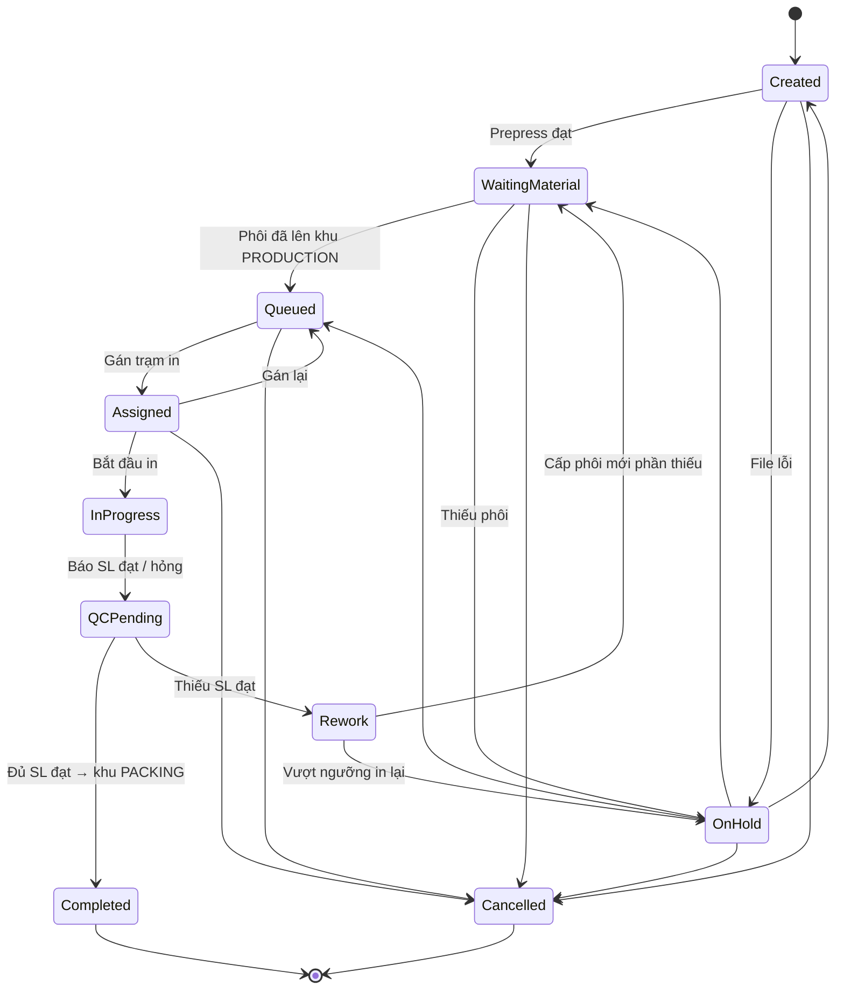

# 19 — Sản xuất / In theo đơn (Production)

> Module số 19 được bổ sung sau khi bộ tài liệu đã đánh số 01–18. Về thứ tự luồng nghiệp vụ, module này nằm **giữa [17 · Order Management](../../ecommerce/17-order-management/README.md) và [07 · Picking](../07-picking/README.md) / [08 · Packing](../08-packing/README.md)**.

## 1. Mục đích (Purpose)

Biến **phôi (hàng chưa in)** thành **thành phẩm in theo thiết kế của khách** tại **xưởng in nội bộ** đặt trong kho, cho các dòng đơn chứa sản phẩm tùy chỉnh (print-on-demand).

Module quản lý:

- **Lệnh sản xuất (Production Order)** — mỗi dòng đơn tùy chỉnh sinh một lệnh, đi kèm bản thiết kế chốt (design snapshot) và file sẵn sàng in (print-ready file) từ [12 · Product Design](../../ecommerce/12-product-design/README.md).
- **Cấp phôi** từ bin lên xưởng qua luồng [Picking](../07-picking/README.md), **hàng đợi** và **trạm in (Print Station)** theo kỹ thuật in.
- **Kiểm tra chất lượng thành phẩm** và **bàn giao thẳng sang khu đóng gói** (Area `PACKING`) — thành phẩm không cất lại lên bin.

Doanh nghiệp **không** thuê gia công in bên ngoài; toàn bộ sản xuất diễn ra tại xưởng nội bộ.

---

## 2. Actor liên quan

| Actor | Vai trò |
|-------|---------|
| **Quản trị sàn (E-commerce Admin)** | Kiểm tra file in trước sản xuất (prepress): duyệt hoặc trả lỗi file của lệnh |
| **Quản lý kho (Warehouse Manager)** | Điều phối xưởng: gán lệnh cho trạm in, đổi ưu tiên, xử lý lệnh `On Hold`, khai báo trạm in & công suất |
| **Nhân viên sản xuất (Production Staff)** | Nhận lệnh tại trạm, in, báo số lượng đạt / hỏng, bàn giao thành phẩm cho QC |
| **Nhân viên QC (QC Staff)** | Kiểm thành phẩm so với design snapshot; kết luận đạt / không đạt |
| **Nhân viên kho (Warehouse Staff)** | Vai *Picker*: lấy phôi từ bin mang lên khu `PRODUCTION`; chuyển thành phẩm đạt sang khu `PACKING` |
| **Hệ thống (Production Scheduler)** | Sinh lệnh từ dòng đơn, sinh lệnh lấy phôi, xếp hàng đợi theo ưu tiên, ước tính ngày xong theo công suất trạm, đồng bộ trạng thái đơn |

---

## 3. Input / Output

### Input

| Dữ liệu | Mô tả | Nguồn |
|---------|-------|-------|
| **Dòng đơn tùy chỉnh** | Order number, dòng hàng, SKU phôi, số lượng, hạn giao dự kiến | [17 · Order Management](../../ecommerce/17-order-management/README.md) |
| **Design snapshot + print-ready file** | Bản thiết kế chốt (`Locked`) và file in đúng chuẩn (bleed, DPI, hệ màu) | [12 · Product Design](../../ecommerce/12-product-design/README.md) |
| **Kỹ thuật in (print method)** | Kỹ thuật in của sản phẩm (DTG, in lụa, UV, sublimation…) — dùng để chọn trạm in phù hợp | [01 · Product Creation](../01-product-creation/README.md) |
| **Tồn phôi** | Phôi `Available` tại bin của kho xuất | Tồn kho theo vị trí ([06](../06-warehouse-map-slotting/README.md)) |
| **Trạm in & công suất** | Danh sách trạm, kỹ thuật in, công suất/ngày, trạng thái | Warehouse Manager khai báo |

### Output

| Kết quả | Dùng bởi |
|---------|----------|
| **Lệnh sản xuất** (mã theo prefix kho, ví dụ `HN-MO-000123`) + dòng thời gian trạng thái | Warehouse Manager, Production Staff, [17](../../ecommerce/17-order-management/README.md) |
| **Lệnh lấy phôi** (pick task có đích là khu `PRODUCTION`) | [07 · Picking](../07-picking/README.md) |
| **Ngày xong dự kiến** của từng lệnh | [17](../../ecommerce/17-order-management/README.md), [16 · Sales Chat](../../ecommerce/16-sales-chat/README.md) (trả lời khách) |
| **Kết quả QC thành phẩm** (đạt / không đạt + lý do) | Warehouse Manager, báo cáo chất lượng |
| **Thành phẩm đạt** tại khu `PACKING`, gắn với dòng đơn | [08 · Packing](../08-packing/README.md) |
| **Chứng từ xuất huỷ (scrap)** cho phôi in hỏng — điều chỉnh tồn có lệnh sản xuất làm chứng từ nguồn | Tồn kho, Kế toán |
| **Sự kiện trạng thái đơn**: mọi lệnh của đơn `Completed` → đơn rời `In Production` | [17](../../ecommerce/17-order-management/README.md) |

### Dữ liệu tối thiểu cần lưu

| Thực thể | Trường chính |
|----------|--------------|
| `ProductionOrder` | `id`, `code`, `warehouse_id`, `order_id`, `order_line_id`, `sku`, `quantity`, `design_snapshot_id`, `print_file_ref`, `print_method`, `due_date`, `priority`, `station_id?`, `estimated_done_at?`, `qty_good`, `qty_scrap`, `rework_count`, `status` |
| `PrintStation` | `id`, `warehouse_id`, `code`, `name`, `print_method`, `capacity_per_day`, `status` (`Active` / `Maintenance` / `Inactive`) |

---

## 4. Luồng nghiệp vụ từng bước (Step-by-step)

### 4.1. Khởi tạo & kiểm file

1. **Sinh lệnh sản xuất** — khi đơn chuyển `Confirmed` (đã đủ điều kiện thanh toán hoặc đặt cọc theo [15](../../ecommerce/15-payment/README.md)) và [17](../../ecommerce/17-order-management/README.md) đã chọn kho xuất, hệ thống sinh **một lệnh cho mỗi dòng tùy chỉnh**, gắn design snapshot + print-ready file. Lệnh ở `Created`; đơn chuyển `In Production`.
2. **Kiểm file trước sản xuất (prepress)** — E-commerce Admin kiểm file in của lệnh:
   - Đạt → lệnh chuyển `Waiting Material`.
   - Lỗi file → lệnh `On Hold` kèm lý do; phối hợp Sale / khách qua [chat](../../ecommerce/16-sales-chat/README.md) theo quy trình thay đổi thiết kế của [12](../../ecommerce/12-product-design/README.md).

### 4.2. Cấp phôi

3. **Sinh lệnh lấy phôi** — hệ thống phân bổ phôi (reservation của dòng đơn chuyển thành allocation tại bin & lô cụ thể) và sinh pick task sang [07 · Picking](../07-picking/README.md), **đích là khu `PRODUCTION`**.
4. **Picker lấy phôi** theo luồng picking chuẩn (quét vị trí → SKU/lô → số lượng), mang lên khu `PRODUCTION` và quét bàn giao. Phôi vẫn ở trạng thái `Allocated` cho dòng đơn, đổi vị trí sang khu `PRODUCTION`. Lệnh chuyển `Queued`.
   - Không đủ phôi (short pick không phân bổ lại được) → lệnh `On Hold` (thiếu phôi); [17](../../ecommerce/17-order-management/README.md) xử lý như thiếu hàng.

### 4.3. Xếp hàng đợi & in

5. **Hàng đợi** — lệnh `Queued` xếp theo ưu tiên: **hạn giao** gần trước, sau đó **thời điểm xác nhận đơn**. Warehouse Manager có thể nâng ưu tiên (đơn hoả tốc) kèm lý do.
6. **Gán trạm in** — Warehouse Manager gán lệnh cho một trạm `Active` có **cùng kỹ thuật in** với lệnh. Hệ thống ước tính **ngày xong dự kiến** = tổng số lượng các lệnh đang xếp trước trên trạm ÷ công suất/ngày của trạm. Lệnh chuyển `Assigned`.
7. **In** — Production Staff quét mã lệnh tại trạm → lệnh `In Progress`; in theo print-ready file.
8. **Báo kết quả in** — Production Staff nhập **số lượng đạt** và **số lượng hỏng**, bàn giao thành phẩm cho QC → lệnh `QC Pending`.

### 4.4. QC & bàn giao đóng gói

9. **QC thành phẩm** — QC Staff đối chiếu từng thành phẩm với design snapshot (nội dung, vị trí in, màu sắc trong dung sai, lỗi in):
   - **Đủ số lượng đạt** → thành phẩm chuyển sang khu `PACKING` (quét mã vị trí khu `PACKING` để xác nhận bàn giao). Lệnh `Completed`.
   - **Thiếu số lượng đạt** (có hỏng khi in hoặc QC không đạt) → phần hỏng làm **xuất huỷ (scrap)**; lệnh `Rework` → quay lại `Waiting Material` để cấp phôi mới cho **phần còn thiếu**. Phần đã đạt được giữ lại ở khu `PRODUCTION`, chờ đủ số lượng rồi bàn giao cùng.
10. **Cập nhật đơn** — khi **mọi lệnh sản xuất** của đơn đã `Completed`, đơn rời `In Production` → `Ready to Fulfill` (xem [17](../../ecommerce/17-order-management/README.md) §4.2):
    - Đơn **chỉ gồm hàng tùy chỉnh**: không cần picking thành phẩm; hệ thống sinh packing task ngay.
    - Đơn **hỗn hợp**: dòng hàng thường được lấy song song trong lúc in; packing chỉ bắt đầu khi cả hai phần đã ở khu `PACKING`.

### 4.5. Huỷ & thay đổi

11. **Huỷ đơn / huỷ dòng** trước khi lệnh `In Progress` → lệnh `Cancelled`; phôi đã lên khu `PRODUCTION` được **put-back** về bin ([07](../07-picking/README.md) BR-05). Sau khi đã in → theo chính sách huỷ có tính phí sản xuất của [17](../../ecommerce/17-order-management/README.md); thành phẩm cá nhân hoá không bán lại được → xuất huỷ.
12. **Yêu cầu thay đổi thiết kế** sau khi đặt: chỉ nhận khi lệnh **chưa tới `In Progress`** — lệnh `On Hold`, dòng đơn huỷ & tạo lại theo quy trình của [12](../../ecommerce/12-product-design/README.md) / [17](../../ecommerce/17-order-management/README.md).

---

## 5. Trạng thái / Vòng đời (Lifecycle)

### 5.1. Trạng thái lệnh sản xuất

| Trạng thái | Ý nghĩa | Chuyển tiếp cho phép | Ai thực hiện |
|------------|---------|----------------------|--------------|
| `Created` | Vừa sinh từ dòng đơn, chờ kiểm file (prepress) | → `Waiting Material`, → `On Hold` (file lỗi), → `Cancelled` | System / E-commerce Admin |
| `Waiting Material` | File đạt; đang chờ cấp phôi lên khu `PRODUCTION` | → `Queued`, → `On Hold` (thiếu phôi), → `Cancelled` | System / Picker |
| `Queued` | Phôi đã ở khu `PRODUCTION`, chờ gán trạm | → `Assigned`, → `On Hold`, → `Cancelled` | Warehouse Manager |
| `Assigned` | Đã gán trạm in, có ngày xong dự kiến | → `In Progress`, → `Queued` (gán lại / trạm bảo trì), → `On Hold`, → `Cancelled` | Warehouse Manager / Production Staff |
| `In Progress` | Đang in tại trạm | → `QC Pending` | Production Staff |
| `QC Pending` | In xong, chờ QC thành phẩm | → `Completed`, → `Rework` | QC Staff |
| `Rework` | Thiếu thành phẩm đạt; phần hỏng đã xuất huỷ, cần in lại phần thiếu | → `Waiting Material`, → `On Hold` (vượt ngưỡng in lại) | System |
| `On Hold` | Tạm dừng: file lỗi, thiếu phôi, chờ thay đổi thiết kế, vượt ngưỡng in lại | → trạng thái trước khi tạm dừng, → `Cancelled` | Warehouse Manager |
| `Completed` | Đủ thành phẩm đạt, đã bàn giao khu `PACKING` | *(cuối)* | QC Staff |
| `Cancelled` | Bị huỷ (đơn/dòng huỷ) | *(cuối)* | System / Warehouse Manager |

### 5.2. Tồn phôi trong luồng sản xuất

| Chặng | Vị trí | Trạng thái tồn |
|-------|--------|----------------|
| Chưa cấp | Bin lưu trữ | `Available` (đã giữ hàng cho dòng đơn) → `Allocated` khi sinh lệnh lấy phôi |
| Đã cấp, đang in, chờ QC | Area `PRODUCTION` | `Allocated` cho dòng đơn |
| Thành phẩm đạt | Area `PACKING` | `Staged`, chờ Packing |
| In hỏng / QC không đạt | — | Xuất huỷ (scrap): giảm tồn qua chứng từ điều chỉnh có lệnh sản xuất làm nguồn |

Thành phẩm **vẫn là Inventory Item của SKU phôi** (không sinh SKU mới); dấu hiệu phân biệt là liên kết tới lệnh sản xuất và design snapshot.

---

## 6. Ràng buộc nghiệp vụ (Business Rules) & Edge case

### Business rules

- **BR-01:** Mỗi dòng đơn tùy chỉnh sinh **đúng một** lệnh sản xuất; lệnh luôn gắn một design snapshot `Locked` và một print-ready file.
- **BR-02:** Chỉ sinh lệnh khi đơn `Confirmed` theo điều kiện thanh toán của [15](../../ecommerce/15-payment/README.md) (prepaid `Paid`/`Authorized`, COD hợp lệ, hoặc đã thu cọc).
- **BR-03:** Lệnh chỉ được gán cho trạm **`Active`**, **cùng kho** và **cùng kỹ thuật in** với lệnh.
- **BR-04:** Không bắt đầu in (`In Progress`) khi phôi chưa được quét bàn giao tại khu `PRODUCTION` hoặc file chưa qua prepress.
- **BR-05:** Thành phẩm chỉ rời khu `PRODUCTION` khi QC kết luận đạt; bàn giao sang khu `PACKING` phải quét mã vị trí.
- **BR-06:** Phôi in hỏng hoặc thành phẩm QC không đạt phải **xuất huỷ có chứng từ** (điều chỉnh tồn, nguồn = lệnh sản xuất, kèm lý do); không để hàng hỏng "biến mất" khỏi tồn.
- **BR-07:** In lại chỉ cấp phôi cho **phần còn thiếu**; số lần in lại (`rework_count`) vượt ngưỡng cấu hình → lệnh `On Hold` chờ Warehouse Manager.  ⚠️ Giả định — xem [open-questions](../../open-questions/README.md).
- **BR-08:** Dòng tùy chỉnh chỉ được giao cho **kho có khu `PRODUCTION` và trạm in `Active` đúng kỹ thuật in**; điều kiện này được kiểm tra ở bước chọn kho xuất của [17](../../ecommerce/17-order-management/README.md).  ⚠️ Giả định — xem [open-questions](../../open-questions/README.md).
- **BR-09:** Design snapshot và print-ready file của lệnh **không sửa được**; muốn đổi thiết kế phải huỷ dòng & tạo lại (chỉ khi lệnh chưa `In Progress`).
- **BR-10:** Đơn chỉ rời `In Production` khi **mọi** lệnh sản xuất của đơn đã `Completed` (hoặc `Cancelled` cùng dòng đơn bị huỷ).

### Edge case

| Tình huống | Hướng xử lý |
|------------|-------------|
| File in lỗi phát hiện ở prepress | Lệnh `On Hold`; Sale liên hệ khách qua chat; sửa theo quy trình thay đổi thiết kế của 12 |
| Thiếu phôi khi cấp (tồn lệch thực tế) | Thử phân bổ lại lô/vị trí khác; vẫn thiếu → lệnh `On Hold`, 17 xử lý như thiếu hàng (chờ nhập / đổi biến thể / huỷ + hoàn tiền) |
| Trạm in hỏng giữa ca | Trạm chuyển `Maintenance`; các lệnh `Assigned` chưa in quay về `Queued` để gán trạm khác; tính lại ngày xong dự kiến |
| In hỏng một phần số lượng | Phần hỏng xuất huỷ; lệnh `Rework` cấp phôi cho phần thiếu; phần đạt giữ tại khu `PRODUCTION` |
| QC không đạt toàn bộ | Toàn bộ xuất huỷ; lệnh `Rework`; ghi nhận lỗi trạm/nhân sự để theo dõi chất lượng |
| Vượt ngưỡng in lại | Lệnh `On Hold`; Warehouse Manager kiểm tra file / trạm / phôi, quyết định in tiếp hoặc liên hệ khách |
| Khách huỷ khi lệnh còn `Queued` / `Assigned` | Lệnh `Cancelled`; put-back phôi về bin; hoàn tiền theo 15 |
| Khách huỷ khi lệnh đã `In Progress` hoặc sau đó | Theo chính sách 17: từ chối huỷ hoặc huỷ có tính phí sản xuất; thành phẩm không bán lại được → xuất huỷ |
| Packing phát hiện thành phẩm không khớp thiết kế (lọt QC) | Packing `Verification Failed` → thành phẩm lỗi xuất huỷ, lệnh mở lại ở `Rework` để in bù |
| Hạn giao dự kiến vượt cam kết với khách do hàng đợi dài | Cảnh báo Warehouse Manager nâng ưu tiên / gán trạm khác; 17 & Sale thông báo khách ngày giao mới |
| Đơn hỗn hợp, hàng thường đã staged nhưng lệnh in chậm | Hàng thường chờ tại khu `PACKING`; hoặc tách giao theo chính sách split shipment (xem open-questions D9) |

---

## 7. Liên kết với các module khác

| Module | Quan hệ |
|--------|---------|
| [17 · Order Management](../../ecommerce/17-order-management/README.md) | Nguồn dòng đơn tùy chỉnh; chọn kho xuất có xưởng; nhận sự kiện đơn rời `In Production`; xử lý huỷ / thay đổi |
| [12 · Product Design](../../ecommerce/12-product-design/README.md) | Cung cấp design snapshot `Locked` và print-ready file cho lệnh; quy trình thay đổi thiết kế sau khi đặt |
| [15 · Payment](../../ecommerce/15-payment/README.md) | Điều kiện thanh toán / đặt cọc để sinh lệnh; hoàn tiền khi huỷ |
| [07 · Picking](../07-picking/README.md) | Lấy phôi từ bin lên khu `PRODUCTION` (pick task đích `PRODUCTION`); put-back khi huỷ |
| [08 · Packing](../08-packing/README.md) | Nhận thành phẩm đạt QC tại khu `PACKING`; báo ngược khi phát hiện sai thiết kế |
| [06 · Warehouse Map & Slotting](../06-warehouse-map-slotting/README.md) | Khai báo khu `PRODUCTION`; mã vị trí để quét bàn giao phôi & thành phẩm |
| [01 · Product Creation](../01-product-creation/README.md) | Kỹ thuật in của sản phẩm; Inventory Item của SKU là phôi |
| [16 · Sales Chat](../../ecommerce/16-sales-chat/README.md) | Trả lời khách về tiến độ & ngày xong dự kiến; phối hợp khi file lỗi |
| [00 · System Overview §5](../../00-system-overview/README.md) | Chặng sản xuất trong luồng Fulfillment cho đơn tùy chỉnh |
