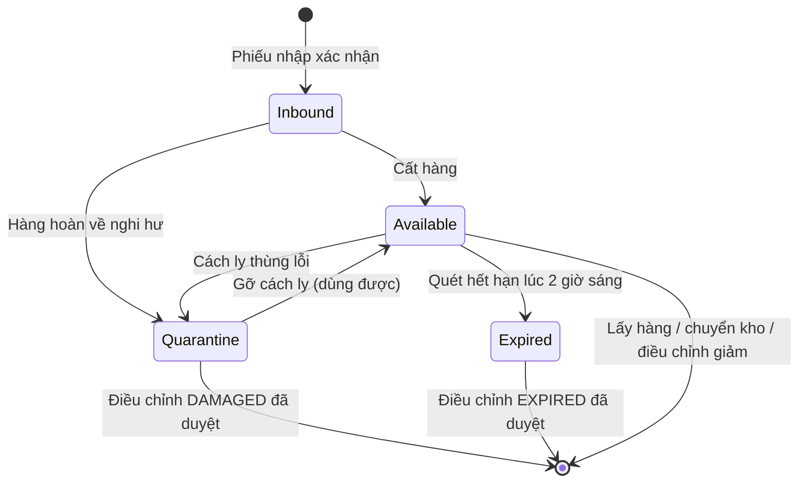
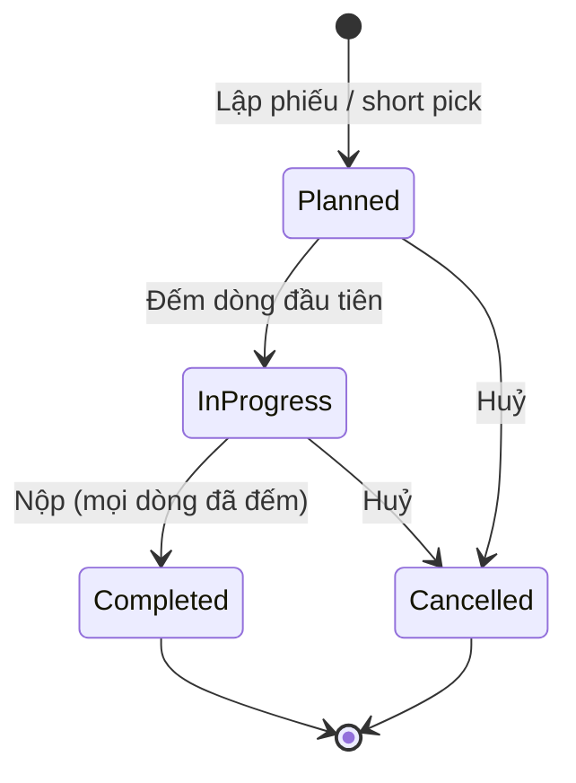
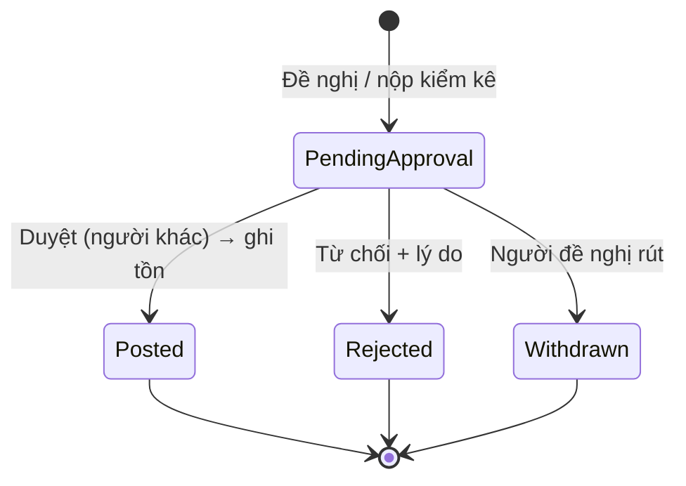
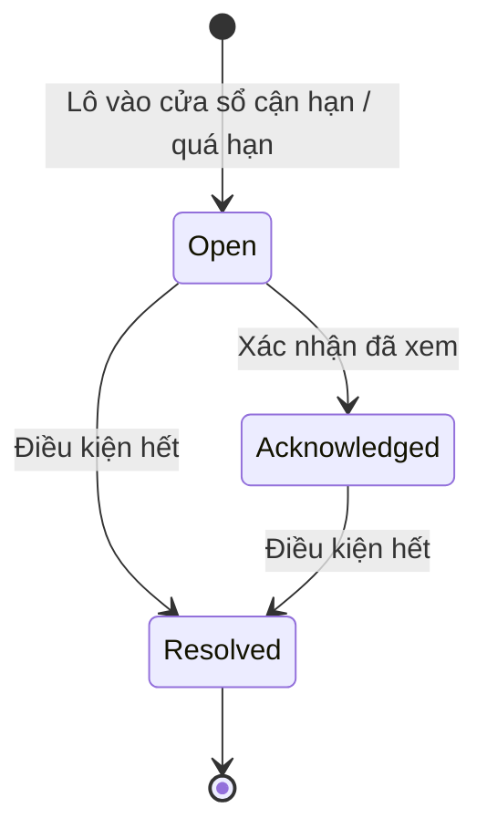
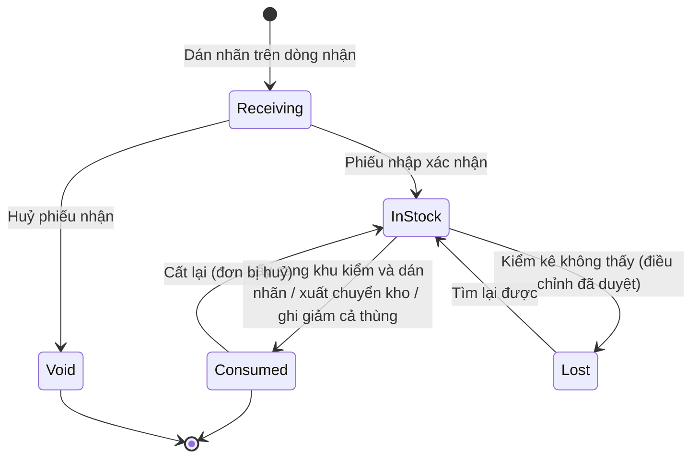

# 20 — Kiểm soát tồn kho (Inventory Control)

## 1. Mục đích (Purpose)

Giữ cho **số tồn trong hệ thống đúng với hàng thực tế** và cho biết **tình trạng** của tồn sau khi hàng đã vào kho. Module này gồm:

- **Tra cứu tồn (Stock inquiry):** tồn theo SKU, vị trí, lô, kho, thùng; tồn khả dụng và ATP — hiển thị theo **số thùng** kèm số cái.
- **Kiểm kê (Cycle count):** kiểm lại các thùng ở một phạm vi vị trí / SKU mà không dừng kho.
- **Điều chỉnh tồn (Inventory adjustment):** mọi thay đổi số lượng làm bằng tay đều phải qua duyệt bốn mắt (four-eyes).
- **Cảnh báo hạn dùng (Expiry alert):** lô sắp hết hạn hoặc đã hết hạn.
- **Quét hết hạn (Expiry sweep):** mỗi đêm chuyển tồn quá hạn sang trạng thái `Expired`.
- **Thùng hàng (LPN – License Plate Number):** mọi tồn nằm trong thùng do bộ phận sản xuất đóng sẵn; thùng là đơn vị lưu trữ, di chuyển, xuất và kiểm kê.
- **Sổ biến động tồn (Stock movement ledger) & truy xuất lô (Lot traceability):** mọi thay đổi tồn đều để lại một dòng sổ có chứng từ nguồn; từ một lô truy được về **Yêu cầu sản xuất** và phiếu nhận, và tới đơn khách.
- **Cách ly hàng lỗi (Quarantine):** tách thùng lỗi / hàng hoàn về chờ xử lý khỏi tồn bán được.

Các module khác **ghi** tồn: nhận thành phẩm và hàng hoàn ([03](../03-receipt/README.md)), cất ([05](../05-putaway/README.md)), lấy — kể cả lấy về khu chờ xuất `STAGING` ([07](../07-picking/README.md)), chuyển kho ([10](../10-inter-warehouse-transfer/README.md)), di chuyển trong kho ([11](../11-intra-warehouse-transfer/README.md)). Module này **kiểm soát** tồn: nó định nghĩa trạng thái và số lượng, sửa sai lệch và cảnh báo.

> Đã chốt 2026-11-04: kho chỉ chứa **thành phẩm sản xuất theo mẫu của khách**; sản xuất nằm ngoài hệ thống và không ghi tồn trực tiếp — thành phẩm vào kho qua nhập kho theo Yêu cầu sản xuất ([03](../03-receipt/README.md)), **đã đóng thùng sẵn**. Kho chỉ đếm nhận, không kiểm chất lượng: trạng thái tồn chỉ còn `Inbound`, `Available`, `Quarantine` (hàng lỗi / hoàn về), `Expired`. **Chỉ xuất nguyên thùng**: không mở thùng, không lấy một phần thùng. SKU sản xuất theo đơn nên **không có cảnh báo tồn thấp**; chỉ còn cảnh báo hạn dùng.

> **Đã chốt 2026-11-05:** mọi thùng của một SKU đúng **số cái chuẩn / thùng** ([01](../01-product-creation/README.md) BR-11, [03](../03-receipt/README.md) BR-13); không có thùng ít hơn số chuẩn. Tồn có thể ghi nội bộ theo **đơn vị cơ sở** (cái) để truy vết, nhưng mọi màn hình nghiệp vụ, chứng từ và tồn khả dụng hiển thị theo **số thùng** kèm số cái. Giữ hàng, phân bổ, điều chỉnh tồn và kiểm kê đều tính theo **số thùng**; phân bổ một dòng = chọn **đủ N thùng** theo FEFO / FIFO ([07](../07-picking/README.md) BR-03).

> ✅ Đã chốt (C8): có nghiệp vụ kiểm kê, mô tả trong module này. Xem [open-questions](../../open-questions/README.md).

> ⚠️ Giả định: kiểm kê **theo thùng** — người đếm quét LPN để xác nhận thùng có mặt tại vị trí, **không mở thùng để đếm**; số cái trong thùng tin là số cái chuẩn / thùng (thùng lệch không được nhận — [03](../03-receipt/README.md) BR-13). Thùng nghi lệch số cái chuẩn (rách, khách báo thiếu) được cách ly cả thùng và xử lý với bộ phận sản xuất ngoài hệ thống. Xem [open-questions](../../open-questions/README.md).

---

## 2. Actor liên quan

| Actor | Vai trò |
|-------|---------|
| **Nhân viên kho (Warehouse Staff)** | Đếm phiếu kiểm kê được giao. Ở phiếu kiểm mù, không thấy số sổ sách. Đề nghị điều chỉnh tồn và rút lại đề nghị của chính mình. Xem cảnh báo, sổ biến động, truy xuất lô và tra cứu tồn của kho mình. |
| **Quản lý kho (Warehouse Manager)** | Lập phiếu kiểm kê và giao người đếm. Xem số sổ sách. Yêu cầu đếm lại, huỷ phiếu kiểm kê. **Duyệt / từ chối điều chỉnh tồn.** **Cách ly / gỡ cách ly** thùng lỗi (§4.8). Xác nhận đã xem cảnh báo. |
| **Nhân viên kế hoạch tồn kho (Inventory Planner)** | Lập phiếu kiểm kê. Đề nghị điều chỉnh tồn nhưng **không duyệt**. Nhận và xác nhận cảnh báo hạn dùng. |
| **Quản trị hệ thống (System Admin)** | Toàn quyền; nhận mọi cảnh báo. |
| **Hệ thống** | Đánh giá cảnh báo hạn dùng mỗi khi tồn thay đổi và đối soát lại mỗi đêm (01:30). Quét hết hạn mỗi đêm (02:00). Tự mở phiếu kiểm kê khi có short pick ([07](../07-picking/README.md)). Ghi sổ biến động cho mọi thay đổi tồn. |

- Mọi thao tác chỉ trong phạm vi **các kho được gán** cho người dùng.
- Người duyệt một điều chỉnh **không được** là người đã đề nghị nó (BR-05).

---

## 3. Input / Output

### Input

| Trường | Mô tả | Bắt buộc |
|--------|-------|----------|
| **Phạm vi kiểm kê** | Kho + một hoặc nhiều tiêu chí: zone (≤ 50), kệ, mã vị trí, SKU (≤ 200). Tối đa 500 dòng đếm (thùng) cho một phiếu. | Có |
| Người đếm | Nhân viên kho hoặc quản lý kho đang hoạt động của kho đó; có thể giao sau | Không |
| Kiểm mù (blind) | Ẩn số sổ sách với người đếm. Mặc định: **có** | Không |
| Ngày kiểm, ghi chú | Mặc định hôm nay; ghi chú ≤ 500 ký tự | Không |
| **Kết quả đếm** | Theo từng thùng LPN: có / không có tại vị trí (quét LPN); thùng thấy ngoài kế hoạch | Có |
| **Đề nghị điều chỉnh** | Thùng LPN, chiều (ghi giảm cả thùng / nạp lại thùng), lý do (BR-04); bắt buộc ghi chú với lý do `OTHER` | Có |
| Cửa sổ cận hạn | Số ngày trước hạn dùng thì coi là "sắp hết hạn"; mặc định 30 ngày, cấu hình hệ thống | Có (mặc định) |
| **Cách ly thùng lỗi** | Thùng LPN, vị trí đích thuộc khu `QUARANTINE`, lý do | Có (khi cách ly) |

### Output

| Kết quả | Dùng bởi |
|---------|----------|
| **Tồn theo vị trí / lô / kho / thùng**: tồn thực tế, khả dụng, đang giữ, ATP — theo **số thùng** kèm số cái; lô hạn dùng gần nhất xếp trước | 07, 10, 13, 14, 17, Planner |
| **Phiếu kiểm kê** và chênh lệch từng thùng | Quản lý kho |
| **Phiếu điều chỉnh tồn** (`Pending Approval` → `Posted` / `Rejected` / `Withdrawn`) | Quản lý kho, Kế toán |
| **Cảnh báo hạn dùng** kèm thông báo trong hệ thống (in-app) | Quản lý kho, Planner, System Admin |
| **Dòng sổ biến động tồn** cho mọi thay đổi | Truy vết, kiểm toán |
| **Báo cáo truy xuất lô**: nguồn gốc (Yêu cầu sản xuất, phiếu nhận) → thùng còn lại theo vị trí → khoản đang giữ → đơn khách đã xuất | Quản lý kho, CSKH, thu hồi hàng (recall) |

---

## 4. Luồng nghiệp vụ từng bước (Step-by-step)

### 4.1. Tra cứu tồn

1. Người dùng chọn kho, hoặc toàn hệ thống, rồi lọc theo SKU / vị trí / lô / thùng / trạng thái.
2. Hệ thống trả về tồn theo từng vị trí và lô (hạn dùng gần nhất trước), tính theo **số thùng** kèm số cái, kèm danh sách thùng LPN, cùng với:
   - tồn theo kho;
   - ATP toàn hệ thống hoặc theo từng kho (BR-01).

### 4.2. Kiểm kê (Cycle count)

**a) Lập phiếu (Quản lý kho / Planner)**

1. Chọn kho và phạm vi (zone, kệ, vị trí, SKU). Chọn kiểm mù hay không, và có thể giao luôn người đếm.
2. Hệ thống tách phạm vi thành các **dòng đếm: mỗi thùng LPN `In Stock` một dòng** (vị trí, SKU, lô).
   - Dòng đang **bận** (BR-10) thì bỏ qua và liệt kê lại cho người lập.
   - Phạm vi vượt 500 dòng thì bị từ chối; người lập chia nhỏ phạm vi.
3. Phiếu ở trạng thái `Planned`. Có thể giao hoặc đổi người đếm tới khi bắt đầu đếm.

**b) Đếm (người được giao, hoặc quản lý kho)**

4. Người đếm quét vị trí, rồi **quét LPN từng thùng thấy tại vị trí**. Thùng trên phiếu được đánh dấu **có mặt**; thùng trên phiếu không quét được là **không thấy**. Không mở thùng (BR-14).
   - Hệ thống **đọc lại sổ sách đúng lúc đó**: không đóng băng tồn trong lúc đếm, kho vẫn vận hành.
   - Dòng đếm đầu tiên chuyển phiếu sang `In Progress`.
5. Thấy thùng **ngoài kế hoạch** thì thêm dòng mới:
   - thùng sổ ghi ở vị trí khác trong cùng kho → ghi nhận **lệch vị trí**; Quản lý kho di chuyển sổ nguyên thùng về vị trí thực tế ([11](../11-intra-warehouse-transfer/README.md)) — không đổi số lượng;
   - thùng đang `Lost` → chênh lệch thừa (bước 8).
6. Thùng đã bị chuyển nguyên thùng sang bin khác trong kho sau khi lập phiếu thì dòng đếm đi theo thùng.

**c) Nộp kết quả**

7. Khi mọi dòng đã đếm, người đếm nộp phiếu → phiếu `Completed`. Phiếu **không tự sửa tồn**.
8. Với mỗi dòng có chênh lệch, hệ thống sinh **điều chỉnh tồn lý do `COUNT_VARIANCE`** cho **cả thùng** ở `Pending Approval` (BR-08):
   - **Thiếu** (thùng không thấy): ghi giảm một thùng; nếu thùng đang giữ cho đơn / lệnh chuyển kho, khoản giữ được xử lý như thiếu hàng ([07](../07-picking/README.md)).
   - **Thừa** (thùng `Lost` được tìm thấy): nạp lại chính thùng đó (một thùng, số cái chuẩn).
9. Dòng không chênh lệch thì không sinh gì.

**d) Duyệt chênh lệch (Quản lý kho)**

10. Duyệt hoặc từ chối từng điều chỉnh như 4.3.
11. Nếu nghi đếm sai, quản lý **yêu cầu đếm lại** các dòng đã chọn. Hệ thống mở **một phiếu kiểm mù mới**; phiếu cũ không mở lại.

**e) Huỷ phiếu** — Quản lý kho huỷ phiếu `Planned` / `In Progress` kèm lý do. Phiếu `Completed` không huỷ được.

**f) Kiểm kê tự động do short pick** ([07](../07-picking/README.md))

12. Picker báo không lấy được một thùng. Hệ thống tự mở **phiếu kiểm mù** (nguồn `SHORT_PICK`) cho đúng thùng đó tại vị trí đó.
   - Nếu thùng / vị trí đang bận vì một phiếu khác, hệ thống **dùng lại** phiếu đó.
13. Trong lúc chờ, thùng đó **không được tính vào ATP và không được phân bổ** (BR-11).

### 4.3. Điều chỉnh tồn (Inventory adjustment)

1. Người đề nghị chọn **thùng LPN**, chiều điều chỉnh và lý do (BR-04):
   - **ghi giảm cả thùng** (hỏng, mất, hết hạn, sửa dữ liệu) → tồn giảm một thùng;
   - **nạp lại thùng** (`Lost` tìm lại được) → tồn tăng lại một thùng.

   Không điều chỉnh một phần thùng (BR-14).
2. Phiếu ở `Pending Approval`. Tồn **chưa thay đổi**.
3. Quản lý kho (khác người đề nghị) quyết định:
   - **Duyệt** → tồn thay đổi **ngay trong bước duyệt**, ghi một dòng sổ `ADJUSTMENT` → `Posted`.
   - **Từ chối**, bắt buộc ghi lý do → `Rejected`.
4. Trước khi có quyết định, **chỉ người đề nghị** được rút lại → `Withdrawn`. Riêng `COUNT_VARIANCE` không rút được.

> Thùng phát hiện hỏng / mất khi đang thao tác ở 05, 07, 08, 11 đều ghi giảm bằng điều chỉnh lý do `DAMAGED` / `LOST` theo luồng này, hoặc được cách ly trước để chờ xử lý (§4.8).

### 4.4. Cảnh báo hạn dùng (Expiry alert)

1. **Khi nào hệ thống đánh giá:**
   - mỗi khi tồn của một lô thay đổi (nhận, cất, lấy, điều chỉnh, chuyển, cách ly…);
   - mỗi khi cửa sổ cận hạn thay đổi;
   - mỗi đêm lúc 01:30 (đối soát toàn bộ) và sau quét hết hạn (§4.5).
2. **Hai loại cảnh báo** (BR-13):

   | Loại | Điều kiện | Phạm vi |
   |------|-----------|---------|
   | `EXPIRING` | Lô còn tồn có hạn dùng trong cửa sổ cận hạn | Theo lô và kho |
   | `EXPIRED` | Lô còn tồn đã quá hạn dùng | Theo lô và kho |

3. **Mở, cập nhật, đóng:**
   - Điều kiện xảy ra mà chưa có cảnh báo mở → mở mới và thông báo **một lần**.
   - Đã có cảnh báo mở → chỉ cập nhật số liệu (số thùng, số lượng, đơn bị ảnh hưởng).
   - Điều kiện hết → cảnh báo tự `Resolved`, kèm lý do đóng (§5.4).
4. **Người nhận thông báo:** Quản lý kho, Planner, System Admin.
5. Người nhận **xác nhận đã xem** → `Acknowledged`. Xác nhận không đóng cảnh báo, vì điều kiện vẫn còn.

### 4.5. Quét hết hạn hằng đêm (Expiry sweep)

1. Lúc **02:00** hằng ngày (giờ Việt Nam), mọi tồn `Available` có hạn dùng < hôm nay chuyển sang `Expired`. Mỗi thùng ghi một dòng sổ `STATUS_CHANGE`.
2. Thùng **đang được giữ cho một đơn** thì không bị chuyển. Cảnh báo của lô đó ghi rõ *hàng đã giữ cho đơn bị ảnh hưởng* để người phụ trách xử lý (BR-15).
3. Cập nhật cảnh báo `EXPIRING` / `EXPIRED` như 4.4.
4. Hàng `Expired` chỉ rời kho bằng điều chỉnh lý do `EXPIRED` đã được duyệt.

### 4.6. Thùng hàng LPN

1. Tại [03 · Receipt](../03-receipt/README.md), mỗi thùng thành phẩm do bộ phận sản xuất đóng sẵn được dán một mã LPN trên dòng nhận; mỗi thùng đúng số cái chuẩn / thùng của SKU, thùng lệch không nhận ([03](../03-receipt/README.md) BR-13) → `Receiving`.
2. Phiếu nhập được xác nhận (→ `In Putaway`, [03](../03-receipt/README.md)) → `In Stock`. Hàng bên trong là tồn của thùng, ở vị trí của thùng.
3. Thùng được cất ([05](../05-putaway/README.md)), di chuyển ([11](../11-intra-warehouse-transfer/README.md)), lấy về khu chờ xuất ([07](../07-picking/README.md)), cách ly (§4.8) và kiểm kê (§4.2) **nguyên thùng**; vẫn `In Stock`.
4. Thùng **rời tồn** → `Consumed` khi:
   - được lấy sang khu kiểm & dán nhãn (`PACKING`) cho đơn ([07](../07-picking/README.md)) — thùng đi tiếp làm **kiện giao** với chính mã LPN ([08](../08-packing/README.md), [09](../09-shipping/README.md));
   - được xuất chuyển kho ([10](../10-inter-warehouse-transfer/README.md));
   - bị ghi giảm cả thùng bằng điều chỉnh đã duyệt (hỏng, hết hạn…).

   Phân bổ cho đơn chọn **đủ N thùng** (N = số thùng của dòng đơn) theo FEFO / FIFO; dòng lấy hàng chỉ xác nhận bằng quét LPN ([07](../07-picking/README.md) BR-03, BR-10).
5. Thùng đã lấy của đơn bị huỷ được **cất lại nguyên thùng** → quay về `In Stock` ([07](../07-picking/README.md) §4.5).
6. Kiểm kê không tìm thấy thùng → quản lý duyệt điều chỉnh `COUNT_VARIANCE` → `Lost`. Thùng `Lost` tìm lại được thì quay về `In Stock`.
7. Phiếu nhập bị huỷ trước khi xác nhận → `Void`.

### 4.7. Sổ biến động tồn & truy xuất lô

1. Mọi thay đổi tồn ghi **một dòng sổ** gồm: loại biến động (BR-16), vị trí đi / đến, SKU, lô, **mã LPN**, số lượng, người, thời điểm, **chứng từ nguồn**.
   - Chứng từ nguồn là dòng phiếu nhận, task cất, dòng lấy hàng, dòng lệnh chuyển kho, phiếu điều chỉnh, lần cách ly, lần quét hết hạn…
   - Dòng sổ **không sửa, không xoá**. Sai thì sửa bằng một điều chỉnh mới.
2. **Truy xuất một lô** gồm:
   - **Nguồn gốc:** Yêu cầu sản xuất và phiếu nhận thành phẩm ([03](../03-receipt/README.md)); với hàng hoàn: phiếu nhận hàng hoàn và đơn gốc.
   - **Thùng còn lại:** theo từng vị trí (kể cả khu chờ xuất, khu `QUARANTINE`).
   - **Khoản đang giữ:** đơn hàng / lệnh chuyển kho đang giữ thùng của lô này.
   - **Đơn khách đã nhận hàng** từ lô này (theo mã LPN đã giao).
   - **Toàn bộ dòng sổ** của lô.
3. Lô không có phiếu nhận trong hệ thống (ví dụ tồn đầu kỳ) được ghi nguồn gốc là **chưa truy được (`UNTRACED`)**.

### 4.8. Cách ly hàng lỗi (Quarantine)

1. **Hàng vào `Quarantine`** theo hai đường:
   - **hàng hoàn về** (giao thất bại / khách trả) nghi hư khi nhận lại qua [03](../03-receipt/README.md): nhận thẳng vào khu `QUARANTINE`;
   - **thùng lỗi phát hiện sau khi nhập kho** (khi cất, lấy, kiểm thùng, kiểm kê): Quản lý kho **cách ly nguyên thùng** — chọn thùng LPN, vị trí đích thuộc khu `QUARANTINE`, lý do. Thùng chuyển sang khu cách ly, trạng thái tồn → `Quarantine`, ghi một dòng sổ `STATUS_CHANGE`.
2. Hàng `Quarantine` **không thuộc ATP**, không phân bổ, không chuyển kho. Chỉ thùng tự do mới cách ly được; thùng đang giữ cho đơn phải được nhả / phân bổ lại trước.
3. **Xử lý** (Quản lý kho):
   - thùng dùng được → **gỡ cách ly** → `Available`, cất về bin ([05](../05-putaway/README.md));
   - thùng lỗi → ghi giảm cả thùng bằng điều chỉnh `DAMAGED` đã duyệt (§4.3). Việc đổi trả với bộ phận sản xuất làm **ngoài hệ thống**; hàng thay thế (nếu có) nhập kho qua [03](../03-receipt/README.md) như thành phẩm mới.

> ⚠️ Giả định: hàng lỗi phát hiện sau khi nhận được đổi trả với bộ phận sản xuất ngoài hệ thống; hệ thống chỉ ghi nhận bằng cách ly ở khu `QUARANTINE` và điều chỉnh tồn. Cách ly / gỡ cách ly là đổi trạng thái, không đổi số lượng nên không qua duyệt bốn mắt. Xem [open-questions](../../open-questions/README.md).

### 4.9. Tồn ở khu chờ xuất (Staging)

1. Lấy hàng với đích `STAGING` ([07](../07-picking/README.md)) chuyển nguyên thùng từ bin sang vị trí thuộc khu chờ xuất (dòng sổ `MOVE`). **Khoản phân bổ của đơn đi theo thùng** và vẫn `Held`; tồn chưa bị trừ.
2. Tồn ở khu chờ xuất **đã gắn đơn**: không thuộc ATP, không phân bổ cho đơn khác, không chuyển kho, không di chuyển thủ công (BR-20).
3. Thùng rời khu chờ xuất theo hai đường:
   - **chuyển cả tác vụ sang khu kiểm & dán nhãn** ([08](../08-packing/README.md)) → tồn bị trừ (dòng sổ `PICK`), thùng `Consumed`, khoản phân bổ → `Consumed`;
   - **đơn bị huỷ** → khoản phân bổ `Released` (`ORDER_CANCELLED`); thùng vẫn ở khu chờ xuất, chưa vào ATP, tới khi được **cất lại** về bin (dòng sổ `MOVE`).
4. Khu chờ xuất được kiểm kê như vị trí khác (§4.2); thùng không thấy là chênh lệch thiếu của phần đang giữ cho đơn, đơn phải xử lý như thiếu hàng ([07](../07-picking/README.md)).

> ⚠️ Giả định: Điều phối quyết định có dùng khu chờ xuất cho đơn hay không; tồn ở `STAGING` đã gắn đơn, không khả dụng cho đơn khác. Lấy về khu chờ xuất chưa trừ tồn (chỉ đổi vị trí), tồn bị trừ khi chuyển cả tác vụ sang khu kiểm & dán nhãn. Xem [open-questions](../../open-questions/README.md).

---

## 5. Trạng thái / Vòng đời (Lifecycle)

### 5.1. Trạng thái của tồn (Stock status)

Trạng thái mô tả **tình trạng hàng**. Số lượng giữ cho đơn (giữ hàng, phân bổ) **không phải trạng thái**: đó là các khoản giữ trên tồn `Available` (§5.6).

| Trạng thái | Ý nghĩa | Chuyển tiếp cho phép | Ai thực hiện |
|------------|---------|----------------------|--------------|
| `Inbound` | Đã nhận, chưa cất: ở khu nhận (`RECEIVING`) | → `Available` (cất hàng); → `Quarantine` (hàng hoàn về nghi hư) | NV kho ([03](../03-receipt/README.md), [05](../05-putaway/README.md)) |
| `Available` | Ở vị trí được phép xuất; là nguồn của ATP (trừ phần đang giữ và hàng ở khu chờ xuất — BR-01) | → `Expired` (quét đêm); → `Quarantine` (cách ly thùng lỗi); → rời kho (lấy, chuyển kho, điều chỉnh giảm) | Hệ thống, NV kho, Quản lý kho |
| `Quarantine` | Thùng lỗi hoặc hàng hoàn về, cách ly ở khu `QUARANTINE` chờ xử lý; không bán | → `Available` (gỡ cách ly, cất lại); → rời kho (điều chỉnh `DAMAGED` đã duyệt) | Quản lý kho |
| `Expired` | Quá hạn dùng; giữ lại để còn vết | → rời kho (điều chỉnh `EXPIRED` đã duyệt) | Quản lý kho |

> Thùng lỗi phát hiện sau khi nhập kho được **cách ly** ở `Quarantine` (§4.8) hoặc ghi giảm thẳng bằng điều chỉnh `DAMAGED` (§4.3). Hàng ở **khu chờ xuất** không có trạng thái riêng: đó là tồn `Available` mang khoản phân bổ của đơn (§4.9, BR-20).

### 5.2. Phiếu kiểm kê (Cycle count)

| Trạng thái | Ý nghĩa | Chuyển tiếp cho phép | Ai thực hiện |
|------------|---------|----------------------|--------------|
| `Planned` | Đã lập, chưa đếm dòng nào; có thể giao / đổi người đếm | → `In Progress`, → `Cancelled` | Quản lý kho / Planner; hệ thống (short pick) |
| `In Progress` | Đã có ít nhất một dòng được đếm | → `Completed`, → `Cancelled` | Người đếm; Quản lý kho |
| `Completed` | Đã nộp; chênh lệch thành điều chỉnh `COUNT_VARIANCE` chờ duyệt | *(cuối)* — đếm lại = phiếu mới | Người đếm |
| `Cancelled` | Huỷ kèm lý do | *(cuối)* | Quản lý kho |

**Nguồn phát sinh** của phiếu:

| Nguồn | Khi nào |
|-------|---------|
| `MANUAL` | Quản lý kho / Planner tự lập |
| `SHORT_PICK` | Picker báo không lấy được thùng (luôn kiểm mù) |
| `SCHEDULED` | Kiểm kê theo lịch |
| `MOVE_DISCREPANCY` | Lệch khi di chuyển trong kho ([11](../11-intra-warehouse-transfer/README.md)) |
| `TRANSFER_DISCREPANCY` | Lệch khi chuyển giữa kho ([10](../10-inter-warehouse-transfer/README.md)) |

> ⚠️ Giả định: ba nguồn `SCHEDULED`, `MOVE_DISCREPANCY`, `TRANSFER_DISCREPANCY` đã được dành chỗ nhưng **chưa tự sinh phiếu**. Hiện tại người dùng lập tay với nguồn `MANUAL`. Lịch kiểm kê định kỳ và việc tự mở phiếu khi lệch số còn để ngỏ. Xem [open-questions](../../open-questions/README.md).

### 5.3. Phiếu điều chỉnh tồn (Inventory adjustment)

| Trạng thái | Ý nghĩa | Chuyển tiếp cho phép | Ai thực hiện |
|------------|---------|----------------------|--------------|
| `Pending Approval` | Đã đề nghị; tồn chưa đổi | → `Posted`, → `Rejected`, → `Withdrawn` | Người đề nghị; Quản lý kho |
| `Posted` | Đã duyệt **và** đã ghi tồn trong cùng bước | *(cuối)* | Quản lý kho (≠ người đề nghị) |
| `Rejected` | Từ chối, có lý do; tồn không đổi | *(cuối)* | Quản lý kho (≠ người đề nghị) |
| `Withdrawn` | Người đề nghị rút lại trước khi có quyết định | *(cuối)* | Chỉ người đề nghị; không áp dụng cho `COUNT_VARIANCE` |

### 5.4. Cảnh báo hạn dùng (Expiry alert)

| Trạng thái | Ý nghĩa | Chuyển tiếp cho phép | Ai thực hiện |
|------------|---------|----------------------|--------------|
| `Open` | Điều kiện đang xảy ra, chưa ai xác nhận | → `Acknowledged`, → `Resolved` | Hệ thống mở |
| `Acknowledged` | Đã có người xác nhận đã xem; điều kiện vẫn còn | → `Resolved` | Planner / Quản lý kho |
| `Resolved` | Điều kiện đã hết | *(cuối)* — điều kiện quay lại = cảnh báo mới | Hệ thống |

**Lý do đóng cảnh báo:**

| Lý do | Áp dụng cho | Ý nghĩa |
|-------|-------------|---------|
| `STOCK_GONE` | `EXPIRING`, `EXPIRED` | Lô không còn tồn ở kho đó |
| `EXPIRED_OUT` | `EXPIRING` | Lô đã hết hạn; chuyển sang cảnh báo `EXPIRED` |

### 5.5. Thùng hàng LPN

| Trạng thái | Ý nghĩa | Chuyển tiếp cho phép | Ai thực hiện |
|------------|---------|----------------------|--------------|
| `Receiving` | Đã dán nhãn trên phiếu nhận chưa xác nhận; chưa có tồn | → `In Stock`, → `Void` | NV kho ([03](../03-receipt/README.md)) |
| `In Stock` | Đang chứa hàng, nằm ở một vị trí (kể cả khu chờ xuất, khu `QUARANTINE`); là trạng thái duy nhất có tồn | → `Consumed`, → `Lost` | Hệ thống; Quản lý kho |
| `Consumed` | Thùng đã rời tồn nguyên thùng: lấy sang khu kiểm & dán nhãn (đi tiếp làm kiện giao), xuất chuyển kho, hoặc ghi giảm cả thùng; giữ lại để còn lịch sử | → `In Stock` (cất lại thùng của đơn bị huỷ) | Hệ thống |
| `Lost` | Kiểm kê không tìm thấy | → `In Stock` (tìm lại được) | Quản lý kho (qua điều chỉnh đã duyệt) |
| `Void` | Phiếu nhập bị huỷ trước khi xác nhận | *(cuối)* | Hệ thống |

### 5.6. Khoản giữ hàng (Reservation & Allocation)

Giữ hàng có hai tầng:

- **Giữ theo SKU (Reservation):** không gắn vị trí, số lượng giữ tính theo **số thùng**, tạo khi đơn `Confirmed` (hợp đồng đã ký, đợt `ON_SIGNING` đã thu — [17](../../ecommerce/17-order-management/README.md)); không có hạn, tồn tại tới khi release, huỷ đơn hoặc nhả tay.
- **Phân bổ (Allocation):** gắn **thùng LPN** cụ thể (và qua đó bin, lô), sinh khi đơn được release cho một kho ([17](../../ecommerce/17-order-management/README.md), [07](../07-picking/README.md)). **Mỗi thùng một khoản**; một dòng có **đủ N thùng** (N = số thùng của dòng), hoặc — khi chỉ có sẵn k < N thùng — có k thùng, phần thiếu N − k thùng đi Yêu cầu sản xuất ([07](../07-picking/README.md) BR-03). Allocation không có hạn. Khi thùng được lấy về **khu chờ xuất**, khoản phân bổ đi theo thùng sang vị trí `STAGING` và vẫn `Held` (§4.9).

> Chữ "`Allocated`" ở module 07 và trong sơ đồ có nghĩa là *phần tồn `Available` đang có khoản phân bổ*, không phải một trạng thái riêng của hàng.

| Trạng thái khoản giữ | Ý nghĩa | Chuyển tiếp cho phép | Ai thực hiện |
|----------------------|---------|----------------------|--------------|
| `Held` | Đang giữ (kể cả thùng đã lấy về khu chờ xuất); không có hạn | → `Allocated` (chỉ giữ theo SKU), → `Consumed` (chỉ phân bổ), → `Released` | Hệ thống |
| `Allocated` | Giữ theo SKU đã được thay bằng các khoản phân bổ | *(cuối)* | Điều phối đơn hàng (release) |
| `Consumed` | Thùng đã lấy sang khu kiểm & dán nhãn, tồn đã trừ | *(cuối)* | NV kho (xác nhận pick); Điều phối / Quản lý kho (chuyển cả tác vụ từ khu chờ xuất sang khu kiểm & dán nhãn) |
| `Released` | Nhả giữ, có lý do (bảng dưới) | *(cuối)* | Hệ thống / người có quyền |

**Lý do nhả giữ:**

| Lý do | Ý nghĩa |
|-------|---------|
| `ORDER_CANCELLED` | Đơn bị huỷ |
| `MANUAL_OVERRIDE` | Người có quyền nhả tay |
| `SHORT_PICKED` | Không lấy được thùng; đơn được phân bổ lại thùng khác |
| `TRANSFER_CANCELLED` | Huỷ lấy hàng của lệnh chuyển kho trước khi hàng rời kho |

---

## 6. Ràng buộc nghiệp vụ (Business Rules) & Edge case

### Business rules

- **BR-01 — ATP.** ATP = tồn `Available` **chưa hết hạn**, **không bị giữ** (không có khoản phân bổ hay giữ cho lệnh chuyển kho), **không nằm ở khu chờ xuất**, trừ đi các khoản giữ theo SKU còn hiệu lực. Tính và hiển thị theo **số thùng** kèm số cái. Xem được toàn hệ thống hoặc theo từng kho. Hàng `Inbound`, `Quarantine`, `Expired`, `In-Transit`, và mọi tồn ở khu `STAGING`, không thuộc ATP.
- **BR-02 — Bất biến số lượng.** Với mọi dòng tồn: tồn thực tế ≥ tổng các khoản đang giữ trên nó. Tồn không bao giờ âm.
- **BR-03 — Không sửa tồn "trần".** Ngoài các luồng nghiệp vụ (nhận, cất, lấy, chuyển), số lượng chỉ thay đổi qua **điều chỉnh đã duyệt**. Sản xuất nằm ngoài hệ thống và không ghi tồn; thành phẩm chỉ vào kho qua phiếu nhận ([03](../03-receipt/README.md)).
- **BR-04 — Lý do điều chỉnh.**

  | Lý do | Ý nghĩa | Chiều |
  |-------|---------|-------|
  | `DAMAGED` | Thùng hỏng | Tăng hoặc giảm |
  | `LOST` | Thùng mất | Tăng hoặc giảm |
  | `FOUND` | Tìm thấy thùng | Tăng hoặc giảm |
  | `EXPIRED` | Hàng hết hạn | Tăng hoặc giảm |
  | `DATA_CORRECTION` | Sửa sai dữ liệu | Tăng hoặc giảm |
  | `OTHER` | Lý do khác, **bắt buộc ghi chú** | Tăng hoặc giảm |
  | `COUNT_VARIANCE` | Chênh lệch kiểm kê; **chỉ kiểm kê được tạo**, người dùng không chọn được | Tăng hoặc giảm |

- **BR-05 — Bốn mắt.** Người duyệt hoặc từ chối một điều chỉnh không được là người đề nghị. Duyệt là ghi tồn ngay; không tồn tại điều chỉnh "đã duyệt nhưng chưa ghi".
- **BR-06 — Rút đề nghị.** Chỉ người đề nghị được rút, và chỉ khi chưa có quyết định. Điều chỉnh `COUNT_VARIANCE` không rút được: nó chỉ được duyệt hoặc từ chối.
- **BR-07 — Kiểm mù.** Ở phiếu kiểm mù, người đếm không thấy sổ sách và ghi chú của phiếu (ghi chú short pick chứa điều picker báo). Chỉ người có quyền duyệt kiểm kê mới thấy. Phiếu từ short pick luôn kiểm mù.
- **BR-08 — Kiểm kê không tự ghi tồn.** Nộp phiếu chỉ sinh điều chỉnh `COUNT_VARIANCE` chờ duyệt. Mọi chênh lệch đều qua duyệt bốn mắt (BR-05).
- **BR-09 — Sổ sách tại thời điểm đếm.** Chênh lệch tính trên sổ sách đọc lúc đếm, không đóng băng kho. Lúc nộp, nếu thùng của một dòng đã rời vị trí hoặc đã `Consumed` sau khi được đếm, dòng đó bị từ chối; người dùng đếm lại dòng đó.
- **BR-10 — Một thùng, một phiếu.** Một dòng đếm (một thùng) là **bận** khi:
  - nó nằm trên một phiếu `Planned` / `In Progress`; hoặc
  - nó nằm trên một phiếu `Completed` mà điều chỉnh `COUNT_VARIANCE` của dòng còn `Pending Approval`.

  Dòng bận không được đưa vào phiếu mới, không được thêm tay hay đếm lại. Short pick trên dòng bận dùng lại phiếu đang giữ nó. Lý do: hai phiếu cùng sửa một chỗ sẽ sửa tồn hai lần. Di chuyển thủ công thùng đang bận bị từ chối ([11](../11-intra-warehouse-transfer/README.md)).
- **BR-11 — Short pick chặn bán.** Thùng của dòng short pick bị loại khỏi ATP và khỏi phân bổ tới khi mọi điều chỉnh của dòng đó có quyết định. Mọi điều chỉnh **giảm** đang chờ duyệt cũng chặn thùng đó, bất kể nguồn phiếu.
- **BR-12 — Phạm vi kiểm kê.** Tối đa 500 dòng (thùng) mỗi phiếu, 50 zone, 200 SKU. Người đếm phải là nhân viên kho hoặc quản lý kho đang hoạt động của kho đó. Người đếm chỉ đổi được trước khi bắt đầu đếm.
- **BR-13 — Cảnh báo hạn dùng.**
  - Chỉ có hai loại cảnh báo: `EXPIRING` (lô còn tồn có hạn dùng trong cửa sổ cận hạn, mặc định 30 ngày) và `EXPIRED` (lô còn tồn đã quá hạn), theo lô và kho.
  - Chỉ áp dụng cho SKU theo dõi lô / hạn dùng ([01](../01-product-creation/README.md)).
  - Không có cảnh báo tồn thấp: SKU thành phẩm theo mẫu của khách sản xuất theo đơn, phần thiếu do Điều phối gửi Yêu cầu sản xuất ([17](../../ecommerce/17-order-management/README.md)).
- **BR-14 — Nguyên thùng.** Mọi tồn nằm trong thùng LPN. Cất, di chuyển, lấy, chuyển kho, cách ly, kiểm kê và điều chỉnh đều theo **nguyên thùng**; kho không mở thùng, không lấy hoặc điều chỉnh một phần thùng, không có hàng nằm ngoài thùng.
- **BR-15 — Không âm thầm bỏ hàng của đơn.** Quét hết hạn không chuyển trạng thái thùng đang giữ cho một đơn. Thay vào đó, cảnh báo của lô ghi rõ hàng của đơn bị ảnh hưởng để người phụ trách xử lý.
- **BR-16 — Loại biến động.**

  | Loại | Ý nghĩa |
  |------|---------|
  | `RECEIPT` | Nhận hàng |
  | `MOVE` | Di chuyển, cất hàng; lấy thùng về khu chờ xuất và cất lại từ khu chờ xuất |
  | `ADJUSTMENT` | Điều chỉnh |
  | `TRANSFER_OUT` | Xuất chuyển kho |
  | `STATUS_CHANGE` | Đổi trạng thái: hết hạn, cách ly / gỡ cách ly |
  | `PICK` | Lấy thùng sang khu kiểm & dán nhãn (trừ tồn) |
  | `PUT_BACK` | Cất lại thùng đã trừ tồn của đơn bị huỷ |

  Dòng sổ không sửa, không xoá.
- **BR-17 — Chống báo trùng.** Một điều kiện chỉ có một cảnh báo mở tại một thời điểm. Điều kiện vừa hết rồi quay lại trong vòng 6 giờ thì mở lại cảnh báo nhưng **không thông báo lại**.
- **BR-18 — Thùng LPN.**
  - Thùng không tự mang số lượng: hàng trong thùng là tồn ở vị trí của thùng; số cái trong thùng bằng **số cái chuẩn / thùng** của SKU, cố định từ lúc nhận.
  - Chênh lệch của thùng là một điều chỉnh cho cả thùng.
  - Điều chỉnh tăng thì nạp lại chính thùng đó, không sinh lô mới.
  - Một thùng chỉ ở một vị trí.
- **BR-19 — Phạm vi kho.** Người dùng gắn với kho chỉ xem và thao tác tồn, phiếu kiểm kê, điều chỉnh, cảnh báo và truy xuất của các kho được gán.
- **BR-20 — Tồn ở khu chờ xuất gắn đơn.** Tồn ở khu `STAGING` chỉ vào bằng lấy hàng cho đơn ([07](../07-picking/README.md)) và luôn mang khoản phân bổ của đơn đó. Tồn này **không khả dụng**: không thuộc ATP, không phân bổ cho đơn khác, không chuyển kho, không di chuyển thủ công ([11](../11-intra-warehouse-transfer/README.md)). Đơn bị huỷ thì thùng vẫn ngoài ATP tới khi được cất lại về bin.
- **BR-21 — Cách ly.** Chỉ Quản lý kho cách ly / gỡ cách ly; chỉ thùng tự do mới cách ly được, và cách ly nguyên thùng. Hàng `Quarantine` chỉ rời kho qua điều chỉnh đã duyệt (BR-05).

### Edge case

| Tình huống | Hướng xử lý |
|------------|-------------|
| Đang đếm thì có người lấy thùng ở vị trí đó | Cho phép. Sổ sách đọc lúc đếm từng dòng (BR-09). Nếu lúc nộp thùng đã rời vị trí thì dòng đó bị từ chối; đếm lại dòng đó. |
| Hai người cùng muốn kiểm một vị trí | Phiếu sau bỏ qua các thùng đang bận và liệt kê lại (BR-10). |
| Short pick ở thùng đang có phiếu kiểm thủ công mở | Dùng lại phiếu đó, không mở phiếu thứ hai. |
| Quản lý nghi kết quả đếm | Từ chối điều chỉnh rồi yêu cầu đếm lại: hệ thống mở phiếu kiểm mù mới; phiếu cũ giữ nguyên. |
| Kiểm kê thấy thùng ở vị trí khác vị trí trên sổ | Ghi nhận lệch vị trí; Quản lý kho di chuyển sổ nguyên thùng về vị trí thực tế ([11](../11-intra-warehouse-transfer/README.md)), không qua điều chỉnh số lượng. |
| Không tìm thấy một thùng LPN | Điều chỉnh `COUNT_VARIANCE` cho cả thùng. Duyệt thì thùng → `Lost`. Tìm lại được thì → `In Stock`. |
| Thùng mất / rách nhãn LPN, không quét được | Quản lý kho xác định thùng theo SKU, lô, vị trí trên sổ rồi in lại nhãn theo mã LPN ([03](../03-receipt/README.md)); không xác định được → cách ly thùng chờ xử lý. |
| Thùng rách hoặc nghi số cái trong thùng khác số cái chuẩn | Cách ly cả thùng sang khu `QUARANTINE` (§4.8) — thùng lệch không được phân bổ; xử lý với bộ phận sản xuất ngoài hệ thống; thùng không dùng được ghi giảm `DAMAGED` qua duyệt. |
| Lô hết hạn nhưng đã giữ cho đơn đã thanh toán | Không chuyển `Expired`. Cảnh báo ghi "hàng đã giữ bị ảnh hưởng"; điều phối xử lý đơn ([17](../../ecommerce/17-order-management/README.md)). |
| Người đề nghị điều chỉnh cũng là quản lý duy nhất của kho | Không tự duyệt được. Cần một quản lý khác hoặc System Admin duyệt. |
| Tồn đầu kỳ không có phiếu nhận | Truy xuất lô ghi nguồn gốc `UNTRACED`. |
| Phát hiện thùng lỗi trong bin sau khi đã nhập kho | Quản lý kho cách ly nguyên thùng sang khu `QUARANTINE` (§4.8); đổi trả với bộ phận sản xuất ngoài hệ thống; thùng lỗi ghi giảm `DAMAGED` qua duyệt. |
| Thùng lỗi nằm trong phần đang giữ cho đơn | Không cách ly thẳng được (BR-21); Điều phối nhả / phân bổ lại cho đơn ([07](../07-picking/README.md)) rồi mới cách ly. |
| Hàng hoàn về nguyên vẹn sau khi đã cách ly | Gỡ cách ly → `Available`, cất về bin. |
| Đơn bị huỷ khi thùng đang ở khu chờ xuất | Nhả phân bổ `ORDER_CANCELLED`; thùng vẫn ngoài ATP tới khi cất lại về bin (§4.9, BR-20). |
| Kiểm kê khu chờ xuất không thấy thùng | Điều chỉnh `COUNT_VARIANCE` cho cả thùng thuộc phần đang giữ của đơn; đơn xử lý như thiếu hàng ([07](../07-picking/README.md)). |
| Lô ở khu chờ xuất sắp / đã hết hạn | Thùng đang giữ cho đơn nên không chuyển `Expired` (BR-15); cảnh báo ghi rõ đơn bị ảnh hưởng để Điều phối xử lý. |

---

## 7. Liên kết với các module khác

| Module | Quan hệ |
|--------|---------|
| [01 · Product Creation](../01-product-creation/README.md) | Chính sách FEFO / FIFO, theo dõi lô / hạn dùng, quy cách thùng (số cái chuẩn / thùng) khai báo cho SKU |
| [03 · Receipt](../03-receipt/README.md) | Nhập thành phẩm theo Yêu cầu sản xuất: ghi tồn `Inbound`, dán nhãn thùng LPN, nguồn gốc cho truy xuất lô; hàng hoàn về nghi hư nhận vào `Quarantine`; cảnh báo cận hạn dùng chung cửa sổ ngày; in lại nhãn LPN |
| [05 · Putaway](../05-putaway/README.md) | `Inbound` → `Available`; cất nguyên thùng; lệch khi cất xử lý bằng điều chỉnh / kiểm kê ở đây |
| [06 · Warehouse Map & Slotting](../06-warehouse-map-slotting/README.md) | Khu chờ xuất `STAGING` (tồn gắn đơn) và khu `QUARANTINE` (thùng lỗi / hoàn về) |
| [07 · Picking](../07-picking/README.md) | Phân bổ đủ N thùng theo FEFO / FIFO từ tồn `Available` chưa hết hạn; dòng lấy hàng quét LPN; lấy về khu chờ xuất giữ tồn gắn đơn (§4.9); short pick tự mở kiểm kê mù (4.2-f, BR-11); cất lại thùng của đơn huỷ |
| [08 · Kiểm thùng & Dán nhãn giao hàng](../08-packing/README.md) | Thùng đã lấy (`Consumed`) đi tiếp làm kiện giao; thùng hư hỏng khi kiểm được cách ly |
| [10 · Inter-warehouse Transfer](../10-inter-warehouse-transfer/README.md) | Giữ thùng cho lệnh chuyển; xuất nguyên thùng (`TRANSFER_OUT`); lệch khi chuyển → kiểm kê + điều chỉnh có duyệt |
| [11 · Intra-warehouse Transfer](../11-intra-warehouse-transfer/README.md) | Di chuyển nguyên thùng ghi sổ `MOVE`; thùng đang kiểm kê không di chuyển được (BR-10); sửa lệch vị trí phát hiện khi kiểm kê |
| [13 · Catalog](../../ecommerce/13-catalog/README.md) · [14 · Quote, Order & Contract](../../ecommerce/14-cart-and-order/README.md) | ATP (BR-01) cấp **theo số thùng**; 13 dùng làm chỉ báo còn hàng trên sàn (ngưỡng "sắp hết" do 13 quy định), 14 dùng làm tồn khả dụng khi lập báo giá / đơn |
| [17 · Order Management](../../ecommerce/17-order-management/README.md) | Release đơn → phân bổ đủ số thùng của dòng; quyết định dùng khu chờ xuất; thùng giữ cho đơn bị hết hạn dùng / short pick → đơn treo xử lý |
| [00 · System Overview §6](../../00-system-overview/README.md) | Nguyên tắc chứng từ nguồn và công thức ATP |
