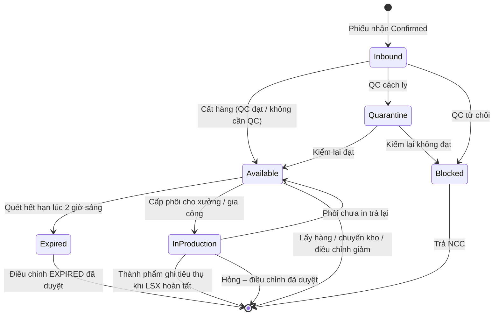
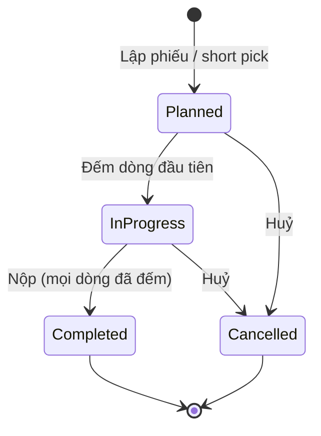
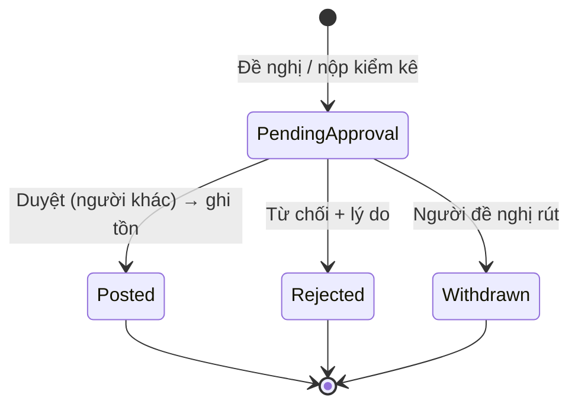
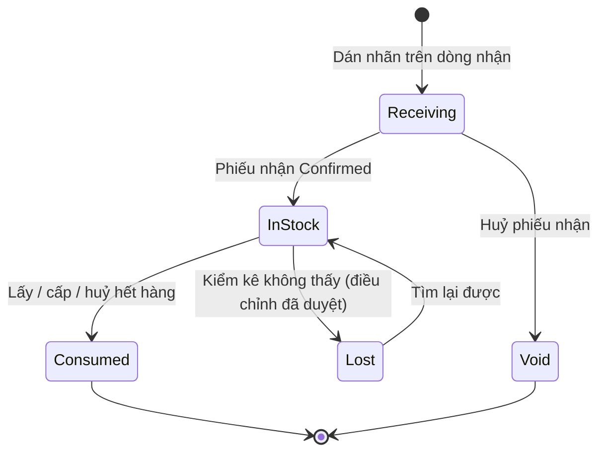

# 20 — Kiểm soát tồn kho (Inventory Control)

## 1. Mục đích (Purpose)

Giữ cho **số tồn trong hệ thống đúng với hàng thực tế** và cho biết **tình trạng** của tồn sau khi hàng đã vào kho. Module này gồm:

- **Tra cứu tồn (Stock inquiry):** tồn theo SKU, vị trí, lô, kho; tồn khả dụng và ATP.
- **Kiểm kê (Cycle count):** đếm lại tồn ở một phạm vi vị trí / SKU mà không dừng kho.
- **Điều chỉnh tồn (Inventory adjustment):** mọi thay đổi số lượng làm bằng tay đều phải qua duyệt bốn mắt (four-eyes).
- **Cảnh báo tồn (Stock alert):** tồn chạm ngưỡng đặt lại hoặc dưới tồn an toàn; lô sắp hết hạn hoặc đã hết hạn.
- **Quét hết hạn (Expiry sweep):** mỗi đêm chuyển tồn quá hạn sang trạng thái `Expired`.
- **Thùng hàng (LPN – License Plate Number):** theo dõi một thùng nguyên đai như một đơn vị.
- **Sổ biến động tồn (Stock movement ledger) & truy xuất lô (Lot traceability):** mọi thay đổi tồn đều để lại một dòng sổ có chứng từ nguồn; từ một lô truy được về NCC và tới đơn khách.

Các module khác **ghi** tồn: nhận ([03](../03-receipt/README.md)), cất ([05](../05-putaway/README.md)), lấy ([07](../07-picking/README.md)), chuyển kho ([10](../10-inter-warehouse-transfer/README.md)), di chuyển trong kho ([11](../11-intra-warehouse-transfer/README.md)), sản xuất ([19](../19-production/README.md)). Module này **kiểm soát** tồn: nó định nghĩa trạng thái và số lượng, sửa sai lệch và cảnh báo.

> ✅ Đã chốt (C8): có nghiệp vụ kiểm kê, mô tả trong module này. Xem [open-questions](../../open-questions/README.md).

---

## 2. Actor liên quan

| Actor | Vai trò |
|-------|---------|
| **Nhân viên kho (Warehouse Staff)** | Đếm phiếu kiểm kê được giao. Ở phiếu kiểm mù, không thấy số sổ sách. Đề nghị điều chỉnh tồn và rút lại đề nghị của chính mình. Xem cảnh báo, sổ biến động, truy xuất lô và tra cứu tồn của kho mình. |
| **Quản lý kho (Warehouse Manager)** | Lập phiếu kiểm kê và giao người đếm. Xem số sổ sách. Yêu cầu đếm lại, huỷ phiếu kiểm kê. **Duyệt / từ chối điều chỉnh tồn.** Xác nhận đã xem cảnh báo. |
| **Nhân viên kế hoạch tồn kho (Inventory Planner)** | Lập phiếu kiểm kê. Đề nghị điều chỉnh tồn nhưng **không duyệt**. Nhận và xác nhận cảnh báo tồn thấp và cảnh báo hạn dùng. Ngưỡng tồn cấu hình trên Inventory Item ([01](../01-product-creation/README.md)). |
| **Quản trị hệ thống (System Admin)** | Toàn quyền; nhận mọi loại cảnh báo. |
| **Hệ thống** | Đánh giá cảnh báo mỗi khi tồn thay đổi và đối soát lại mỗi đêm (01:30). Quét hết hạn mỗi đêm (02:00). Tự mở phiếu kiểm kê khi có short pick ([07](../07-picking/README.md)). Ghi sổ biến động cho mọi thay đổi tồn. |

- Mọi thao tác chỉ trong phạm vi **các kho được gán** cho người dùng.
- Người duyệt một điều chỉnh **không được** là người đã đề nghị nó (BR-05).

---

## 3. Input / Output

### Input

| Trường | Mô tả | Bắt buộc |
|--------|-------|----------|
| **Phạm vi kiểm kê** | Kho + một hoặc nhiều tiêu chí: zone (≤ 50), kệ, mã vị trí, SKU (≤ 200). Tối đa 500 dòng đếm cho một phiếu. | Có |
| Người đếm | Nhân viên kho hoặc quản lý kho đang hoạt động của kho đó; có thể giao sau | Không |
| Kiểm mù (blind) | Ẩn số sổ sách với người đếm. Mặc định: **có** | Không |
| Ngày kiểm, ghi chú | Mặc định hôm nay; ghi chú ≤ 500 ký tự | Không |
| **Số đếm thực tế** | Theo từng dòng (vị trí + SKU + lô, hoặc một thùng LPN) | Có |
| **Đề nghị điều chỉnh** | Vị trí, SKU, lô, số lượng tăng / giảm (≠ 0), lý do (BR-04); bắt buộc ghi chú với lý do `OTHER` | Có |
| **Ngưỡng tồn** | Ngưỡng đặt lại (reorder point), tồn an toàn (safety stock), mức tối đa — khai báo trên Inventory Item ([01](../01-product-creation/README.md)) | Không (không khai báo = không cảnh báo) |
| Cửa sổ cận hạn | Số ngày trước hạn dùng thì coi là "sắp hết hạn"; mặc định 30 ngày, cấu hình hệ thống | Có (mặc định) |

### Output

| Kết quả | Dùng bởi |
|---------|----------|
| **Tồn theo vị trí / lô / kho**: tồn thực tế, khả dụng, đang giữ, ATP; lô hạn dùng gần nhất xếp trước | 07, 10, 13, 14, 17, Planner |
| **Phiếu kiểm kê** và chênh lệch từng dòng | Quản lý kho |
| **Phiếu điều chỉnh tồn** (`Pending Approval` → `Posted` / `Rejected` / `Withdrawn`) | Quản lý kho, Kế toán, 19 |
| **Cảnh báo tồn** kèm thông báo trong hệ thống (in-app) | Planner, Quản lý kho, System Admin; 02 (lập PO bổ sung) |
| **Dòng sổ biến động tồn** cho mọi thay đổi | Truy vết, kiểm toán |
| **Báo cáo truy xuất lô**: nguồn gốc → tồn còn lại theo vị trí → khoản đang giữ → đơn khách đã xuất | Quản lý kho, CSKH, thu hồi hàng (recall) |

---

## 4. Luồng nghiệp vụ từng bước (Step-by-step)

### 4.1. Tra cứu tồn

1. Người dùng chọn kho, hoặc toàn hệ thống, rồi lọc theo SKU / vị trí / lô / trạng thái.
2. Hệ thống trả về tồn theo từng vị trí và lô (hạn dùng gần nhất trước), cùng với:
   - tồn theo kho;
   - ATP toàn hệ thống hoặc theo từng kho (BR-01).

### 4.2. Kiểm kê (Cycle count)

**a) Lập phiếu (Quản lý kho / Planner)**

1. Chọn kho và phạm vi (zone, kệ, vị trí, SKU). Chọn kiểm mù hay không, và có thể giao luôn người đếm.
2. Hệ thống tách phạm vi thành các **dòng đếm**. Mỗi dòng là một vị trí + SKU + lô, hoặc một thùng LPN nguyên đai.
   - Dòng đang **bận** (BR-10) thì bỏ qua và liệt kê lại cho người lập.
   - Phạm vi vượt 500 dòng thì bị từ chối; người lập chia nhỏ phạm vi.
3. Phiếu ở trạng thái `Planned`. Có thể giao hoặc đổi người đếm tới khi bắt đầu đếm.

**b) Đếm (người được giao, hoặc quản lý kho)**

4. Người đếm quét vị trí, rồi SKU / lô (hoặc quét mã thùng), rồi nhập số đếm.
   - Hệ thống **đọc lại số sổ sách đúng lúc đó**: không đóng băng tồn trong lúc đếm, kho vẫn vận hành.
   - Dòng đếm đầu tiên chuyển phiếu sang `In Progress`.
5. Thấy hàng **ngoài kế hoạch** (SKU / lô không có trên phiếu) thì thêm dòng mới.
6. Thùng LPN đã bị chuyển nguyên thùng sang bin khác trong kho thì dòng đếm đi theo thùng.

**c) Nộp kết quả**

7. Khi mọi dòng đã đếm, người đếm nộp phiếu → phiếu `Completed`. Phiếu **không tự sửa tồn**.
8. Với mỗi dòng có chênh lệch, hệ thống sinh **điều chỉnh tồn lý do `COUNT_VARIANCE`** ở `Pending Approval` (BR-08):
   - **Thiếu**: chia vào các dòng tồn của vị trí đó. Lấy phần tự do trước, phần đang giữ sau; mỗi phần theo FEFO.
   - **Thừa**: cộng vào lô nhận gần nhất.
   - **Thùng LPN**: một điều chỉnh cho cả thùng.
9. Dòng không chênh lệch thì không sinh gì.

**d) Duyệt chênh lệch (Quản lý kho)**

10. Duyệt hoặc từ chối từng điều chỉnh như 4.3.
11. Nếu nghi đếm sai, quản lý **yêu cầu đếm lại** các dòng đã chọn. Hệ thống mở **một phiếu kiểm mù mới**; phiếu cũ không mở lại.

**e) Huỷ phiếu** — Quản lý kho huỷ phiếu `Planned` / `In Progress` kèm lý do. Phiếu `Completed` không huỷ được.

**f) Kiểm kê tự động do short pick** ([07](../07-picking/README.md))

12. Picker báo thiếu tại một bin. Hệ thống tự mở **phiếu kiểm mù** (nguồn `SHORT_PICK`) cho đúng vị trí + SKU + lô đó.
   - Nếu vị trí đang bận vì một phiếu khác, hệ thống **dùng lại** phiếu đó.
13. Trong lúc chờ, phần tồn tự do của dòng đó **không được tính vào ATP và không được phân bổ** (BR-11).

### 4.3. Điều chỉnh tồn (Inventory adjustment)

1. Người đề nghị chọn vị trí, SKU, lô (hoặc thùng LPN), số tăng / giảm và lý do (BR-04).
2. Phiếu ở `Pending Approval`. Tồn **chưa thay đổi**.
3. Quản lý kho (khác người đề nghị) quyết định:
   - **Duyệt** → tồn thay đổi **ngay trong bước duyệt**, ghi một dòng sổ `ADJUSTMENT` → `Posted`.
   - **Từ chối**, bắt buộc ghi lý do → `Rejected`.
4. Trước khi có quyết định, **chỉ người đề nghị** được rút lại → `Withdrawn`. Riêng `COUNT_VARIANCE` không rút được.

> Hàng phát hiện hỏng / mất khi đang thao tác ở 05, 07, 11 đều ghi giảm bằng điều chỉnh lý do `DAMAGED` / `LOST` theo luồng này.
>
> Phôi in hỏng (`SCRAP`), phôi làm mẫu (`SAMPLE`) và hao hụt tại nhà gia công (`SUBCONTRACT_LOSS`) do [19](../19-production/README.md) đề nghị, cũng qua luồng này.

### 4.4. Cảnh báo tồn (Stock alert)

1. **Khi nào hệ thống đánh giá:**
   - mỗi khi tồn của một SKU thay đổi (nhận, cất, lấy, điều chỉnh, chuyển, cấp phôi…);
   - mỗi khi ngưỡng thay đổi;
   - mỗi đêm lúc 01:30 (đối soát toàn bộ).
2. **Tồn dùng được (usable on-hand)** = tồn `Available` chưa hết hạn, **không trừ** phần giữ hàng. Đây không phải ATP (BR-13).
3. **Bốn loại cảnh báo:**

   | Loại | Điều kiện | Phạm vi |
   |------|-----------|---------|
   | `REORDER` | Tồn dùng được ≤ ngưỡng đặt lại | Theo SKU, toàn hệ thống |
   | `SAFETY` | Tồn dùng được < tồn an toàn | Theo SKU, toàn hệ thống |
   | `EXPIRING` | Lô có hạn dùng trong cửa sổ cận hạn | Theo lô và kho |
   | `EXPIRED` | Lô đã quá hạn dùng | Theo lô và kho |

4. **Mở, cập nhật, đóng:**
   - Điều kiện xảy ra mà chưa có cảnh báo mở → mở mới và thông báo **một lần**.
   - Đã có cảnh báo mở → chỉ cập nhật số liệu.
   - Điều kiện hết → cảnh báo tự `Resolved`, kèm lý do đóng (§5.4).
5. **Người nhận thông báo:**
   - Tồn thấp (`REORDER`, `SAFETY`): Planner, System Admin.
   - Hạn dùng (`EXPIRING`, `EXPIRED`): Quản lý kho, Planner, System Admin.
6. Người nhận **xác nhận đã xem** → `Acknowledged`. Xác nhận không đóng cảnh báo, vì điều kiện vẫn còn.
7. Cảnh báo `REORDER` là tín hiệu để Planner lập PO bổ sung ([02](../02-purchase-order/README.md)).

### 4.5. Quét hết hạn hằng đêm (Expiry sweep)

1. Lúc **02:00** hằng ngày (giờ Việt Nam), mọi tồn `Available` có hạn dùng < hôm nay chuyển sang `Expired`. Mỗi dòng tồn ghi một dòng sổ `STATUS_CHANGE`.
2. Dòng tồn **đang được giữ cho một đơn** thì không bị chuyển. Cảnh báo của lô đó ghi rõ *hàng đã giữ cho đơn bị ảnh hưởng* để người phụ trách xử lý (BR-15).
3. Cập nhật cảnh báo `EXPIRING` / `EXPIRED` như 4.4.
4. Hàng `Expired` chỉ rời kho bằng điều chỉnh lý do `EXPIRED` đã được duyệt.

### 4.6. Thùng hàng LPN

1. Tại [03 · Receipt](../03-receipt/README.md), mỗi thùng nguyên đai được dán một mã LPN trên dòng nhận → `Receiving`.
2. Phiếu nhận `Confirmed` → `In Stock`. Hàng bên trong là tồn của thùng, ở vị trí của thùng.
3. Lấy, cấp phôi, xuất huỷ dần hết hàng trong thùng → `Consumed`.
4. Kiểm kê không tìm thấy thùng → quản lý duyệt điều chỉnh `COUNT_VARIANCE` → `Lost`. Thùng `Lost` tìm lại được thì quay về `In Stock`.
5. Phiếu nhận bị huỷ trước khi xác nhận → `Void`.

### 4.7. Sổ biến động tồn & truy xuất lô

1. Mọi thay đổi tồn ghi **một dòng sổ** gồm: loại biến động (BR-16), vị trí đi / đến, SKU, lô, số lượng, người, thời điểm, **chứng từ nguồn**.
   - Chứng từ nguồn là dòng phiếu nhận, phiếu QC, task cất, dòng pick, dòng lệnh chuyển kho, phiếu điều chỉnh, lệnh sản xuất, lần quét hết hạn…
   - Dòng sổ **không sửa, không xoá**. Sai thì sửa bằng một điều chỉnh mới.
2. **Truy xuất một lô** gồm:
   - **Nguồn gốc:** NCC và phiếu nhận.
   - **Tồn còn lại:** theo từng vị trí.
   - **Khoản đang giữ:** đơn hàng / lệnh sản xuất / lệnh chuyển kho đang giữ lô này.
   - **Đơn khách đã nhận hàng** từ lô này.
   - **Toàn bộ dòng sổ** của lô.
3. Lô không có phiếu nhận trong hệ thống (ví dụ tồn đầu kỳ) được ghi nguồn gốc là **chưa truy được (`UNTRACED`)**.

---

## 5. Trạng thái / Vòng đời (Lifecycle)

### 5.1. Trạng thái của tồn (Stock status)

Trạng thái mô tả **tình trạng hàng**. Số lượng giữ cho đơn (giữ hàng, phân bổ) **không phải trạng thái**: đó là các khoản giữ trên tồn `Available` (§5.6).

| Trạng thái | Ý nghĩa | Chuyển tiếp cho phép | Ai thực hiện |
|------------|---------|----------------------|--------------|
| `Inbound` | Đã nhận, chưa cất: ở khu nhận hoặc khu QC | → `Available` (cất hàng); → `Quarantine` / `Blocked` (QC kết luận) | NV kho, QC ([03](../03-receipt/README.md), [05](../05-putaway/README.md)) |
| `Available` | Ở vị trí được phép xuất; là nguồn của ATP | → `Expired` (quét đêm); → `In Production` (cấp phôi); → rời kho (lấy, chuyển kho, điều chỉnh giảm) | Hệ thống, NV kho |
| `Quarantine` | Cách ly chờ kết luận chất lượng lại | → `Available` (đạt, cất lại); → `Blocked` | QC |
| `Blocked` | QC từ chối, chờ trả NCC; không bao giờ bán | → rời kho (trả NCC) | NV mua hàng |
| `Expired` | Quá hạn dùng; giữ lại để còn vết | → rời kho (điều chỉnh `EXPIRED` đã duyệt) | Quản lý kho |
| `In Production` | Phôi đã cấp cho xưởng in hoặc gửi nhà gia công; hàng đã in chờ QC; thành phẩm gia công chờ QC sản xuất | → `Available` (phôi chưa in trả lại); → rời kho: thành phẩm đơn hàng **ghi tiêu thụ** (`CONSUMPTION`) khi lệnh sản xuất hoàn tất; hỏng, phôi mẫu, hao hụt qua điều chỉnh đã duyệt | Hệ thống theo [19](../19-production/README.md) |

> Hàng hỏng không có trạng thái riêng trong luồng hiện tại: phát hiện hỏng thì ghi giảm bằng điều chỉnh lý do `DAMAGED` (§4.3).

### 5.2. Phiếu kiểm kê (Cycle count)

| Trạng thái | Ý nghĩa | Chuyển tiếp cho phép | Ai thực hiện |
|------------|---------|----------------------|--------------|
| `Planned` | Đã lập, chưa đếm dòng nào; có thể giao / đổi người đếm | → `In Progress`, → `Cancelled` | Quản lý kho / Planner; hệ thống (short pick) |
| `In Progress` | Đã có ít nhất một dòng được đếm | → `Completed`, → `Cancelled` | Người đếm; Quản lý kho |
| `Completed` | Đã nộp; chênh lệch thành điều chỉnh `COUNT_VARIANCE` chờ duyệt | *(cuối)* — đếm lại = phiếu mới | Người đếm |
| `Cancelled` | Huỷ kèm lý do | *(cuối)* | Quản lý kho |

**Nguồn phát sinh** của phiếu:

| Nguồn | Khi nào |
|-------|---------|
| `MANUAL` | Quản lý kho / Planner tự lập |
| `SHORT_PICK` | Picker báo thiếu tại bin (luôn kiểm mù) |
| `SCHEDULED` | Kiểm kê theo lịch |
| `MOVE_DISCREPANCY` | Lệch số khi di chuyển trong kho ([11](../11-intra-warehouse-transfer/README.md)) |
| `TRANSFER_DISCREPANCY` | Lệch số khi chuyển giữa kho ([10](../10-inter-warehouse-transfer/README.md)) |

> ⚠️ Giả định: ba nguồn `SCHEDULED`, `MOVE_DISCREPANCY`, `TRANSFER_DISCREPANCY` đã được dành chỗ nhưng **chưa tự sinh phiếu**. Hiện tại người dùng lập tay với nguồn `MANUAL`. Lịch kiểm kê định kỳ và việc tự mở phiếu khi lệch số còn để ngỏ. Xem [open-questions](../../open-questions/README.md).

### 5.3. Phiếu điều chỉnh tồn (Inventory adjustment)

| Trạng thái | Ý nghĩa | Chuyển tiếp cho phép | Ai thực hiện |
|------------|---------|----------------------|--------------|
| `Pending Approval` | Đã đề nghị; tồn chưa đổi | → `Posted`, → `Rejected`, → `Withdrawn` | Người đề nghị; Quản lý kho |
| `Posted` | Đã duyệt **và** đã ghi tồn trong cùng bước | *(cuối)* | Quản lý kho (≠ người đề nghị) |
| `Rejected` | Từ chối, có lý do; tồn không đổi | *(cuối)* | Quản lý kho (≠ người đề nghị) |
| `Withdrawn` | Người đề nghị rút lại trước khi có quyết định | *(cuối)* | Chỉ người đề nghị; không áp dụng cho `COUNT_VARIANCE` |

### 5.4. Cảnh báo tồn (Stock alert)

| Trạng thái | Ý nghĩa | Chuyển tiếp cho phép | Ai thực hiện |
|------------|---------|----------------------|--------------|
| `Open` | Điều kiện đang xảy ra, chưa ai xác nhận | → `Acknowledged`, → `Resolved` | Hệ thống mở |
| `Acknowledged` | Đã có người xác nhận đã xem; điều kiện vẫn còn | → `Resolved` | Planner / Quản lý kho |
| `Resolved` | Điều kiện đã hết | *(cuối)* — điều kiện quay lại = cảnh báo mới | Hệ thống |

**Lý do đóng cảnh báo:**

| Lý do | Áp dụng cho | Ý nghĩa |
|-------|-------------|---------|
| `RECOVERED` | `REORDER`, `SAFETY` | Tồn đã lên trên ngưỡng |
| `UNCONFIGURED` | `REORDER`, `SAFETY` | Ngưỡng bị bỏ |
| `NOT_PURCHASABLE` | `REORDER`, `SAFETY` | SKU không còn mua được (BR-14) |
| `STOCK_GONE` | `EXPIRING`, `EXPIRED` | Lô không còn tồn |
| `EXPIRED_OUT` | `EXPIRING` | Lô đã hết hạn; chuyển sang cảnh báo `EXPIRED` |

### 5.5. Thùng hàng LPN

| Trạng thái | Ý nghĩa | Chuyển tiếp cho phép | Ai thực hiện |
|------------|---------|----------------------|--------------|
| `Receiving` | Đã dán nhãn trên phiếu nhận chưa xác nhận; chưa có tồn | → `In Stock`, → `Void` | NV kho ([03](../03-receipt/README.md)) |
| `In Stock` | Đang chứa hàng; là trạng thái duy nhất có tồn | → `Consumed`, → `Lost` | Hệ thống; Quản lý kho |
| `Consumed` | Đã lấy hết; giữ lại để còn lịch sử | *(cuối)* | Hệ thống |
| `Lost` | Kiểm kê không tìm thấy | → `In Stock` (tìm lại được) | Quản lý kho (qua điều chỉnh đã duyệt) |
| `Void` | Phiếu nhận bị huỷ trước khi xác nhận | *(cuối)* | Hệ thống |

### 5.6. Khoản giữ hàng (Reservation & Allocation)

Giữ hàng có hai tầng:

- **Giữ theo SKU (Reservation):** không gắn vị trí, do đặt hàng tạo ra ([14](../../ecommerce/14-cart-and-order/README.md)).
- **Phân bổ (Allocation):** gắn bin và lô cụ thể, sinh khi đơn được release cho một kho ([17](../../ecommerce/17-order-management/README.md), [07](../07-picking/README.md)). Mỗi bin / lô một khoản. Allocation không có hạn.

> Chữ "`Allocated`" ở các module 07, 19 và trong sơ đồ có nghĩa là *phần tồn `Available` đang có khoản phân bổ*, không phải một trạng thái riêng của hàng.

| Trạng thái khoản giữ | Ý nghĩa | Chuyển tiếp cho phép | Ai thực hiện |
|----------------------|---------|----------------------|--------------|
| `Held` | Đang giữ; với giữ theo SKU thì có hạn khi đơn còn chờ thanh toán (14 BR-07) | → `Allocated` (chỉ giữ theo SKU), → `Consumed` (chỉ phân bổ), → `Released`, → `Expired` | Hệ thống |
| `Allocated` | Giữ theo SKU đã được thay bằng các khoản phân bổ | *(cuối)* | Điều phối đơn hàng (release) |
| `Consumed` | Hàng đã lấy, tồn đã trừ | *(cuối)* | NV kho (xác nhận pick) |
| `Released` | Nhả giữ, có lý do (bảng dưới) | *(cuối)* | Hệ thống / người có quyền |
| `Expired` | Hết hạn giữ mà đơn chưa thanh toán | *(cuối)* | Hệ thống (quét mỗi phút) |

**Lý do nhả giữ:**

| Lý do | Ý nghĩa |
|-------|---------|
| `ORDER_CANCELLED` | Đơn bị huỷ |
| `PAYMENT_FAILED` | Thanh toán không thành công |
| `RESERVATION_EXPIRED` | Hết hạn giữ |
| `MANUAL_OVERRIDE` | Người có quyền nhả tay |
| `PRODUCTION_CANCELLED` | Lệnh sản xuất huỷ trước khi dùng phôi |
| `RETURNED_FROM_PRODUCTION` | Phôi đã cấp nhưng chưa in, trả về kho |
| `SCRAPPED` | Phôi / hàng in hỏng, xuất huỷ |
| `SUBCONTRACTED` | Phần lệnh giao nhà gia công tự lo phôi |
| `SHORT_PICKED` | Bin thiếu; đơn được phân bổ lại ở bin khác |
| `TRANSFER_CANCELLED` | Huỷ lấy hàng của lệnh chuyển kho trước khi hàng rời kho |

---

## 6. Ràng buộc nghiệp vụ (Business Rules) & Edge case

### Business rules

- **BR-01 — ATP.** ATP = tồn `Available` **chưa hết hạn**, **không bị giữ** (không có khoản phân bổ, giữ cho sản xuất hay giữ cho lệnh chuyển kho), trừ đi các khoản giữ theo SKU còn hiệu lực. Xem được toàn hệ thống hoặc theo từng kho. Hàng `Inbound`, `Quarantine`, `Blocked`, `Expired`, `In Production`, `In-Transit`, cùng hàng ở vị trí gia công, không thuộc ATP.
- **BR-02 — Bất biến số lượng.** Với mọi dòng tồn: tồn thực tế ≥ tổng các khoản đang giữ trên nó. Tồn không bao giờ âm.
- **BR-03 — Không sửa tồn "trần".** Ngoài các luồng nghiệp vụ (nhận, cất, lấy, chuyển, sản xuất), số lượng chỉ thay đổi qua **điều chỉnh đã duyệt**.
- **BR-04 — Lý do điều chỉnh.**

  | Lý do | Ý nghĩa | Chiều |
  |-------|---------|-------|
  | `DAMAGED` | Hàng hỏng | Tăng hoặc giảm |
  | `LOST` | Hàng mất | Tăng hoặc giảm |
  | `FOUND` | Tìm thấy hàng | Tăng hoặc giảm |
  | `EXPIRED` | Hàng hết hạn | Tăng hoặc giảm |
  | `DATA_CORRECTION` | Sửa sai dữ liệu | Tăng hoặc giảm |
  | `OTHER` | Lý do khác, **bắt buộc ghi chú** | Tăng hoặc giảm |
  | `SCRAP` | Phôi / hàng in hỏng | **Chỉ giảm** |
  | `SAMPLE` | Phôi dùng làm mẫu | **Chỉ giảm** |
  | `SUBCONTRACT_LOSS` | Hao hụt tại nhà gia công | **Chỉ giảm** |
  | `COUNT_VARIANCE` | Chênh lệch kiểm kê; **chỉ kiểm kê được tạo**, người dùng không chọn được | Tăng hoặc giảm |

- **BR-05 — Bốn mắt.** Người duyệt hoặc từ chối một điều chỉnh không được là người đề nghị. Duyệt là ghi tồn ngay; không tồn tại điều chỉnh "đã duyệt nhưng chưa ghi".
- **BR-06 — Rút đề nghị.** Chỉ người đề nghị được rút, và chỉ khi chưa có quyết định. Điều chỉnh `COUNT_VARIANCE` không rút được: nó chỉ được duyệt hoặc từ chối.
- **BR-07 — Kiểm mù.** Ở phiếu kiểm mù, người đếm không thấy số sổ sách và ghi chú của phiếu (ghi chú short pick chứa số picker thấy). Chỉ người có quyền duyệt kiểm kê mới thấy. Phiếu từ short pick luôn kiểm mù.
- **BR-08 — Kiểm kê không tự ghi tồn.** Nộp phiếu chỉ sinh điều chỉnh `COUNT_VARIANCE` chờ duyệt. Mọi chênh lệch đều qua duyệt bốn mắt (BR-05).
- **BR-09 — Số sổ sách tại thời điểm đếm.** Chênh lệch tính trên số sổ sách đọc lúc đếm, không đóng băng kho.
  - Lúc nộp, nếu số thiếu lớn hơn số tồn vị trí đó đang có (tồn đã đổi sau khi đếm), phiếu bị từ chối. Người dùng đếm lại dòng đó.
  - Thùng đã `Consumed` sau khi được đếm cũng làm dòng đó bị từ chối.
- **BR-10 — Một vị trí, một phiếu.** Một dòng (vị trí + SKU + lô, hoặc một thùng) là **bận** khi:
  - nó nằm trên một phiếu `Planned` / `In Progress`; hoặc
  - nó nằm trên một phiếu `Completed` mà điều chỉnh `COUNT_VARIANCE` của dòng còn `Pending Approval`.

  Dòng bận không được đưa vào phiếu mới, không được thêm tay hay đếm lại. Short pick trên dòng bận dùng lại phiếu đang giữ nó. Lý do: hai phiếu cùng sửa một chỗ sẽ sửa tồn hai lần.
- **BR-11 — Short pick chặn bán.** Phần tồn tự do của dòng short pick bị loại khỏi ATP và khỏi phân bổ tới khi mọi điều chỉnh của dòng đó có quyết định. Mọi điều chỉnh **thiếu** đang chờ duyệt cũng chặn phần tự do của dòng đó, bất kể nguồn phiếu.
- **BR-12 — Phạm vi kiểm kê.** Tối đa 500 dòng mỗi phiếu, 50 zone, 200 SKU. Người đếm phải là nhân viên kho hoặc quản lý kho đang hoạt động của kho đó. Người đếm chỉ đổi được trước khi bắt đầu đếm.
- **BR-13 — Ngưỡng cảnh báo.**
  - So trên **tồn dùng được** (tồn `Available` chưa hết hạn, không trừ phần giữ hàng).
  - `REORDER` khi ≤ ngưỡng đặt lại; `SAFETY` khi < tồn an toàn.
  - Ngưỡng để trống = không theo dõi.
  - **Tồn an toàn chỉ để cảnh báo, không trừ vào ATP** (C11).
- **BR-14 — Chỉ cảnh báo SKU còn mua được.** Chỉ SKU có biến thể `Active` thuộc sản phẩm `Approved` / `Published` mới có cảnh báo `REORDER` / `SAFETY` (cùng điều kiện với dòng PO mới, [01](../01-product-creation/README.md) BR-04, [02](../02-purchase-order/README.md) BR-01). SKU không còn mua được thì cảnh báo đang mở đóng lý do `NOT_PURCHASABLE`.
- **BR-15 — Không âm thầm bỏ hàng của đơn.** Quét hết hạn không chuyển trạng thái dòng tồn đang giữ cho một đơn. Thay vào đó, cảnh báo của lô ghi rõ hàng của đơn bị ảnh hưởng để người phụ trách xử lý.
- **BR-16 — Loại biến động.**

  | Loại | Ý nghĩa |
  |------|---------|
  | `RECEIPT` | Nhận hàng |
  | `MOVE` | Di chuyển, cất hàng |
  | `ADJUSTMENT` | Điều chỉnh |
  | `TRANSFER_OUT` | Xuất chuyển kho |
  | `STATUS_CHANGE` | Đổi trạng thái, ví dụ hết hạn |
  | `PICK` | Lấy hàng |
  | `PUT_BACK` | Cất lại hàng của đơn bị huỷ |
  | `CONSUMPTION` | Hàng rời kho cho sản xuất: thành phẩm đơn hàng khi lệnh sản xuất hoàn tất; phôi nhà gia công đã dùng |

  Dòng sổ không sửa, không xoá.
- **BR-17 — Chống báo trùng.** Một điều kiện chỉ có một cảnh báo mở tại một thời điểm. Điều kiện vừa hết rồi quay lại trong vòng 6 giờ thì mở lại cảnh báo nhưng **không thông báo lại**.
- **BR-18 — Thùng LPN.**
  - Thùng không tự mang số lượng: hàng trong thùng là tồn ở vị trí của thùng.
  - Chênh lệch của thùng là một điều chỉnh cho cả thùng.
  - Điều chỉnh tăng thì nạp lại chính thùng đó, không sinh lô mới.
  - Một thùng chỉ ở một vị trí.
- **BR-19 — Phạm vi kho.** Người dùng gắn với kho chỉ xem và thao tác tồn, phiếu kiểm kê, điều chỉnh, cảnh báo và truy xuất của các kho được gán.

### Edge case

| Tình huống | Hướng xử lý |
|------------|-------------|
| Đang đếm thì có người lấy hàng ở vị trí đó | Cho phép. Số sổ sách đọc lúc đếm từng dòng (BR-09). Nếu lúc nộp tồn đã giảm quá số thiếu thì phiếu báo lệch; đếm lại dòng đó. |
| Hai người cùng muốn kiểm một vị trí | Phiếu sau bỏ qua dòng đang bận và liệt kê lại (BR-10). |
| Short pick ở vị trí đang có phiếu kiểm thủ công mở | Dùng lại phiếu đó, không mở phiếu thứ hai. Phần tự do vẫn bán được tới khi phiếu nộp (khoảng hở chấp nhận được). |
| Quản lý nghi kết quả đếm | Từ chối điều chỉnh rồi yêu cầu đếm lại: hệ thống mở phiếu kiểm mù mới; phiếu cũ giữ nguyên. |
| Kiểm kê phát hiện SKU / lô không có trên phiếu | Thêm dòng ngoài kế hoạch. Chênh lệch thừa sinh điều chỉnh tăng. |
| Không tìm thấy một thùng LPN | Điều chỉnh `COUNT_VARIANCE` cho cả thùng. Duyệt thì thùng → `Lost`. Tìm lại được thì → `In Stock`. |
| Lô hết hạn nhưng đã giữ cho đơn đã thanh toán | Không chuyển `Expired`. Cảnh báo ghi "hàng đã giữ bị ảnh hưởng"; điều phối xử lý đơn ([17](../../ecommerce/17-order-management/README.md)). |
| Người đề nghị điều chỉnh cũng là quản lý duy nhất của kho | Không tự duyệt được. Cần một quản lý khác hoặc System Admin duyệt. |
| SKU ngừng kinh doanh khi còn cảnh báo đặt lại | Cảnh báo đóng `NOT_PURCHASABLE`. |
| Đề nghị giảm `SCRAP` / `SAMPLE` / `SUBCONTRACT_LOSS` nhưng nhập số tăng | Hệ thống từ chối (BR-04). |
| Tồn đầu kỳ không có phiếu nhận | Truy xuất lô ghi nguồn gốc `UNTRACED`. |

---

## 7. Liên kết với các module khác

| Module | Quan hệ |
|--------|---------|
| [01 · Product Creation](../01-product-creation/README.md) | Ngưỡng tồn, chính sách FEFO / FIFO, theo dõi lô / hạn dùng khai báo trên Inventory Item; điều kiện "còn mua được" của SKU (BR-14) |
| [02 · Purchase Order](../02-purchase-order/README.md) | Cảnh báo `REORDER` là tín hiệu lập PO bổ sung |
| [03 · Receipt](../03-receipt/README.md) | Ghi tồn `Inbound`, dán nhãn thùng LPN, nguồn gốc cho truy xuất lô; cảnh báo cận hạn dùng chung cửa sổ ngày |
| [05 · Putaway](../05-putaway/README.md) | `Inbound` → `Available`; lệch số khi cất xử lý bằng điều chỉnh / kiểm kê ở đây |
| [07 · Picking](../07-picking/README.md) | Phân bổ theo FEFO từ tồn `Available` chưa hết hạn; short pick tự mở kiểm kê mù (4.2-f, BR-11) |
| [10 · Inter-warehouse Transfer](../10-inter-warehouse-transfer/README.md) | Giữ hàng cho lệnh chuyển; lệch số khi chuyển → kiểm kê + điều chỉnh có duyệt |
| [11 · Intra-warehouse Transfer](../11-intra-warehouse-transfer/README.md) | Lệch số khi di chuyển → kiểm kê + điều chỉnh có duyệt |
| [19 · Production](../19-production/README.md) | Phôi `In Production`; thành phẩm ghi tiêu thụ `CONSUMPTION` khi lệnh hoàn tất; xuất huỷ `SCRAP` / `QC_FAILED`, phôi mẫu `SAMPLE`, hao hụt gia công `SUBCONTRACT_LOSS`, hàng đã in của lệnh huỷ / dừng `OTHER`, phôi hết hạn trả về `EXPIRED` qua điều chỉnh có duyệt |
| [13 · Catalog](../../ecommerce/13-catalog/README.md) · [14 · Cart & Order](../../ecommerce/14-cart-and-order/README.md) | ATP (BR-01) quyết định hàng còn bán được; giữ hàng theo SKU khi đặt |
| [17 · Order Management](../../ecommerce/17-order-management/README.md) | Release đơn → phân bổ; hàng giữ cho đơn bị hết hạn / short pick → đơn treo xử lý |
| [00 · System Overview §6](../../00-system-overview/README.md) | Nguyên tắc chứng từ nguồn và công thức ATP |
